# DDD 领域驱动设计

DDD 的学习重点是用业务概念组织代码：明确对象承担的规则、用例的执行步骤以及外部资源的访问方式。先从一个具体业务用例理解职责，再把规则放进合适的对象和服务中；实体、聚合、仓储等构件按需要使用。

## 一、架构演进与 DDD 基本思想

### 1. 架构演进与职责划分

如果把编程的复杂架构缩小到最容易理解的程度，==开发可以概括为“定义属性、创建方法、调用展示”==。但随着对象、方法和接口增多，就需要合理地把这些内容分配到不同的层次中。工程结构的作用，是承载系统的模型划分，明确开发过程中各类职责的归属：在哪一层访问数据库、使用缓存、调用外部接口，在哪一层实现业务功能。

图中按“定义对象、创建方法、调用展示”划分职责，说明工程分层首先是在为不同种类的代码确定位置。

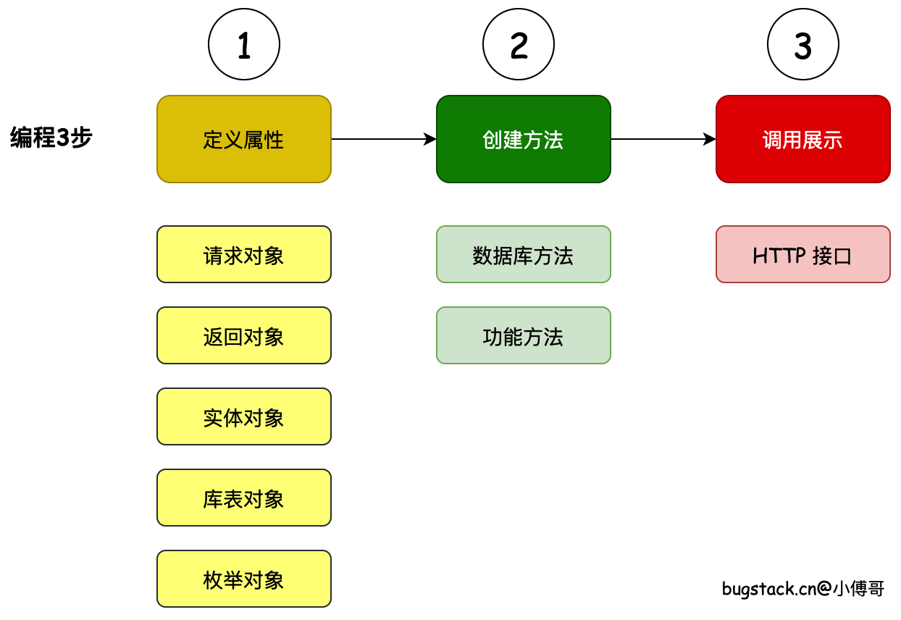

早期的简单网页可以把页面处理、业务逻辑和数据库访问集中在少量代码中。这种方式适合快速验证功能，但随着用户交互和业务逻辑增加，把所有内容堆在页面或 Controller 中，会使维护和修改越来越困难。下图展示了页面经 HTTP 请求进入 Controller，再直接访问数据库的简单组织方式。

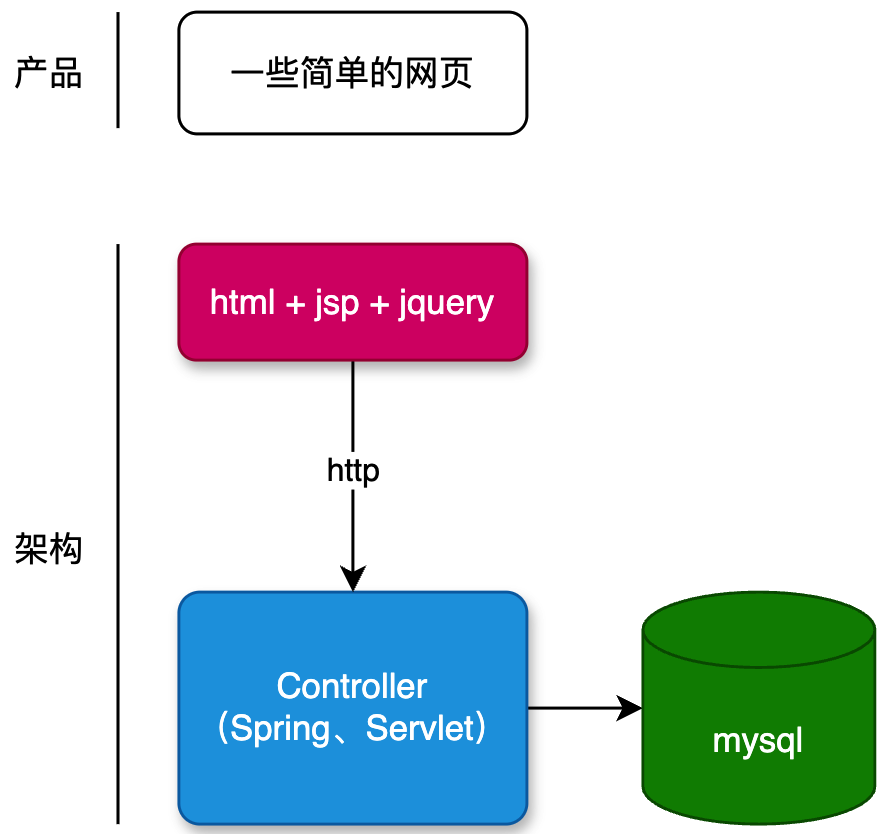

常见的 Java Web 工程会进一步分离 Controller、Service 和 DAO：Controller 接收请求，Service 处理业务，DAO 访问数据库。请求对象、持久化对象和返回对象在调用过程中承担不同职责。这样分层以后，可以更清晰地知道各层在做什么，也方便后续维护和迭代。下图把接口、业务处理、对象与持久化等内容分配到不同包中，展示常见后端工程的职责划分。

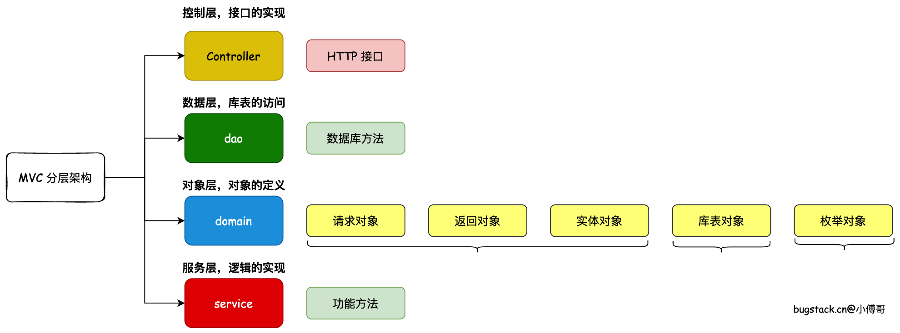

下图进一步展示 Service 承担业务处理、DAO 承担数据访问的关系。图中 Service、Controller 也被标为“模型层”，这里应分别理解为业务服务与控制职责，不能把它们都等同于 MVC 的 Model。

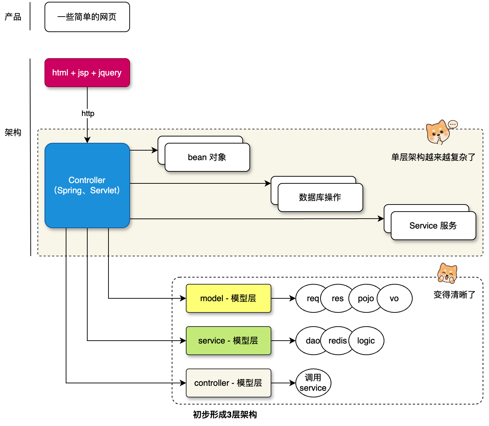

从一次 HTTP 请求看，Controller 接收请求后，调用由 Spring 注入的 Service；Service 根据需要访问数据库或执行内部逻辑，再由 Controller 封装响应。下图沿请求对象、业务对象、数据库对象和响应对象展示调用链路。图中的回箭头只概括返回过程；实际通常由 DAO 返回 Service，再返回 Controller，不表示 DAO 越层调用 Controller。

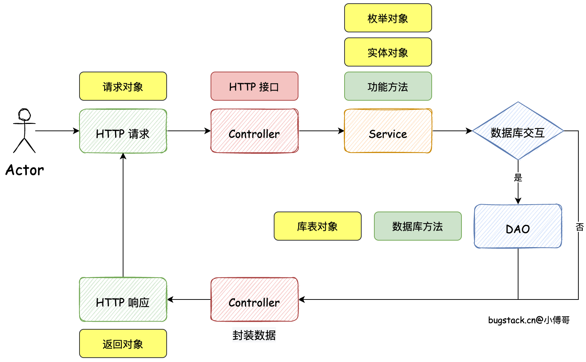

这里需要区分两个概念：MVC 指 Model、View、Controller 的职责分离；Controller、Service、DAO 则是常见的后端分层方式，二者并不严格等同。MVC 中的 Model 也不只是若干数据类，采用 MVC 并不必然意味着采用贫血模型。[MVC 的职责说明](https://martinfowler.com/eaaDev/uiArchs.html)。

当工程需要对接 RPC、消费和生产 MQ 消息、执行定时任务，并使用缓存、配置中心等组件时，原有工程会增加更多模块。如果仍把所有业务规则和技术调用集中在 Service 中，对象与服务就容易交叉依赖，产生难以控制的修改范围。下图展示加入 RPC、MQ 和任务等能力后，工程需要承接的额外职责。

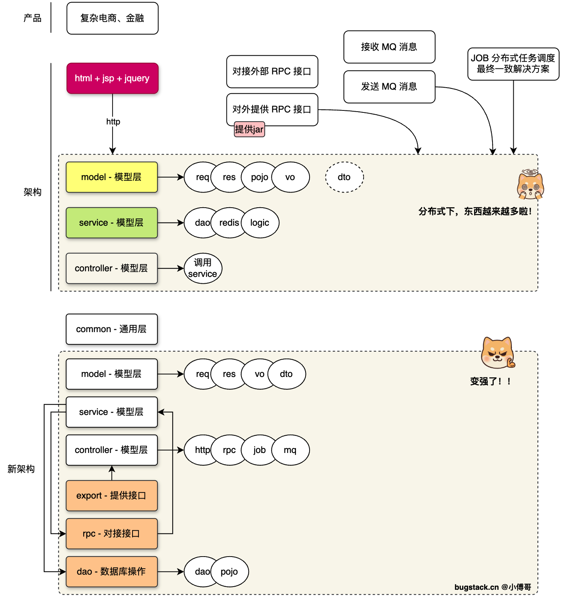

如果仍把远程调用、配置、缓存和消息等能力集中在 Service 周围，就会形成下图中的依赖聚集。

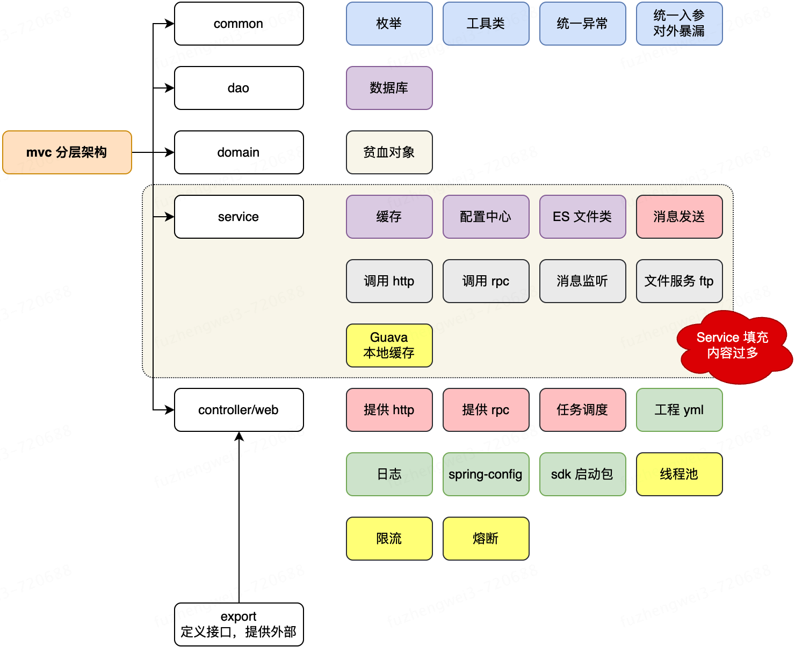

问题的关键是职责和业务边界是否清晰，不能仅凭三层、四层或是否使用微服务判断架构质量。分层的目的，是为不断增加的职责找到合适位置，并减少它们之间不必要的耦合。

### 2. DDD 的基本思想

DDD 是领域驱动设计（Domain-Driven Design）的缩写，是一种围绕业务领域建立和实现软件模型的设计方法。**DDD 主要关注于创建与业务领域紧密相关的软件模型，以确保软件能够准确地解决实际问题。**

DDD 既不是 MVC 一样的工程结构，也不能直接等同于微服务架构，更不是一种单独的设计模式。它通过领域、限界上下文、实体、值对象、聚合、工厂、仓储等概念，指导我们理解业务和组织代码。下图对比对象和服务交叉使用、按业务边界组织模型两种方式；左侧描述的是业务集中在 Service 的一种实现，不代表 MVC 必然贫血。右下成本曲线是定性示意，不能当作实测结论。

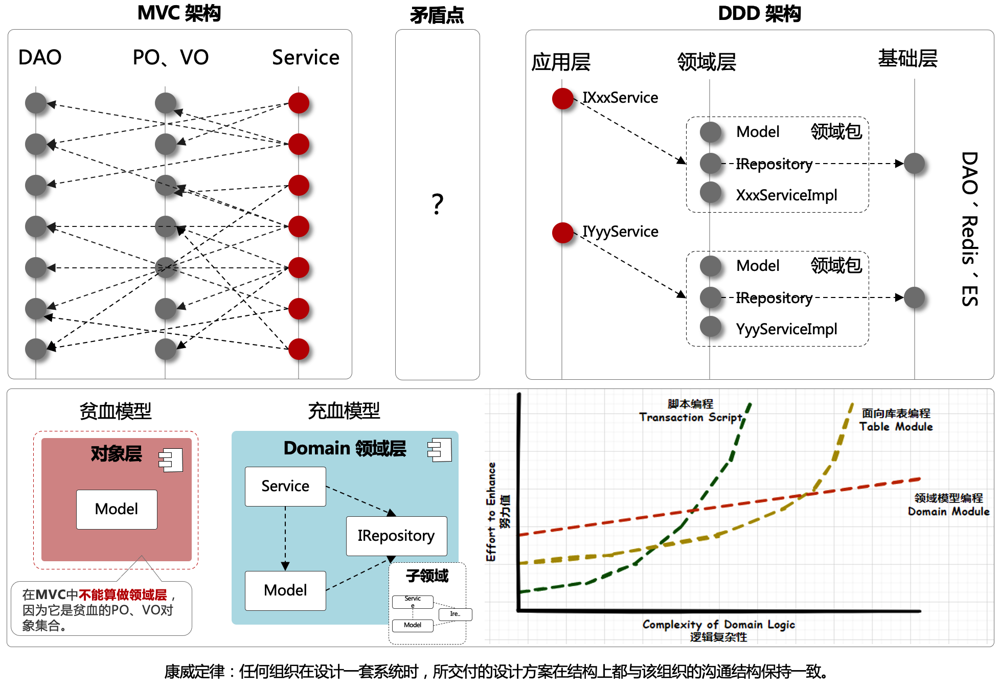

DDD 通常从战略设计和战术设计两个层面展开：

- **战略设计**关注业务领域的划分、模型边界与上下文之间的关系，通过抽象和分治降低复杂度。它可以指导模块或服务的拆分，但并不要求把系统拆成多个微服务。
- **战术设计**关注边界内部如何用领域模型表达业务概念，通过实体、值对象、聚合、领域服务等构件承载规则和行为。

领域是具体业务范围内的知识、业务逻辑和规则的集合，较大的领域可以进一步划分为子域。领域模型是对这些业务知识的抽象，不只是数据库表结构，也包括业务对象之间的关系、行为以及状态变化的条件。

**统一语言（Ubiquitous Language）**是开发团队与业务专家共同使用的语言，用来确保业务讨论和代码表达具有一致含义。**限界上下文（Bounded Context）**则明确这套模型和语言的适用边界。不同上下文可以对同一个词采用不同的模型，再通过明确的接口和转换规则协作，不能强求整个大型系统共用一套模型。**上下文映射（Context Mapping）**用于描述不同限界上下文之间的关系及集成方式。[限界上下文说明](https://martinfowler.com/bliki/BoundedContext.html)。

在一些业务规则复杂、需要长期迭代的系统中，DDD 可以帮助缩小修改范围、明确职责。但它也需要前期建模和持续沟通，简单的增删改查未必值得使用完整的一套构件。选择工程结构时，应考虑业务复杂度和维护成本。

在已有 Java 项目中，可以先选一个规则较集中的用例，写清输入、允许的操作和执行结果，再识别规则归属。比如处理订单时，先说明“付款后不能再添加商品”，再考虑由订单对象控制这个行为；不要先建齐所有目录，再寻找能往里面放的代码。

## 二、领域模型与核心构件

### 1. 充血模型、实体、值对象与聚合

在常见的 Service 加数据对象的开发方式中，对象主要保存属性，业务规则则集中在外部 Service。随着业务增长，同一对象可能被多个服务修改，同一条规则也可能被多处重复实现。

充血模型强调把与对象相关的状态和业务行为封装在一起，让对象控制自己的合法变化。例如，订单是否允许添加商品、是否可以确认支付，应通过业务行为统一判断，而不是让各处代码直接修改状态。判断模型是否充血，要看业务行为和约束是否得到封装，不能仅凭类中有工具方法，或包中包含 Service、仓储和工厂作出判断。下图展示把分散方法收拢到对象或业务模块的思路；缓存 Key 和通用数据转换本身不足以定义充血模型，图中的 DAO 也不表示领域对象应直接依赖数据库实现。

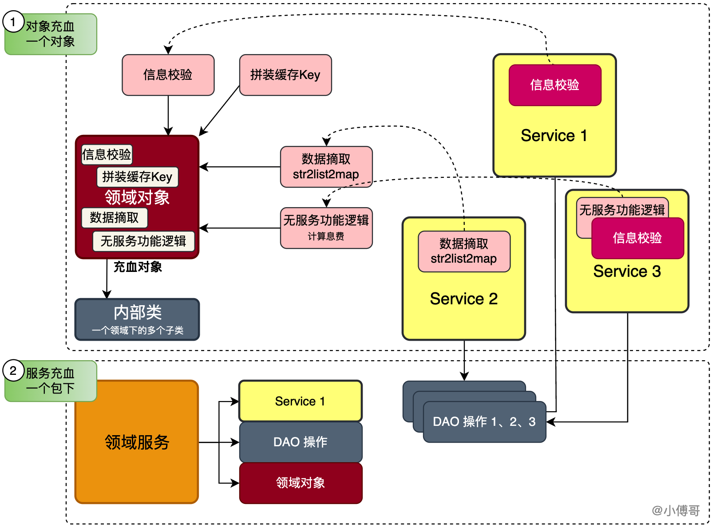

领域模型进一步把相关的业务概念和规则组织在明确的边界内。每个领域模块按需要拥有自己的模型、服务、仓储契约和外部交互契约，具体的数据库、缓存和远程调用则由外部实现提供。下图把平铺的数据、服务和对象与领域组织作对照。连线只概括能力协作；实现时仍应由核心声明契约，外部提供数据库等实现，不能据此让领域服务反向依赖上层 Service。

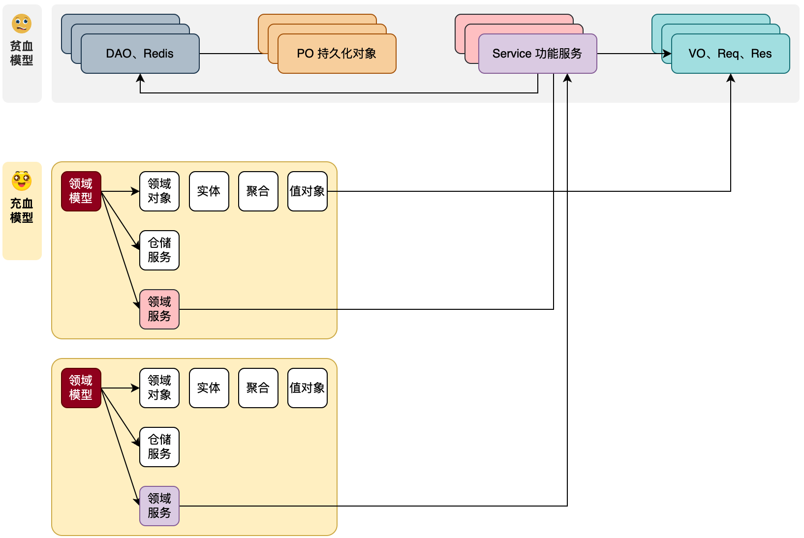

**实体（Entity）**是具有唯一标识的领域对象，可以概括为“唯一标识、状态属性、行为动作”。实体不仅包含数据，还包含相关行为；即使姓名、地址、订单状态发生变化，只要业务身份不变，仍是同一个实体。标识可采用业务编号、UUID 或数据库生成的 ID，应在所属业务范围内稳定。实体的相等性围绕业务身份定义，示例中的 equals 和 hashCode 使用 ID，而不比较会变化的姓名和邮箱。

下面的代码侧重说明构件职责，省略部分导入、访问器和基础组件实现。用户示例通过 ID 识别用户，并提供修改姓名和邮箱的行为：

```java
import java.util.Objects;
import java.util.UUID;

public class UserEntity{
    private final UUID id;
    private String name;
    private String email;

    public UserEntity(UUID id,String name,String email){
        this.id=id;
        this.name=name;
        this.email=email;
    }

    public void updateName(String newName){
        this.name = newName;
    }

    public void updateEmail(String newEmail){
        this.email=newEmail;
    }

    public UUID getId(){
        return id;
    }

    public String getName(){
        return name;
    }

    public String getEmail(){
        return email;
    }

    @Override
    public boolean equals(Object o){
        if(this==o)return true;
        if(o==null||getClass()!=o.getClass())return false;
        UserEntity user = (UserEntity)o;
        return id.equals(user.id);
    }

    @Override
    public int hashCode(){
        return Objects.hash(id);
    }

    @Override
    public String toString(){
        return"UserEntity{"+
            "id="+id+
            ",name='"+name+'\''+
            ",email='"+email+'\''+
            '}';
    }
}

public class UserEntityDemo{

    public static void main(String[]args){
        UserEntity user=new UserEntity(UUID.randomUUID(),"XiaoFuGe","xiaofuge@qq.com");
        System.out.println(user);
        user.updateName("XiaoFuGe");
        System.out.println(user);
        user.updateEmail("xiaofuge@qq.com");
        System.out.println(user);
    }
}
```

实体应根据业务身份和生命周期设计，不必与数据库表一一对应。领域实体与持久化对象可以分开，一张表也不能直接决定一个领域对象应具有哪些职责。

使用实体时，通过业务身份持续识别同一个对象，通过有业务含义的方法改变状态。修改姓名属于用户行为，但能否修改、是否需要校验仍取决于业务约定。字段具备 getter、setter 只解决数据访问，关键规则还应由相应业务行为统一维护。

**值对象（Value Object）**是由一组属性组成的对象，它们共同描述一个领域概念。与实体不同，值对象不依靠独立身份区分，而是根据有业务意义的属性值判断等价。值对象通常设计为不可变，需要变化时用新的值替换旧值。

金额、地址、日期范围、坐标、等级等都可以使用值对象。值对象可以作为实体属性，也可以独立作为方法的输入和输出。实现时除了不提供 setter，还要注意集合、数组、Date 等可变引用的保护，并提供符合业务含义的 equals 和 hashCode。创建时应通过构造函数或工厂校验取值及组合约束，避免产生无效状态，例如日期范围的结束时间不能早于开始时间。金额还应明确币种、精度和舍入规则，示例中的 double 只是简化表示，不能直接用于精确结算。

订单状态可以用枚举限制取值，避免在代码中散落裸露的数字；状态之间是否允许转换，仍需要由相应的业务行为控制：

```java
public enum OrderStatusVO{
    PLACED(0,"下单"),
    PAID(1,"支付"),
    COMPLETED(2,"完成"),
    CANCELLED(3,"取消");

    private final int code;
    private final String description;

    OrderStatusVO(int code,String description){
        this.code = code;
        this.description = description;
    }

    public int getCode(){
        return code;
    }

    public String getDescription(){
        return description;
    }

    public static OrderStatusVO fromCode(int code){
        for(OrderStatusVO status:OrderStatusVO.values()){
            if(status.getCode()==code){
                return status;
            }
        }
        throw new IllegalArgumentException("Invalid code for OrderStatus:"+code);
    }
}
```

地址则可以把若干相关字段组合起来，按整体表达一个地址值：

```java
public final class AddressVO{
    private final String street;
    private final String city;
    private final String zipCode;
    private final String country;

    public AddressVO(String street,String city,String zipCode,String country){
        this.street=street;
        this.city=city;
        this.zipCode=zipCode;
        this.country=country;
    }

    public String getStreet(){
        return street;
    }

    public String getCity(){
        return city;
    }

    public String getZipCode(){
        return zipCode;
    }

    public String getCountry(){
        return country;
    }

    @Override
    public boolean equals(Object o){
        if(this==o)return true;
        if(o==null||getClass()!=o.getClass())return false;
        AddressVO address=(AddressVO)o;
        return street.equals(address.street)&&
            city.equals(address.city)&&
            zipCode.equals(address.zipCode)&&
            country.equals(address.country);
    }

    @Override
    public int hashCode(){
        return Objects.hash(street,city,zipCode,country);
    }
}
```

AddressVO 把街道、城市等作为一个整体传递，变化时创建新地址再替换。这个片段展示字段组合与不可变结构；如果业务需要按地址内容比较，还应提供相应的 equals 和 hashCode，不能只靠类名中的 VO 判断它已经具备完整的值对象语义。

**聚合（Aggregate）**是一组相关的实体和值对象，它们在一个边界内共同维护业务规则和一致性。每个聚合有一个聚合根（Aggregate Root），外部通过聚合根发起修改，由它维护整体约束。聚合根是实体的一种，不能把所有实体都称为聚合根。一个聚合也可以只有聚合根；边界取决于需要共同维护的业务规则，而不是数据库查询涉及几张表。

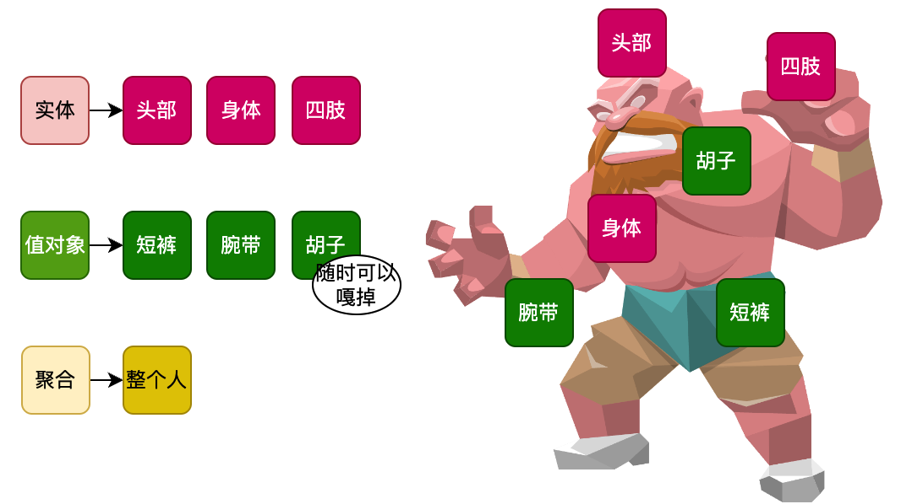

上图用人体的部分与整体作类比。实体和值对象仍按业务中是否需要持续身份区分，不能只看能否替换；聚合还必须明确聚合根与一致性边界，这些细节没有在图中展开。

例如，订单与订单项可以构成一个聚合：订单负责判断是否还能添加商品、订单金额如何计算、什么条件下可以确认支付。用户和商品通常有自己的生命周期，订单可以引用它们的标识并保存必要的成交快照，不必把完整的用户、商品、账户和库存对象都装进同一个聚合。

订单示例侧重聚合行为，省略标识生成和持久化细节。先定义实体和值对象基类，再定义订单项和订单聚合，用聚合根控制添加商品与支付行为：

```java
public abstract class BaseEntity{
    protected Long id;

    public Long getId(){
        return id;
    }
}

public abstract class ValueObject{
}
```

```java
public class OrderItem extends BaseEntity{
    private String productName;
    private int quantity;
    private double price;

    public OrderItem(String productName,int quantity,double price){
        this.productName = productName;
        this.quantity = quantity;
        this.price = price;
    }

    public double getTotalPrice(){
        return quantity * price;
    }
}
```

```java
import java.util.ArrayList;
import java.util.List;

public class OrderAggregate extends BaseEntity{
    private List<OrderItem> orderItems;
    private String customerName;
    private boolean isPaid;

    public OrderAggregate(String customerName){
        this.customerName = customerName;
        this.orderItems = new ArrayList<>();
        this.isPaid = false;
    }

    public void addItem(OrderItem item){
        if(!isPaid){
            orderItems.add(item);
        }else{
            throw new IllegalStateException("Can not add items to a paid order.");
        }
    }

    public double getTotalAmount(){
        return orderItems.stream().mapToDouble(OrderItem::getTotalPrice).sum();
    }

    public void markAsPaid(){
        if(getTotalAmount() > 0){
            isPaid = true;
        }else{
            throw new IllegalStateException("Order total must be greater than 0 to be paid.");
        }
    }
}
```

```java
public class OrderDemo{

    public static void main(String[] args){
        OrderAggregate orderAggregate= new OrderAggregate("XiaoFuGe");
        orderAggregate.addItem(new OrderItem("手机",1,1000.00));
        orderAggregate.addItem(new OrderItem("数据线",2,25.00));
        System.out.println("Total amount:" + orderAggregate.getTotalAmount());
        orderAggregate.markAsPaid();
    }
}
```

使用这个订单聚合时，业务通过 addItem 添加订单项，通过 markAsPaid 确认支付：前者阻止已付款订单继续增加商品，后者检查支付前的金额条件。已有订单通常先由仓储加载，再调用这些行为，最后保存结果。对象内部隐藏字段，有助于把规则集中在修改入口；仍需防止外部拿到可变内部对象后绕过根修改状态。

聚合是业务一致性边界，数据库事务则是保证数据操作原子提交的技术机制，二者不能等同。聚合方法维护对象规则，持久化时仍需要事务和并发控制。“聚合内强一致、聚合间最终一致”是一条常用设计指导；跨聚合是否允许延迟一致，应由业务要求决定，不能理解为聚合之间一律必须使用 MQ。

**工厂（Factory）**用于封装复杂实体或聚合的创建过程，让对象以合法状态诞生。创建简单时可以使用构造函数或静态工厂方法，复杂时再引入独立工厂。加载历史对象时，应恢复已有身份和状态，不能重复执行新建逻辑、生成新编号或产生新的创建事件。

### 2. 领域服务与应用编排

领域服务（Domain Service）封装具有业务含义、但不适合自然归属于某个实体或值对象的操作。它通常需要协调多个领域对象，同时保持这些对象各自的职责清晰。

领域服务通常是无状态的：不保存某次请求的可变业务状态，而是通过参数和依赖操作领域对象。它可以持有仓储或端口等依赖，必要时通过这些抽象取得业务事实，但不应直接绑定具体的数据库、缓存或外部 SDK。

不要只定义一个 Service 接口，然后在一个实现类中堆积所有逻辑。应根据业务能力和变化原因划分职责，必要时使用工厂、策略、模板、组合、责任链等模式，而不是为了模式增加无意义的层次。

应用服务（Application Service）则负责组织用例：接收任务，准备数据，调用领域对象或领域服务，协调保存和事务，返回结果。领域服务决定业务规则，应用服务组织执行步骤；常见依赖方向是应用层调用领域层，不应让领域服务反向调用应用服务形成循环。

把一个操作落实到代码时，可以按下面的职责安排，具体类名不必完全相同：

| 工作 | 常见归属 | 使用时的判断依据 |
| --- | --- | --- |
| 接收 HTTP/RPC 请求、解析格式、转换响应 | Controller 或输入适配器 | 与入口协议直接相关 |
| 拒绝非法金额、限制订单状态转换 | 值对象、实体或聚合 | 换成 MQ、任务入口后仍必须遵守的业务规则 |
| 执行不适合归属单个对象的业务计算或判断 | 领域服务 | 操作具有明确业务含义，需要协调领域对象 |
| 组织数据准备、领域调用、保存和事务 | 应用服务 | 为完成一次用例安排执行步骤 |
| 执行 SQL、调用具体缓存或外部 SDK、转换 PO | 基础设施或输出适配器 | 与技术实现和外部系统直接相关 |

入口可以检查参数是否缺失、格式是否正确，核心模型仍应保护自己的业务约束。这样同一能力从 HTTP、消息或定时任务进入时，关键规则都能复用。

银行转账可以用来理解这种分工。账户实体负责扣款和入款，转账服务协调两个账户的业务操作，应用服务接收并组织转账请求。代码如下：

```java
public class Account {
    private String id;
    private BigDecimal balance;

    public Account(String id, BigDecimal balance) {
        this.id = id;
        this.balance = balance;
    }

    public String getId() {
        return id;
    }

    public BigDecimal getBalance() {
        return balance;
    }

    public void debit(BigDecimal amount) {
        if (balance.compareTo(amount) < 0) {
            throw new IllegalArgumentException("Insufficient funds");
        }
        balance = balance.subtract(amount);
    }

    public void credit(BigDecimal amount) {
        balance = balance.add(amount);
    }
}
```

```java
public class TransferService {
    private final AccountRepository accountRepository;

    public TransferService(AccountRepository accountRepository) {
        this.accountRepository = accountRepository;
    }

    public void transfer(String fromAccountId, String toAccountId, BigDecimal amount) {
        Account fromAccount = accountRepository.findById(fromAccountId);
        Account toAccount = accountRepository.findById(toAccountId);
        if (fromAccount == null || toAccount == null) {
            throw new IllegalArgumentException("Account not found");
        }
        fromAccount.debit(amount);
        toAccount.credit(amount);
        accountRepository.save(fromAccount);
        accountRepository.save(toAccount);
    }
}
```

```java
public interface AccountRepository {
    Account findById(String id);
    void save(Account account);
}
```

```java
public class BankingApplicationService {
    private final TransferService transferService;

    public BankingApplicationService(TransferService transferService) {
        this.transferService = transferService;
    }

    public void handleTransferRequest(String fromAccountId, String toAccountId, BigDecimal amount) {
        transferService.transfer(fromAccountId, toAccountId, amount);
    }
}
```

这个例子用于说明职责分工。实际转账还需要金额合法性、幂等和并发控制，并保证所需的原子性；分别调用两次保存不能自动保证共同成功。事务边界通常由应用用例协调，仓储实现承担具体的数据访问。

阅读时沿 handleTransferRequest → transfer → debit/credit → save 观察职责：应用入口组织转账，领域服务协调两个账户，账户行为改变余额，仓储保存结果。例中由领域服务完成所需加载与保存；项目也可以由应用层准备数据，选择应服从职责，而不是机械规定每次查询只能出现在哪个类。

### 3. 仓储与持久化

Repository（仓储）模式用于封装数据访问逻辑，使领域和应用代码可以通过简单、一致的契约访问领域对象，而不需要理解背后的存储机制。它通常被视为领域对象的集合，提供保存、加载和查询等操作。

在 DDD 中，写操作的仓储通常围绕聚合根设计。外部取得聚合后调用它的业务行为，再由仓储保存，避免通过内部实体的独立写入口绕过聚合根。仓储实现可以组合多个 DAO 或 Mapper，完成持久化对象与领域对象的转换。

仓储契约通常定义在领域模块，具体的 MyBatis、Hibernate、JDBC 或内存实现放在基础设施中。应用启动时通过依赖注入组装，这样业务代码依赖契约，而不依赖具体数据源。

用户管理示例依次定义用户对象、仓储接口和内存实现：

```java
public class User {
    private Long id;
    private String username;
    private String email;

    // getter、setter 省略
}
```

```java
public interface UserRepository {
    User findById(Long id);
    List<User> findAll();
    void save(User user);
    void delete(User user);
}
```

```java
public class InMemoryUserRepository implements UserRepository {
    private Map<Long, User> database = new HashMap<>();
    private AtomicLong idGenerator = new AtomicLong();

    @Override
    public User findById(Long id) {
        return database.get(id);
    }

    @Override
    public List<User> findAll() {
        return new ArrayList<>(database.values());
    }

    @Override
    public void save(User user) {
        if (user.getId() == null) {
            user.setId(idGenerator.incrementAndGet());
        }
        database.put(user.getId(), user);
    }

    @Override
    public void delete(User user) {
        database.remove(user.getId());
    }
}
```

服务使用仓储完成查询与保存，启动时再提供具体实现：

```java
public class UserService {
    private final UserRepository userRepository;

    public UserService(UserRepository userRepository) {
        this.userRepository = userRepository;
    }

    public User getUserById(Long id) {
        return userRepository.findById(id);
    }

    public void createUser(String username, String email) {
        User newUser = new User();
        newUser.setUsername(username);
        newUser.setEmail(email);
        userRepository.save(newUser);
    }
}
```

```java
public class Application {

    public static void main(String[] args) {
        UserRepository userRepository = new InMemoryUserRepository();
        UserService userService = new UserService(userRepository);
        userService.createUser("XiaoFuGe", "xiaofuge@qq.com");
        User user = userService.getUserById(1L);
        System.out.println("User found: " + user.getUsername());
    }
}
```

这里先用内存实现体会“服务依赖仓储接口”。换成数据库时，保留业务所需的接口，由新的实现通过 Mapper 查询记录、转换成领域对象，保存时再转换为持久化数据，最后在启动组装时注入该实现。不要把 Mapper 返回的 PO 直接当作所有业务层共同修改的领域对象。

仓储可以封装缓存、批处理等访问策略，但仍要明确一致性与失效规则。复杂业务条件可以结合规格模式（Specification Pattern）表达；如果需要在数据库执行，仍需相应的查询实现。只读列表或报表也可以直接查询投影，不必为了展示少量字段加载完整聚合。

### 4. 端口、适配器与防腐

端口（Port）定义应用核心向外提供或需要使用的交互契约，适配器（Adapter）负责把具体的外部协议或技术接到这个契约上。这就是端口与适配器架构（Ports and Adapters），也称六边形架构的基本思想。

端口可以分为输入端口和输出端口。HTTP、RPC、消息消费等输入适配器驱动应用执行用例；仓储、支付渠道、消息发送等输出适配器为核心提供能力。端口位置应根据使用者和职责确定，可以属于领域或应用核心；不必把所有接口都规定在领域层。

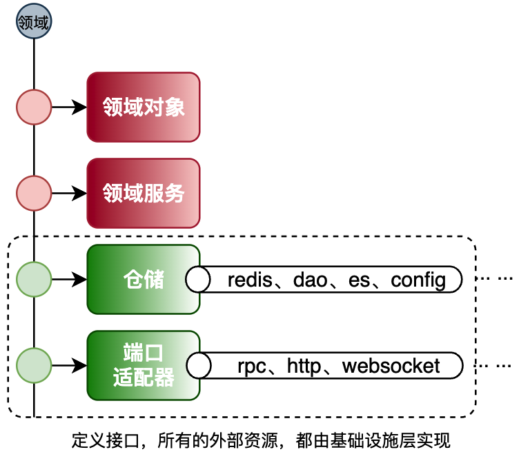

上图概括外部资源隔离关系。仓储主要表达领域对象或聚合的获取与保存；图中的配置读取等能力应按用途定义契约，不能把所有外部资源都归入仓储。

领域与应用代码通过契约表达“需要什么能力”，基础设施负责“具体如何调用”。当外部系统的数据模型、字段、单位或状态定义与本地不同，可以通过防腐层（Anticorruption Layer，ACL）完成转换，保护本地模型。接口包装可以参与防腐，但不能仅凭多了一层接口就认定所有外部变化都已隔离。同一端口可以替换不同实现，也可以在测试中使用内存或模拟适配器，独立验证核心业务。

支付示例首先定义支付端口，再提供外部支付服务和适配器：

```java
public interface PaymentPort {
    boolean processPayment(double amount);
}
```

```java
public class ExternalPaymentService {

    public boolean makePayment(double amount) {
        System.out.println("Calling external payment service for amount: " + amount);
        return true;
    }
}

public class PaymentAdapter implements PaymentPort {
    private ExternalPaymentService externalPaymentService;

    public PaymentAdapter(ExternalPaymentService externalPaymentService) {
        this.externalPaymentService = externalPaymentService;
    }

    @Override
    public boolean processPayment(double amount) {
        return externalPaymentService.makePayment(amount);
    }
}
```

使用者依赖 PaymentPort，启动时把适配器组装进去：

```java
public class PaymentService {
    private PaymentPort paymentPort;

    public PaymentService(PaymentPort paymentPort) {
        this.paymentPort = paymentPort;
    }

    public void processUserPayment(double amount) {
        if (paymentPort.processPayment(amount)) {
            System.out.println("Payment processed successfully.");
        } else {
            System.out.println("Payment failed.");
        }
    }
}
```

```java
public class Application {

    public static void main(String[] args) {
        ExternalPaymentService externalPaymentService = new ExternalPaymentService();
        PaymentAdapter paymentAdapter = new PaymentAdapter(externalPaymentService);
        PaymentService paymentService = new PaymentService(paymentAdapter);
        paymentService.processUserPayment(100.0);
    }
}
```

这一示例展示接口解耦；真实支付还需要区分受理、成功、失败和结果未知等情况，创建支付请求也不等于已经支付成功。仓储同样可以视为一种输出端口，只是它侧重按领域对象语义访问持久化数据。

接入另一个支付渠道时，可以增加相应适配器，在其中处理参数、状态和错误码转换，再由组装配置选择实现。核心业务继续使用自己定义的支付能力；渠道语义发生变化时，也要审视端口是否仍能准确表达业务，接口包装并不能消除所有差异。

### 5. 领域事件与消息协作

领域事件（Domain Event）表示领域中已经发生、具有业务意义的事实，例如订单已创建、支付已完成、优惠券已发放。事件承载业务上下文，可以让其他处理逻辑对这些事实作出反应，减少直接耦合。

事件通常包含业务对象标识、事件发生时间和必要的业务数据，宜保持不可变。“创建订单”是希望执行的命令，“订单已创建”则是已经发生的事实，二者应当区分。

领域事件不等同于异步 MQ 消息。它可以在进程内同步或异步处理；需要通知其他上下文或外部系统时，可以映射为集成事件，再选择合适的传播机制。对外传播已生效的事实，还要考虑业务事务是否已经成功提交。

使用事件时，先说明业务事实及其处理者。例如“订单已创建”由订单处理产生，下游根据订单标识安排后续工作；消费者应按事件契约处理，而不是直接修改发布方的内部对象。是否需要事件，取决于是否存在独立响应这个事实的职责，简单的内部方法协作也可以直接调用。

先定义事件接口与订单创建事件：

```java
public interface DomainEvent {
    Date occurredOn();
}

public class OrderCreatedEvent implements DomainEvent {
    private final String orderId;
    private final Date occurredOn;

    public OrderCreatedEvent(String orderId) {
        this.orderId = orderId;
        this.occurredOn = new Date();
    }

    @Override
    public Date occurredOn() {
        return new Date(this.occurredOn.getTime()); // 防御性复制，避免外部修改事件时间
    }

    public String getOrderId() {
        return orderId;
    }
}
```

再定义发布契约与模拟消息队列实现：

```java
public interface DomainEventPublisher {
    void publish(DomainEvent event);
}

public class MessageQueueEventPublisher implements DomainEventPublisher {
    private final MessageQueueClient messageQueueClient;

    public MessageQueueEventPublisher(MessageQueueClient messageQueueClient) {
        this.messageQueueClient = messageQueueClient;
    }

    @Override
    public void publish(DomainEvent event) {
        messageQueueClient.send(serialize(event));
    }

    private String serialize(DomainEvent event) {
        return event.toString();
    }
}

public class MessageQueueClient {

    // onMessage 等订阅注册方法的实现省略

    public void send(String message) {
        System.out.println("Message sent to queue: " + message);
    }
}
```

业务处理产生事件，接收方监听并作出反应，最后在启动阶段组装：

```java
public class OrderService {
    private final DomainEventPublisher eventPublisher;

    public OrderService(DomainEventPublisher eventPublisher) {
        this.eventPublisher = eventPublisher;
    }

    public void createOrder(String orderId) {
        OrderCreatedEvent event = new OrderCreatedEvent(orderId);
        eventPublisher.publish(event);
    }
}
```

```java
public class ExternalSystemAdapter {
    private final MessageQueueClient messageQueueClient;

    public ExternalSystemAdapter(MessageQueueClient messageQueueClient) {
        this.messageQueueClient = messageQueueClient;
        messageQueueClient.onMessage(this::onEventReceived);
    }

    private void onEventReceived(String message) {
        System.out.println("External system received event: " + message);
    }
}
```

```java
public class Application {

    public static void main(String[] args) {
        MessageQueueClient messageQueueClient = new MessageQueueClient();
        DomainEventPublisher eventPublisher = new MessageQueueEventPublisher(messageQueueClient);
        OrderService orderService = new OrderService(eventPublisher);
        ExternalSystemAdapter externalSystemAdapter = new ExternalSystemAdapter(messageQueueClient);
        orderService.createOrder("XFG1000900111199");
    }
}
```

以上是简化的消息协作示意。实际实现需要处理连接、稳定的序列化协议、错误、重试和消费幂等；数据库保存后直接发送消息，仍可能在两步之间发生故障，不能据此宣称已经保证最终一致性。

领域事件也可以用于事件溯源（Event Sourcing），但只有把事件序列作为恢复状态的依据，并设计相应的存储、重放与版本机制，才构成事件溯源。普通系统保存当前状态并发布事件，不因此成为事件溯源系统。

## 三、领域建模与边界划分

### 1. 建模过程

工程建模的目的是为开发提供指导：识别业务边界、核心对象、业务流程、规则以及与外部系统的交互，使产品、研发、测试等参与者能够在共同的语言下讨论。

建模可以从业务需求和用例出发，识别参与者的行为，再寻找命令、事件、对象与流程。事件风暴（EventStorming）是一种协作探索复杂业务领域的工作坊方法，可以通过便签和可视化讨论发现遗漏与分歧；它不等同于四色建模，也不是 DDD 强制要求的唯一建模方式。[EventStorming 官方说明](https://www.eventstorming.com/)。

下图汇总建模时需要讨论的命令、事件、流程、对象及外部系统，并用一条流程说明它们如何配合。

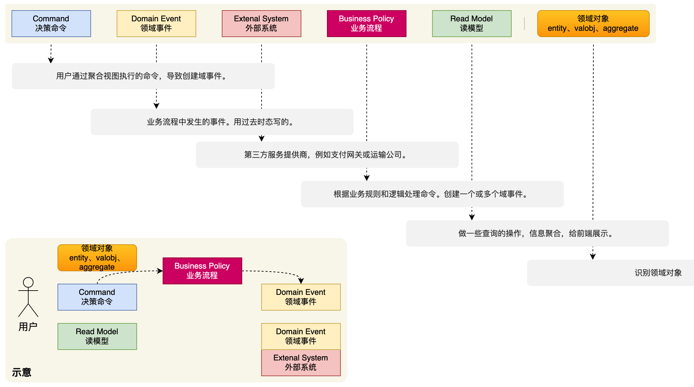

图中使用不同颜色区分命令、领域事件、外部系统、业务流程、只读模型和领域对象。这些颜色是本例的表达约定。分析时，重点是明确：谁发出命令，操作哪些对象，经过哪些规则与流程，产生什么业务事实，需要调用哪些外部能力。

超市购物可以帮助理解这种关系。购物者带着采购要求进入超市，使用购物车，在选购和结算过程中完成购买，再进入后续出行流程。采购要求可以类比命令，购物车可以作为对象，购物完成可以作为事件；把若干步骤串起来，体现流程编排。

下图把角色、采购要求、购物车和超市放在同一场景中，对应上述命令、对象与流程的类比。

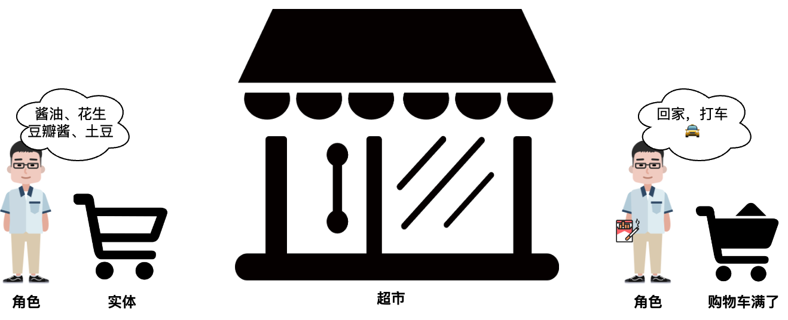

从类比回到工程，不能把每个步骤都机械地划为一个领域。边界应结合业务含义、对象生命周期、规则归属和一致性要求讨论，再用具体场景验证。

### 2. 营销抽奖案例

营销系统示例包含活动配置、签到奖励、活动账户、抽奖策略、库存扣减以及累计抽奖次数后解锁奖品等能力。面对这样的业务，需要先明确规则，再逐步寻找模型。

下图把活动配置、规则、奖励和额度等需求放在同一业务视图中，作为后续建模的输入。

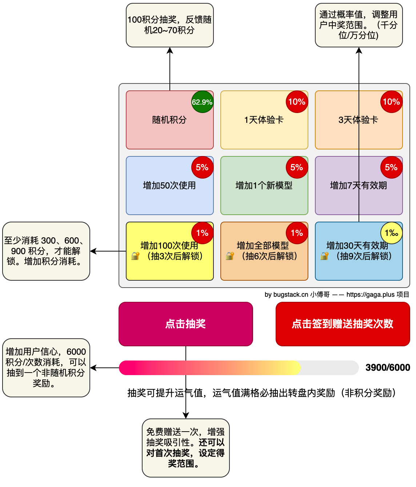

需求包括：以归一化概率或等价分值配置奖品分布，本例概率精度到千分位；支持免费次数与积分抽奖；签到后发放抽奖次数；管理用户总额度及每日额度；累计一定次数后解锁特定规则；抽奖后更新运气值、积分和次数等记录；对接本地积分与其他系统奖品；支持随机积分，并为黑名单用户设置固定奖品。这些都是该案例的业务约定。

**先明确参与者与用例。**根据需求画出用例图，识别不同角色及其能够发起的操作。用例图提供系统交互概览；用户故事则用日常语言描述用户目标与价值，二者可以相互补充，但不能等同。

下图从参与者出发，标出其能够发起的操作及相关用例。

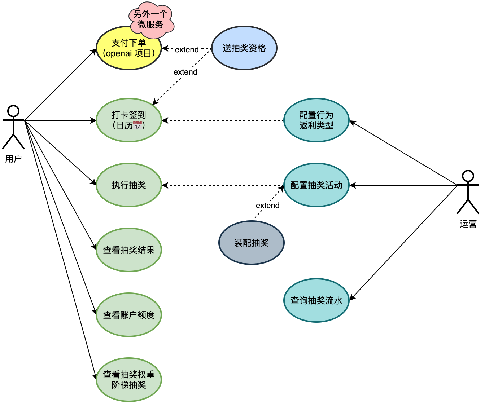

**再寻找领域事件。**产品、研发、测试等一起梳理已经发生的业务事实，例如活动创建完成、签到完成、抽奖完成、奖品发放完成。这个过程需要覆盖正常流程和容易遗漏的分支，先展开讨论，再整理关系。

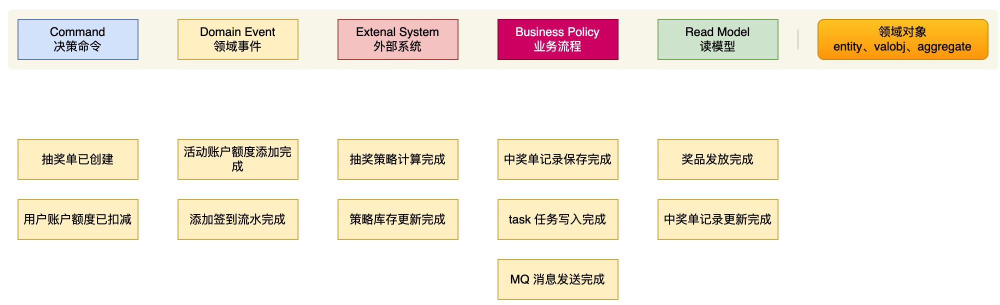

上图先展开候选事件与关联步骤。便签中也包含“任务写入完成”“MQ 消息发送完成”等技术节点，实际建模时应将它们与核心业务事实区分，不能一律视为领域事件。

**通过命令串联事件，并补充对象和规则。**为事件找到触发它的操作、执行角色、输入对象，以及必要的外部交互。复杂流程需要进一步展开，简单操作则不必人为增加流程层。

下图在事件之间补上角色、命令、对象和流程，使分散的业务事实形成可讨论的业务链路。

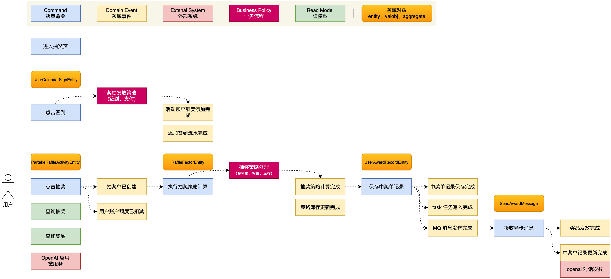

**最后讨论领域边界。**把语义相关、共同维护规则的对象与行为归在合适范围，识别不同模型之间如何交互。图上圈出的边界是讨论结果，需要继续用业务变化和异常场景检验，不能仅按颜色或流程先后决定。

在这个案例中，可以分别讨论活动是否允许参与、账户能否扣减次数、策略怎样选奖、奖品怎样发放。先把各项规则写成明确的业务语句，再确定维护这些规则的对象与能力。这样画出的边界才有可以检查的业务依据，后续也能据此设计方法和测试场景。

下图先在业务流程上圈出相互关联的事件与对象，形成待验证的边界。

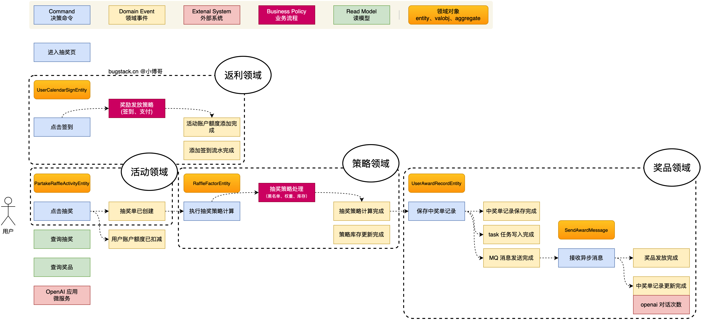

下图上半部整理活动、返利、账户、策略、奖品和任务等能力的协作，下半部展示 HTTP、MQ、JOB 等触发方式。这是本例的协作划分，不能直接等同于 Maven 依赖或微服务拆分方案。

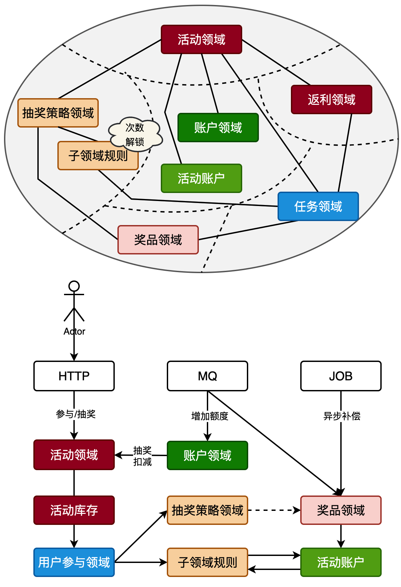

确定边界后，再细化各领域中的实体、值对象、聚合、服务及契约，把建模结果落实为工程结构和代码。

## 四、工程组织与调用链路

### 1. 工程职责与模块依赖

工程结构的存在，是为了把业务实现与技术能力安排到合适的位置。异常处理、数据库连接、日志、外部调用、消息监听、任务调度等内容都需要承载位置，不能因为某个 Service 使用它们，就把这些职责全部混在一起。

下图把工程能力归为通用、配置、组件、持久化、内部资源和外部交互，便于逐类确定归属。

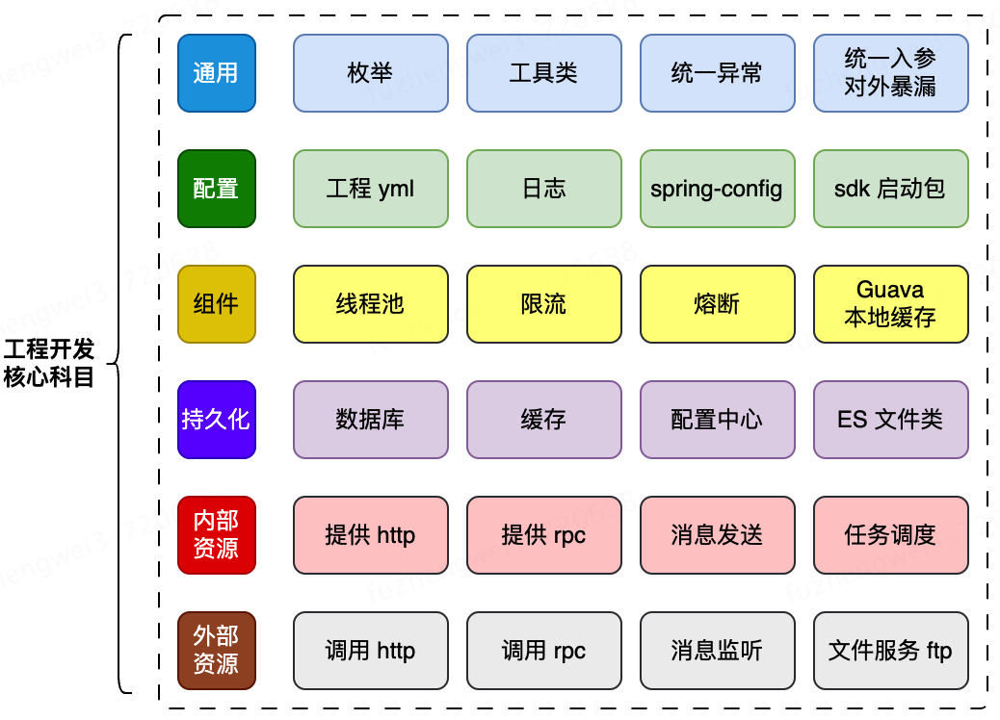

六边形架构、整洁架构等都可以用于承载 DDD 的设计结果，但它们各有自己的出发点，不是 DDD 专用的固定目录规范。共同关注点是让核心业务与外部交互细节保持适当隔离。[六边形架构说明](https://alistair.cockburn.us/hexagonal-architecture)。

下图展示业务核心、应用服务、适配与外部资源之间的组织关系。

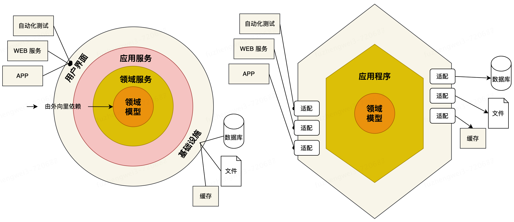

整洁架构的工程划分可以把对内、对外的交互归入适配部分；六边形架构的示例则把对外提供能力放在 trigger，把访问外部资源的实现放在 infrastructure。具体模块名称可以不同，依赖关系和职责边界需要一致。

下图展示一套整洁架构分包，将接口、持久化和外部调用等适配职责与领域核心分开。

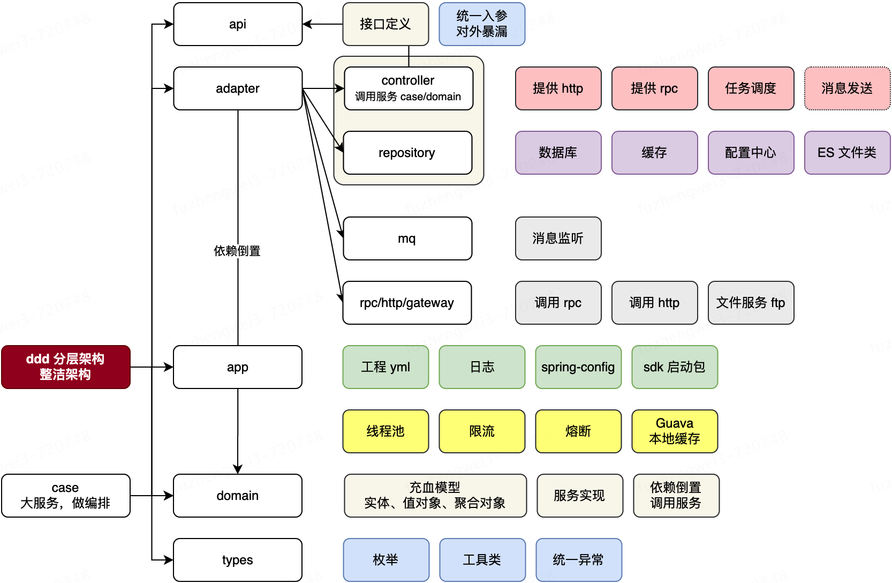

另一套六边形架构分包如下图所示，trigger 接收触发，infrastructure 承接外部能力，domain 位于核心。

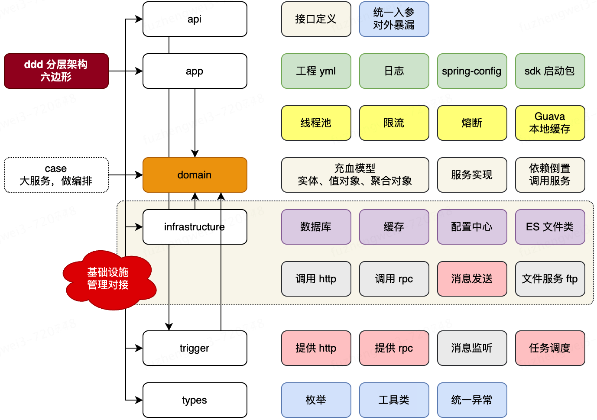

示例工程使用下列模块承载职责：

- **domain**：领域模型与业务规则，包括相关对象、服务、仓储契约、事件及必要的外部能力契约，是工程的业务核心。
- **infrastructure**：基础设施，实现持久化、缓存、配置读取、消息发送及外部接口等能力。它可以依赖 domain，完成领域中声明的契约。
- **trigger**：输入触发与适配，提供 HTTP 或 RPC 实现、消费消息、执行任务，再调用应用用例。它处理协议、输入输出和入口相关职责。
- **case/application**：应用编排，协调领域对象和服务执行用例。小工程可以简化这一组织层，但事务、授权与流程协调等职责仍需有明确归属。
- **app**：示例工程的启动与组装模块，承载启动程序、配置、部分通用切面以及打包部署。它与应用服务所在的 application 不是同一个概念。
- **api**：对外接口契约，常用于提供 RPC 接口及必要的数据传输对象，供调用方依赖。
- **types**：适合共享的基础类型、结果结构、常量和异常等；具有具体业务含义的对象与枚举仍应归属相应领域。
- **gateway**：部分工程会把外部 HTTP、RPC 等调用实现从基础设施中单独分出。是否单设模块取决于工程需要。

下图展开启动、接口契约、领域、基础设施和触发模块。底部的 RPC、HTTP、MQ、任务是并列入口，不是一次请求必须依次经过的步骤。

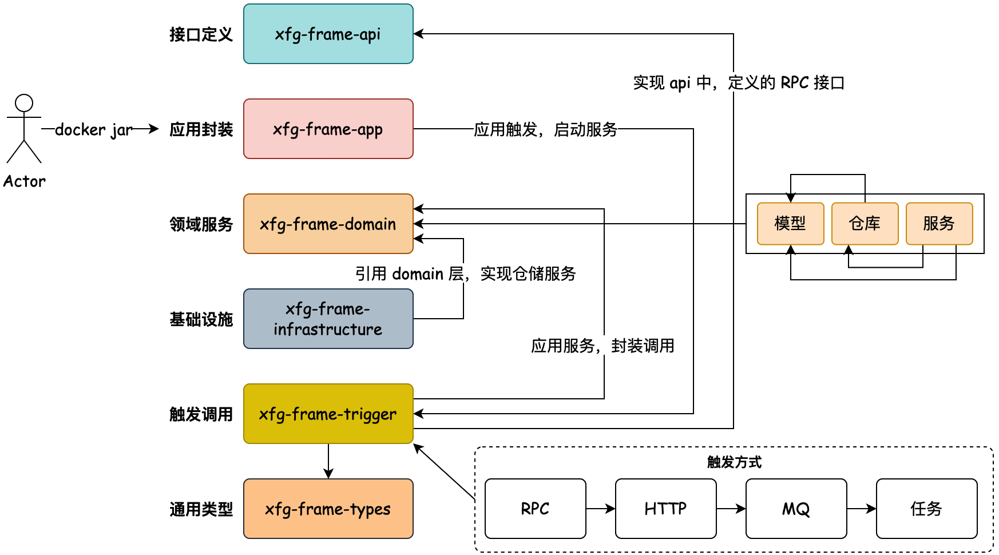

需要编排或单独封装外部调用时，可以使用下图中的 case 和 gateway 等模块；这些是工程选择，不是必须增加的固定层数。

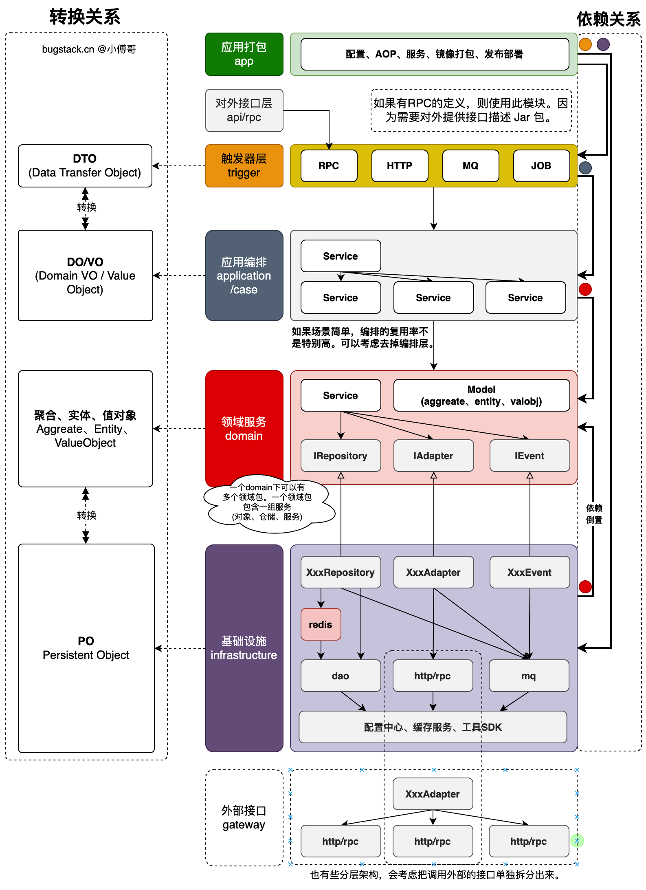

这种结构运用了依赖倒置：核心声明所需能力，基础设施提供具体实现。依赖注入负责组装实现；仅仅使用 Spring 注入，并不能自动说明业务核心已经与技术细节解耦。

### 2. 领域分包、对象流转与调用链路

一个工程可以包含用户、积分、抽奖、支付等业务模块。分包既可以先按技术构件划分，再放入不同业务，也可以先按业务能力划分，再在每个业务包内组织模型、服务和契约。

下图左侧按构件类型集中存放不同业务，右侧先按业务分包，再在各业务内部组织所需构件。

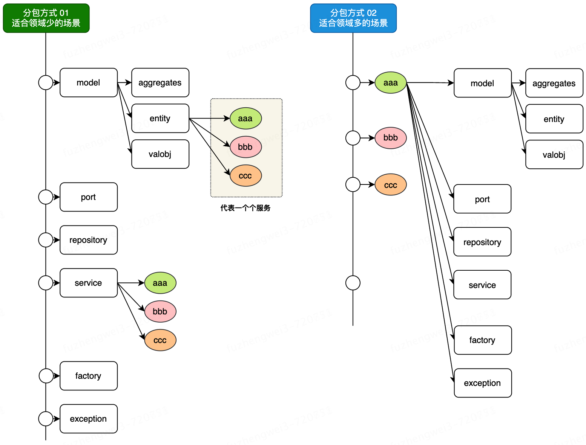

当多个业务模块有较独立的规则和变化时，按业务能力组织通常更容易看清上下文；通用组件则根据实际共享需要安排。Java 包、限界上下文、聚合与微服务部署单元属于不同层次，不必一一对应。

一个领域包可以按需要包含 model、service、repository、adapter、event、factory 等构件。这里的 repository 表示领域需要的持久化契约，PO 和具体的数据库访问实现通常位于基础设施中；并不是把所有对象和技术调用都塞进一个领域包，就形成了充血模型。

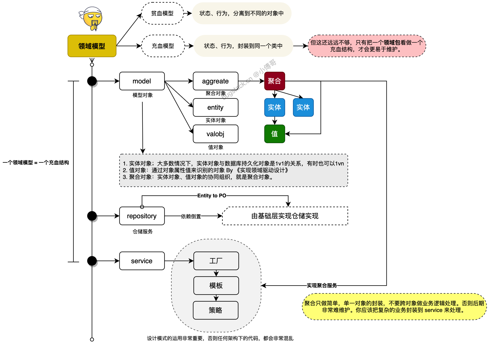

上图展示领域包中的构件组织。聚合应维护内部多个对象间的约束，不能把图中的“单一对象封装”当作聚合定义，也不能只因业务复杂就移到 Service；实体与 PO 的映射同样不是固定的一对一关系。

在完整调用链路中，可以把运行过程概括为“触发、业务处理、连接外部能力”：HTTP、RPC、MQ、任务是不同触发方式，应用用例协调业务处理，领域模型执行规则，仓储和适配器提供外部能力。

下图把 HTTP、RPC、MQ、任务统一看作触发，并通过业务处理连接接口、数据库和缓存。

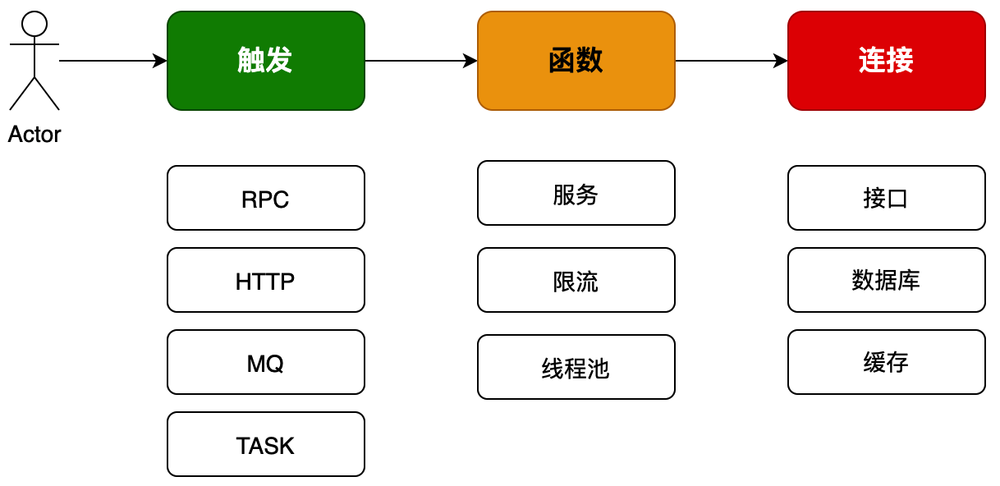

从完整工程看，下图将触发入口、应用编排、领域业务和基础设施放在各自的位置。

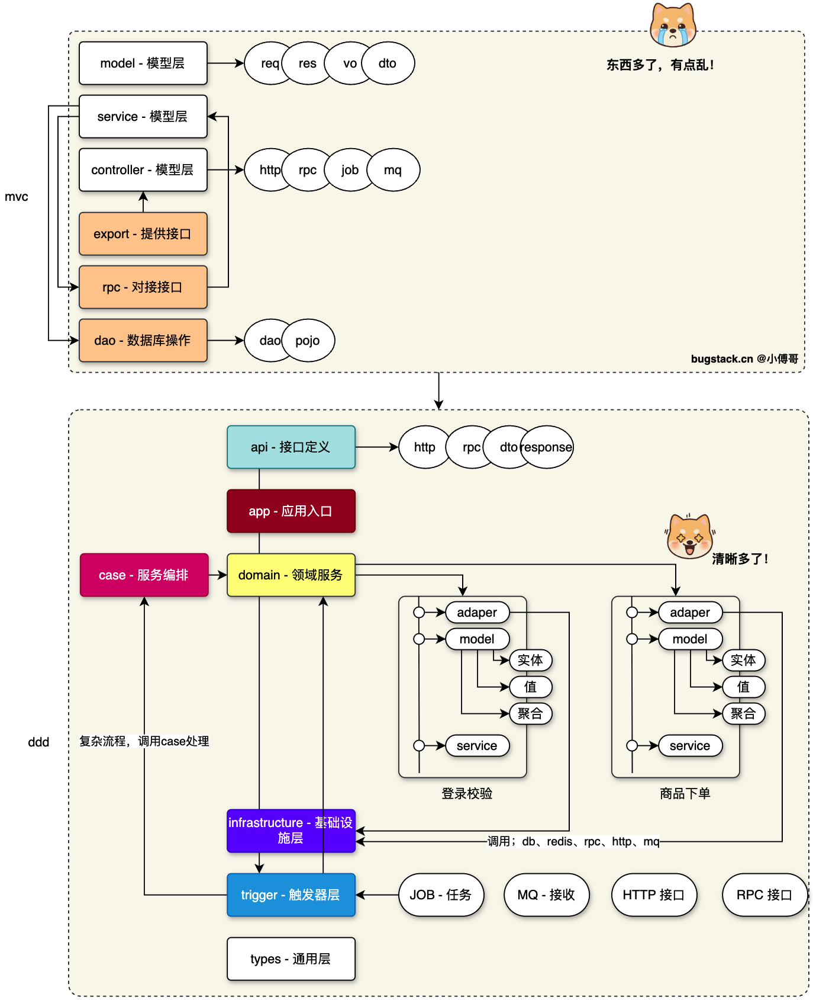

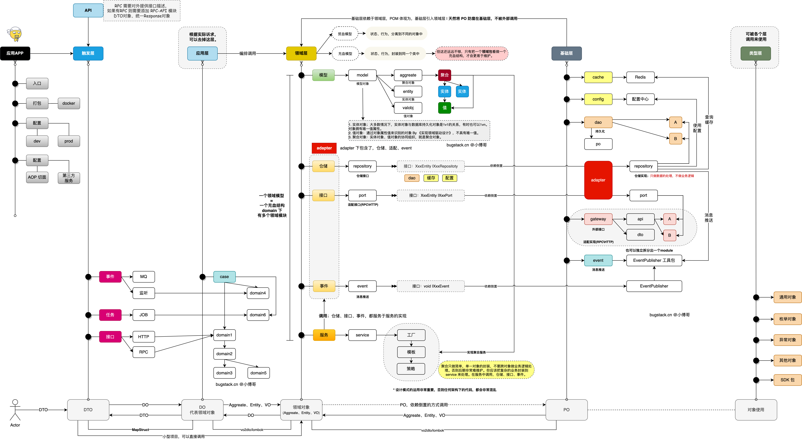

上图进一步展开调用全景及对象流转。图中的“简单封装”不限制聚合只能处理单个对象；聚合内部约束由根维护，不宜归属实体或聚合的领域行为才交给领域服务。底部的 PO 转换由持久化实现承担，核心不依赖 PO；Lombok 生成样板代码，不会自动完成不同模型的语义转换。

一次请求可以由 trigger 进入 case/application，加载或创建领域对象，调用相应业务行为，再通过仓储契约保存结果，最后转换为接口响应。运行时，核心通过接口调用注入的仓储或适配器实现；编译时，infrastructure 依赖 domain 中的契约，domain 不反向依赖 infrastructure；app 在启动时完成组装。

以抽奖请求为例，可以让入口解析活动和用户参数，应用用例组织活动校验、账户额度处理、策略执行与结果保存；相应模型和领域服务执行具体业务规则，仓储与适配器连接数据库、缓存和外部奖品系统。跨步骤失败时怎样回滚或补偿，还需单独明确。这个过程中的类名可以不同，但每项职责都应能沿调用关系定位。

对象也应随边界承担各自职责：

- **接口请求、响应与 DTO**承担边界数据传输，表达调用契约，不应任意暴露内部持久化结构。
- **实体、值对象与聚合**承担领域语义和业务约束，不能只把原来的 Req、Res、VO 改名后就当作完成建模。
- **PO**映射数据库记录与字段，由持久化实现负责转换。
- **Response**等通用结果结构可以包装错误码、说明和业务数据；RPC 契约中的类型宜随接口契约提供，控制不必要的依赖。

Java 工程中的 VO 有时指 View Object，有时指 Value Object，必须根据上下文区分。应用编排可以把接口 DTO 转成自己的命令或模型，也可以在简单场景减少转换；是否增加一层对象，应由边界隔离和变化需要决定。

数据库事务、缓存更新和消息投递也需要分别设计。基础设施承接具体技术操作，应用用例协调事务与流程；不能因为它们都位于基础设施中，就认为跨数据库、缓存和 MQ 的操作天然原子一致。

### 3. 示例工程的配置与运行

下面通过 [MVC 示例工程](https://gitcode.net/KnowledgePlanet/road-map/xfg-frame-mvc) 和 [DDD 示例工程](https://gitcode.net/KnowledgePlanet/road-map/xfg-frame-ddd) 对照前面的职责。示例使用 JDK 1.8、Maven 3.8.6、Spring Boot 2.7.2、MySQL 5.7；DDD 工程还涉及 Dubbo。复现时保持兼容的版本组合，改变数据库版本后同时核对驱动与连接配置。Maven 镜像配置可查看 MVC 工程的 docs/maven/settings.xml，注册相关配置可对应查看[Dubbo 广播注册文档](https://cn.dubbo.apache.org/zh-cn/overview/mannual/java-sdk/reference-manual/registry/multicast/)。

先解析并构建工程依赖，执行 road-map.sql 初始化库表，再配置数据库地址和账号。接着选择运行环境、启动 Application，通过接口或 Spring 测试验证。环境与业务问题应分开判断：依赖无法解析先检查 Maven；数据库无法连接先检查地址、库表和驱动；进入业务方法后再分析规则与返回结果。

开发、测试和生产环境通常使用不同配置。下面是 pom.xml 中的 Maven profile，用于构建阶段选择相应属性：

```xml
<profile>
    <id>dev</id>
    <activation>
        <activeByDefault>true</activeByDefault>
    </activation>
    <properties>
        <profileActive>dev</profileActive>
    </properties>
</profile>
<profile>
    <id>test</id>
    <properties>
        <profileActive>test</profileActive>
    </properties>
</profile>
<profile>
    <id>prod</id>
    <properties>
        <profileActive>prod</profileActive>
    </properties>
</profile>
```

Spring 运行环境由 `spring.profiles.active` 选择，默认配置名下对应加载 application-dev.yml、application-test.yml 或 application-prod.yml。下面的 active 固定为 dev，与 Maven 的 profileActive 属性没有自动关联；需要联动时，应显式传递启动参数或配置资源过滤，参见 [Spring Profiles](https://docs.spring.io/spring-boot/reference/features/profiles.html) 和 [Maven 资源过滤](https://maven.apache.org/plugins/maven-resources-plugin/examples/filter.html)。

```yaml
spring:
  config:
    name: xfg-frame
  profiles:
    active: dev # dev、test、prod
```

`spring.config.name` 用来改变配置文件基础名时，需要通过命令行、系统属性或环境变量提前提供；仅写在已经读取的 YAML 内，不能据此改变最初搜索的文件名。使用自定义基础名时，还应核对对应的环境配置文件名，详见 [Spring Boot 2.7 外部配置](https://docs.spring.io/spring-boot/docs/2.7.2/reference/html/features.html#features.external-config.files)。

下图定位 app 模块中的通用切面与配置，示例把入口限流与领域业务规则分开。

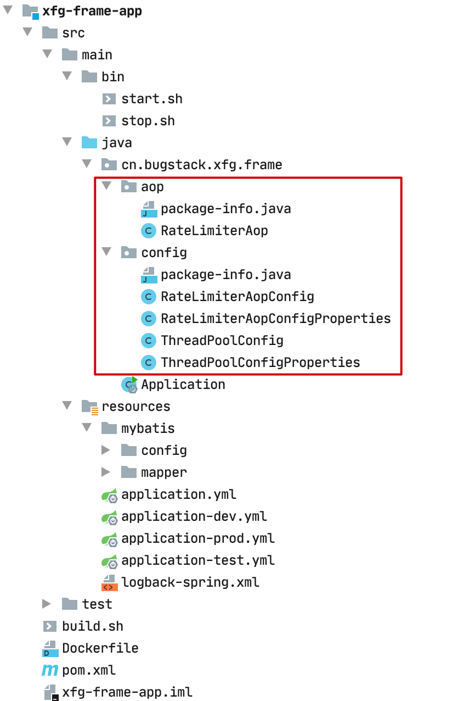

RateLimiterAop 在触发入口执行前尝试获取许可，获取失败则返回限流结果，获取成功才继续调用。阅读时先看切点覆盖哪些方法，再看失败分支和许可等待时间：

```java
@Slf4j
@Aspect
public class RateLimiterAop {

    private final long timeout;
    private final double permitsPerSecond;
    private final RateLimiter limiter;

    public RateLimiterAop(double permitsPerSecond, long timeout) {
        this.permitsPerSecond = permitsPerSecond;
        this.timeout = timeout;
        this.limiter = RateLimiter.create(permitsPerSecond);
    }

    @Pointcut("execution(* cn.bugstack.xfg.frame.trigger..*.*(..))")
    public void pointCut() {
    }

    @Around(value = "pointCut()", argNames = "jp")
    public Object around(ProceedingJoinPoint jp) throws Throwable {
        boolean tryAcquire = limiter.tryAcquire(timeout, TimeUnit.MILLISECONDS);
        if (!tryAcquire) {
            Method method = getMethod(jp);
            log.warn("方法 {}.{} 请求已被限流，超过限流配置[{}/秒]", method.getDeclaringClass().getCanonicalName(), method.getName(), permitsPerSecond);
            return Response.<Object>builder()
                    .code(Constants.ResponseCode.RATE_LIMITER.getCode())
                    .info(Constants.ResponseCode.RATE_LIMITER.getInfo())
                    .build();
        }
        return jp.proceed();
    }

    private Method getMethod(JoinPoint jp) throws NoSuchMethodException {
        Signature sig = jp.getSignature();
        MethodSignature methodSignature = (MethodSignature) sig;
        return jp.getTarget().getClass().getMethod(methodSignature.getName(), methodSignature.getParameterTypes());
    }

}
```

对应配置如下。permits-per-second 控制许可速率，timeout 在这段代码中按毫秒使用。参数还需要由配置类传入构造函数，切面需注册为 Spring Bean 并使 AOP 生效；只写 YAML 并不会自动创建这段切面。

```yaml
# 限流配置
rate-limiter:
  permits-per-second: 1
  timeout: 5
```

这个 RateLimiter 实例由被切点覆盖的调用共享，并非按每个用户独立限流。实际使用时应先确认限流范围、失败返回类型与接口约定一致，再通过调用观察正常返回和限流返回。

MVC 工程提供 http://localhost:8089/queryUserInfo 这样的 HTTP 查询入口，也可以直接通过 Spring 测试调用服务。下图的 ApiTest.test_queryUserList 调用注入的 IUserService.queryUserList，上部是方法，下部是用户列表结果；这条验证路径没有经过 HTTP 入口。

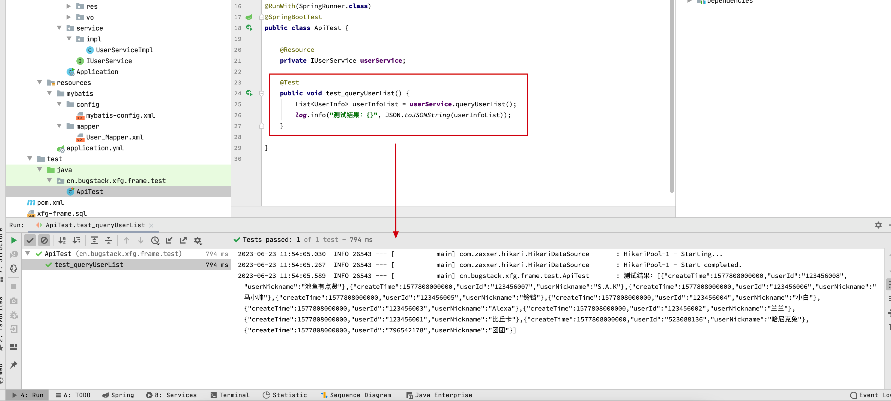

DDD 工程也可直接验证领域能力。下图的 ApiTest.test_process 注入 EngineFilter，构造 DecisionMatterEntity 后调用 process，日志展示 gender、age 规则节点的执行与决策结果。这是在检查领域规则的运行结果，而非 RPC 调用过程。

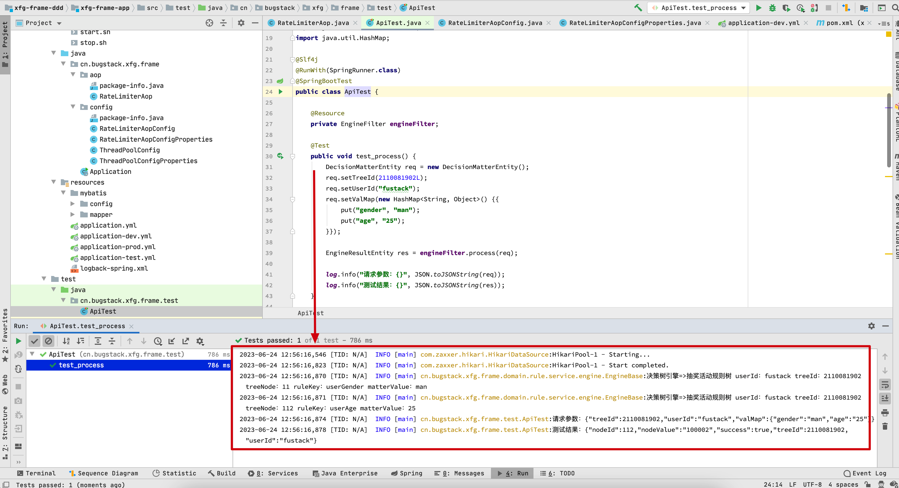

需要查找上述配置、接口和模型的位置时，可对照下面的完整目录。MVC 工程由 Application 启动，controller 接收请求，service 处理业务，dao 访问数据库，domain 定义相关对象，common 保存通用内容：

```text
.
├── docs
│   └── mvc.drawio - 架构文档
├── pom.xml
├── src
│   ├── main
│   │   ├── java
│   │   │   └── cn
│   │   │       └── bugstack
│   │   │           └── xfg
│   │   │               └── frame
│   │   │                   ├── Application.java
│   │   │                   ├── common
│   │   │                   │   ├── Constants.java
│   │   │                   │   └── Result.java
│   │   │                   ├── controller
│   │   │                   │   └── UserController.java
│   │   │                   ├── dao
│   │   │                   │   └── IUserDao.java
│   │   │                   ├── domain
│   │   │                   │   ├── po
│   │   │                   │   │   └── User.java
│   │   │                   │   ├── req
│   │   │                   │   │   └── UserReq.java
│   │   │                   │   ├── res
│   │   │                   │   │   └── UserRes.java
│   │   │                   │   └── vo
│   │   │                   │       └── UserInfo.java
│   │   │                   └── service
│   │   │                       ├── IUserService.java
│   │   │                       └── impl
│   │   │                           └── UserServiceImpl.java
│   │   └── resources
│   │       ├── application.yml
│   │       └── mybatis
│   │           ├── config
│   │           │   └── mybatis-config.xml
│   │           └── mapper
│   │               └── User_Mapper.xml
│   └── test
│       └── java
│           └── cn
│               └── bugstack
│                   └── xfg
│                       └── frame
│                           └── test
│                               └── ApiTest.java
└── road-map.sql
```

DDD 工程由 xfg-frame-app 启动，domain 中组织 order、rule、user 等业务模块，各模块有相应模型、契约、实现和测试。先根据职责定位模块，再查找具体类：

```text
.
├── README.md
├── docs
│   ├── dev-ops
│   │   ├── environment
│   │   │   └── environment-docker-compose.yml
│   │   ├── siege.sh
│   │   └── skywalking
│   │       └── skywalking-docker-compose.yml
│   ├── doc.md
│   ├── sql
│   │   └── road-map.sql
│   └── xfg-frame-ddd.drawio
├── pom.xml
├── xfg-frame-api
│   ├── pom.xml
│   ├── src
│   │   └── main
│   │       └── java
│   │           └── cn
│   │               └── bugstack
│   │                   └── xfg
│   │                       └── frame
│   │                           └── api
│   │                               ├── IAccountService.java
│   │                               ├── IRuleService.java
│   │                               ├── model
│   │                               │   ├── request
│   │                               │   │   └── DecisionMatterRequest.java
│   │                               │   └── response
│   │                               │       └── DecisionMatterResponse.java
│   │                               └── package-info.java
│   └── xfg-frame-api.iml
├── xfg-frame-app
│   ├── Dockerfile
│   ├── build.sh
│   ├── pom.xml
│   ├── src
│   │   ├── main
│   │   │   ├── bin
│   │   │   │   ├── start.sh
│   │   │   │   └── stop.sh
│   │   │   ├── java
│   │   │   │   └── cn
│   │   │   │       └── bugstack
│   │   │   │           └── xfg
│   │   │   │               └── frame
│   │   │   │                   ├── Application.java
│   │   │   │                   ├── aop
│   │   │   │                   │   ├── RateLimiterAop.java
│   │   │   │                   │   └── package-info.java
│   │   │   │                   └── config
│   │   │   │                       ├── RateLimiterAopConfig.java
│   │   │   │                       ├── RateLimiterAopConfigProperties.java
│   │   │   │                       ├── ThreadPoolConfig.java
│   │   │   │                       ├── ThreadPoolConfigProperties.java
│   │   │   │                       └── package-info.java
│   │   │   └── resources
│   │   │       ├── application-dev.yml
│   │   │       ├── application-prod.yml
│   │   │       ├── application-test.yml
│   │   │       ├── application.yml
│   │   │       ├── logback-spring.xml
│   │   │       └── mybatis
│   │   │           ├── config
│   │   │           │   └── mybatis-config.xml
│   │   │           └── mapper
│   │   │               ├── RuleTreeNodeLine_Mapper.xml
│   │   │               ├── RuleTreeNode_Mapper.xml
│   │   │               └── RuleTree_Mapper.xml
│   │   └── test
│   │       └── java
│   │           └── cn
│   │               └── bugstack
│   │                   └── xfg
│   │                       └── frame
│   │                           └── test
│   │                               └── ApiTest.java
│   └── xfg-frame-app.iml
├── xfg-frame-ddd.iml
├── xfg-frame-domain
│   ├── pom.xml
│   ├── src
│   │   └── main
│   │       └── java
│   │           └── cn
│   │               └── bugstack
│   │                   └── xfg
│   │                       └── frame
│   │                           └── domain
│   │                               ├── order
│   │                               │   ├── model
│   │                               │   │   ├── aggregates
│   │                               │   │   │   └── OrderAggregate.java
│   │                               │   │   ├── entity
│   │                               │   │   │   ├── OrderItemEntity.java
│   │                               │   │   │   └── ProductEntity.java
│   │                               │   │   ├── package-info.java
│   │                               │   │   └── valobj
│   │                               │   │       ├── OrderIdVO.java
│   │                               │   │       ├── ProductDescriptionVO.java
│   │                               │   │       └── ProductNameVO.java
│   │                               │   ├── repository
│   │                               │   │   ├── IOrderRepository.java
│   │                               │   │   └── package-info.java
│   │                               │   └── service
│   │                               │       ├── OrderService.java
│   │                               │       └── package-info.java
│   │                               ├── rule
│   │                               │   ├── model
│   │                               │   │   ├── aggregates
│   │                               │   │   │   └── TreeRuleAggregate.java
│   │                               │   │   ├── entity
│   │                               │   │   │   ├── DecisionMatterEntity.java
│   │                               │   │   │   └── EngineResultEntity.java
│   │                               │   │   ├── package-info.java
│   │                               │   │   └── valobj
│   │                               │   │       ├── TreeNodeLineVO.java
│   │                               │   │       ├── TreeNodeVO.java
│   │                               │   │       └── TreeRootVO.java
│   │                               │   ├── repository
│   │                               │   │   ├── IRuleRepository.java
│   │                               │   │   └── package-info.java
│   │                               │   └── service
│   │                               │       ├── engine
│   │                               │       │   ├── EngineBase.java
│   │                               │       │   ├── EngineConfig.java
│   │                               │       │   ├── EngineFilter.java
│   │                               │       │   └── impl
│   │                               │       │       └── RuleEngineHandle.java
│   │                               │       ├── logic
│   │                               │       │   ├── BaseLogic.java
│   │                               │       │   ├── LogicFilter.java
│   │                               │       │   └── impl
│   │                               │       │       ├── UserAgeFilter.java
│   │                               │       │       └── UserGenderFilter.java
│   │                               │       └── package-info.java
│   │                               └── user
│   │                                   ├── model
│   │                                   │   └── valobj
│   │                                   │       └── UserVO.java
│   │                                   ├── repository
│   │                                   │   └── IUserRepository.java
│   │                                   └── service
│   │                                       ├── UserService.java
│   │                                       └── impl
│   │                                           └── UserServiceImpl.java
│   └── xfg-frame-domain.iml
├── xfg-frame-infrastructure
│   ├── pom.xml
│   ├── src
│   │   └── main
│   │       └── java
│   │           └── cn
│   │               └── bugstack
│   │                   └── xfg
│   │                       └── frame
│   │                           └── infrastructure
│   │                               ├── dao
│   │                               │   ├── IUserDao.java
│   │                               │   ├── RuleTreeDao.java
│   │                               │   ├── RuleTreeNodeDao.java
│   │                               │   └── RuleTreeNodeLineDao.java
│   │                               ├── package-info.java
│   │                               ├── po
│   │                               │   ├── RuleTreeNodeLinePO.java
│   │                               │   ├── RuleTreeNodePO.java
│   │                               │   ├── RuleTreePO.java
│   │                               │   └── UserPO.java
│   │                               └── repository
│   │                                   ├── RuleRepository.java
│   │                                   └── UserRepository.java
│   └── xfg-frame-infrastructure.iml
├── xfg-frame-trigger
│   ├── pom.xml
│   ├── src
│   │   └── main
│   │       └── java
│   │           └── cn
│   │               └── bugstack
│   │                   └── xfg
│   │                       └── frame
│   │                           └── trigger
│   │                               ├── http
│   │                               │   ├── Controller.java
│   │                               │   └── package-info.java
│   │                               ├── mq
│   │                               │   └── package-info.java
│   │                               ├── rpc
│   │                               │   ├── AccountService.java
│   │                               │   ├── RuleService.java
│   │                               │   └── package-info.java
│   │                               └── task
│   │                                   └── package-info.java
│   └── xfg-frame-trigger.iml
└── xfg-frame-types
    ├── pom.xml
    ├── src
    │   └── main
    │       └── java
    │           └── cn
    │               └── bugstack
    │                   └── xfg
    │                       └── frame
    │                           └── types
    │                               ├── Constants.java
    │                               ├── Response.java
    │                               └── package-info.java
    └── xfg-frame-types.iml
```


## 五、MVC 到 DDD 的渐进式重构

### 1. 工程映射与依赖调整

旧工程已经承担业务，整体推倒重做的成本较高。可以在保留现有模块关系和交付能力的前提下，逐步把业务逻辑与基础支撑拆开，让原有结构承载更清晰的领域模型。

当贫血对象被大量 Service 交叉使用、Service 之间随意相互调用时，对象字段会不断膨胀，修改某个需求可能影响许多无关场景。治理重点是这些混乱的职责与依赖，不能笼统归因于所有 MVC 工程。

下图以对象被交叉复用与按业务聚合组织作对比，说明缺少边界时修改影响为什么容易扩散。

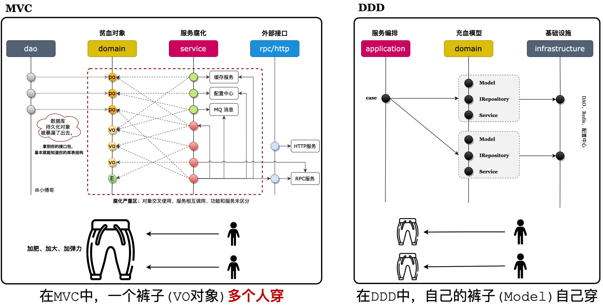

一种渐进迁移方式是：从现有 service 中抽取具有领域含义的逻辑，在 domain 中按业务建立领域包；把数据库、Redis、配置及外部调用等实现归入基础设施或对应适配模块；service 保留为应用编排，协调领域能力。在这套迁移示例中，export 承担对外契约，对应 api；web 承担触发入口，对应 trigger；dao 和 rpc 分别承接数据等基础设施与外部调用适配。

下图用相同颜色对应旧模块与迁移后的职责，帮助确定各类代码应该逐步移到哪里。

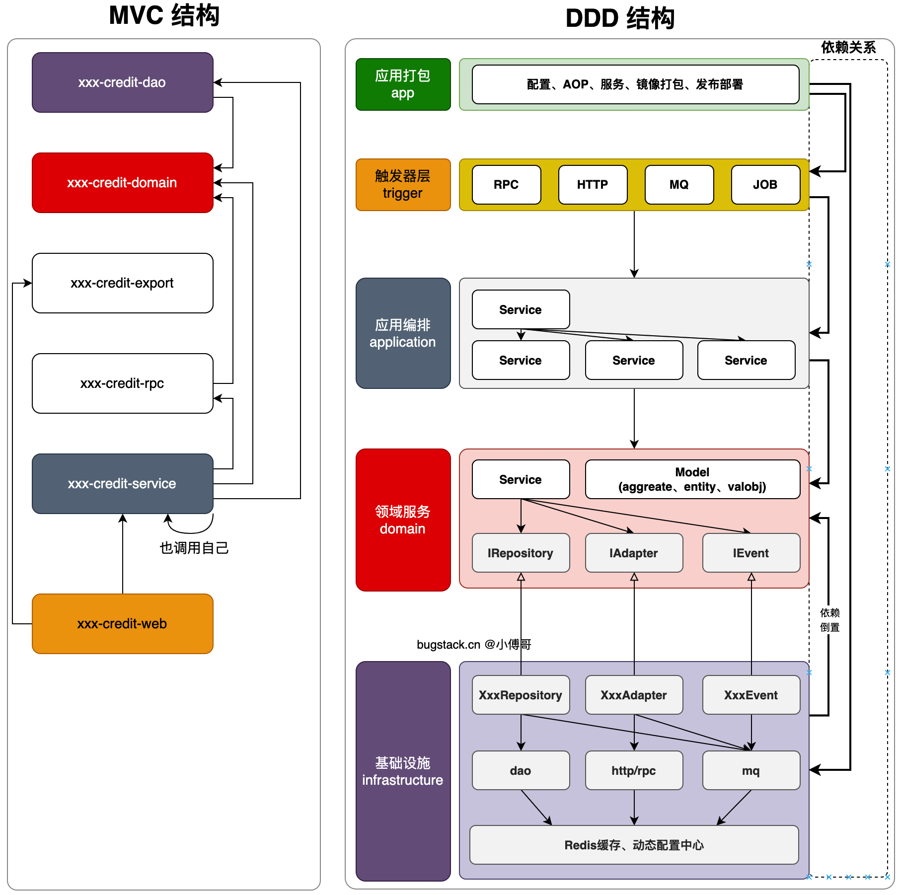

如果原有 domain 是被其他模块依赖的对象模块，可以在审视现有依赖后逐步增加领域行为与契约，再让 dao、rpc 等模块实现这些契约。并非所有旧工程都天然具有相同依赖关系，迁移时需要以实际结构为准。

对外提供的 RPC 接口和传输对象应位于清晰的公共契约中，不应把内部领域模型和 PO 整体暴露给调用方。外部服务调用可以在核心声明所需接口，由基础设施或独立适配模块实现。

这样的改造可以减少一次性调整工程骨架的范围，但仍然需要逐步迁移规则、收拢修改入口，并保护现有行为。换一套包名或分层结构，不会自动让原有代码变得清晰。

实际迁移可以按一个用例推进：先记录现有输入、结果和异常行为；把重复、易变的业务判断收拢到明确的对象或规则能力；再把数据库及外部访问隔离到契约实现；最后让旧入口调用新的用例路径。每完成一部分，重新验证既有场景，确认行为一致后再迁移下一部分，避免一次同时调整目录、业务规则与接口契约。

下图以房屋布局变化作类比：工程骨架可以更清晰，但内部代码仍需持续治理。

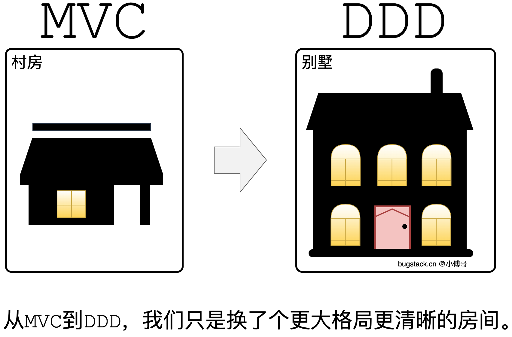

### 2. 提额流程的结构重构

以额度调整为例：用户有初始额度，后续申请提额，需要经过一系列校验，最终执行额度变更。

下图沿调用步骤列出额度调整的检查与处理过程，用于识别稳定主线和可变化规则。

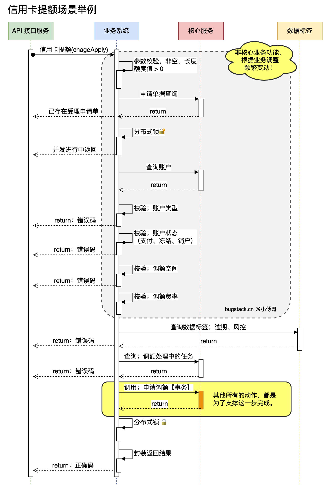

如果把全部判断都写在一个实现方法中，随着规则新增、停用或调整，主流程会不断积累条件分支。这类易变校验与稳定主流程混在一起，是代码难以维护的重要原因。

下图展示支撑方法重复、Service 交叉依赖和实现代码堆叠；代码区域经过打码，只能据其结构讨论职责混杂，不能推断具体规则。

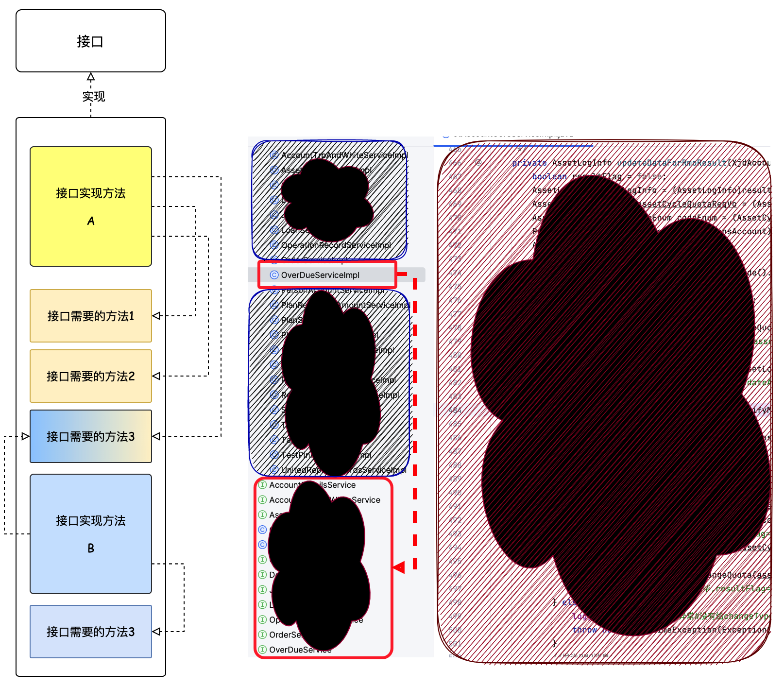

重构时，先在 domain 下建立 credit 业务包，集中额度调整所需的模型、服务和契约。数据库查询、缓存和外部接口通过契约获得，由基础设施提供实现，让领域代码关注业务处理。

下图把 credit 领域包、业务契约与支撑实现对应起来，展示重新分层后的职责归属。

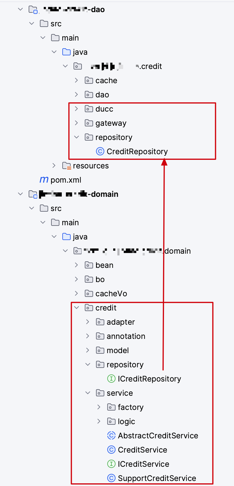

再使用模板、策略和工厂组织行为：

- 定义额度调整接口，使接口能够表达提额、降额等相应业务能力。
- 在抽象类中固定主流程，提取可复用的支撑方法。
- 把频繁变化的规则拆成独立策略，按明确规则选择或组合。
- 由工厂提供相应规则能力，具体业务实现负责执行最终调整。

下图把抽象流程、具体实现、规则策略和工厂展开，说明这些构件如何支撑额度调整。

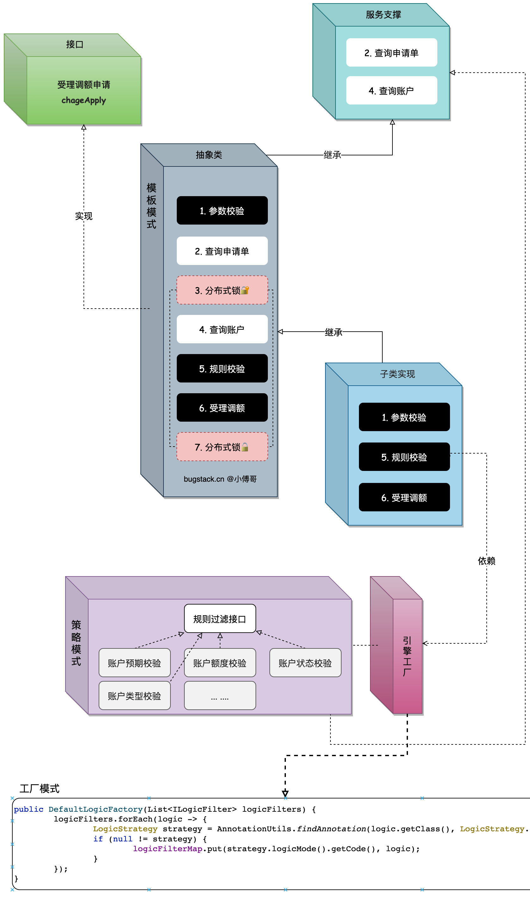

流程代码如下：

```java
public AdjustAssetOrderEntity acceptAdjustAssetApply(AdjustAssetApplyEntity adjustAssetApplyEntity) {
    // 1. 参数校验
    this.parameterVerification(adjustAssetApplyEntity);
  
    // 2. 查询申请单数据，如已经存在则直接返回
    AdjustAssetOrderEntity orderEntity = queryAssetLog(adjustAssetApplyEntity.getPin(), adjustAssetApplyEntity.getAccountType(), adjustAssetApplyEntity.getTaskNo(), adjustAssetApplyEntity.getAdjustType());
    if (null != orderEntity) {
        log.info("pin={} taskNo={} 受理申请，检索到任务存在进行中的申请单。", adjustAssetApplyEntity.getUserId(), adjustAssetApplyEntity.getTaskNo());
        return orderEntity;
    }
  
    // 3. 以下流程放到分布式锁内处理【避免相同请求二次进入】
    String lockId = genLockId(adjustAssetApplyEntity.getAdjustType(), adjustAssetApplyEntity.getUserId());
    try {
        // 3.1 分布式锁：加锁
        long state = lock(lockId);
        if (0 == state) {
            throw new AccountRuntimeException(BizResultCodeEm.DISTRIBUTED_LOCK_EXCEPTION.getCode(), "分布式锁异常，当前用户行为处理中。");
        }
      
        // 3.2 账户查询
        UserAccountInfoDTO userAccountInfoDTO = queryJtAccount(adjustAssetApplyEntity.getUserId(), adjustAssetApplyEntity.getAccountType());
      
        // 3.3 基础校验：(1)账户类型、(2)状态状态、(3)额度类型、(4)账户逾期、(5)费率类型【暂无】
        LogicCheckResultEntity logicCheckResultEntity = doCheckLogic(adjustAssetApplyEntity, userAccountInfoDTO,
                DefaultLogicFactory.LogicModel.ACCOUNT_TYPE_FILTER.getCode(),
                DefaultLogicFactory.LogicModel.ACCOUNT_STATUS_FILTER.getCode(),
                DefaultLogicFactory.LogicModel.ACCOUNT_QUOTA_FILTER.getCode(),
                DefaultLogicFactory.LogicModel.ACCOUNT_OVERDUE_FILTER.getCode()
        );
      
        if (!AssetCycleQuotaAlterCodeEnum.E0000.getCode().equals(logicCheckResultEntity.getCode())) {
            log.info("userId={} taskNo={} 规则校验过滤拦截。code:{} info:{}", adjustAssetApplyEntity.getUserId(), adjustAssetApplyEntity.getTaskNo(), logicCheckResultEntity.getCode(), logicCheckResultEntity.getInfo());
            throw new AccountRuntimeException(logicCheckResultEntity.getCode(), logicCheckResultEntity.getInfo());
        }
      
        // 3.4 受理调额
        return this.acceptAsset(adjustAssetApplyEntity, userAccountInfoDTO);
    } finally {
        // 3.1 分布式锁：解锁
        this.unlock(lockId);
    }
}
```

这段示意先做参数与基础数据检查，再处理锁和规则校验，最后执行额度调整。模式的作用是把稳定流程与易变规则分开，并让可复用能力具有明确位置；是否使用锁、怎样处理异常和事务，仍要服从具体业务与技术要求。

新增一条额度校验时，先判断它能否作为独立规则加入 doCheckLogic 的组合；修改统一受理步骤时，再调整模板主流程。参数验证、已有申请查询、规则失败和受理成功各有明确结果，迁移时应逐项保持。锁也不代替幂等与事务；具体实现要保证只释放当前调用实际持有的锁，避免直接把示意流程视为完整并发方案。

重构是持续发生的工作，不应积累到只能推倒重做时才开始。领域划分、依赖隔离和设计模式共同服务于职责清晰与修改范围收敛，但没有固定的模式组合可以保证代码质量。应根据实际变化选择必要的结构，并用现有用例和测试保护行为。
