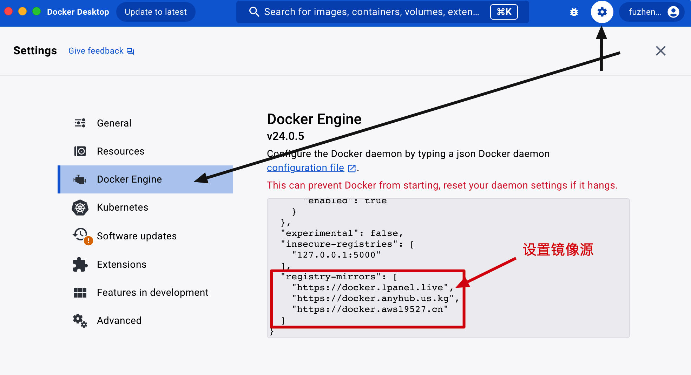
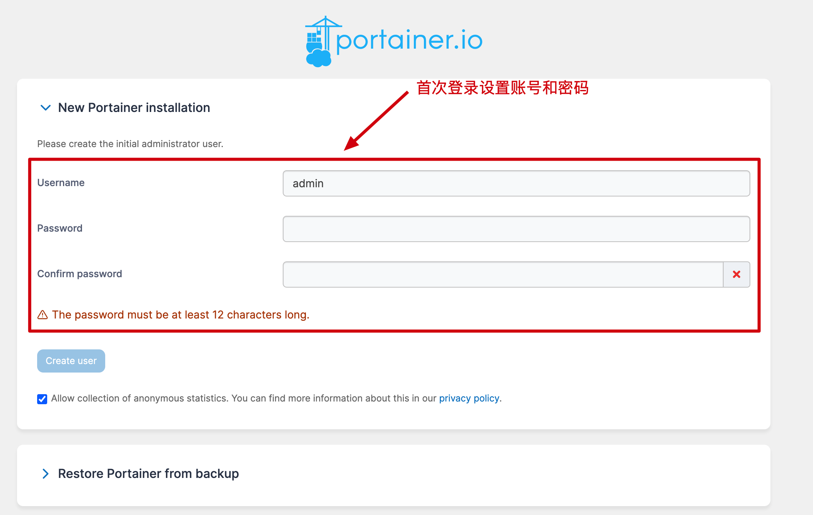
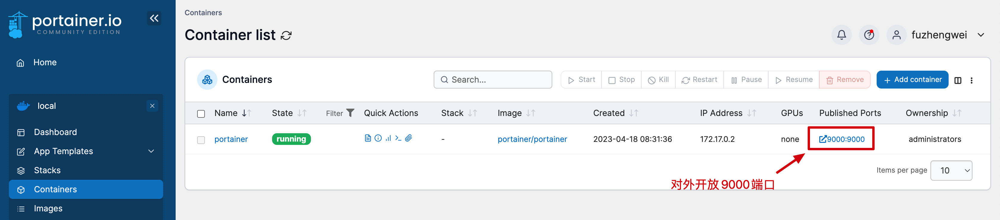

# Docker 使用指南

Docker 将应用及其依赖打包成镜像，再根据镜像创建和运行容器。Windows 开发环境可以使用 Docker Desktop，Linux 服务器可以直接安装 Docker Engine；环境准备完成后，两者都可以通过 Compose 管理 MySQL、Redis 等服务。

## 一、Windows 安装与配置

### 1.1 WSL 2 与 Docker Desktop 安装

Windows 上运行 Linux 容器，可以采用 **WSL 2 + Docker Desktop**：WSL 2 提供 Linux 内核环境，Docker Desktop 集成 Docker Engine、命令行工具和 Compose，并提供容器管理界面。Engine 负责实际运行容器，命令行和界面向它发送操作请求，Compose 则根据 YAML 文件统一管理一组服务。

安装前确认 Windows 版本符合 [Docker Desktop 系统要求](https://docs.docker.com/desktop/setup/install/windows-install/)，并在“任务管理器 → 性能 → CPU”中确认“虚拟化：已启用”；未启用时，需要进入 BIOS/UEFI 开启硬件虚拟化。普通 Intel/AMD 64 位电脑选择 x86_64 安装包，ARM 电脑应选择对应架构。

以管理员身份打开 PowerShell，安装 WSL；该命令通常还会安装 Ubuntu，完成后按提示重启 Windows，并完成发行版的首次初始化。

```powershell
wsl --install
```

如果通过 Microsoft Store 下载失败，可以改用 `wsl --install --web-download`。已安装 WSL 时，先更新并检查：

```powershell
wsl --update
wsl --version
wsl -l -v
```

`wsl --version` 查看 WSL 软件版本，`wsl -l -v` 中的 `VERSION` 列则表示各发行版采用 WSL 1 还是 WSL 2，应确认需要集成的发行版为 `2`。例如 Ubuntu 仍为 WSL 1 时，可执行 `wsl --set-version Ubuntu 2`，发行版名称以实际输出为准。完整操作见 [WSL 安装说明](https://learn.microsoft.com/zh-cn/windows/wsl/install)。

从 [Docker Desktop 官方页面](https://docs.docker.com/desktop/setup/install/windows-install/)下载安装包，安装时选择 WSL 2 后端。启动后在 **Settings → General** 中确认使用 WSL 2；部分版本的选项名称为 `Use WSL 2 based engine`。如果需要在 Ubuntu 终端使用 Docker，再到 **Settings → Resources → WSL Integration** 启用该发行版的集成。直接在 PowerShell 操作 Docker 时，无需在 Ubuntu 内重复安装一套 Engine。

等待 Docker Desktop 的引擎启动，在 PowerShell 中验证：

```powershell
docker --version
docker compose version
docker info
docker run hello-world
```

客户端能显示版本，不代表引擎已启动；`docker info` 成功返回才能确认已连接 Engine。测试容器输出 `Hello from Docker!` 后退出，表示镜像拉取和容器运行成功。若无法连接 daemon，先确认 Desktop 已启动且处于 Linux 容器模式；若只在拉取镜像时失败，再检查网络和下一节的下载配置。

### 1.2 Docker Desktop 使用与环境设置

Docker Desktop 的 **Containers** 页面可以查看容器状态，执行启动、停止、重启，查看日志或打开容器终端；**Images** 管理镜像，**Volumes** 管理持久化数据。Compose 创建的服务通常按项目分组，日常查看可以使用界面，部署配置仍保存在 Compose 文件中，便于重建环境。

镜像下载较慢时，可在 **Settings → Docker Engine** 的 JSON 中合并 `registry-mirrors` 字段，然后应用并重启。下图展示设置入口与字段位置，界面样式会随平台和版本变化。



图中的镜像地址仅作字段位置示意，使用前应确认服务仍然可用；`insecure-registries` 是另一项配置，使用 HTTPS 加速器不需要照搬它。加速器地址的获取、适用范围和验证方法见第二章“Docker 运行配置与维护”。修改时保留已有 JSON 字段，不能用一份镜像配置覆盖整个文件。

使用网络代理时，在 Docker Desktop 的代理设置中配置；仅给 PowerShell 设置代理，不一定能影响引擎拉取镜像。资源设置、代理入口等见 [Desktop 设置说明](https://docs.docker.com/desktop/settings-and-maintenance/settings/)。WSL 2 后端的内存、处理器等限制可结合 [WSL 配置](https://learn.microsoft.com/zh-cn/windows/wsl/wsl-config)设置，停止容器与退出 Docker Desktop 的资源释放效果也不同：前者停止服务，后者还会停止 Desktop 管理的引擎。

如需登录 Windows 后自动启动，在 **Settings → General** 中启用 `Start Docker Desktop when you sign in to your computer`；不常使用时可以关闭。容器是否随引擎恢复，由第三章的 `restart` 策略决定，不能仅开启 Desktop 自启动就认为所有容器都会启动。

## 二、Linux 安装与配置

### 2.1 Docker Engine 与 Compose 安装

下面以 **CentOS Stream 9、10** 为例，使用 DNF 安装 Docker CE；Ubuntu、Debian 等发行版应采用各自的[官方安装步骤](https://docs.docker.com/engine/install/)。先确认发行版与处理器架构，不能仅根据内核版本选择安装命令：

```bash
cat /etc/os-release
uname -r
uname -m
```

`uname -m` 常见输出为 `x86_64` 或 `aarch64`，镜像与安装包也需要支持相应架构。CentOS Linux 7、8 已结束维护，不能用 CentOS 7 的系统源覆盖其他发行版来解决下载问题。

**检查旧版本，再配置软件仓库。** 已有 Docker 环境时，先确认安装方式并备份重要数据，再处理冲突包；新环境执行下面的卸载命令，可能提示没有对应软件包，这是正常情况。

```bash
sudo dnf remove docker docker-client docker-client-latest docker-common \
    docker-latest docker-latest-logrotate docker-logrotate docker-engine
```

卸载软件包不会自动清除 `/var/lib/docker` 中的数据。随后安装仓库管理工具，并添加 Docker 官方软件仓库：

```bash
sudo dnf install -y dnf-plugins-core
sudo dnf config-manager --add-repo https://download.docker.com/linux/centos/docker-ce.repo
```

如果官方仓库访问困难，上一行添加仓库的命令可以改用[阿里云 Docker CE 软件源](https://developer.aliyun.com/mirror/docker-ce)，二者选择一个即可：

```bash
sudo dnf config-manager --add-repo https://mirrors.aliyun.com/docker-ce/linux/centos/docker-ce.repo
```

该地址提供的仓库文件已经指向阿里云，无需再重复替换域名。**软件源负责下载 Docker 安装包，下一节的镜像加速器负责拉取容器镜像，两者需要分别配置。** 确认仓库与当前发行版匹配后，刷新缓存：

```bash
sudo dnf clean all
sudo dnf makecache
```

较旧环境可能使用 `yum-utils`、`yum-config-manager` 等工具，本节统一使用当前发行版对应的 DNF 命令。安装 Docker 不要求先升级所有系统软件，也不需要照搬旧存储驱动相关软件包。

**安装并启动。** 一次安装 Engine、CLI、容器运行组件，以及 Buildx、Compose 插件：

```bash
sudo dnf install -y docker-ce docker-ce-cli containerd.io docker-buildx-plugin docker-compose-plugin
sudo systemctl start docker
sudo systemctl enable docker
```

`start` 启动当前服务，`enable` 设置开机启动。软件包安装完成后仍需启动服务；详细步骤与支持范围见 [CentOS 安装说明](https://docs.docker.com/engine/install/centos/)。

需要指定 Engine 版本时，先运行 `dnf list docker-ce --showduplicates | sort -r`，从当前仓库选择完整版本字符串，再替换下方变量。Engine 与 CLI 应选择对应版本，不能直接照搬另一发行版的包版本号。

```bash
DOCKER_VERSION='替换为仓库中列出的完整版本字符串'
sudo dnf install -y "docker-ce-${DOCKER_VERSION}" "docker-ce-cli-${DOCKER_VERSION}" \
    containerd.io docker-buildx-plugin docker-compose-plugin
```

安装后验证客户端、服务端和 Compose，并运行测试容器：

```bash
docker --version
sudo docker version
sudo docker info
docker compose version
sudo docker run hello-world
```

`docker version` 应同时显示客户端与服务端信息，`hello-world` 应打印成功信息后退出。仅有客户端版本不能证明 Engine 可用。后文为简洁省略部分 `sudo`；Linux 普通用户如无 socket 访问权限，应加上 `sudo`，或按[安装后设置](https://docs.docker.com/engine/install/linux-postinstall/)配置用户权限。`docker` 用户组具有很高的宿主机权限，不应通过把 socket 改为所有人可写来解决权限问题。

**兼容独立 Compose 命令。** 新环境使用插件形式 `docker compose`，Desktop 已集成，Linux 在上述步骤中已安装；缺少插件时可单独安装 `docker-compose-plugin`。带连字符的 `docker-compose` 是独立命令的调用形式，不能仅凭连字符判断它一定是 Compose V1；V1 已停止维护，具体区别见 [Compose 版本说明](https://docs.docker.com/compose/intro/history/)。

仅兼容既有脚本时考虑[独立安装](https://docs.docker.com/compose/install/standalone/)。下面保留固定版本 `v2.24.1` 的 Linux x86_64 安装示例；新安装前应从[官方发行页](https://github.com/docker/compose/releases)选择适用版本与架构，而不是将该示例版本作为默认选择。

```bash
sudo curl -fL https://github.com/docker/compose/releases/download/v2.24.1/docker-compose-linux-x86_64 -o /usr/local/bin/docker-compose
sudo chmod +x /usr/local/bin/docker-compose
docker-compose -v
```

离线安装时，在可联网机器下载对应二进制与校验文件，核对后上传到目标机器。在上传目录执行以下命令即可完成安装；若使用 [Gitee 分发地址](https://gitee.com/fustack/docker-compose/releases/download/v2.24.1/docker-compose-linux-x86_64)，也需要核对来源与校验值。

```bash
sudo mv docker-compose-linux-x86_64 /usr/local/bin/docker-compose
sudo chmod +x /usr/local/bin/docker-compose
docker-compose -v
```

只在当前目录重命名不会自动安装到命令搜索路径；手动安装也不会随包管理器自动升级。

### 2.2 Docker 运行配置与维护

**配置镜像下载。** `registry-mirrors` 用于 Docker Hub 镜像加速，不是所有镜像仓库的通用代理。可以从[阿里云镜像加速器控制台](https://cr.console.aliyun.com/cn-hangzhou/instances/mirrors)获取账号对应的地址，但阿里云已说明加速器停止同步最新镜像，可能无法拉取某些镜像，或通过 `latest` 得到较旧内容；适用限制与替代方案以[阿里云服务说明](https://help.aliyun.com/zh/acr/user-guide/accelerate-the-pulls-of-docker-official-images)为准。使用时选择明确标签，并实际验证；其他公共地址也不能视为长期有效配置，可结合[服务状态页](https://status.1panel.top/status/docker)和提供方说明判断。

常规 Linux Engine 使用 `/etc/docker/daemon.json`。文件已存在时，先备份，例如执行 `sudo cp -a /etc/docker/daemon.json /etc/docker/daemon.json.bak`，再编辑并合并 `registry-mirrors` 字段，保留其他配置。**以下命令仅用于首次创建文件**，执行前把占位地址换成实际可用地址：

```bash
sudo mkdir -p /etc/docker
sudo tee /etc/docker/daemon.json <<-'EOF'
{
  "registry-mirrors": ["https://YOUR_ID.mirror.aliyuncs.com"]
}
EOF
```

JSON 不允许注释与多余的尾逗号。修改后先[校验配置](https://docs.docker.com/reference/cli/dockerd/#daemon-configuration-file)，再重启并确认加载结果：

```bash
sudo dockerd --validate --config-file=/etc/docker/daemon.json
sudo systemctl restart docker
sudo docker info
sudo docker pull hello-world
```

在 `docker info` 的 `Registry Mirrors` 部分确认地址，拉取镜像检查当前下载链路；看到配置不等于加速服务可用，重启引擎也可能影响正在运行的容器。只修改 `daemon.json` 无需 `systemctl daemon-reload`，修改 systemd 服务配置后才需要重新加载。配置文件与启动参数不能重复指定冲突选项，见 [daemon 配置说明](https://docs.docker.com/engine/daemon/)。

使用代理时，需要让 **Docker daemon 进程**获得代理配置；仅在当前终端设置环境变量，不一定影响由 systemd 启动的服务。可按[官方代理配置](https://docs.docker.com/engine/daemon/proxy/)设置 daemon 配置或 systemd drop-in；Desktop 则使用第一章的界面入口。镜像访问问题也可参考[相关配置文章](https://cloud.tencent.com/developer/article/2301228)，其中的地址需重新确认。

**服务排查与卸载。** 提示无法连接 daemon 时，先确认服务状态，再查看日志中的具体错误；若是 `permission denied`，检查当前用户的 socket 权限。

```bash
sudo systemctl status docker
sudo journalctl -u docker -n 50 --no-pager
```

使用 Docker CE 软件包安装的环境，可以按下面的方式停止并卸载；`containerd.io` 仍被其他服务使用时，应先确认依赖。

```bash
sudo systemctl stop docker
sudo dnf remove docker-ce docker-ce-cli containerd.io docker-buildx-plugin docker-compose-plugin docker-ce-rootless-extras
```

卸载包不会自动清除全部镜像、容器、数据卷和配置，也不会移除手动安装的独立 Compose。删除这些内容属于另外的数据清理操作，应先确认备份；不能把卸载软件包理解为数据库数据已经被删除。

### 2.3 Portainer 可视化管理（可选）

[Portainer](https://www.portainer.io/) 为 Linux Docker 提供网页管理界面，可以管理容器、镜像、网络、数据卷和日志。Server 通过 Docker socket 管理本机，通过 Agent 接入其他主机；本机管理无需额外安装 Agent。

下面使用社区版 CE，Server 与 Agent 均为 `2.45.3`，安装前按[兼容表](https://docs.portainer.io/start/requirements-and-prerequisites)确认 Engine 版本。命令适用于以 root 权限运行的 Linux Engine；启用 SELinux 时，按[官方安装说明](https://docs.portainer.io/start/install-ce/server/docker/linux)处理权限要求，包括文档要求的 `--privileged` 选项。

```bash
docker pull portainer/portainer-ce:2.45.3
docker volume create portainer_data
docker run -d --restart=always --name portainer \
  -p 9443:9443 \
  -v /var/run/docker.sock:/var/run/docker.sock \
  -v portainer_data:/data \
  portainer/portainer-ce:2.45.3
docker ps
docker logs portainer
```

`portainer_data:/data` 保存账号与面板配置，创建卷后必须挂载；socket 挂载则授予面板管理本机 Docker 的高权限，应限制面板的访问来源。若采用 `registry.cn-hangzhou.aliyuncs.com/xfg-studio/portainer:latest` 等分发镜像，需要先核对实际版本与架构。

浏览器打开 `https://服务器地址:9443`，本机可用 `https://localhost:9443`；防火墙与云服务器安全组应只允许可信来源访问。默认自签名证书可能触发浏览器提示，先确认目标服务器。首次访问创建管理员，密码至少 12 位并满足页面要求；需要的初始化令牌从 `docker logs portainer` 的 `setup_token=` 行获取，见[初始化说明](https://docs.portainer.io/start/install-ce/server/setup)。下图展示账号创建区域，较新界面还会要求输入初始化令牌。



完成后进入本机环境，通过 **Containers** 启停容器、查看日志与终端，通过 **Images**、**Volumes** 管理对应资源。下图展示容器列表及发布端口的位置；图中是旧版 HTTP `9000`，本节部署使用 HTTPS `9443`。



如需兼容 HTTP，必须另外发布 `9000:9000`，不能直接用截图中的地址访问上述部署。

管理其他 Linux 主机时，在**被管理主机**运行匹配版本的 Agent：

```bash
docker run -d \
  -p 9001:9001 \
  --name portainer_agent \
  --restart=always \
  -v /var/run/docker.sock:/var/run/docker.sock \
  -v /var/lib/docker/volumes:/var/lib/docker/volumes \
  portainer/agent:2.45.3
```

随后在 Server 的 **Environments → Add environment** 中选择 **Docker Standalone → Agent**，填写名称与 `被管理主机地址:9001`，不加协议前缀。9001 仅允许 Portainer Server 访问；若 Docker 数据目录已改变，需要调整挂载左侧的宿主机卷目录，SELinux 等要求见 [Agent 接入说明](https://docs.portainer.io/admin/environments/add/docker/agent)。

## 三、通用部署与管理

### 3.1 使用 Compose 部署 MySQL 和 Redis

Compose 把服务所需的镜像、端口、环境变量、挂载、健康检查和网络集中到 YAML 文件中。下面的示例在 Windows 与 Linux 上共用，使用[官方 MySQL 镜像](https://hub.docker.com/_/mysql)的 `8.4` 系列与[官方 Redis 镜像](https://hub.docker.com/_/redis)的 `8.2` 系列；标签会随该系列的补丁发布更新，需要完全复现时可进一步固定补丁版本或摘要。

**准备文件。** 建立以下目录，文件保存为 UTF-8；创建 `redis.conf` 文件后再启动，避免把不存在的文件误建为目录。

```text
docker-env/
├── compose.yaml
├── .env
├── mysql/
│   └── sql/
│       └── 001-init.sql
└── redis/
    └── redis.conf
```

`.env` 集中保存供 Compose 替换的变量。下面是学习示例值，实际使用时自行设置，包含密码的文件不要提交到公开仓库。

```dotenv
MYSQL_ROOT_PASSWORD=ChangeMe_Root_123
MYSQL_PASSWORD=ChangeMe_App_123
REDIS_PASSWORD=ChangeMe_Redis_123
```

在 `mysql/sql/001-init.sql` 中创建一张示例表；数据库 `demo_db` 由后面的环境变量创建：

```sql
CREATE TABLE IF NOT EXISTS demo_item (
    id BIGINT PRIMARY KEY,
    name VARCHAR(100) NOT NULL
);
```

`redis/redis.conf` 配置如下。Redis 在容器内前台运行，监听容器网卡，数据写到 `/data`，并启用 AOF 持久化；密码由启动命令传入。

```conf
bind 0.0.0.0
protected-mode yes
port 6379
daemonize no
dir /data
appendonly yes
appendfsync everysec
```

把以下内容保存为 `compose.yaml`：

```yaml
name: docker-env

services:
  mysql:
    image: mysql:8.4
    restart: unless-stopped
    environment:
      TZ: Asia/Shanghai
      MYSQL_ROOT_PASSWORD: ${MYSQL_ROOT_PASSWORD:?set MYSQL_ROOT_PASSWORD in .env}
      MYSQL_DATABASE: demo_db
      MYSQL_USER: app_user
      MYSQL_PASSWORD: ${MYSQL_PASSWORD:?set MYSQL_PASSWORD in .env}
    ports:
      - "127.0.0.1:13306:3306"
    volumes:
      - ./mysql/sql:/docker-entrypoint-initdb.d:ro
      - mysql-data:/var/lib/mysql
    healthcheck:
      test: ["CMD-SHELL", 'MYSQL_PWD="$$MYSQL_ROOT_PASSWORD" mysql -h 127.0.0.1 -uroot -e "SELECT 1" >/dev/null 2>&1']
      interval: 5s
      timeout: 10s
      retries: 10
      start_period: 30s
    networks:
      - app-network

  redis:
    image: redis:8.2
    restart: unless-stopped
    environment:
      REDIS_PASSWORD: ${REDIS_PASSWORD:?set REDIS_PASSWORD in .env}
    command:
      - redis-server
      - /usr/local/etc/redis/redis.conf
      - --requirepass
      - ${REDIS_PASSWORD:?set REDIS_PASSWORD in .env}
    ports:
      - "127.0.0.1:16379:6379"
    volumes:
      - ./redis/redis.conf:/usr/local/etc/redis/redis.conf:ro
      - redis-data:/data
    healthcheck:
      test: ["CMD-SHELL", 'REDISCLI_AUTH="$$REDIS_PASSWORD" redis-cli ping | grep -qx PONG']
      interval: 5s
      timeout: 5s
      retries: 10
      start_period: 10s
    networks:
      - app-network

volumes:
  mysql-data:
  redis-data:

networks:
  app-network:
    driver: bridge
```

这里的 `mysql`、`redis` 是服务名，Compose 负责创建各自的容器，并将它们接入同一网络。未指定 `container_name` 时，由 Compose 根据项目名和服务名命名容器，可直接用服务名执行 Compose 操作。两项服务之间没有启动依赖，因此不需要相互配置 `depends_on`。

`environment` 把变量传入容器，`${变量名:?提示}` 表示变量为空或未定义就停止解析。**`.env` 主要供 Compose 替换 YAML 中的变量，不会自动把所有变量传给容器，也不会自动传给本机 Java 程序。** 这里通过 `environment` 明确传入；健康检查中的 `$$` 则让 Compose 保留一个 `$`，交给容器内的 shell 展开，见[变量替换说明](https://docs.docker.com/compose/how-tos/environment-variables/variable-interpolation/)。

MySQL 用 `MYSQL_ROOT_PASSWORD` 设置管理员初始密码，用 `MYSQL_DATABASE` 创建数据库，并用 `MYSQL_USER`、`MYSQL_PASSWORD` 创建可访问该数据库的应用账号。8.4 示例使用默认认证，连接工具与 JDBC 驱动需要支持它；`mysql_native_password` 在 8.4 默认禁用，不要照搬旧版本的认证启动参数，见 [MySQL 认证说明](https://dev.mysql.com/doc/refman/8.4/en/native-pluggable-authentication.html)。Redis 官方镜像则不会仅因为存在 `REDIS_PASSWORD` 环境变量就启用密码，本例由 `command` 加载配置文件并设置 `--requirepass`。

**端口与持久化。** `ports` 使用“宿主机监听地址:宿主机端口:容器端口”，两个宿主机端口需未被占用。当前仅绑定 `127.0.0.1`，适合本机开发；容器内部端口与宿主机映射端口是两组不同的地址。

| 访问位置 | MySQL 地址 | Redis 地址 |
| --- | --- | --- |
| Docker 宿主机上的程序 | `127.0.0.1:13306` | `127.0.0.1:16379` |
| 同一 Compose 网络中的其他容器 | `mysql:3306` | `redis:6379` |
| 其他电脑 | 当前本机绑定不提供远程直连；需调整监听地址并限制访问，或使用 SSH 隧道 | 同左 |

容器内的 `localhost` 指向该容器自身；其他 Compose 项目的容器也不会自动加入这里的网络。如果改成 `"13306:3306"`、`"16379:6379"`，通常会发布到宿主机所有网卡，远程客户端使用宿主机地址加映射端口，并检查防火墙、云安全组和服务认证。

`volumes` 中左侧以 `./` 开头的是宿主机文件或目录，相对路径以 Compose 文件所在目录为基准；右侧是容器路径，`:ro` 表示容器只读。`mysql-data`、`redis-data` 是 Docker 管理的命名卷，分别保存数据库文件与 Redis 持久化文件，容器重建时可以继续使用。Desktop 把这些卷保存在其管理的 Linux 环境中，不能把它们理解为 Windows 当前目录下的文件夹。

**MySQL 初始化 SQL 挂载与数据库数据卷用途不同。** `/docker-entrypoint-initdb.d` 中的脚本只在首次初始化空数据目录时按文件名顺序执行；已有数据库时，修改 SQL 文件、密码或数据库环境变量，再次启动不会自动重建数据库或修改账号。后续结构变更应执行 SQL 或迁移脚本，密码应在数据库中修改。初始化规则见 [MySQL 镜像说明](https://hub.docker.com/_/mysql)。

Redis 把 AOF 文件写入 `/data`，再由命名卷保存；只挂配置文件不能保证运行数据被保留。`appendfsync everysec` 在性能与持久化之间作了取舍，异常断电时仍可能丢失最近约一秒的写入，重要数据还需备份，见 [Redis 持久化说明](https://redis.io/docs/latest/operate/oss_and_stack/management/persistence/)。配置文件与命令行参数的使用见 [Redis 配置说明](https://redis.io/docs/latest/operate/oss_and_stack/management/config/)。

**启动与连接验证。** 在 PowerShell 或 Linux 终端进入 `docker-env` 目录，执行同一组命令：

```bash
docker compose config --quiet
docker compose up -d
docker compose ps
docker compose logs --tail 100 mysql redis
```

Compose 默认识别 `compose.yaml`；使用其他文件名时，通过 `-f 文件名` 指定。`config --quiet` 只检查配置解析，不能证明镜像可下载、端口未占用或数据库已经可用。`up -d` 会拉取缺少的镜像并创建、启动服务；MySQL 首次初始化需要时间，可结合日志与健康状态判断。

`healthcheck.test` 是检查命令，`interval` 是间隔，`timeout` 是单次超时，`retries` 是连续失败阈值，`start_period` 是启动宽限期；宽限期内的失败暂不累计到阈值，成功则可提前进入正常检查。示例中 MySQL 检查认证与 `SELECT 1`，Redis 检查带认证的 `PING`。容器 `running` 只说明主进程在运行，`healthy` 也仅说明所配置的检查通过，仍需验证实际使用的账号、数据库和访问链路。

可以直接使用容器内的客户端验证：

```bash
docker compose exec mysql mysql -uapp_user -p demo_db
```

输入 `.env` 中的 `MYSQL_PASSWORD`，连接后执行 `SHOW TABLES;`，应能看到 `demo_item`。Redis 使用交互式密码提示：

```bash
docker compose exec redis redis-cli --askpass
```

输入 `REDIS_PASSWORD` 后执行 `PING`，应返回 `PONG`。这两步验证容器内部服务可用；还应在宿主机使用 IDEA Database、Navicat、DataGrip 或 Redis 客户端，按上表的映射地址连接，以验证端口与应用访问。

本机 Spring Boot 的数据库配置可以写成：

```yaml
spring:
  datasource:
    url: jdbc:mysql://127.0.0.1:13306/demo_db
    username: app_user
    password: ${DB_PASSWORD}
```

在启动 Java 程序的环境中设置 `DB_PASSWORD`，值与 `MYSQL_PASSWORD` 一致；应用部署进同一 Compose 网络后，数据库地址改用 `mysql:3306`，Redis 同理改用 `redis:6379`。

**就绪依赖与重启。** 如果以后把应用服务也加入 Compose，可以把下面的字段放在**应用服务**下，使它启动前等待 MySQL、Redis 的健康检查通过：

```yaml
depends_on:
  mysql:
    condition: service_healthy
  redis:
    condition: service_healthy
```

该配置控制 Compose 启动时的依赖就绪，不保证数据库运行期间永不掉线，应用仍需要连接重试与恢复能力，见[启动顺序说明](https://docs.docker.com/compose/how-tos/startup-order/)。健康检查变成 `unhealthy` 本身不会触发 Docker 的重启策略，`restart` 主要处理容器主进程退出后的重启。

本例的 `restart: unless-stopped` 可在进程退出或引擎重启后恢复容器，但主动停止的容器会保持停止。`restart: always` 也会在进程退出后重启；手动停止后，当前引擎运行期间不会立即再启动它，但引擎重启后会恢复，具体条件见[重启策略说明](https://docs.docker.com/engine/containers/start-containers-automatically/)。Windows 还需先启动 Desktop，Linux 则需先启动 Docker 服务。

环境建立后，可按实际目的维护，不必每次都删除重建：

```bash
# 暂停使用，保留容器；恢复已有容器
docker compose stop
docker compose start

# 修改 Compose 环境变量、镜像、挂载或启动命令后，重新应用配置
docker compose up -d

# 停止并删除项目容器和网络，默认保留命名卷
docker compose down
```

`docker compose restart` 适合重启已有容器，不会应用新写入的 Compose 环境变量或其他创建配置；修改这些配置应使用 `up -d`。修改已挂载的 Redis 配置文件后，可重启 Redis 使其重新读取。`down -v` 会额外删除项目管理的数据卷，可能永久丢失数据库与 Redis 数据，仅在确认要清空并已有所需备份时使用。持久化卷保留数据，也意味着不能把删除容器当作重置数据库的方法。

### 3.2 远程 Docker 连接

Windows 或 Linux 上的 CLI、IDE 都可以操作远端 Engine。远端需要运行 Docker，SSH 登录可用，并且 SSH 用户有权访问远端 Docker socket。在本机创建连接配置，替换用户名和服务器地址后验证：

```bash
docker context create remote-docker --docker host=ssh://docker-user@your-server
docker --context remote-docker info
docker --context remote-docker ps
```

`--context` 只让当前命令使用该连接，便于确认正在操作的主机。远程访问也可参考 [Docker SSH 连接说明](https://docs.docker.com/engine/security/protect-access/)；具备 Docker 集成功能的 IDEA，可在 Docker 设置中选择 [SSH 连接](https://www.jetbrains.com/help/idea/settings-docker.html)。

远程 Engine 创建的容器、镜像与命名卷都在远端。Compose 中的绑定挂载同样要求**源文件存在于远端宿主机**，本机的 `./mysql/sql` 不会因为使用远程 context 就自动上传。初学时可以先把 `docker-env` 目录上传到服务器，再通过 SSH 进入该目录执行 Compose；配置中绑定 `127.0.0.1` 的数据库端口，也指向远端宿主机的回环地址，本机客户端需要 SSH 隧道或按访问需求调整发布方式。

不应把未认证、未加密的 `tcp://0.0.0.0:2375` 作为默认远程连接方式，网络可达者可能因此获得宿主机控制能力。确需 TCP API 时，应配置 TLS、客户端认证与访问控制；修改 Linux 服务使用 systemd override，避免覆盖发行版服务文件，也避免与 `daemon.json` 重复设置冲突的监听参数，详见[远程 API 配置](https://docs.docker.com/engine/daemon/remote-access/)。
