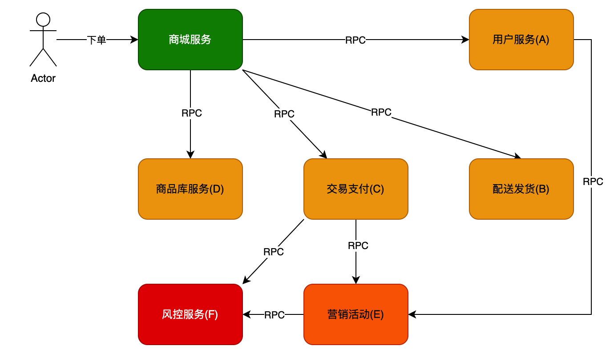
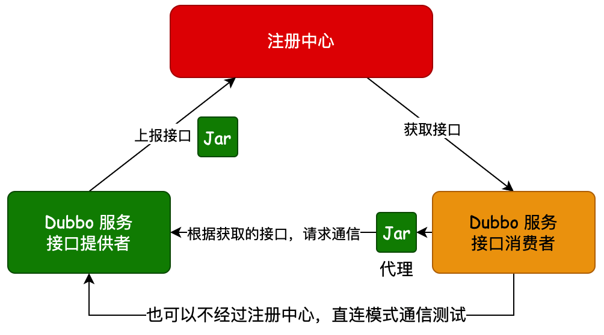
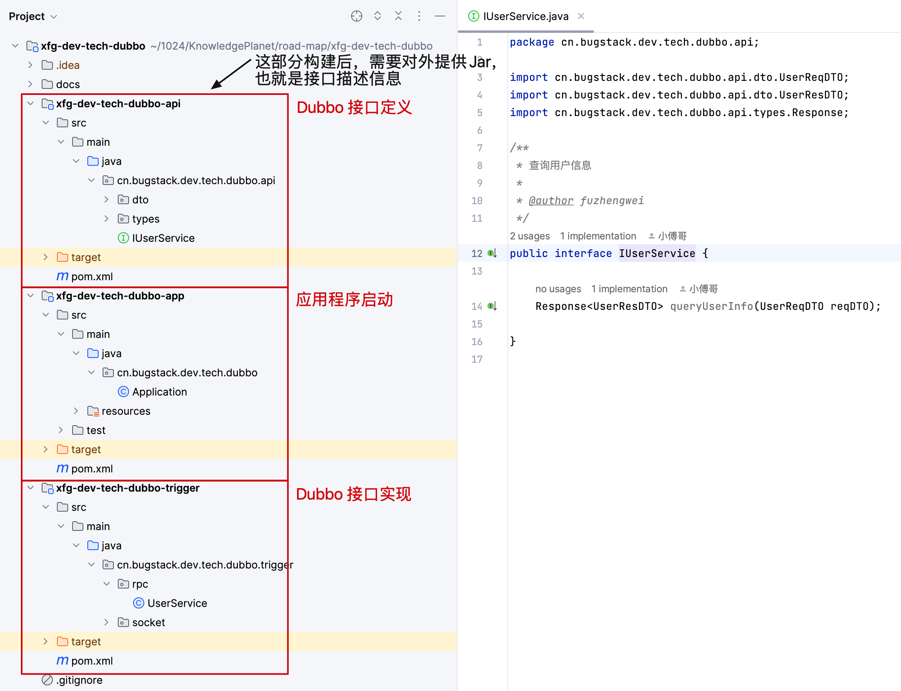
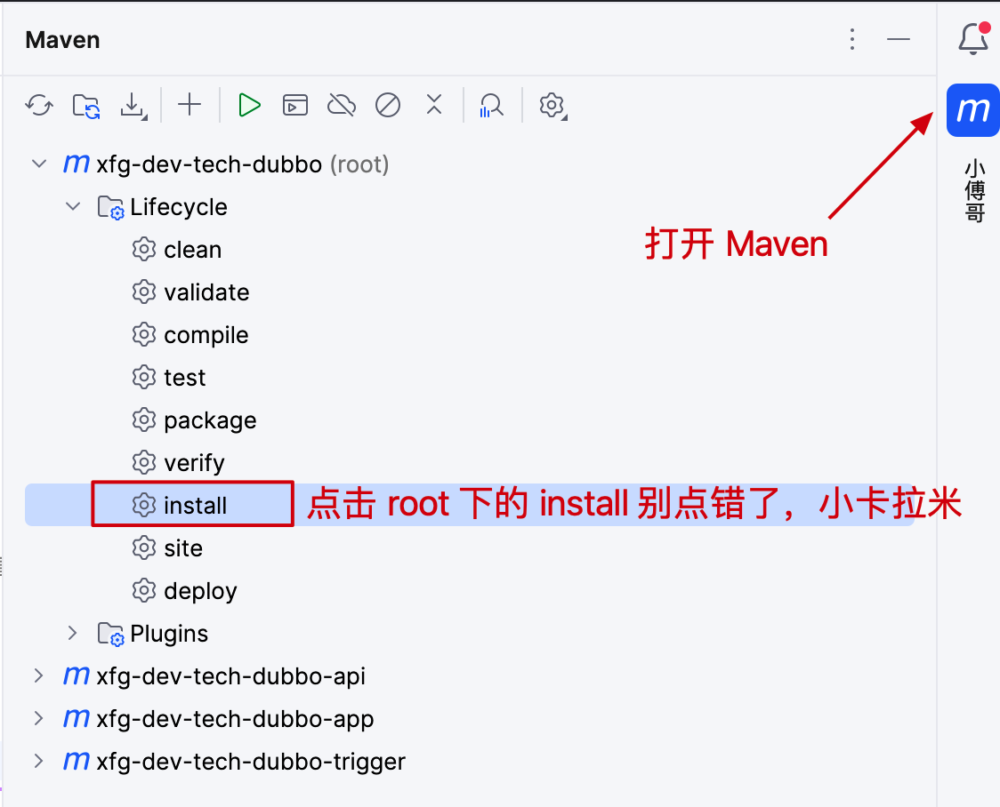
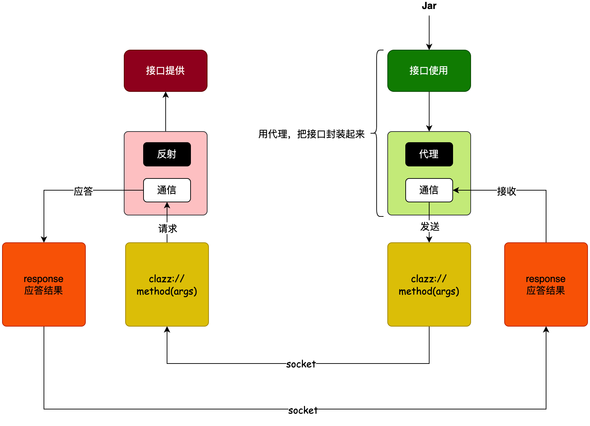

# Dubbo 使用教程

## 一、用途与基本概念

当用户、商品、支付等业务部署在不同进程中，订单服务需要查询用户信息时，就需要发起远程调用。**远程过程调用（Remote Procedure Call，RPC）**让调用方通过接口调用远端服务；调用过程中仍可能出现网络延迟、超时和失败。Apache Dubbo 提供服务发布、服务引用和服务治理能力，适合 Java 服务之间按接口协作的场景。

==是否发生 RPC，要看调用是否跨越进程及其通信机制，不能仅凭类名包含 `RPC` 判断。== 一个叫 `ProductRPC` 的类如果只是创建对象并填写固定字段，本次仍是本地方法执行；只有它进一步通过远程引用、HTTP 客户端等访问另一个进程，才真正发生远程通信。

接口契约、代理和网络请求也承担不同职责。契约约定“能调用什么、传入与返回什么”；代理把本地接口调用转换为框架处理；通信层完成编码、传输及响应关联。调用看起来像本地方法，只是框架提供的使用形式，远程端仍可能超时、不可达或已经执行但结果没有送回。涉及写操作时，应据此设计幂等与结果查询。

下图展示商城服务与用户、库存、支付等服务之间的调用关系。箭头表达业务依赖，具体是否拆分部署仍取决于项目需要。



使用 Dubbo 时，先分清各部分的职责：

| 组成 | 在项目中负责什么 |
| --- | --- |
| 提供方（Provider） | 实现业务接口，启动后对外提供远程服务 |
| 消费方（Consumer） | 引入接口契约，取得远程引用并发起调用；同一应用也可以提供其他服务 |
| 接口契约（API Jar） | 包含双方约定的接口、参数和返回类型，通过 Maven 等方式共享 |
| 注册中心（Registry） | 接收服务地址注册，供消费方发现提供方及跟踪地址变化 |

下图概括这些关系。图中的 Jar 由工程依赖引入，注册中心不负责传输 Jar，也不转发每次业务请求。



在 Java 接口调用方式下，契约包括接口名称、方法、参数类型和返回类型，相关 DTO 也需兼容。使用注册中心时，提供方登记地址，消费方发现地址后与提供方通信；开发测试也可直接指定提供方地址，称为直连。实例变化的发现和故障切换存在检测与处理过程，应结合调用失败处理使用，详见[服务发现机制](https://dubbo.apache.org/zh-cn/overview/what/core-features/service-discovery/)。

本例使用基于 TCP 的 dubbo 协议，Dubbo 也支持基于 HTTP/2 的 Triple 等协议。接入时需要保证双方的协议配置匹配，不能让浏览器直接按普通 HTTP 接口访问 dubbo 协议端口。协议、连接复用、序列化和负载都会影响性能，不能概括为“Socket 一定比 HTTP 快”，参见 [Dubbo 通信协议](https://dubbo.apache.org/en/overview/what/core-features/protocols/)。

## 二、服务发布与调用

示例工程使用 JDK 1.8、兼容的 Maven 3.x、Dubbo 3.1.4；注册中心示例采用 ZooKeeper 3.4.x，客户端依赖需匹配。复现时先保持工程的依赖版本组合，升级版本应同时核对 JDK、Spring Boot、Dubbo 和注册中心客户端的兼容性。下面展示业务接口与配置片段，省略部分导入和启动代码。

双方的 Spring Boot 启动模块还需准备 Dubbo 框架依赖，例如与工程版本配套的 `org.apache.dubbo:dubbo-spring-boot-starter`；使用 ZooKeeper 注册中心时，还需配套的注册中心客户端依赖。接口契约 Jar 只提供接口和类型，不能代替框架依赖，接入形式可参考 [Spring Boot 接入说明](https://dubbo.apache.org/zh-cn/overview/mannual/java-sdk/quick-start/starter/)，具体版本以本例工程为准。

### 1. 定义接口并发布服务

先确定要对外提供的业务能力，把接口及传输对象放进 API 模块，再在提供方实现接口。消费方只需依赖契约。提供方工程 xfg-dev-tech-dubbo 采用 api、app、trigger 模块；下图中 api 放置 IUserService、DTO 和 Response，app 负责启动，trigger.rpc 放置 UserService 实现。这种[工程分层](https://bugstack.cn/md/road-map/ddd.html)用于组织代码，不是使用 Dubbo 必须照搬的目录结构。



`cn.bugstack.dev.tech.dubbo.api.IUserService` 定义用户查询能力。调用方提交 UserReqDTO，接收包装了 UserResDTO 的 Response：

```java
public interface IUserService {

    Response<UserResDTO> queryUserInfo(UserReqDTO reqDTO);

}
```

需要传输的自定义类型应满足所选序列化方式的要求。本例的 UserReqDTO、UserResDTO、Response 应实现 Serializable，也供后面的 Java 对象编码示例使用；IUserService 接口本身不需要继承 Serializable。不同协议、序列化实现和版本配置的要求应分别核对。

`cn.bugstack.dev.tech.dubbo.trigger.rpc.UserService` 实现接口，查询与返回数据的业务逻辑写在实现中：

```java
@Slf4j
@DubboService(version = "1.0.0")
public class UserService implements IUserService {

    @Override
    public Response<UserResDTO> queryUserInfo(UserReqDTO reqDTO) {
        log.info("查询用户信息 userId: {} reqStr: {}", reqDTO.getUserId(), JSON.toJSONString(reqDTO));
        try {
            // 1. 模拟查询【你可以从数据库或者Redis缓存获取数据】
            UserResDTO resDTO = UserResDTO.builder()
                    .userId(reqDTO.getUserId())
                    .userName("小傅哥")
                    .userAge(20)
                    .build();

            // 2. 返回结果
            return Response.<UserResDTO>builder()
                    .code(Constants.ResponseCode.SUCCESS.getCode())
                    .info(Constants.ResponseCode.SUCCESS.getInfo())
                    .data(resDTO).build();
        } catch (Exception e) {
            log.error("查询用户信息失败 userId: {} reqStr: {}", reqDTO.getUserId(), JSON.toJSONString(reqDTO), e);
            return Response.<UserResDTO>builder()
                    .code(Constants.ResponseCode.UN_ERROR.getCode())
                    .info(Constants.ResponseCode.UN_ERROR.getInfo())
                    .build();
        }
    }

}
```

这里的 `org.apache.dubbo.config.annotation.DubboService` 用于导出远程服务，`version` 表示服务版本。Spring 的 `@Service` 只注册 Spring Bean，不能单独完成 Dubbo 服务导出。消费方引入接口 Jar 后，仍需要提供方进程实际启动并导出这个实现。

接着在提供方 `application.yml` 中配置应用名、注册中心、协议端口和实现类扫描包：

```yaml
dubbo:
  application:
    name: xfg-dev-tech-dubbo
    version: 1.0.0
  registry:
    address: zookeeper://127.0.0.1:2181 # N/A - 无zookeeper可配置 N/A 走直连模式测试
  protocol:
    name: dubbo
    port: 20881
  scan:
    base-packages: cn.bugstack.dev.tech.dubbo.trigger.rpc
```

`dubbo.application.name` 用于标识应用；`dubbo.registry.address` 指向注册中心；`dubbo.protocol.name` 与 `port` 指定业务通信协议和监听端口，本例为 20881。注册中心端口和业务端口承担不同职责，排查连接时要分别检查。

`dubbo.scan.base-packages` 应覆盖标注 `@DubboService` 的实现类，本例是 trigger.rpc 包。启动模块必须直接或间接依赖实现模块，Spring 也要能扫描相关组件。示例 Application 位于 `cn.bugstack.dev.tech.dubbo` 根包，可以覆盖子包，配置方式见 [Dubbo 配置说明](https://dubbo.apache.org/en/overview/mannual/java-sdk/reference-manual/config/principle/)。

使用注册中心模式时，先保证 ZooKeeper 可连接，再启动提供方，检查日志中的服务导出、注册及监听端口。配置为 `N/A` 表示不使用注册中心，此时消费方需要其他方式获得地址，例如本例的直连。

### 2. 引入契约并配置消费方

消费方通过 Maven 引入接口契约 Jar。先在提供方父工程执行 `install`，把相关模块构建并安装到本地 Maven 仓库，再在消费方解析依赖。下图展示 IDEA 中的 install 入口；若依赖无法解析，检查构建是否成功、坐标是否一致，以及双方 settings.xml 指向的本地仓库。



消费方引入 API 模块：

```xml
<dependency>
    <groupId>cn.bugstack</groupId>
    <artifactId>xfg-dev-tech-dubbo-api</artifactId>
    <version>1.0-SNAPSHOT</version>
</dependency>
```

`install` 解决本地依赖，团队共享可以通过 `deploy` 发布到远程 Maven 仓库；两者都不等于启动服务。这里 `1.0-SNAPSHOT` 是 Jar 版本，服务注解中的 `1.0.0` 是 Dubbo 服务版本，含义不同。修改契约后，应重新构建依赖，并检查双方的方法、DTO 和服务版本是否兼容。

消费方 `application.yml` 使用独立应用名，纯消费方不必配置提供方的监听端口：

```yaml
dubbo:
  application:
    name: xfg-dev-tech-dubbo-test
    version: 1.0.0
  registry:
    address: zookeeper://127.0.0.1:2181
    # address: N/A
```

注册中心模式下，双方连接能发现同一服务的注册中心，由 `@DubboReference` 按接口、版本和分组等信息取得远程引用。`group` 可区分同一接口的不同服务分组，`version` 可区分服务版本；使用确定值匹配时，两端应保持一致。只改消费方的分组或版本，可能导致找不到匹配的提供方。

本地调试采用直连时，将消费方 `registry.address` 改为 `N/A`，并在引用上指定 `url = "dubbo://127.0.0.1:20881"`。即使提供方仍注册到注册中心，这个引用也可以直连。远程部署应换成消费方可达的地址；127.0.0.1 指向消费方自身所在的网络环境，详见[直连提供者](https://cn.dubbo.apache.org/zh-cn/docs/advanced/explicit-target/)。

### 3. 发起调用并验证结果

使用注册中心时先启动注册中心，再启动提供方 xfg-dev-tech-dubbo，最后运行消费方测试。采用直连时先启动提供方即可。下面是 `cn.bugstack.dev.tech.dubbo.consumer.test.ApiTest` 的调用片段，注释给出了直连写法，实际生效的注解使用注册中心，两种方式选择一种配置：

```java
// 直连模式；@DubboReference(interfaceClass = IUserService.class, url = "dubbo://127.0.0.1:20881", version = "1.0.0")
@DubboReference(interfaceClass = IUserService.class, version = "1.0.0")
private IUserService userService;

@Test
public void test_userService() {
    UserReqDTO reqDTO = UserReqDTO.builder().userId("10001").build();
    Response<UserResDTO> resDTO = userService.queryUserInfo(reqDTO);
    log.info("测试结果 req: {} res: {}", JSON.toJSONString(reqDTO), JSON.toJSONString(resDTO));
}
```

`userService` 是 Dubbo 提供的远程引用。业务代码按接口构造参数并调用方法，提供方执行 UserService 后返回结果。观察返回中的 code、info、用户编号、姓名和年龄，同时检查提供方是否收到对应请求。示例成功输出如下：

```text
2023-07-08 15:37:22.291  INFO 62481 --- [           main] c.b.d.tech.dubbo.consumer.test.ApiTest   : 测试结果 req: {"userId":"10001"} res: {"code":"0000","data":{"userAge":20,"userId":"10001","userName":"小傅哥"},"info":"成功"}
2023-07-08 15:37:22.324  INFO 62481 --- [tor-Framework-0] o.a.c.f.imps.CuratorFrameworkImpl        : backgroundOperationsLoop exiting
```

启动成功只能说明应用完成了相应启动过程；完成一次实际调用，才能继续验证服务发现、网络通信和业务返回。示例日志中的 `backgroundOperationsLoop exiting` 是 Curator 后台循环退出信息，不能单独据此判断 Dubbo 调用失败，应结合前后的异常与返回结果分析。

### 客户端封装与业务适配

==额外的客户端封装类是工程选择，不是 RPC 必须新增的一层。== 业务适配器可以直接使用 Dubbo 的远程引用，或使用 Retrofit、其他 HTTP 客户端；如果调用配置、错误转换、日志或多个接口组合确实需要复用，再收拢到独立客户端类。

例如，本地定义商品查询端口，基础设施实现它，并使用远程商品接口取得结果。接口 DTO 应转换为本地需要的数据，渠道错误和超时也应转换为调用方能理解的结果。需要保持的是依赖与语义边界，而不是固定保留 `Port → RPC类 → 远程接口` 三层空转发。

框架与协议的选择取决于双方契约：Dubbo 远程引用需要匹配对应的服务暴露与配置，HTTP 客户端需要真实 URL、HTTP 方法及编码约定。Retrofit 接口方法上的 `@GET` 与消费端引用字段或配置方法上的 `@DubboReference` 不属于同一种注解处理机制，相关 HTTP 客户端可参照[《HTTP 接口与服务调用》](HTTP%20接口与服务调用.md)，分层职责参照[《DDD 领域驱动设计》](DDD%20领域驱动设计.md)。

## 三、常用配置与问题处理

基本调用成功后，再根据接口要求配置超时和重试。在消费方已有的 `dubbo` 节点下合并 `consumer`，不要在同一 YAML 文档中重复定义顶层 `dubbo` 键：

```yaml
dubbo:
  consumer:
    timeout: 2000
    retries: 0
    loadbalance: random
```

`timeout` 的单位是毫秒，这里演示 2000 毫秒的调用超时配置。消费方等待超时，不代表提供方已经停止执行业务；写操作超时后，应通过业务编号查询实际结果，避免仅凭一次超时就认定操作没有发生。超时值应结合接口正常耗时和上游等待要求设置，相关用法见[超时配置](https://dubbo.apache.org/zh-cn/overview/mannual/java-sdk/tasks/framework/timeout/)。

`retries` 表示失败后的重试次数，不包含首次调用。在采用失败重试的集群策略时，0 表示不进行这类失败重试。重试有助于应对部分瞬时故障，也会增加等待和请求量；一般适用于只读接口，或已经保证幂等的写接口。例如创建订单应使用稳定的业务请求标识避免重复创建，不能只靠设置重试次数处理重复业务，参见[服务重试](https://dubbo.apache.org/zh-cn/overview/mannual/java-sdk/tasks/traffic-management/retry/)。

`loadbalance` 控制消费方从多个候选提供方中选择实例的方式。示例使用 `random`；常见的 `roundrobin` 表示加权轮询，`leastactive` 表示最少活跃优先。先保证多个提供方都已导出并被消费方发现，再观察各实例的请求日志验证分配效果；只有一个候选实例时，改变该配置也没有多个实例可供选择，详见[负载均衡配置](https://dubbo.apache.org/zh-cn/overview/mannual/java-sdk/tasks/service-discovery/loadbalance/)。

`consumer` 提供消费方引用的公共默认配置；同一消费方内，引用级设置覆盖公共默认设置，方法级设置可进一步细化对应方法。实际项目也可能由配置中心或动态规则覆盖本地配置。遇到“改了参数没有效果”，先确认活动环境和配置文件，再核对引用上的显式设置、方法设置及动态规则，避免在多个位置反复添加同名参数。

排查时应先定位失败发生在哪一步，再修改对应配置：

| 现象 | 优先检查的内容 |
| --- | --- |
| API Jar 无法解析 | 提供方 API 是否构建安装或发布成功，Maven 坐标、仓库与版本是否一致 |
| 找不到服务提供方 | 实现类是否被扫描并导出，注册中心或直连方式是否正确，接口、group、version 是否匹配 |
| 连接被拒绝或一直无法建立连接 | 提供方是否启动，发布的 IP、业务端口、容器映射与网络是否可达 |
| 调用超时 | 提供方是否收到请求，业务、数据库或下游是否变慢，实际生效的超时与重试设置是什么 |
| 请求已发出但发生业务异常 | 业务参数和规则、服务端异常日志、返回错误码；增加超时通常不能解决业务规则错误 |
| 方法或传输类型不兼容 | 双方 API Jar、DTO 字段和序列化配置是否兼容，是否仍使用了旧依赖 |

验证一种问题时尽量只改变一个因素。例如先用同一契约完成一次直连，再验证注册中心发现；这样可以区分业务服务本身的连接问题与地址发现问题。验证完成后恢复项目约定的调用方式。

## 四、RPC 实现示例

前面三章已经覆盖 Dubbo 的基本接入与常用配置。本章使用 Netty、JDK 动态代理和反射组成教学示例，可在需要了解实现思路时再阅读。它使用自定义协议，服务器监听 22881，与前面的 20881 Dubbo 服务不能直接互通，也不需要把这些类加入普通 Dubbo 接入流程。

下图中，消费方根据接口创建代理，将目标接口、方法和参数发送给服务端，服务端调用实现并返回结果。`clazz://method(args)` 只是调用目标的示意，不是 Dubbo 的实际报文格式。



### 1. 服务端接收与方法调用

`cn.bugstack.dev.tech.dubbo.trigger.socket.RpcServerSocket` 用 Netty 建立服务器，ObjectEncoder 和 ObjectDecoder 负责 Java 对象编解码。请求中的 clazz、methodName、paramTypes、args 分别描述接口类型、方法名、参数类型和参数值：

```java
@Slf4j
@Service
public class RpcServerSocket implements Runnable {

    private ApplicationContext applicationContext;

    public RpcServerSocket(ApplicationContext applicationContext) {
        this.applicationContext = applicationContext;
        new Thread(this).start();
    }

    @Override
    public void run() {
        EventLoopGroup bossGroup = new NioEventLoopGroup();
        EventLoopGroup workerGroup = new NioEventLoopGroup();

        try {
            ServerBootstrap b = new ServerBootstrap();
            b.group(bossGroup, workerGroup)
                    .channel(NioServerSocketChannel.class)
                    .option(ChannelOption.SO_BACKLOG, 128)
                    .childHandler(new ChannelInitializer<SocketChannel>() {
                        @Override
                        public void initChannel(SocketChannel channel) {
                            channel.pipeline().addLast(new ObjectEncoder());
                            channel.pipeline().addLast(new ObjectDecoder(ClassResolvers.cacheDisabled(null)));
                            channel.pipeline().addLast(new SimpleChannelInboundHandler<Map<String, Object>>() {

                                @Override
                                protected void channelRead0(ChannelHandlerContext channelHandlerContext, Map<String, Object> request) throws Exception {
                                    // 解析参数
                                    Class<?> clazz = (Class<?>) request.get("clazz");
                                    String methodName = (String) request.get("methodName");
                                    Class<?>[] paramTypes = (Class<?>[]) request.get("paramTypes");
                                    Object[] args = (Object[]) request.get("args");

                                    // 反射调用
                                    Method method = clazz.getMethod(methodName, paramTypes);
                                    Object invoke = method.invoke(applicationContext.getBean(clazz), args);

                                    // 封装结果
                                    Map<String, Object> response = new HashMap<>();
                                    response.put("data", invoke);

                                    log.info("RPC 请求调用 clazz:{} methodName:{}, response:{}", clazz.getName(), methodName, JSON.toJSON(response));
                                    // 回写数据
                                    channelHandlerContext.channel().writeAndFlush(response);
                                }
                            });
                        }
                    });

            ChannelFuture f = b.bind(22881).sync();
            f.channel().closeFuture().sync();
        } catch (Exception e) {
            e.printStackTrace();
        } finally {
            bossGroup.shutdownGracefully();
            workerGroup.shutdownGracefully();
        }
    }

}
```

服务端从 Spring 容器取得接口实现，通过反射调用方法，把结果放入响应的 data 字段后写回连接。这里 RpcServerSocket 的 `@Service` 用于注册自定义 Spring 组件，前面的 `@DubboService` 则用于导出 Dubbo 远程服务。

### 2. 消费端代理与响应接收

[消费端示例工程](https://gitcode.net/KnowledgePlanet/road-map/xfg-dev-tech-dubbo-test)中的 `cn.bugstack.dev.tech.dubbo.consumer.config.RPCProxyBeanFactory` 使用 FactoryBean<IUserService> 提供代理对象。getObject 创建 JDK 动态代理，业务方法调用进入 InvocationHandler，再通过 Netty 发出目标信息：

```java
@Slf4j
@Component("rpcProxyBeanFactory")
public class RPCProxyBeanFactory implements FactoryBean<IUserService>, Runnable {

    private Channel channel;

    // 缓存数据，实际RPC会对每次的调用生成一个ID来标记获取
    private Object responseCache;

    public RPCProxyBeanFactory() throws InterruptedException {
        new Thread(this).start();
        while (null == channel) {
            Thread.sleep(150);
            log.info("Rpc Socket 链接等待...");
        }
    }

    @Override
    public IUserService getObject() throws Exception {

        ClassLoader classLoader = Thread.currentThread().getContextClassLoader();
        Class<?>[] classes = {IUserService.class};
        InvocationHandler handler = new InvocationHandler() {
            @Override
            public Object invoke(Object proxy, Method method, Object[] args) throws Throwable {

                if (Object.class.equals(method.getDeclaringClass())) {
                    return method.invoke(this, args);
                }

                Map<String, Object> request = new HashMap<>();
                request.put("clazz", IUserService.class);
                request.put("methodName", method.getName());
                request.put("paramTypes", method.getParameterTypes());
                request.put("args", args);

                channel.writeAndFlush(request);

                // 模拟超时等待，一般RPC接口请求，都有一个超时等待时长。
                Thread.sleep(350);

                return responseCache;
            }
        };

        return (IUserService) Proxy.newProxyInstance(classLoader, classes, handler);
    }

    @Override
    public Class<?> getObjectType() {
        return IUserService.class;
    }

    @Override
    public void run() {
        EventLoopGroup workerGroup = new NioEventLoopGroup();
        try {
            Bootstrap b = new Bootstrap();
            b.group(workerGroup)
                    .channel(NioSocketChannel.class)
                    .option(ChannelOption.AUTO_READ, true)
                    .handler(new ChannelInitializer<SocketChannel>() {

                        @Override
                        protected void initChannel(SocketChannel channel) throws Exception {
                            channel.pipeline().addLast(new ObjectEncoder());
                            channel.pipeline().addLast(new ObjectDecoder(ClassResolvers.cacheDisabled(null)));
                            channel.pipeline().addLast(new SimpleChannelInboundHandler<Map<String, Object>>() {

                                @Override
                                protected void channelRead0(ChannelHandlerContext channelHandlerContext, Map<String, Object> data) throws Exception {
                                    responseCache = data.get("data");
                                }
                            });
                        }
                    });
            ChannelFuture channelFuture = b.connect("127.0.0.1", 22881).syncUninterruptibly();
            this.channel = channelFuture.channel();
            channelFuture.channel().closeFuture().syncUninterruptibly();
        } finally {
            workerGroup.shutdownGracefully();
        }
    }

}
```

这个类同时实现 Runnable，启动客户端并接收响应；data 暂存在 responseCache，代理从中取回结果。业务代码使用的是 FactoryBean 产生的 IUserService 代理。

### 3. 调用验证与示例限制

先启动含 RpcServerSocket 的提供方应用，再执行消费方测试。这里通过 `@Resource` 注入自定义代理：

```java
@Resource(name = "rpcProxyBeanFactory")
private IUserService proxyUserService;

@Test
public void test_proxyUserService(){
    UserReqDTO reqDTO = UserReqDTO.builder().userId("10001").build();
    Response<UserResDTO> resDTO = proxyUserService.queryUserInfo(reqDTO);
    log.info("测试结果 req: {} res: {}", JSON.toJSONString(reqDTO), JSON.toJSONString(resDTO));
}
```

示例输出如下：

```text
2023-07-08 16:14:51.322  INFO 74498 --- [           main] c.b.d.tech.dubbo.consumer.test.ApiTest   : 测试结果 req: {"userId":"10001"} res: {"code":"0000","data":{"userAge":20,"userId":"10001","userName":"小傅哥"},"info":"成功"}
```

这套代码展示了代理、编解码、传输、方法分发和返回。responseCache 是共享的单槽缓存，无法正确关联多个并发请求，还存在旧响应和跨线程可见性问题；Thread.sleep(350) 也不构成可靠的超时控制。完整 RPC 通常需要请求 ID 与 Future/Promise 等机制关联响应，并处理超时、异常和连接生命周期。

Dubbo 还提供服务发现、路由、负载均衡和集群容错等能力。这里接受类型后反射调用，并使用 Java 对象反序列化，只适合受控的本地演示；实际暴露服务还需限制允许调用的服务与方法，并配置访问和反序列化保护。

