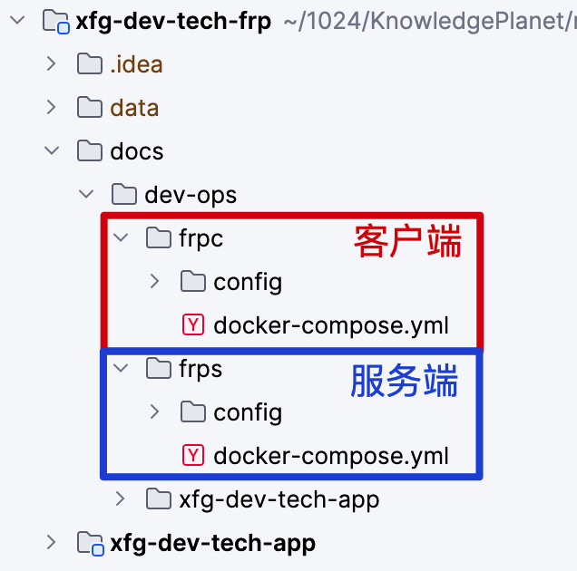
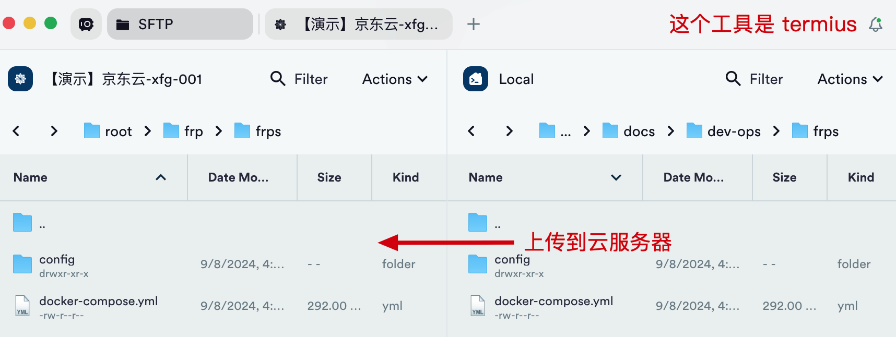
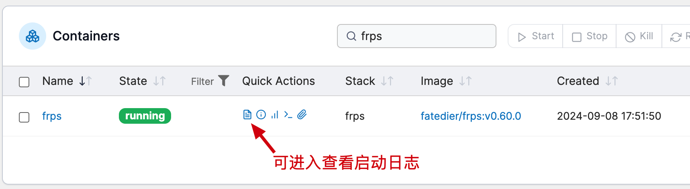
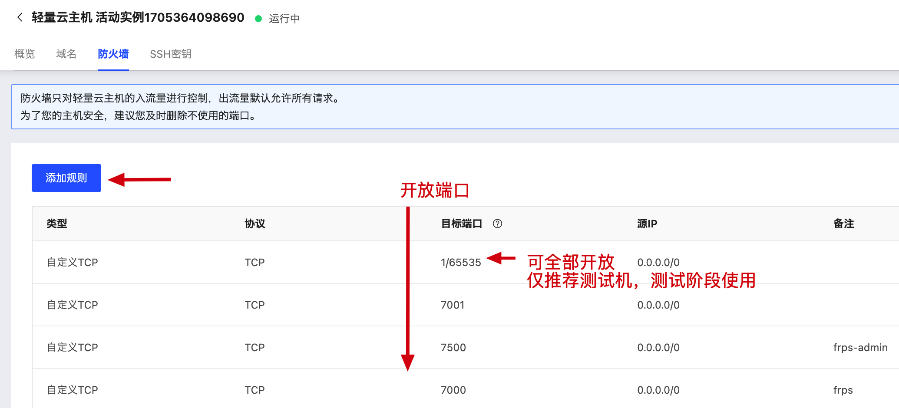
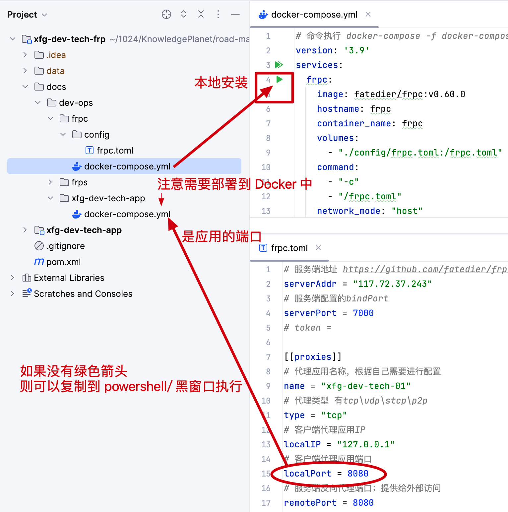
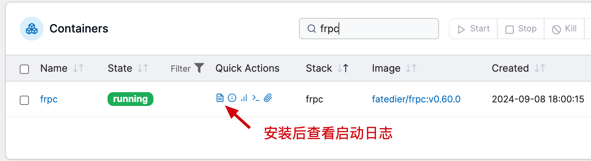
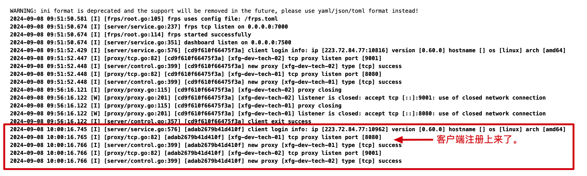
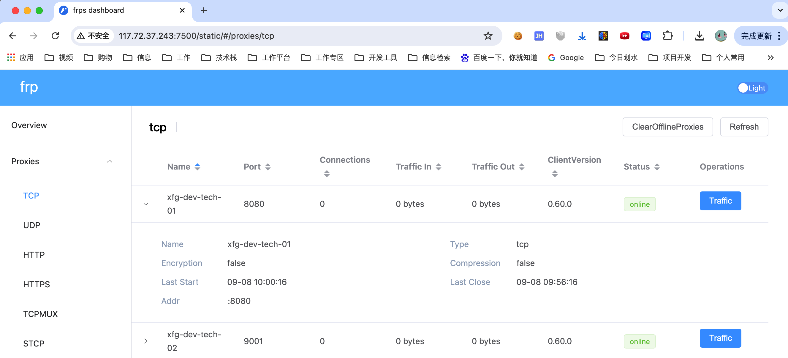
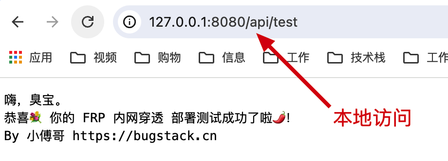
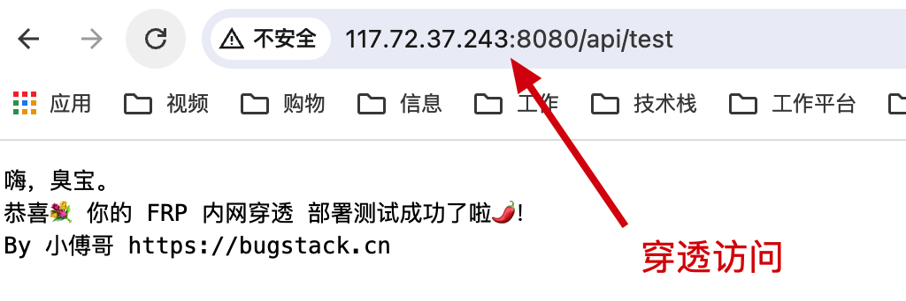

# Frp 内网穿透

需要把本地开发服务提供给外部测试时，可以在有公网地址的服务器运行 `frps`，在内网一侧运行 `frpc`。`frpc` 主动连接 `frps` 并注册代理。外部请求到达 `frps` 的业务端口后，经 `frpc` 转发到本地应用。例如访问 `公网服务器:8080`，最终由内网的 `127.0.0.1:8080` 处理。

## 一、服务端部署

本例两端使用 `v0.60.0`。准备一台可从公网访问的 Linux 服务器，安装 Docker Engine 和 Compose，并确认内网主机能连接服务器。下图的 `frps` 和 `frpc` 分别放置自己的 `docker-compose.yml` 和 `config` 目录，两端在各自的目录启动。 [Docker 使用指南](<Docker 使用指南.md>)



在 `frps/config/frps.toml` 写入下面的配置。`bindPort` 接收 `frpc` 连接，`webServer` 配置管理面板。启动前更换示例令牌和面板密码。 [v0.60.0 服务端配置示例](https://github.com/fatedier/frp/blob/v0.60.0/conf/frps_full_example.toml)

```toml
# https://github.com/fatedier/frp/blob/dev/conf/frps_full_example.toml
[common]
# 监听端口
bind_port = 7000
# 面板端口
dashboard_port = 7500
# 登录面板的账号密码（修改成自己的）
dashboard_user = admin
dashboard_pwd = 123456
token = zainxx
```

`frps/docker-compose.yml` 将上述文件挂载为容器内的 `/frps.toml`，并通过 `-c` 指定加载路径。Linux 的 `network_mode: "host"` 使服务直接监听宿主机端口，Compose 文件中可省略 `ports`。 [Docker host 网络](https://docs.docker.com/engine/network/drivers/host/)

```yaml
services:
  frps:
    image: fatedier/frps:v0.60.0
    hostname: frps
    container_name: frps
    volumes:
      - "./config/frps.toml:/frps.toml"
    command:
      - "-c"
      - "/frps.toml"
    network_mode: "host"
```

按下图所示，通过 SFTP 将 `config` 目录和 Compose 文件一起上传到服务器的同一目录，保留相对路径。



在服务器进入 `frps` 目录，先校验配置，再启动容器并查看日志。

```bash
docker compose run --rm --no-deps frps verify -c /frps.toml
docker compose up -d
docker compose logs --tail 30 frps
```

看到 `frps started successfully` 和 `7000` 端口监听记录后，可以继续连接客户端。若使用 Portainer，下图标出了容器日志入口。



在云防火墙或安全组与服务器系统防火墙中，按下表放行所需的公网端口和来源。下图标出了 **添加规则** 入口。图中 `1/65535` 表示全端口范围，本例按实际端口添加规则，`7500` 保持回环监听。

| TCP 端口 | 作用 | 访问范围 |
| --- | --- | --- |
| `7000` | `frpc` 登录并连接 `frps` | 内网主机的公网出口地址 |
| `8080`、`9001` | 对外提供的业务入口，对应 `remotePort` | 实际需要访问的用户来源 |
| `7500` | `frps` Dashboard | 服务器回环地址，通过 SSH 转发访问 |



## 二、客户端部署

把下面的配置放在内网主机的 `frpc/config/frpc.toml`。将 `203.0.113.10` 换成服务器公网 IP，`serverPort` 与 `bindPort` 一致，`auth.token` 使用服务端设定的同一令牌。令牌用于客户端登录，外部业务访问由入站规则和应用自身的认证控制。 [v0.60.0 客户端配置示例](https://github.com/fatedier/frp/blob/v0.60.0/conf/frpc_full_example.toml)

```toml
# 服务端地址 https://github.com/fatedier/frp/blob/dev/conf/frpc_full_example.toml
serverAddr = "8.137.197.131"
# 服务端配置的bindPort
serverPort = 7000
auth.method = "token"
auth.token = "zainxx"

[[proxies]]
# 代理应用名称，根据自己需要进行配置
name = "zain-dev-tech-01"
# 代理类型 有tcp\udp\stcp\p2p
type = "tcp"
# Windows Docker Desktop 宿主机地址（Java 服务运行在 Windows 上）
localIP = "host.docker.internal"
# 客户端代理应用端口
localPort = 8080
# 服务端反向代理端口；提供给外部访问
remotePort = 8080
```

每个 `[[proxies]]` 定义一条转发规则，名称需唯一。`localIP:localPort` 是 `frpc` 能够访问的应用地址，`remotePort` 是公网服务器上供外部访问的端口。两边端口可以不同。只转发 `8080` 时，保留第一条代理，并放行对应的公网业务端口。 [TCP 转发示例](https://gofrp.org/zh-cn/docs/examples/ssh/)

在 Linux 上按下面的 `frpc/docker-compose.yml` 部署。容器使用 host 网络，因此 `127.0.0.1` 指向本机，可以访问本机运行的应用或容器发布到宿主机的端口。

```yaml
services:
  frpc:
    image: fatedier/frpc:v0.60.0
    hostname: frpc
    container_name: frpc
    volumes:
      - "./config/frpc.toml:/frpc.toml"
    command:
      - "-c"
      - "/frpc.toml"
    network_mode: "host"
```

在 `frpc` 目录执行下列命令。IDEA 已连接本机 Docker 时，也可以使用图中的 Compose 运行入口。图中圈出的 `localPort` 应填应用实际监听或发布到宿主机的端口。

```bash
docker compose run --rm --no-deps frpc verify -c /frpc.toml
docker compose up -d
docker compose logs --tail 30 frpc
```



另一种方式：Windows 上可下载对应 CPU 架构的压缩包，将 `frpc.exe` 放入 `frpc` 目录，从 PowerShell 执行以下命令并保持进程运行。如果通过 Docker Desktop 的默认网络运行客户端，移除 `network_mode`，用 `host.docker.internal` 作为宿主机应用地址，并确认容器能访问该应用。 [v0.60.0 发行包](https://github.com/fatedier/frp/releases/tag/v0.60.0) · [Docker Desktop 网络](https://docs.docker.com/desktop/features/networking/networking-how-tos/#connect-a-container-to-a-service-on-the-host)

```powershell
.\frpc.exe verify -c .\config\frpc.toml
.\frpc.exe -c .\config\frpc.toml
```

客户端日志出现 `login to server success` 和 `start proxy success`，表示已登录并启动对应代理。通过 Portainer 查看时，日志入口如下图所示。



服务端日志可进一步确认客户端注册与 `8080`、`9001` 的监听记录。下图红框是注册结果。图中的 INI 弃用提示和 `0.0.0.0:7500` 对应旧部署，本例使用 TOML 并将面板绑定到回环地址。



在本机通过 SSH 转发面板端口。将 `user` 和示例 IP 换成自己的 SSH 用户名和服务器地址，保持 SSH 连接，再打开 `http://127.0.0.1:7500/`，使用 `webServer` 中的账号登录。下图展示 TCP 代理列表和 `online` 状态，访问地址使用此处的回环地址。 [frp 管理面板](https://gofrp.org/zh-cn/docs/features/common/ui/)

```bash
ssh -N -L 127.0.0.1:7500:127.0.0.1:7500 user@203.0.113.10
```



## 三、应用部署与访问验证

先在内网主机打开 `http://127.0.0.1:8080/api/test`，确认应用返回预期内容。下图是本地接口的响应。



再从外部网络访问 `http://公网IP:8080/api/test`。用实际公网 IP 和 `remotePort`，接口路径保持一致。如下图所示，公网入口返回同一应用的预期响应后，才完成这条转发链路的验证。



登录超时先看 `7000` 的连通性和服务端状态，认证失败则核对令牌。代理注册失败时，查看 `remotePort` 是否被占用、代理名是否重复。代理在线但接口不通时，检查公网业务端口的入站规则，以及 `frpc` 能否访问配置中的本地应用地址。

