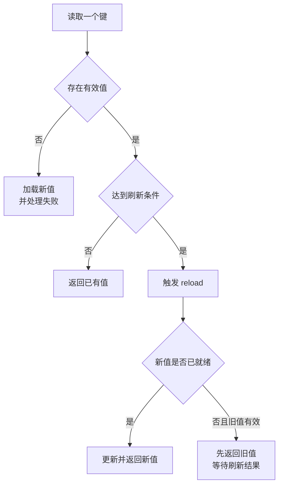

# Guava 常用工具与事件机制

Java 标准库提供了集合、线程池、字符串和并发工具，但实际开发仍会遇到重复的参数检查、集合整理、本地缓存和异步结果衔接。Guava 是 Google 维护的一组 Java 基础库，提供这些常见能力的补充实现，主要类位于 `com.google.common` 包。

学习 Guava 需要同时理解工具的便利性与边界：不可变集合限制的是集合结构，本地缓存只影响当前进程，异步回调需要执行线程，而事件总线不会自动提供消息持久化。**先弄清数据、线程和状态由谁拥有，再选择工具，比记住一串类名更有用。**

## 一、Guava 的定位、版本与依赖

### 1. 优先使用能够清楚表达意图的能力

Guava 很多功能诞生较早，随着 JDK 演进，一部分需求已经有标准实现。已有工程使用 Guava，不需要为了形式统一立即全部替换；新代码也没有必要只为创建一个 ArrayList 就引入整个库。

| 常见需求 | JDK 已有能力 | Guava 的相关能力与取舍 |
| --- | --- | --- |
| 检查引用非空 | `Objects.requireNonNull`，Java 7 起 | `Preconditions.checkNotNull` 可以与其他前置条件检查统一 |
| 字符串连接 | `String.join`、`StringJoiner`，Java 8 起 | `Joiner` 提供明确的 null 处理配置 |
| 创建少量只读集合 | `List.of`、`Set.of`、`Map.of`，Java 9 起 | Guava 不可变集合支持 builder，且常用于已有公共接口 |
| 判断空白字符串 | `String.isBlank`，Java 11 起 | `Strings.isNullOrEmpty` 只判断 null 或空串，含义不同 |
| 组织异步结果 | `CompletableFuture`，Java 8 起 | `ListenableFuture` 常见于使用 Guava 的库和已有异步接口 |
| 一对多、频次与双向映射 | 可以组合 JDK 集合自行维护 | `Multimap`、`Multiset`、`BiMap` 直接表达相应约束 |

表中的版本前提不能省略。例如，在 Java 8 工程里复制 `List.of(...)` 会遇到 API 不存在；反过来，在较新 JDK 中继续使用 Guava 也不一定错误，关键在于是否需要其语义、现有依赖和生态接口。

JDK 的只读集合也不意味着元素被深度冻结，`List.of` 与 Guava 的 ImmutableList 还需要分别核对具体契约。相关标准能力可对照 [JDK List API](https://docs.oracle.com/en/java/javase/21/docs/api/java.base/java/util/List.html)、[String API](https://docs.oracle.com/en/java/javase/21/docs/api/java.base/java/lang/String.html)和 [CompletableFuture API](https://docs.oracle.com/en/java/javase/21/docs/api/java.base/java/util/concurrent/CompletableFuture.html)。

### 2. Maven 依赖与示例前提

普通 Java 服务端通常使用 JRE flavor，Android 工程则应核对 Android flavor 与兼容要求。下面以已经发布、可以查到对应 Javadoc 的 `33.6.0-jre` 作为本文 API 参考版本：

```xml
<dependency>
    <groupId>com.google.guava</groupId>
    <artifactId>guava</artifactId>
    <version>33.6.0-jre</version>
</dependency>
```

这不是“最新版”声明，也不表示所有工程都应升级到这一版本。实际接入时应优先服从工程的依赖管理，核对 JDK、框架和调用方对 Guava 的版本约束，再选择受维护且兼容的版本。[Guava 官方仓库](https://github.com/google/guava)说明了 Maven 坐标、JRE 与 Android 两种 flavor；当前 JRE 系列面向 Java 8 及以上环境。

下面的示例使用 Java 8 可表达的常用写法；带 `Duration` 的缓存配置以本文参考版本为前提。少数工具存在 `@Beta` 标记，表示 API 兼容性承诺有所不同，升级时应额外核对。

## 二、参数检查与字符串工具

### 1. Preconditions 把调用约束写在入口

方法往往存在输入前提，例如数量必须大于零、标识不能为空、某个对象必须已经初始化。Preconditions 将这些条件以紧凑的代码表达出来，失败时抛出相应的非受检异常。

| 方法 | 检查对象 | 失败异常 |
| --- | --- | --- |
| `checkArgument(condition, message)` | 调用参数是否符合前提 | `IllegalArgumentException` |
| `checkState(condition, message)` | 当前对象或流程状态是否允许操作 | `IllegalStateException` |
| `checkNotNull(value, message)` | 引用是否非 null，并返回该引用 | `NullPointerException` |
| `checkElementIndex(index, size)` | 元素下标是否在 `[0, size)` | `IndexOutOfBoundsException` |

```java
import static com.google.common.base.Preconditions.*;

public final class BatchRequest {
    private final String taskId;
    private final int batchSize;

    public BatchRequest(String taskId, int batchSize) {
        this.taskId = checkNotNull(taskId, "taskId");
        checkArgument(!taskId.isEmpty(), "taskId must not be empty");
        checkArgument(batchSize > 0, "batchSize must be positive: %s", batchSize);
        this.batchSize = batchSize;
    }
}
```

这里先拒绝 null，再调用字符串方法，避免在真正的检查之前就发生空指针。参数错误表达“调用者传入了不允许的数据”；状态错误则表达“参数可能正常，但对象当前不能完成这项操作”，例如已经关闭的处理器不能继续提交任务。

错误消息中的常用替换符是 `%s`，不能把它当作完整的 `String.format` 格式语言。传入消息参数的 Java 表达式仍会先求值，因此把昂贵查询写进错误消息参数，即使检查成功也可能执行。这类情况可以使用普通 if/throw，使昂贵内容只在失败时计算。[Preconditions 官方 API](https://guava.dev/releases/33.6.0-jre/api/docs/com/google/common/base/Preconditions.html)解释了这些检查与求值成本。

前置条件检查也不能替代接口层的统一校验和错误映射。对用户输入的拒绝应转换为清楚的接口错误；不能因为抛出了 IllegalArgumentException，就让所有非法请求都变成无说明的 500。

### 2. Strings 与 MoreObjects

`Strings.isNullOrEmpty(value)` 对 null 和 `""` 返回 true，对 `"   "` 返回 false；它没有自动去掉空格，也没有判断“业务上是否有效”。`nullToEmpty` 将 null 统一成空串，`emptyToNull` 将空串统一成 null，二者都不自动 trim。

这种统一只适合 null 与空串在当前业务中确实等价的场合。例如，展示备注时可以把 null 转为空字符串；修改用户资料时，“未传字段”和“清空字段”可能含义不同，就不应在入口无条件合并。

`padStart`、`padEnd` 可以补齐最小长度，`repeat` 用于重复字符串。它们不会判断业务编码是否有效，例如把数字补成六位，并不会自动保证全局唯一。[Strings 官方 API](https://guava.dev/releases/33.6.0-jre/api/docs/com/google/common/base/Strings.html)可用于核对每个方法的 null 与空值规则。

`MoreObjects.firstNonNull(a, b)` 返回第一个非 null 参数；两者都是 null 时仍抛出 NullPointerException。它不是延迟计算：如果 `b` 写成一次方法调用，Java 会先计算该实参，即使 a 已经非空。

`MoreObjects.toStringHelper(this).add("taskId", taskId).add("size", size)` 用来构造便于阅读的对象说明，调用 `omitNullValues()` 可以省略 null 值字段。它适合调试文本，不是 JSON 序列化器，也不应无选择地打印令牌和敏感信息。[MoreObjects 官方 API](https://guava.dev/releases/33.6.0-jre/api/docs/com/google/common/base/MoreObjects.html)说明了非空回退和对象文本辅助功能。

### 3. Joiner 与 Splitter 的默认行为

Joiner 把多个值连接成字符串，Splitter 把一个字符串拆成多个部分。它们的价值在于把分隔符、空值和空白处理明确写出来，但默认规则需要先掌握：

| 情形 | 默认行为 | 显式调整方式 |
| --- | --- | --- |
| Joiner 遇到 null 元素 | 抛出 NullPointerException | `skipNulls()` 跳过，或 `useForNull("...")` 替换 |
| Joiner 遇到空串 | 保留该元素及相应分隔关系 | 需要时先按业务规则过滤 |
| Splitter 遇到连续分隔符或末尾分隔符 | 保留相应空串 | `omitEmptyStrings()` |
| Splitter 遇到片段两侧空白 | 默认保留 | `trimResults()` |
| Splitter 接收 null 输入 | 不作为空串处理，会失败 | 在调用前决定拒绝还是采用缺省值 |

```java
import com.google.common.base.Joiner;
import com.google.common.base.Splitter;
import java.util.List;

String text = Joiner.on(",").skipNulls().join("java", null, "redis");
// text 为 "java,redis"

List<String> tags = Splitter.on(',')
        .trimResults()
        .omitEmptyStrings()
        .splitToList(" java, ,redis,, ");
// tags 包含 "java" 和 "redis"
```

Splitter 配合 trim 与 omit 时，先对片段去除指定空白，再判断是否为空，与两个配置方法的书写先后无关。因此，中间只有空格的片段也会被移除。

Joiner 和 Splitter 的配置方法返回新的配置对象，不原地改变旧实例。例如，只执行 `joiner.skipNulls();` 却继续使用旧 joiner，并不会启用跳过 null。需要保存返回值或采用链式调用。[Joiner API](https://guava.dev/releases/33.6.0-jre/api/docs/com/google/common/base/Joiner.html)与 [Splitter API](https://guava.dev/releases/33.6.0-jre/api/docs/com/google/common/base/Splitter.html)列出了默认语义。

`Splitter.on(',')` 和 `Splitter.on(",")` 按字面分隔符处理，`onPattern(...)` 才按正则表达式处理。复杂 CSV 的引号、转义和嵌套字段应交给 CSV 解析器；拼接 URL query 或 SQL 也应使用对应的参数化工具，不能把普通 Joiner 当作编码与注入防护组件。

## 三、不可变集合与特殊集合模型

### 1. 不可变结构与可变元素

Guava 的 `ImmutableList`、`ImmutableSet`、`ImmutableMap` 等集合，在构造完成后不允许增删或替换集合中的条目。可以通过 `of`、`copyOf` 或 builder 创建。

```java
import com.google.common.collect.ImmutableList;
import java.util.ArrayList;
import java.util.List;

List<String> source = new ArrayList<>();
source.add("created");
source.add("confirmed");

ImmutableList<String> snapshot = ImmutableList.copyOf(source);
source.add("closed");

System.out.println(snapshot); // [created, confirmed]
// snapshot.add("closed") 会抛出 UnsupportedOperationException
```

`copyOf` 建立的集合结构不再跟随原可变集合变化，因此适合在边界处保存快照。内部可能对已经不可变的数据进行安全复用，不应依赖“每次调用都分配全新对象”这一假设。

`Collections.unmodifiableList(source)` 则通常是原列表的不可修改视图：不能通过该视图执行 add，但 source 被其他代码修改后，视图中的内容仍可能变化。选择包装视图还是独立快照，取决于是否希望观察后续变化。

**不可变集合不允许 null，但不会自动把元素本身变成不可变对象。** ImmutableList 中如果放入一个可修改的 User，调用 `user.setName(...)` 仍可能改变读者看到的姓名。不可变 Map 的 key、value 也需要遵守相应的 null 约束。

对于基于 hashCode 和 equals 判断成员关系的集合，元素或键的相关字段在加入后发生变化，还可能破坏查找逻辑。希望安全共享的对象，应尽量使用本身不可变的元素；集合结构不能替对象的线程安全作保证。[Guava 不可变集合 API](https://guava.dev/releases/33.6.0-jre/api/docs/com/google/common/collect/ImmutableCollection.html)说明了结构保证与可变元素限制。

### 2. Lists、Maps 与视图

`Lists.newArrayList(...)` 创建的是可变 ArrayList，并不因为来自 Guava 就自动不可变。较新 Java 代码中，普通集合初始化通常直接使用 JDK 即可；Lists 中更有辨识度的能力包括分批和视图操作。

例如，`Lists.partition(list, 100)` 把原列表按顺序划分为每批最多 100 个元素的子列表，便于批量提交。最后一批可以不足 100 个。它返回的外层列表不可直接修改，但内部批次是原列表的 subList 视图，原列表变化会影响结果。

因此，分批后如果要交给异步任务长期使用，可以按需要为每批建立快照；不能一边无约束地修改原列表，一边假定所有批次都已经固定。`Lists.reverse` 同样是反向视图，不是自动复制出一份互不影响的数据。[Lists 官方 API](https://guava.dev/releases/33.6.0-jre/api/docs/com/google/common/collect/Lists.html)说明了这些视图关系。

`Maps.uniqueIndex(values, keyFunction)` 可以按每个值计算出的键建立索引。它要求结果中的键唯一，出现重复键时会失败，不会自动保留第一项或最后一项。如果多个对象本来就应该属于同一个键，应选择分组模型，而不是使用唯一索引。

`Maps.difference(left, right)` 可以比较两个 Map 中只在一边存在、两边相同或值不同的条目，适合分析配置差异。比较结果能说明数据差异，但怎样合并冲突仍由业务决定；它不会替调用方更新数据库。[Maps 官方 API](https://guava.dev/releases/33.6.0-jre/api/docs/com/google/common/collect/Maps.html)可用于核对索引与差异比较规则。

### 3. Multimap、Multiset 与 BiMap

特殊集合首先表达一种数据关系，再提供维护这种关系的操作：

| 类型 | 关系模型 | 典型用途 | 需要留意的约束 |
| --- | --- | --- | --- |
| Multimap | 一个键关联多个值 | 分类到商品、用户到角色 | 是否保留重复值由具体实现决定 |
| Multiset | 元素与出现次数 | 词频、状态计数 | size 统计总次数，elementSet 只包含不同元素 |
| BiMap | 键和值都唯一的双向映射 | 唯一代码与唯一名称互查 | 不同键不能占用同一个值 |

```java
import com.google.common.collect.*;

ListMultimap<String, String> roles = ArrayListMultimap.create();
roles.put("u1", "reader");
roles.put("u1", "editor");
roles.put("u1", "reader");
// roles.get("u1") 为 [reader, editor, reader]

Multiset<String> words = HashMultiset.create();
words.add("java", 3);
words.add("redis");
// words.count("java") 为 3；words.size() 为 4

BiMap<String, String> codes = HashBiMap.create();
codes.put("CREATED", "待确认");
codes.put("CONFIRMED", "已确认");
String code = codes.inverse().get("已确认"); // CONFIRMED
```

ArrayListMultimap 保留同一键下的重复值和插入顺序；HashMultimap 采用集合语义，不保留重复的键值对。Multimap 的 `size()` 统计键值对数量，不是不同键的数量。`get(key)` 通常返回与原集合关联的视图，缺少键时得到空集合，而不是普通 Map 常见的 null；向可修改视图加入元素也会更新 Multimap。

Multiset 的 `remove(element)` 移除一次出现，`remove(element, count)` 可以移除指定次数，`elementSet()` 则用于遍历不同元素。若多个线程共同计数，应选择合适的并发实现或同步方式，普通 HashMultiset 不会自动变成并发计数器。[Multimap API](https://guava.dev/releases/33.6.0-jre/api/docs/com/google/common/collect/Multimap.html)和 [Multiset API](https://guava.dev/releases/33.6.0-jre/api/docs/com/google/common/collect/Multiset.html)详细说明了集合视图和计数。

BiMap 的 `inverse()` 返回反向视图，正反两侧修改会相互反映。如果给另一键 put 已被占用的值，普通 put 会抛出 IllegalArgumentException；`forcePut` 会先移除占用该值的原映射，因此可能让原来的另一键消失，使用时要接受这一后果。

同一键正常替换为一个未被占用的新值则属于更新，不等于所有重复 put 都失败。只有业务中的键和值确实都唯一，双向映射才合适；多个代码都叫“成功”时，就不满足 BiMap 的一对一前提。[BiMap 官方 API](https://guava.dev/releases/33.6.0-jre/api/docs/com/google/common/collect/BiMap.html)说明了唯一约束、inverse 和 forcePut 的关系。

## 四、进程内缓存与数据新鲜度

### 1. CacheBuilder 与 LoadingCache

Guava Cache 在当前 JVM 的内存中保存数据，适合缓存计算较贵、重复访问较多且允许短期陈旧的结果。它与 ConcurrentHashMap 的重要区别是支持容量、过期和加载等缓存语义。

Cache 是基本缓存接口；LoadingCache 关联了 CacheLoader，缺少键时可以通过统一的加载函数取回结果。下面用可重复计算的标签值说明生命周期，不依赖数据库或课程工程：

```java
import com.google.common.cache.*;
import java.time.Duration;
import java.util.concurrent.ExecutionException;

public final class LabelCache {
    private final LoadingCache<String, String> labels =
            CacheBuilder.newBuilder()
                    .maximumSize(1000)
                    .expireAfterWrite(Duration.ofMinutes(5))
                    .recordStats()
                    .build(new CacheLoader<String, String>() {
                        @Override
                        public String load(String key) {
                            return "label-" + key;
                        }
                    });

    public String find(String key) throws ExecutionException {
        return labels.get(key);
    }

    public void invalidate(String key) {
        labels.invalidate(key);
    }
}
```

第一次读取某个 key 时，缓存执行 load；加载成功后存入结果，随后命中时复用。多个线程同时请求同一缺失键时，LoadingCache 可以协调同一键的加载，但不同键仍可能并发访问数据源，不能据此认为数据库已经得到完整的流量保护。

key 和 value 都不允许为 null，加载函数不能用 null 表示“没有找到”。确有负缓存需求时，可以缓存一个含义清楚的结果类型或 Optional，并为“不存在”选择合适的短期策略。

`get` 的加载异常需要按契约处理；受检异常通常封装在 ExecutionException 中，非受检异常与 Error 还可能有其他包装。不能为了少写 catch 就随意改成 `getUnchecked`，后者适用于加载器只抛非受检异常的约定。[LoadingCache API](https://guava.dev/releases/33.6.0-jre/api/docs/com/google/common/cache/LoadingCache.html)说明了加载与异常行为。

当前 Guava 的 CacheBuilder 官方文档明确推荐优先考虑 Caffeine 作为后续缓存实现。因此，本章主要用于理解已有 Guava 缓存代码及其通用原理；新工程应把 JDK、异步能力、维护状态和实际缓存需求一起纳入选型，而不是机械复用旧方案。[CacheBuilder 官方说明](https://guava.dev/releases/33.6.0-jre/api/docs/com/google/common/cache/CacheBuilder.html)提供了这一选型背景。

### 2. 容量驱逐、过期与清理

缓存必须限制内存占用。maximumSize 按条目数控制规模；如果对象大小差别较大，可以研究 maximumWeight 与 weigher。条目数并不等于真实字节数，1000 个很大的对象仍可能占用大量堆内存。

| 配置或操作 | 主要含义 | 不应推断出的保证 |
| --- | --- | --- |
| `maximumSize` | 限制缓存条目规模并按策略驱逐 | 严格的、可供业务依赖的完整 LRU 顺序 |
| `expireAfterWrite` | 自写入或最近替换起，超过期限即过期 | 到点触发精确业务动作 |
| `expireAfterAccess` | 自最近相关访问起，超过期限即过期 | 被频繁访问的数据一定足够新 |
| `invalidate` | 主动使指定键失效 | 自动同步所有服务实例 |
| `cleanUp` | 执行待做的缓存维护 | 承担可靠定时任务与业务补偿 |

expireAfterAccess 会让持续被读取的旧值继续留存，因此更接近“闲置一段时间后不再保留”；如果数据写入后最多允许陈旧五分钟，通常更应关注 expireAfterWrite 或明确的数据变更通知。

**过期判定与物理清除不是同一时刻。** 已过期条目不会再作为有效缓存值返回，但底层条目清除和移除通知常随读写维护或显式 cleanUp 执行，不保证在截止时刻由专门定时线程精确删除。size 的观察值也可能包含尚待清理的条目。

因此，不能用缓存到期回调作为“必须在这一秒关闭订单、释放库存”的唯一机制。业务期限要保存在可信状态中，由可恢复的任务按条件推进。Guava 的[缓存使用指南](https://github.com/google/guava/wiki/CachesExplained)解释了维护与清理发生的时机。

移除监听器可以记录条目离开的原因，但默认同步执行，过重逻辑可能拖慢触发维护的线程；它也不提供数据库事务、重试和可靠投递。需要异步通知时仍要安排线程与失败处理，不能只把逻辑移到回调中就视为可靠。

### 3. refresh 与过期的区别

刷新尝试为已经存在的键重新加载值，过期则表示旧值已经不应再作为有效命中使用。使用 `refreshAfterWrite(Duration.ofMinutes(1))`，表示写入一定时间后具备刷新条件，并不表示每分钟自动扫描并刷新全部键。

通常是在具备刷新条件后，后续读取触发刷新。若新值尚未就绪且旧值仍然有效，可以继续返回旧值；刷新失败时通常保留原值并记录异常。与之相比，已经过期而又缺少可用结果时，读取需要按加载规则取得新的值。

还要区分“刷新接口返回 Future”与“加载一定在后台执行”。CacheLoader 默认 reload 同步调用 load，触发刷新的读取仍可能等待这段加载工作。需要后台刷新时，可以实现异步 reload，或使用 `CacheLoader.asyncReloading(loader, executor)`，并由应用管理该 executor 的资源。



图中的“尚未就绪”需要真实的异步 reload 支持，默认同步实现不会因为配置了 refreshAfterWrite 就自动拥有独立后台线程。[CacheLoader API](https://guava.dev/releases/33.6.0-jre/api/docs/com/google/common/cache/CacheLoader.html)说明了默认 reload 与异步包装，[CacheBuilder 刷新配置](https://guava.dev/releases/33.6.0-jre/api/docs/com/google/common/cache/CacheBuilder.html#refreshAfterWrite(java.time.Duration))说明了读取触发条件。

### 4. 单进程边界与权威数据

每个 JVM 都有自己的缓存副本。一个实例执行 invalidate，不会自动清除其他实例的条目；应用重启后，进程内缓存通常重新开始。缓存对象若本身可变，多线程共享读取还会受到对象内部并发安全的影响。

适合缓存的数据包括稳定字典、展示标签或可接受短期延迟的查询结果。对于登录撤销、账户冻结、权限变更、库存和支付结果，必须先确定允许的陈旧程度与权威来源。不能因为本地缓存“还没过期”，就无条件允许一项已经被服务端撤销的资格。

Redis 可以提供独立于单个 JVM 的共享数据服务，但共享存储也不会自动完成业务权限、原子性和故障恢复设计。分布式缓存与 Redisson 的相关能力可继续阅读[《Redis 与 Redisson 开发实践》](Redis%20与%20Redisson%20开发实践.md)。

## 五、ListenableFuture 与异步任务衔接

### 1. 从等待结果到注册后续操作

JDK Future 表示异步计算的结果。调用 get 可以等待结果，但如果调用线程马上阻塞等待，便没有充分利用“完成后再继续”的组织方式。

ListenableFuture 在 Future 基础上增加完成监听。任务完成时，监听动作交给指定 Executor 执行；如果注册时任务已经完成，监听动作也会立即进入相应的执行安排。这不等于必然在另一个线程运行，因为 executor 可以采用当前线程执行策略。

ListeningExecutorService 是返回 ListenableFuture 的 ExecutorService。可以用 `MoreExecutors.listeningDecorator(existingExecutor)` 包装已有线程池，保留线程池的执行机制，同时改变 submit 返回的结果类型。[ListenableFuture API](https://guava.dev/releases/33.6.0-jre/api/docs/com/google/common/util/concurrent/ListenableFuture.html)与 [ListeningExecutorService API](https://guava.dev/releases/33.6.0-jre/api/docs/com/google/common/util/concurrent/ListeningExecutorService.html)说明了两者的关系。

### 2. 明确指定回调执行器

`Futures.addCallback(future, callback, executor)` 将成功结果和失败原因分别交给 FutureCallback。下面是一个可以独立观察执行过程的简化示例：

```java
import com.google.common.util.concurrent.*;
import java.util.concurrent.*;

public final class FutureDemo {
    public static void main(String[] args) throws InterruptedException {
        ListeningExecutorService workers = MoreExecutors.listeningDecorator(
                Executors.newFixedThreadPool(2));
        ExecutorService callbacks = Executors.newSingleThreadExecutor();
        CountDownLatch callbackDone = new CountDownLatch(1);

        try {
            ListenableFuture<Integer> result =
                    workers.submit(() -> 40 + 2);

            Futures.addCallback(result, new FutureCallback<Integer>() {
                @Override
                public void onSuccess(Integer value) {
                    try {
                        System.out.println("result = " + value);
                    } finally {
                        callbackDone.countDown();
                    }
                }

                @Override
                public void onFailure(Throwable error) {
                    try {
                        System.err.println(error.getMessage());
                    } finally {
                        callbackDone.countDown();
                    }
                }
            }, callbacks);

            callbackDone.await();
        } finally {
            MoreExecutors.shutdownAndAwaitTermination(
                    workers, 5, TimeUnit.SECONDS);
            MoreExecutors.shutdownAndAwaitTermination(
                    callbacks, 5, TimeUnit.SECONDS);
        }
    }
}
```

工作线程负责计算，回调线程负责处理结果，主线程通过计数器等待演示结束。这里使用的是一项很小且不会阻塞的演示计算；长期运行的服务应复用受管理线程池，根据负载配置队列、拒绝策略、超时与监控，不能为每次请求创建一组线程池。

明确指定 executor，有助于避免耗时回调意外阻塞关键工作线程。`MoreExecutors.directExecutor()` 在调用 execute 的线程直接运行任务，适合短小、可控的动作；它不是“自动创建一个更快的后台线程”。回调阻塞、递归衔接或持锁情况下采用 directExecutor，都需要格外谨慎。[Futures API](https://guava.dev/releases/33.6.0-jre/api/docs/com/google/common/util/concurrent/Futures.html)说明了回调注册，[MoreExecutors API](https://guava.dev/releases/33.6.0-jre/api/docs/com/google/common/util/concurrent/MoreExecutors.html)说明了直接执行和线程池关闭辅助方法。

### 3. 结果组合与失败传播

多个异步步骤存在依赖时，可以使用 transform 将一个结果转换为另一个结果；如果下一步本身返回 ListenableFuture，通常用 transformAsync 表达异步衔接，避免得到 Future 中再套 Future 的结果。

多个任务都完成后才继续时，`Futures.allAsList(...)` 可以组合结果；它要求所有输入都成功，任一失败会影响组合结果。若业务允许部分成功，应明确记录每一项的成功、失败和取消，而不是把失败项默默替换为空对象后继续当作完整数据。

回调的 onFailure 表示计算结果失败，可能包含业务异常、执行异常或取消等情况，应按具体类型决定后续动作。回调方法自己又抛出异常，也不会把已经完成的原 Future 重新改为失败状态；需要对回调自身负责的业务动作安排错误处理。

使用 Guava 异步类型的库，可以沿用 ListenableFuture 组织结果；新工程如果没有这种接口约束，也可以评估 JDK CompletableFuture。两种类型没有因为都叫 Future 就自动互换，取消传播、默认线程和组合行为需要分别确认。[Guava 的异步结果指南](https://github.com/google/guava/wiki/ListenableFutureExplained)介绍了常见衔接方式。

### 4. 取消、中断与线程资源

`future.cancel(true)` 是请求取消，允许实现尝试中断正在执行的任务，不是强制终止任何 Java 代码。任务是否结束，取决于实现是否响应中断、是否处在支持中断的等待中，以及底层 I/O 的取消能力。

同样，`future.get(timeout, unit)` 超时只表示当前调用者停止等待，并不自动取消底层任务。需要取消时应显式执行相应策略，还要处理任务已经产生的外部副作用。

中断也不等于回滚：一个任务可能已经调用外部服务成功，随后才因中断结束本地等待。线程池 shutdown 停止接收新任务并安排已有任务结束，shutdownNow 也主要是尝试中断，不能保证所有任务立刻消失。[JDK Future 契约](https://docs.oracle.com/en/java/javase/21/docs/api/java.base/java/util/concurrent/Future.html)说明了等待和取消的边界。

线程池应有清楚的所有者：谁创建，谁负责在应用退出或组件销毁时关闭。多个组件共享的池不能被某一个普通请求随意关闭；异步工作退出前还要考虑尚未执行的回调和待处理结果。

## 六、RateLimiter 与请求速率控制

### 1. 许可按秒生成，操作如何计费由应用决定

RateLimiter 按设定速率分配许可。`RateLimiter.create(5.0)` 表示稳定速率为每秒 5 个许可。若一次调用消耗一个许可，才可以近似理解为该 limiter 控制每秒 5 次调用。

一次操作也可以消耗多个许可，例如按处理记录数或发送字节量计费。此时许可单位应与业务资源一致，不能只看 create 的数字就直接称为 QPS。

```java
import com.google.common.util.concurrent.RateLimiter;

RateLimiter limiter = RateLimiter.create(5.0); // 在组件内长期复用

if (limiter.tryAcquire()) {
    System.out.println("Allowed to start the operation");
} else {
    System.out.println("Rejected because no permit is available now");
}
```

`acquire()` 可以阻塞等待许可，并返回等待耗时；`tryAcquire()` 用于无法立刻取得许可时直接失败；带等待上限的 tryAcquire 则可以在预算内等待。调用方再决定拒绝、降级还是延后处理，而不是自动把所有流量无限排队。

许可获得后不需要 release，RateLimiter 控制的是时间中的发放速率。Semaphore 则更常用于限制同时进行的操作数，使用后需要归还许可。一个外部服务可能既需要限制每秒请求量，也需要限制并发连接数，这两项限制可以共同存在。

### 2. 平滑速率与突发

稳定速率不等于“任意一秒窗口内严格最多 5 次”。默认实现能够在闲置后允许一定突发，持续请求时再按稳定速率平滑安排；带 warmup 的配置还可以逐渐爬升到设定吞吐。

它也不保证先到的线程一定先拿到许可。对于严格计费窗口、用户公平性、每租户配额等需求，需要按业务选择更合适的算法与数据模型。[RateLimiter 官方 API](https://guava.dev/releases/33.6.0-jre/api/docs/com/google/common/util/concurrent/RateLimiter.html)说明了许可单位、突发、等待与公平性边界。

### 3. 单实例与分布式限流

线程安全意味着多个线程可以安全地共享同一个 RateLimiter，并受到这一对象的共同限制。它不意味着多个 JVM 自动共享同一个限流状态。

如果三个服务实例各创建一个每秒 5 许可的对象，系统整体可能达到每秒约 15 许可的稳定速率；如果每次请求都重新创建 limiter，更无法形成持续限制。

需要限制整个集群、同一用户或同一外部账号时，可以在网关或共享服务中维护限流状态，或使用经过验证的分布式限流方案。分布式限流还要明确计费键、原子操作、时间与存储故障时的处理。Guava RateLimiter 适合进程内整形与保护，不能凭一个注解或本地对象完成全局配额。

## 七、EventBus、异步事件与常见注解

### 1. 先明确官方当前定位

EventBus 通过发布与订阅连接同一进程中的组件，发布方不必直接调用每一个订阅对象。它仍可用于理解已有代码中的事件分发，但 **Guava 官方明确不推荐在新设计中继续采用 EventBus**，并指出其调用关系追踪、异常传播、线程控制和背压等方面的限制。

因此，本章重点是读懂已有使用方式和边界。新系统可以根据具体需要选择显式监听器、依赖注入组织的监听者集合或适合的响应式能力；不应为了发送两条通知就机械增加一种复杂框架。[EventBus 官方 Javadoc](https://guava.dev/releases/33.6.0-jre/api/docs/com/google/common/eventbus/EventBus.html)中的 Avoid EventBus 给出了当前建议。

### 2. 注册、类型匹配与发布

使用 EventBus 时，需要先定义事件数据，准备带订阅方法的对象，再把该对象注册到同一个总线实例中。仅在类上写一个注解，不会自动把实例加入任意 EventBus。

```java
import com.google.common.eventbus.EventBus;
import com.google.common.eventbus.Subscribe;

public final class EventBusDemo {
    public static final class DocumentSaved {
        public final String documentId;

        public DocumentSaved(String documentId) {
            this.documentId = documentId;
        }
    }

    public static final class AuditListener {
        @Subscribe
        public void onSaved(DocumentSaved event) {
            System.out.println("Saved: " + event.documentId);
        }
    }

    public static void main(String[] args) {
        EventBus bus = new EventBus();
        AuditListener listener = new AuditListener();
        bus.register(listener);
        bus.post(new DocumentSaved("D100"));
        bus.unregister(listener);
    }
}
```

订阅方法使用 `com.google.common.eventbus.Subscribe`，通常声明为 public，并且只能接收一个非基本类型参数。参数类型就是事件匹配依据：DocumentSaved 事件会发给接收 DocumentSaved 的订阅者，也可能匹配接收其父类或接口类型的订阅者；方法名叫 onSaved 不是路由依据。

因此，把参数声明为 Object 会收到非常宽泛的事件类型。EventBus 也不能根据 `List<String>` 与 `List<Integer>` 这种泛型实参完成可靠区分，设计事件时应使用明确的事件类，而不是依赖泛型参数充当主题。

register 与 post 必须针对同一个总线对象。每次发布时临时 new 一个总线，或者在总线 A 注册、在总线 B 发布，都不能得到预期订阅效果。组件结束生命周期时需要适当 unregister，以免仍被总线引用。

没有匹配的订阅者时，EventBus 会尝试包装为 DeadEvent 再发布；如果也没有观察 DeadEvent 的订阅者，就不会形成持久待办。晚注册的订阅者不会自动重放历史事件。[Subscribe API](https://guava.dev/releases/33.6.0-jre/api/docs/com/google/common/eventbus/Subscribe.html)说明了方法要求，EventBus 本身也不承担跨进程传输。

### 3. 同步、异步与并发控制

普通 EventBus 默认在发布线程上分发，慢订阅处理可能拖慢当前调用。它没有因为叫“事件”就自动切换到后台，也没有自动脱离当前调用的资源约束。

AsyncEventBus 使用调用方提供的 Executor 执行分发：

```java
ExecutorService eventWorkers = Executors.newFixedThreadPool(2);
AsyncEventBus bus = new AsyncEventBus(eventWorkers);
bus.register(listener);
bus.post(event);
// 组件退出时，由线程池所有者安排停止接收、等待与关闭。
```

这段代码沿用已经定义的 listener 与 event，需要导入 `java.util.concurrent` 和 `com.google.common.eventbus.AsyncEventBus`。post 返回通常只表示分发任务已经被安排，不代表订阅业务已经全部成功。executor 若采用直接执行策略，也不会凭空产生后台线程；异步程度由执行器决定。

默认情况下，同一总线中的同一个订阅对象、同一个订阅方法不会被并发调用，但不同方法、不同对象仍可能并行。不能据此认为整个 listener 对象中的所有共享状态都受同一把锁保护。

`@AllowConcurrentEvents` 与 `@Subscribe` 配合，表示开发者允许该订阅方法被多个线程同时调用。它取消相应串行保护，不会自动让代码变得线程安全，也不会自动新建线程。只有订阅处理自身满足并发安全条件时，才应使用。[AsyncEventBus API](https://guava.dev/releases/33.6.0-jre/api/docs/com/google/common/eventbus/AsyncEventBus.html)与 [AllowConcurrentEvents API](https://guava.dev/releases/33.6.0-jre/api/docs/com/google/common/eventbus/AllowConcurrentEvents.html)分别说明了执行器和并发许可。

订阅者之间不应依赖未明确保证的执行顺序。使用多个工作线程时，事件处理完成顺序尤其可能与 post 顺序不同；如果下一步必须依赖前一步成功，应采用明确的结果衔接或业务流程，而不是假定总线按方法声明顺序执行。

### 4. 异常、事务与可靠性

订阅方法抛出的普通异常，会被 EventBus 交给 SubscriberExceptionHandler 处理，默认处理通常记录日志。发布方不能只在 post 外面加一个 try/catch，就期待捕获每一个订阅业务失败。

可以构造带自定义异常处理器的总线，记录事件类型、订阅方法和关联标识，再按需要告警；这仍不等于总线已经提供可靠重试。严重 Error 等情况也不能简单归入“所有异常都会被吞掉”的笼统表述。[SubscriberExceptionHandler API](https://guava.dev/releases/33.6.0-jre/api/docs/com/google/common/eventbus/SubscriberExceptionHandler.html)与 [Subscriber 官方源码](https://github.com/google/guava/blob/v33.6.0/guava/src/com/google/common/eventbus/Subscriber.java)可以核对异常转交边界。

普通 EventBus 在发布线程执行，不自动承诺订阅方法的异常会使外层事务回滚。AsyncEventBus 则使用其他线程，Spring 的线程绑定事务上下文也不会仅因传递一个事件对象而自动延伸过去。事务是否已经提交、订阅方读取到什么状态，都要单独设计。

进程在 post 后退出，内存中的待执行事件可能丢失；发布成功不说明外部邮件、账务或履约已经成功。只有具备相应持久化、恢复和幂等机制，才能把关键业务事件作为可靠处理链的一部分。

| 能力 | EventBus / AsyncEventBus | RabbitMQ 等消息中间件 |
| --- | --- | --- |
| 通信范围 | 当前应用进程内 | 可以跨进程和机器 |
| 数据载体 | 内存中的 Java 对象 | 按契约编码的消息 |
| 持久化与重启恢复 | 不自动提供 | 可配置，但需要正确的队列、消息和确认策略 |
| 失败重试与死信 | 需要应用另行实现 | 可结合确认、重投、死信和业务策略设计 |
| 业务处理保证 | post 返回不能代表所有业务成功 | Broker 确认也不能代替消费者业务完成 |

消息中间件仍需处理重复消费、事务边界和失败补偿，不能把“换成 MQ”理解为自动获得所有可靠性。相关过程可继续阅读[《RabbitMQ 消息通信与可靠性》](RabbitMQ%20消息通信与可靠性.md)。

### 5. 注解的归属与实际作用

Guava 中常见的几个注解属于不同包，其作用不能根据名字自行推断：

| 注解 | 所属包 | 实际含义与运行影响 |
| --- | --- | --- |
| `@Subscribe` | `com.google.common.eventbus` | 运行时可读取，由 EventBus 识别订阅方法；需要注册对象 |
| `@AllowConcurrentEvents` | `com.google.common.eventbus` | 运行时可读取，允许总线并发调用该订阅方法；本身不是订阅声明 |
| `@VisibleForTesting` | `com.google.common.annotations` | 表达成员为测试而存在或放宽可见性的意图，不改变 Java 访问权限 |
| `@Beta` | `com.google.common.annotations` | 表示 API 可能发生不兼容变化，不承诺完全冻结 |
| `@GwtCompatible` | `com.google.common.annotations` | 表示类型可用于 GWT/J2CL，具体方法仍可能有限制 |

例如，一个 private 方法加上 VisibleForTesting 后，仍然是 private。若测试代码需要访问，访问级别必须由源代码、设计和工具规则明确决定；这个注解也不会阻止其他生产代码调用已经公开的方法。官方源码还提醒，不要用它为破坏封装的 public/protected 声明提供借口。[VisibleForTesting 官方定义](https://github.com/google/guava/blob/v33.6.0/guava/src/com/google/common/annotations/VisibleForTesting.java)说明了它表达的是代码意图。

**Beta 不是性能开关，也不表示实现一定低质量。** 它说明的是 API 兼容性范围，不能通过添加或删除该注解使方法切换为“高速模式”。[Beta API](https://guava.dev/releases/33.6.0-jre/api/docs/com/google/common/annotations/Beta.html)明确区分了兼容性与质量、性能。

GwtCompatible 也不会在普通 Java 服务端运行时自动执行一次“转换成 JavaScript”。它是面向相关编译与移植生态的兼容性信息；某个兼容类型仍可能包含 GwtIncompatible 方法。[GwtCompatible API](https://guava.dev/releases/33.6.0-jre/api/docs/com/google/common/annotations/GwtCompatible.html)说明了这层范围。

上述两种事件注解采用 RUNTIME 保留策略，供运行时分发机制读取；Beta、GwtCompatible 采用 CLASS，VisibleForTesting 在本文参考版本未显式声明 Retention，按 Java 规则默认为 CLASS。它们不是同一类运行时拦截器，JVM 不会只因为遇到一个注解就自动改变业务行为。[Java Retention 契约](https://docs.oracle.com/en/java/javase/21/docs/api/java.base/java/lang/annotation/Retention.html)规定了这一默认策略。
