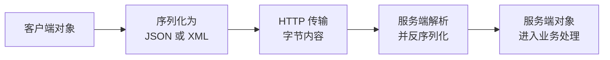
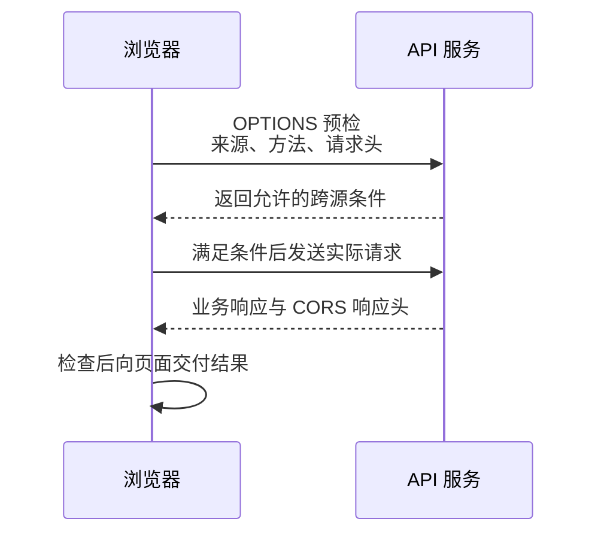

# HTTP 接口与服务调用

浏览器查询商品、Java 服务访问支付平台、移动端提交订单，都可以通过 HTTP 交换数据。请求从哪里发出、数据放在哪里、谁把 Java 对象转换为网络内容，以及一次调用失败后业务是否已经完成，是理解接口开发的几个核心问题。

**HTTP 规定消息怎样交换，接口契约规定消息表达什么业务含义，客户端和服务端框架负责把代码与消息连接起来。** 把这三层分清，就能解释为什么两个方法都叫 `queryProduct`，一个只是本地计算，另一个却会等待网络；也能理解为什么页面能跳转，并不代表接口调用已经成功。

## 一、HTTP 请求、响应与接口契约

### 1. URL、路径与查询参数

URL 用来定位资源。以下地址中的各部分承担不同职责：

```text
https://api.example.com:8443/v1/products/P100?region=cn&includeStock=true
└协议┘ └────主机─────┘ 端口 └──────路径──────┘ └────查询参数──────┘
```

协议为 `https`，主机为 `api.example.com`，端口为 `8443`，路径为 `/v1/products/P100`，问号后为查询字符串（query）。路径常用于表达资源及其层级，查询参数常用于筛选、分页和控制返回内容。它们的具体含义由接口契约决定，不是所有系统都必须采用相同的命名。

例如，`/products/P100` 可以表示编号为 P100 的商品；`/products?category=book&page=2` 可以表示图书分类的第二页商品。两种表达都需要服务端有相应处理逻辑，URL 自身不会查询数据库。

查询参数需要按 URL 规则编码。关键字中存在空格、中文、`&` 等字符时，优先使用客户端提供的参数构建功能，避免字符串拼接把数据误当作分隔符。URL 中的 `#section` 属于片段标识，一般由浏览器在本地处理，不作为普通 HTTP 请求目标发送给服务端。[MDN 的 URL 组成说明](https://developer.mozilla.org/en-US/docs/Learn_web_development/Howto/Web_mechanics/What_is_a_URL)可以进一步对照这些部分。

### 2. 一条请求中不同位置的数据

以提交报价请求为例，下面使用 HTTP/1.1 的文本形式帮助观察消息结构，省略了实际传输时可能存在的其他字段：

```http
POST /v1/quotes?channel=web HTTP/1.1
Host: api.example.com
Content-Type: application/json
Accept: application/json
Authorization: Bearer <access-token>

{"skuId":"P100","quantity":2}
```

请求方法为 `POST`，请求路径为 `/v1/quotes`，查询参数是 `channel=web`。请求头（headers）表达内容格式、认证等附加信息；空行后的请求体（body）携带本次提交的数据。

| 消息部分 | 示例 | 应当怎样理解 |
| --- | --- | --- |
| method | `GET`、`POST`、`PUT`、`DELETE` | 表达请求语义，与路径共同参与接口匹配 |
| path | `/v1/quotes` | 表达所访问的资源或业务入口 |
| query | `channel=web` | URL 中的参数，POST 同样可以带 query |
| headers | `Content-Type`、`Authorization` | 描述消息内容、身份凭据或协议控制信息 |
| body | JSON、XML、表单或文件 | 可选的数据内容，格式由双方约定 |

`Content-Type` 说明当前消息体的媒体类型；`Accept` 表达客户端希望接收的响应媒体类型。请求发送 JSON，不代表响应一定是 JSON；服务端也可能返回没有响应体的成功状态或 HTML 错误页面。

**请求体不自动等于 JSON。** 它也可以是 `application/xml`、`application/x-www-form-urlencoded`、`multipart/form-data`、普通文本或二进制内容。接口没有 JSON 请求体时，仍可以通过路径、query 或请求头接收数据；采用表单提交时，字段位于表单格式的请求体中。

GET 通常通过路径和 query 查询资源，不设计依赖 GET 请求体的通用接口，因为不同客户端、代理与服务端对这种用法的支持不一致。查询条件过于复杂时，可以设计有明确业务语义的 POST 查询接口，而不是假定所有工具都能转发 GET body。[MDN 的 HTTP 消息说明](https://developer.mozilla.org/en-US/docs/Web/HTTP/Guides/Messages)展示了请求与响应的基本组成；HTTP/2、HTTP/3 的线上编码方式不同，但这些业务层概念仍然适用。

### 3. HTTP 状态与业务结果

服务端处理完请求后，返回状态码、响应头和可选响应体：

```http
HTTP/1.1 200 OK
Content-Type: application/json

{
  "quoteId": "Q20261112001",
  "amountMinor": 19800,
  "currency": "CNY",
  "eligible": true
}
```

这里约定金额单位为分，因此 `19800` 表示人民币 198.00 元。字段名、币种和单位都属于契约，不能根据数字看起来像价格就自行猜测。

2xx 表示 HTTP 层面成功，4xx 常用于请求、身份或资源访问方面的问题，5xx 表示服务端处理失败。具体采用哪个状态码，还要符合该状态的定义。业务还可能在合法响应中说明“资格不满足”“报价已过期”等结果，调用方必须按契约解读。

例如，HTTP 200 加上 `eligible=false`，可以表示资格查询成功而用户不符合条件；HTTP 202 常表示请求已经受理，后续处理尚未完成。响应体中的一个 `success=true` 也不能自行扩大为“付款到账、库存扣减、商品已发货”。

接口契约至少需要说明请求位置、字段类型、必填性、单位、时间格式、身份来源、响应含义和错误处理。字段的同名同类型只解决一部分兼容问题，`expireAt` 到底是秒、毫秒还是带时区的日期字符串，同样需要明确。

## 二、序列化与 Spring 服务端参数绑定

### 1. 对象与网络消息之间的转换

Java 对象存在于当前 JVM 的内存中，不能把一个对象引用直接交给另一台机器使用。序列化是按照某种格式把对象的数据编码为可传输内容，反序列化则按约定把收到的内容恢复为目标语言能够使用的数据结构。



JSON 常用对象、数组、字符串、数字、布尔值和 null 表达数据；XML 使用元素、属性和命名空间组织内容。二者都只是数据表示方式，不天然附带业务权限、真实性或保密性。

例如，Java 中的 `QuoteRequest` 对象可以被编码为：

```json
{"skuId":"P100","quantity":2}
```

也可以根据 XML 契约表达为：

```xml
<quoteRequest>
    <skuId>P100</skuId>
    <quantity>2</quantity>
</quoteRequest>
```

客户端与服务端不一定使用相同 Java 类，但必须对字段、结构和含义有兼容的理解。金额精度、枚举未知值、日期时区、字段缺省值以及 null 与“未提供”的区别，都会影响转换后的业务行为。

Java 开发中常用 Jackson、Gson 等库处理 JSON，XML 则需要适合相应格式的解析和绑定组件。**序列化不等于加密。** HTTPS 负责传输链路的加密与服务器身份校验，签名和认证解决的又是不同问题，不能因为数据被编码为 JSON 就认为内容已经受到保护。

### 2. Spring MVC 在接收端绑定数据

在 Spring MVC 中，控制器方法描述服务端如何接收请求。下面只演示参数来源，省略真实业务服务的实现：

```java
import org.springframework.web.bind.annotation.*;

@RestController
@RequestMapping("/v1")
public class ProductController {

    @GetMapping("/products/{skuId}")
    public String getProduct(
            @PathVariable("skuId") String skuId,
            @RequestParam(name = "region", defaultValue = "cn") String region) {
        return skuId + ":" + region;
    }

    @PostMapping(value = "/quotes", consumes = "application/json")
    public String createQuote(@RequestBody QuoteRequest request) {
        return request.skuId + ":" + request.quantity;
    }

    public static class QuoteRequest {
        public String skuId;
        public int quantity;
    }
}
```

`@PathVariable` 从匹配到的路径变量中取值；`@RequestParam` 从 Servlet 请求参数中取值，包括 query 和表单数据；`@RequestBody` 交给消息转换器读取请求体，并转换为方法参数。

收到 `GET /v1/products/P100?region=cn` 时，Spring 将路径中的 P100 绑定给 `skuId`，将 query 中的 cn 绑定给 `region`。收到带有正确 JSON 请求体的 `POST /v1/quotes` 时，合适的 JSON 消息转换器才会创建并填充 `QuoteRequest`。

`@RequestParam` 默认通常要求参数存在；可通过 `required=false`、默认值或合适的可选类型表达缺省语义。需要精确匹配参数名时，像示例一样显式写出名称，可以减少对编译器参数名保留配置的依赖。[Spring 的请求参数文档](https://docs.spring.io/spring-framework/reference/web/webmvc/mvc-controller/ann-methods/requestparam.html)说明了 query 与表单绑定，[请求映射文档](https://docs.spring.io/spring-framework/reference/web/webmvc/mvc-controller/ann-requestmapping.html)说明了路径变量和映射条件。

`@RestController` 还使方法返回值按响应体处理；返回普通对象时，需要合适的响应消息转换器编码。示例返回 String 只是观察绑定结果，不代表它自动成为一个含字段的 JSON 对象。

### 3. 消息转换、字段校验与业务判断

`@RequestBody` 本身不是 JSON 解析器。Spring MVC 通过 `HttpMessageConverter` 处理请求体，选择过程与媒体类型、目标类型和已经注册的转换器有关。声明 JSON 接口还需要运行环境中存在合适的 JSON 组件与 MVC 配置；不能把任何一个独立 JDK 或任意 Spring 应用都视为默认拥有同样能力。

反序列化成功也不代表参数有效。上面使用 `int quantity`，没有提供该字段时可能得到默认值 0；服务端仍需要验证数量范围。实际接口可以结合 Bean Validation、必要的类型设计和业务校验处理这些条件。较新的 Spring 版本通常使用 `jakarta.validation` 命名空间，旧工程可能使用 `javax.validation`，示例不能混用不同代际的依赖。

可以把接收过程理解为三个连续阶段：先识别消息格式并读取数据，再检查字段与结构是否满足输入约束，最后根据当前用户、商品和业务状态决定能否执行。JSON 格式正确，只完成了第一阶段的一部分；用户是否拥有这张订单，不是 JSON 解析器能够判断的。

表单参数优先按表单绑定方式接收，而不是一律加 `@RequestBody`。Spring 官方也指出，Servlet 请求参数解析会读取表单请求体，重复读取可能产生问题。[Spring 的请求体文档](https://docs.spring.io/spring-framework/reference/web/webmvc/mvc-controller/ann-methods/requestbody.html)说明了消息转换和校验的关系。

## 三、使用 OkHttp 执行 HTTP 调用

### 1. 客户端、请求、调用与响应

OkHttp 是 Java/Kotlin 生态中的 HTTP 客户端库，常见 Java API 位于 `okhttp3` 包。它负责连接、请求发送、响应读取以及相关网络处理，不负责替业务判断“这笔订单能否退款”。

几个核心对象可以按职责区分：`OkHttpClient` 保存客户端配置和可复用资源，`Request` 描述准备发送的请求，`Call` 表示一次调用过程，`Response` 表示收到的 HTTP 响应。先构建 Request 只是描述消息，创建 Call 也不等于对方已经收到请求。

客户端应作为可以共享的长期对象复用。每次请求都重新创建独立 `OkHttpClient`，会造成连接池和线程资源的重复开销；复用客户端才有机会复用已有连接。连接能否复用还取决于服务端、协议、连接健康情况和响应资源处理，并非每次请求都保证使用同一条连接。[OkHttpClient 官方 API](https://lysine.dev/okhttp/5.x/okhttp/okhttp3/-ok-http-client/index.html)专门说明了共享客户端的原因。

### 2. 同步请求与响应关闭

下面是一个独立的查询客户端，展示 URL 参数构建、超时和响应资源管理。它使用 OkHttp 4/5 常见的 Java API 写法，实际依赖和 JDK 要求应以所选版本为准：

```java
import java.io.IOException;
import java.util.concurrent.TimeUnit;
import okhttp3.*;

public final class ProductHttpClient {
    private final OkHttpClient client = new OkHttpClient.Builder()
            .connectTimeout(3, TimeUnit.SECONDS)
            .readTimeout(5, TimeUnit.SECONDS)
            .writeTimeout(5, TimeUnit.SECONDS)
            .callTimeout(8, TimeUnit.SECONDS)
            .build();

    public String find(String skuId) throws IOException {
        HttpUrl url = new HttpUrl.Builder()
                .scheme("https")
                .host("api.example.com")
                .addPathSegment("v1")
                .addPathSegment("products")
                .addPathSegment(skuId)
                .addQueryParameter("region", "cn")
                .build();
        Request request = new Request.Builder().url(url).get().build();

        try (Response response = client.newCall(request).execute()) {
            if (!response.isSuccessful()) {
                throw new IOException("HTTP status: " + response.code());
            }
            ResponseBody body = response.body();
            if (body == null) {
                throw new IOException("Missing response body");
            }
            return body.string();
        }
    }
}
```

`execute()` 在当前线程执行同步调用，线程需要等待响应或失败结果。try-with-resources 负责关闭响应；响应体通常是与底层网络资源关联的一次性流，不能把 `body.string()` 当作可以任意重复读取的普通 getter。

这里返回 String，是为了观察原始响应内容。它没有自动将 JSON 转为 Java 商品对象；要得到对象，还需要 JSON 解析步骤。对于很大的响应，不适合一次性读成字符串，应使用流式处理并继续保证资源关闭。[OkHttp 官方示例](https://lysine.dev/okhttp/recipes/#synchronous-get-kt-java)展示了同步调用与响应读取方式。

### 3. 异步调用与失败分类

`enqueue(callback)` 将调用交给 OkHttp 的调度机制，调用线程不必一直等待网络响应，结果通过回调交付。OkHttp 的回调通常运行在其后台线程，不能据此直接修改需要特定 UI 线程访问的界面。

```java
client.newCall(request).enqueue(new Callback() {
    @Override
    public void onFailure(Call call, IOException error) {
        System.err.println("Network call failed: " + error.getMessage());
    }

    @Override
    public void onResponse(Call call, Response response) throws IOException {
        try (Response closeableResponse = response) {
            System.out.println("HTTP status: " + closeableResponse.code());
            ResponseBody body = closeableResponse.body();
            if (body != null) {
                System.out.println(body.string());
            }
        }
    }
});
```

这段代码假定已经有可复用的 `client` 与构造好的 `request`。异步响应同样需要关闭。收到 404 或 500 时，网络通信可能已经正常完成，因此仍进入 `onResponse`；调用方需要检查 HTTP 状态，不能把“进入回调”当作业务成功。

同步与异步主要改变等待和结果交付方式，不改变接口的 HTTP 内容。异步也不自动提高服务端处理速度，更不会取消线程池、排队、并发上限和背压方面的资源约束。[OkHttp 的 Call 说明](https://lysine.dev/okhttp/features/calls/#calls)区分了两种执行方式。

### 4. 超时、取消与远端副作用

连接超时主要约束建立连接，读取和写入超时约束相应 I/O 等待，整体调用超时则约束一次调用的总体耗时。它们不是简单相加关系；重定向、重试和响应体读取也可能影响总耗时，配置应结合实际服务预算。[OkHttp 超时示例](https://lysine.dev/okhttp/recipes/#timeouts-kt-java)列出了不同超时能力。

取消 Call 可以中止仍未完成的客户端调用，相关读写可能以异常结束，但取消请求不会回滚服务端已经提交的事务。超时也只说明调用方没有在期限内获得期望结果，服务端可能尚未处理、正在处理，或者已经成功而应答丢失。

因此，商品详情查询通常可以按策略重试；创建支付、扣减余额等操作则需要稳定的业务请求标识、幂等约定或结果查询能力。不能把每一次超时都转换成一个新的扣款请求。

## 四、Retrofit 声明式客户端与远程调用

### 1. 服务端注解和客户端注解的分工

Retrofit 把 HTTP API 描述为 Java 接口。常见注解位于 `retrofit2.http` 包，与 Spring MVC 的注解不是同一套：

| 数据位置或职责 | Spring MVC 接收端 | Retrofit 调用端 |
| --- | --- | --- |
| HTTP 方法与路径 | `@GetMapping`、`@PostMapping` | `@GET`、`@POST` |
| 路径占位符 | `@PathVariable` | `@Path` |
| query 参数 | `@RequestParam` | `@Query` |
| 消息体对象 | `@RequestBody` | `@Body` |
| 表单字段 | 可用 `@RequestParam` 绑定 | `@FormUrlEncoded` 配合 `@Field` |

接收端注解告诉 Spring 从收到的请求中读取什么；调用端注解告诉 Retrofit 如何构造准备发出的请求。双方没有通过 Java 注解互相通信，真正跨网络传递的仍然是 HTTP 消息。调用方也可以不用 Retrofit，改用 OkHttp、浏览器 fetch 或其他语言，只要遵守同一契约。

```java
import retrofit2.Call;
import retrofit2.http.*;

public interface ProductApi {
    @GET("products/{skuId}")
    Call<ProductView> find(
            @Path("skuId") String skuId,
            @Query("region") String region);

    @POST("quotes")
    Call<QuoteView> quote(@Body QuoteRequest request);
}
```

示例中的 `ProductView`、`QuoteView` 和 `QuoteRequest` 是按接口字段定义的数据类。它们不因类名相同就自动兼容，转换器需要能够按字段和类型正确处理。[Retrofit 的声明规则](https://lysine.dev/retrofit/declarations/)说明了这些注解如何构造 URL、消息体和表单。

### 2. 依赖、转换器与代理对象

Retrofit、OkHttp 和 JSON 转换器是外部库，不是 JDK 标准包，也不是写一个 Spring 注解就会自动出现的依赖。Maven 工程通常需要 `com.squareup.retrofit2:retrofit`；使用 Gson 转换时，还需要相同兼容版本的 `com.squareup.retrofit2:converter-gson`。已有工程应先检查依赖管理和依赖树，避免随意覆盖被统一管理的 OkHttp 版本。

```java
import retrofit2.Retrofit;
import retrofit2.converter.gson.GsonConverterFactory;

Retrofit retrofit = new Retrofit.Builder()
        .baseUrl("https://api.example.com/v1/")
        .client(sharedOkHttpClient)
        .addConverterFactory(GsonConverterFactory.create())
        .build();

ProductApi api = retrofit.create(ProductApi.class);
```

`sharedOkHttpClient` 是已经创建并复用的 OkHttpClient。这里注册的 `GsonConverterFactory` 使 Retrofit 可以委托 Gson 编码和解析相应对象。若不注册匹配的对象转换器，不能期待任意 DTO 自动变成 JSON。[Retrofit 转换器配置](https://lysine.dev/retrofit/configuration/)给出了官方模块与配置方式。

`retrofit.create(ProductApi.class)` 返回接口的动态代理对象。调用代理方法时，Retrofit 读取方法和参数的 HTTP 描述，结合 baseUrl、转换器与调用适配器建立调用。应用开发者通常不需要再手写一个发送 HTTP 的 `ProductApiImpl`；但这不表示接口获得了本地业务实现。

`@Body` 只标明哪个实参用于请求体，具体编码由转换器处理，真正发送由执行机制和底层客户端完成。它不会独自触发网络，也不负责加密、用户认证或服务端权限校验。

### 3. baseUrl 与相对路径

baseUrl 需要以 `/` 结尾。相对路径按 URL 解析规则与其组合，路径开头是否有 `/` 会改变结果：

| baseUrl | 方法上的路径 | 最终请求 URL |
| --- | --- | --- |
| `https://api.example.com/v1/` | `products/P100` | `https://api.example.com/v1/products/P100` |
| `https://api.example.com/v1/` | `/products/P100` | `https://api.example.com/products/P100` |

第二行从主机根路径解析，原来的 `/v1/` 被替换。因此，排查 404 时需要观察最终 URL，不能只看接口注解中包含了 `products` 就认为路径正确。

如果再传入 `@Query("region")` 对应的 cn，第一行得到 `https://api.example.com/v1/products/P100?region=cn`。路径参数和 query 参数由不同注解负责，不要把 `?region=...` 填进 `@Path` 的值中。[Retrofit.Builder 的官方源码说明](https://github.com/lysine-dev/retrofit/blob/trunk/retrofit/src/main/java/retrofit2/Retrofit.java)包含 baseUrl 的拼接规则和代理创建逻辑。

### 4. 从 Call 到实际调用

下面以普通 Java 的 `Call<T>` 返回方式为例：

```java
Call<ProductView> call = api.find("P100", "cn"); // 创建调用描述
retrofit2.Response<ProductView> response = call.execute(); // 开始同步调用

if (response.isSuccessful() && response.body() != null) {
    ProductView product = response.body();
    // 在这里使用已经转换后的商品数据。
} else {
    okhttp3.ResponseBody errorBody = response.errorBody();
    if (errorBody != null) {
        errorBody.close();
    }
    throw new IllegalStateException("HTTP status: " + response.code());
}
```

调用 `api.find(...)` 得到 Call，通常还没有发起网络请求；调用 `execute()` 或 `enqueue(callback)` 才执行。这一结论针对这里的 Call 用法，采用协程、响应式返回类型或其他调用适配器时，要看相应执行语义。

一个 Call 只执行一次，需要重新发起同样的请求时，可以创建新的 Call 或使用 `clone()`，但业务上是否允许重试仍要单独判断。Retrofit 的 `Response<T>` 与 OkHttp 的 `Response` 也应区分：普通对象转换通常由 Retrofit 完成原始响应体读取；错误响应体、显式返回的 ResponseBody 或流式下载资源，则需要调用方按契约管理。

### 5. HTTP 调用、RPC 与本地方法

RPC 是远程过程调用，核心是通过约定的服务契约调用远端能力。常见 RPC 框架通过代理隐藏网络编解码过程，但远程调用依然存在序列化、传输、超时、认证和版本兼容问题。

HTTP 是应用层协议，RPC 是调用方式与组织模型，两者不处在同一个分类维度。RPC 可以使用 HTTP 作为传输基础；一个 HTTP 接口也可以采用很强的“调用远程方法”风格。不能凭类名包含 `RPC`，就认定它用了 Dubbo 或某个二进制协议。

判断一段代码是否远程调用，应看接口实例怎样创建、代理由谁提供、请求怎样编码、目标地址怎样选择，以及实际是否进入网络客户端。直接 `new` 出来的普通 Java 对象，其方法通常还是同 JVM 中的调用。

Dubbo 的服务暴露、发现、代理和协议协作可继续阅读[《Dubbo 使用教程和原理分析》](Dubbo%20使用教程和原理分析.md)。这里需要保留的判断依据是调用机制与契约，而不是命名习惯。

## 五、浏览器请求、同源策略与代理

### 1. 页面路由与 API 请求

Vue Router 负责把浏览器 URL 与页面组件对应起来。执行 `router.push("/products/P100")`，通常是导航到某个前端页面；获取商品数据则需要页面代码另外使用 Axios、fetch 等 HTTP 能力。

一个页面可以先切换路由再加载数据，也可以进入前先等待数据。无论采用哪种组织方式，**页面导航与 API 请求都有各自的目标和结果**。前端 history 路由刷新后的静态资源回退配置，也不能代替后端 API 路由。[Vue Router 官方入门](https://router.vuejs.org/guide/)说明了客户端路由的作用。

```javascript
const response = await fetch("/api/products/P100?region=cn");
if (!response.ok) {
    throw new Error("HTTP status: " + response.status);
}
const product = await response.json();
```

`fetch` 真正发出 HTTP 请求，`response.json()` 则读取并解析 JSON 响应。HTTP 404、500 通常不会让 fetch 自动进入网络异常分支，因此需要检查状态。Axios 对非成功状态的默认处理与 fetch 不同，也可以通过 validateStatus 调整，参见其[错误处理文档](https://axios.rest/pages/advanced/error-handling)。[MDN 的 fetch 使用说明](https://developer.mozilla.org/en-US/docs/Web/API/Fetch_API/Using_Fetch)给出了状态检查和请求体处理方式。

### 2. 同源由协议、主机和端口共同决定

两个 URL 的协议、主机和有效端口都相同，才是同源。例如，以页面 `http://localhost:5173/shop` 为基准：

| API 地址 | 是否同源 | 原因 |
| --- | --- | --- |
| `http://localhost:5173/api/products` | 是 | 只改变路径 |
| `http://localhost:8080/api/products` | 否 | 端口不同 |
| `http://127.0.0.1:5173/api/products` | 否 | 主机表示不同 |
| `https://localhost:5173/api/products` | 否 | 协议不同 |

**同源不等于同一台机器。** 两个服务即使都在自己的电脑上，端口不同也可能跨源；反过来，一个域名后面可以由代理转发到不同机器，浏览器看到的访问入口仍然可以同源。[MDN 的同源策略](https://developer.mozilla.org/en-US/docs/Web/Security/Defenses/Same-origin_policy)明确以协议、主机和端口判断来源。

同源策略主要由浏览器实施。Java 后端通过 OkHttp 访问另一个服务，不会因为缺少 `Access-Control-Allow-Origin` 就自动被浏览器 CORS 规则拦截；但仍要满足目标服务的认证、网络和业务限制。

### 3. CORS、预检与携带凭据

CORS 是跨源资源共享机制。服务端通过响应头声明允许哪些来源、方法和请求头，浏览器再据此决定脚本是否可以读取跨源响应。

部分符合条件的请求可以直接发送，随后检查响应中的 CORS 许可；另一些请求需要浏览器先发 OPTIONS 预检。跨源发送 `application/json`，或携带 `Authorization` 等不在安全列表中的请求头，通常会触发预检。



预检被拒绝时，浏览器通常不继续发送对应实际请求；对于不需要预检的请求，服务端却可能已经执行，浏览器只是不向脚本开放响应。因此，CORS 失败不能直接推断“服务端一定没收到请求”。[MDN 的 CORS 说明](https://developer.mozilla.org/en-US/docs/Web/HTTP/Guides/CORS)介绍了这两类流程。

Spring MVC 可以使用 `@CrossOrigin` 或全局配置响应 CORS 请求。`@CrossOrigin(origins = "*")` 表示允许任意来源读取符合配置的跨源响应，适用于确实希望公开的资源；它不是接口认证机制。

如果跨源调用要携带 Cookie 等凭据，前端需要采用适当的凭据发送配置，服务端也需要允许凭据，并返回匹配的明确来源。浏览器不接受凭据模式下的 `Access-Control-Allow-Origin: *`。因此，不应把 `origins="*"` 与 `allowCredentials="true"` 当作通用组合；当前 Spring 对这种组合也有约束。

生产环境通常明确列出可信前端来源，按需要开放方法和请求头。若使用 `allowedOriginPatterns`，也要理解匹配范围与风险，不能借宽泛模式等同放开所有站点。Cookie 的 SameSite、Secure 等策略和 CSRF 防护仍需分别处理。[Spring CORS 配置文档](https://docs.spring.io/spring-framework/reference/web/webmvc-cors.html)给出了本地与全局配置方式。

### 4. 开发代理与 Nginx 反向代理

开发时，页面由 `http://localhost:5173` 提供，后端在 `http://localhost:8080`。若页面直接请求后端地址，浏览器会按跨源处理；若页面请求 `/api/products/P100`，开发服务器再把它转发给后端，浏览器看到的请求仍然是 `http://localhost:5173/api/products/P100`。

```text
浏览器 → http://localhost:5173/api/products/P100
               开发服务器代理 → http://localhost:8080/api/products/P100
```

代理改变的是请求经过的网络路径。第二段请求由代理服务器发出，不是浏览器直接发起的跨源请求，所以浏览器侧可以保持同源。前端如果仍写后端绝对地址，便可能绕过代理；配置 `changeOrigin` 主要影响转发请求的 Host 等内容，不会把任意浏览器请求都变成同源。[Vite 的 server.proxy 文档](https://vite.dev/config/server-options.html#server-proxy)说明了开发期代理的匹配和转发。

生产部署可以采用类似结构：Nginx 对外提供 `https://shop.example.com`，静态页面由它提供，`/api/` 请求再转发到内部 Java 服务。浏览器请求页面和 API 时采用同一个协议、主机和端口，内部服务器在哪台机器不影响浏览器这次的同源判断。

需要同时核对代理是否保留或去掉 `/api/` 前缀、转发到哪个端口，以及是否意外重定向到另一个来源。开发代理配置不会自动进入打包后的静态文件，生产仍需要自己的网关或反向代理配置。[Nginx 官方入门](https://nginx.org/en/docs/beginners_guide.html#proxy)介绍了静态内容与反向代理的组织方式。

## 六、交易页面与可信服务端状态

### 1. 倒计时来自期限，成交条件由服务端确认

倒计时常用于报价有效期、付款期限或活动结束时间。稳妥的接口可以同时返回 `serverNow` 和 `expireAt`，并明确使用 UTC 时间戳毫秒或带时区时间。前端据此估计剩余时间，再周期性刷新显示。

例如，收到响应时计算 `remaining = expireAt - serverNow`，然后结合本地经过的时间更新剩余值；需要更平滑显示时，可以用单调时间计量页面内的经过时长。网络传输本身有延迟，这种计算仍是显示估计，需要时应定期向服务端重新同步。

不宜只在每次定时器回调中把一个整数减一。浏览器切到后台、主线程繁忙或设备休眠，都可能使回调延迟。更合理的方式是每次根据期限和估计当前时间重新计算，页面恢复可见时再次同步。[MDN 的 setInterval 说明](https://developer.mozilla.org/en-US/docs/Web/API/Window/setInterval#delay_restrictions)指出实际回调间隔可能长于设定值。

**倒计时归零是展示事件，不是可信的订单关闭结果。** 用户提交支付或订单时，服务端需要根据自己的时间、订单状态和业务规则重新校验；时间已过但支付结果尚不明确时，还需要按支付与关单规则处理。仅靠前端禁用按钮，无法阻止直接调用接口。

### 2. 金额、身份与资格的可信来源

前端可以提交商品标识、数量、地址和优惠选择，但商品价格、支付金额、活动资格以及订单归属应由服务端依据可信数据决定。即使页面已经显示“会员价 80 元”，提交时也需要检查这一条件当前是否仍有效。

用户身份通常从已经校验的登录会话或令牌中得到，不能直接信任请求体中任意填写的 `userId`。接口还需要区分“已经登录”与“有权访问此订单”；知道订单号不等于拥有该订单。

涉及金额时，契约应说明币种、精度、最小单位和舍入方式。服务端可以使用整数最小货币单位或适当的十进制类型，避免让二进制浮点数随意决定成交金额。客户端传回一个 `amount=1`，不能据此覆盖已经确认的订单应付价。

这些原则在 HTTP、RPC、移动端和服务间调用中都成立。报价、锁单、支付与履约之间的业务关系可继续阅读[《电商营销与交易业务设计》](电商营销与交易业务设计.md)。

### 3. 登录回跳与请求恢复

用户从商品页进入登录页时，可以保存经过校验的站内返回路径，登录完成后回到原页面。返回路径应限制为允许的站内目标，避免把任意外部 URL 直接作为重定向地址。[OWASP 的重定向说明](https://cheatsheetseries.owasp.org/cheatsheets/Unvalidated_Redirects_and_Forwards_Cheat_Sheet.html)解释了未校验目标的风险与允许列表思路。

恢复页面后需要重新查询身份相关数据，例如优惠资格、地址和订单可操作状态。登录前暂存的购买意图可以继续使用，但不能把登录前缓存的报价永久视为可信成交结果。

如果原请求是下单或付款，不宜登录后毫无提示地反复自动重放。应结合幂等标识、当前业务状态以及是否需要用户再次确认决定后续动作。回到原页面，只代表导航恢复，并不意味着原来的高风险业务操作已经完成。

### 4. 移动端底栏与测试支付隔离

移动端固定购买底栏需要预留底部安全区域，否则按钮可能被屏幕形状或系统界面遮挡。可以在底栏中使用 `padding-bottom: calc(12px + env(safe-area-inset-bottom, 0px))`，同时为正文预留与底栏实际高度匹配的空间，避免最后一段内容被覆盖。

安全区域解决的是布局问题，不承担鉴权和交易确认。仍需在真实手机或相应设备环境中检查横竖屏、字体缩放和软键盘变化。[MDN 的 env() 文档](https://developer.mozilla.org/en-US/docs/Web/CSS/Reference/Values/env)解释了安全区域变量的含义。

模拟支付应与真实支付使用清楚的环境、配置和权限隔离。测试系统可以用受控的假渠道验证状态流程，但生产部署不能仅靠隐藏按钮来关闭测试入口，也不能接受前端传一个“模拟成功”字段就确认收款。

真正的支付状态应由服务端按照渠道契约认证通知或主动查询后推进。测试能力应有独立授权和数据边界，避免测试记录流入真实账务；支付完成页面则负责展示服务端已经确认的状态。

## 七、外部调用边界与故障定位

### 1. 把网络契约转换为本系统能力

外部平台通常有自己的字段、状态码、签名、错误和限流规则。应用如果直接在每个业务方法里拼 URL、解析外部 JSON，就会把外部协议变化扩散到业务内部。

一种常见组织方式是由 Port 表达本系统需要的外部能力，例如“查询配送报价”；Adapter 使用 Retrofit 或 OkHttp 完成具体协议调用，再把外部响应映射为本系统能够理解的结果。HTTP 客户端解决传输，适配层解决外部契约转换，业务层决定结果如何影响业务。

适配层可以统一处理认证、连接配置、响应解析、可识别的错误映射和必要观测信息；重试、补偿与幂等则需要结合业务后果决定。它不能仅凭把异常包装成一个对象，就保证跨服务事务成立。相关职责划分可继续阅读[《DDD 领域驱动设计》](DDD%20领域驱动设计.md)。

### 2. 沿实际请求链路定位问题

排查时先看实际 Request URL、HTTP 方法、请求头、请求体和状态，而不是根据页面地址或方法名猜测。浏览器开发者工具的 Network 面板可以帮助判断请求究竟发给了前端服务器、Nginx，还是后端服务。

| 现象 | 优先观察的证据 | 常见需要核对的内容 |
| --- | --- | --- |
| 没有看到 API 请求 | 页面事件、网络面板 | 按钮是否触发，是否只执行了路由导航 |
| 404 | 最终 URL、代理日志 | baseUrl、路径前缀、转发重写、服务端映射 |
| 400 或转换失败 | 响应错误、服务端绑定日志 | 字段类型、必填参数、JSON 结构、编码 |
| 415 | 请求 Content-Type | 媒体类型与服务端可接收格式是否匹配 |
| 浏览器报告 CORS | 控制台、OPTIONS 与响应头 | 来源、方法、请求头、凭据配置 |
| 超时或连接失败 | 客户端耗时、网络与服务日志 | DNS、端口、连接、读取、整体调用预算 |
| HTTP 成功但业务未完成 | 响应契约、业务状态记录 | 是否仅受理，是否需要后续异步确认 |

日志应包含有用的关联标识、目标服务、耗时、状态和错误类别，帮助把一次用户操作关联到相关服务请求；认证令牌、支付敏感内容和个人数据应按需要脱敏，不能为了方便调试把全部请求原样长期保存。

当请求超时或状态不明确时，应把结果保留为“尚未确认”，通过查询、幂等重试或恢复任务继续处理。只有把消息传输的结果与业务状态的结果分别记录清楚，客户端异常才不会被误写成用户交易的最终结论。
