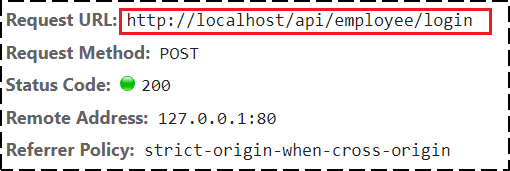
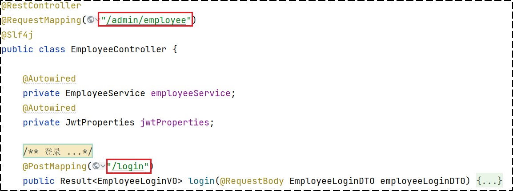
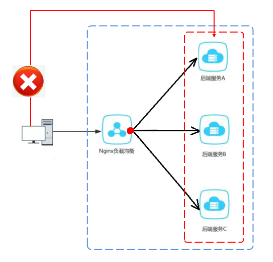

### Nginx 反向代理和负载均衡

**前端发送的请求，是如何请求到后端服务的？**

前端请求地址：http://localhost/api/employee/login

后端接口地址：http://localhost:8080/admin/employee/login

**前端请求地址：**



**后端接口地址：**



**Nginx 反向代理**，就是将前端发送的动态请求由 Nginx 转发到后端服务器

**Nginx 反向代理的好处：**

- **提高访问速度**：因为 Nginx 本身可以进行缓存，如果访问的同一接口，并且做了数据缓存，Nginx 就直接可把数据返回，不需要真正地访问服务端，从而提高访问速度。

- **负载均衡**：所谓负载均衡，就是把大量的请求按照我们指定的方式均衡的分配给集群中的每台服务器。

- **保证后端服务安全**：因为一般后台服务地址不会暴露，所以使用浏览器不能直接访问，可以把 Nginx 作为请求访问的入口，请求到达 Nginx 后转发到具体的服务中，从而保证后端服务的安全。



**Nginx 反向代理的配置方式：**

```nginx
server{
    listen 80;
    server_name localhost;
    
    location /api/{
        proxy_pass http://localhost:8080/admin/; #反向代理
    }
}
```

**proxy_pass：**该指令是用来设置代理服务器的地址，可以是主机名称，IP地址加端口号等形式。如上代码的含义是：监听 80 端口号， 当我们访问 http://localhost:80/api/../.. 这样的接口的时候，它会通过 location /api/ {} 这样的反向代理转交访问到 http://localhost:8080/admin/ 上来。

#### 浏览器地址、路径转发与同源

==浏览器判断是否跨域，看的是页面地址与实际请求地址的协议、主机和端口，不看 Nginx 后面最终连接了哪台服务器。== 页面来自 `http://localhost/`，JavaScript 请求 `/api/employee/login`，实际请求目标仍是 `http://localhost/api/employee/login`，因此与页面同源。Nginx 再请求 `http://localhost:8080/admin/employee/login`，这是代理到后端的服务器间通信。

如果页面直接请求 `http://localhost:8080/admin/employee/login`，浏览器访问目标的端口改变，仍然属于跨域；不能因为两边都在本机，就认为同源。Vue Router 负责页面组件切换，Axios 或 Fetch 才负责发送接口请求。开发服务器的代理与 Nginx 可以承担类似转发职责，但前提是页面真的向代理地址发送请求，详见[《HTTP 接口与服务调用》](HTTP%20接口与服务调用.md)。

==`proxy_pass` 带 URI 时，通常用该 URI 替换匹配的 location 前缀；末尾斜杠会影响拼接结果。== 对上面的普通前缀 `location /api/`，可以比较：

| `proxy_pass` 配置 | 浏览器请求 `/api/orders` 时的上游路径 |
| --- | --- |
| `http://127.0.0.1:8080` | `/api/orders` |
| `http://127.0.0.1:8080/` | `/orders` |
| `http://127.0.0.1:8080/admin/` | `/admin/orders` |
| `http://127.0.0.1:8080/admin` | `/adminorders` |

这个表适用于没有额外 rewrite、变量或正则 location 干预的示例；相关规则见 [Nginx `proxy_pass` 文档](https://nginx.org/en/docs/http/ngx_http_proxy_module.html#proxy_pass)。因此后面的负载均衡示例使用 `/admin/`，才与 `/admin/orders` 这类后端路径对应。

反向代理可以统一入口并配合网络隔离、认证及访问规则。仅隐藏一个后端地址，不等于自动实现身份认证和接口授权。负载均衡选择处理实例，也不会单独改变浏览器的同源判断；是否需要 CORS，仍应回到浏览器开发者工具中的实际 Request URL 核对。

**Nginx 负载均衡**

当服务以集群的方式进行部署时，那 Nginx 在转发请求到服务器时就需要做相应的负载均衡。其实，负载均衡从本质上来说也是基于反向代理来实现的，最终都是转发请求。

Nginx 负载均衡的配置方式：

```nginx
upstream webservers{
    server 192.168.100.128:8080;
    server 192.168.100.129:8080;
}
server{
    listen 80;
    server_name localhost;
    
    location /api/{
        proxy_pass http://webservers/admin/;#负载均衡
    }
}
```

**upstream：**如果代理服务器是一组服务器的话，就可以使用 upstream 指令配置后端服务器组中每一个服务器的地址。upstream 后面的名称可自定义，但要上下保持一致。

如上代码的含义是：监听80端口号， 然后当我们访问 http://localhost:80/api/../.. 这样的接口的时候，它会通过 location /api/ {} 这样的反向代理转交访问到 http://webservers/admin/，根据 webservers 名称找到一组服务器，根据设置的负载均衡策略(默认是轮询)转发到具体的服务器。

**Nginx 负载均衡策略：**

| **名称**   | **说明**                                               |
| ---------- | ------------------------------------------------------ |
| 轮询       | 默认方式                                               |
| weight     | 权重方式，默认为1，权重越高，被分配的客户端请求就越多  |
| ip_hash    | 依据ip分配方式，这样每个访客可以固定访问一个后端服务   |
| least_conn | 依据最少连接方式，把请求优先分配给连接数少的后端服务   |
| url_hash   | 依据url分配方式，这样相同的url会被分配到同一个后端服务 |
| fair       | 依据响应时间方式，响应时间短的服务将会被优先分配       |

具体配置方式示例：

**轮询：**

```nginx
upstream webservers{
    server 192.168.100.128:8080;
    server 192.168.100.129:8080;
}
```

**weight:**

```nginx
upstream webservers{
    server 192.168.100.128:8080 weight=90;
    server 192.168.100.129:8080 weight=10;
}
```

**ip_hash:**

```nginx
upstream webservers{
    ip_hash;
    server 192.168.100.128:8080;
    server 192.168.100.129:8080;
}
```

**least_conn:**

```nginx
upstream webservers{
    least_conn;
    server 192.168.100.128:8080;
    server 192.168.100.129:8080;
}
```

**url_hash:**

```nginx
upstream webservers{
    hash $request_uri;
    server 192.168.100.128:8080;
    server 192.168.100.129:8080;
}
```

**fair:**

```nginx
upstream webservers{
    server 192.168.100.128:8080;
    server 192.168.100.129:8080;
    fair;
}
```


==URL 哈希示例使用的是 Nginx 变量 `$request_uri`，不是 `&request_uri`。== `fair` 不在官方 upstream 模块列出的内置指令中，不能把它当作默认安装即可使用的配置；采用额外模块时需核对模块及构建方式。内置策略与 `hash` 指令参见[上游服务器组文档](https://nginx.org/en/docs/http/ngx_http_upstream_module.html)。