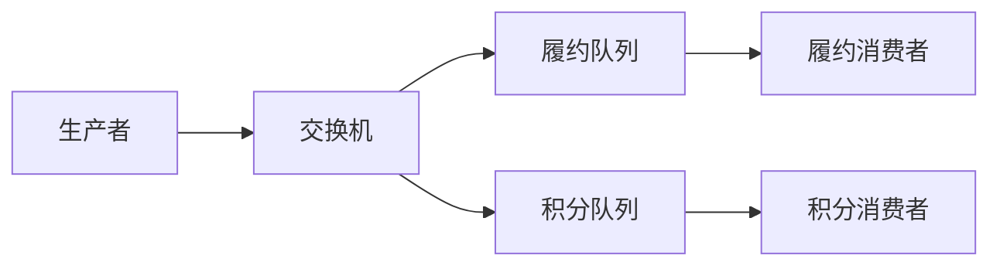
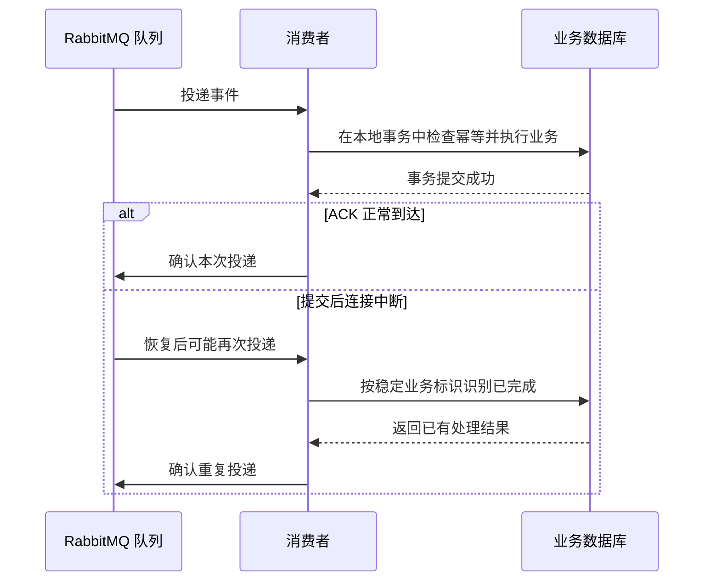
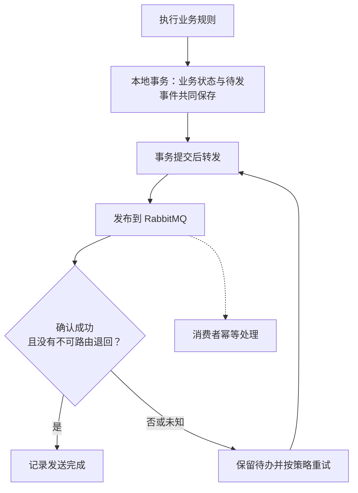

# RabbitMQ 消息通信与可靠性

订单付款后，交易系统可能需要通知库存、履约、积分和数据统计。同步调用可以立即取得对方结果，但也把一次请求的等待时间与多个系统的可用性联系在一起。消息通信把“记录发生了什么”和“由其他系统继续处理”分开，使接收方按照自己的处理能力推进工作。

RabbitMQ 是消息代理。它接收发送方提交的消息，根据路由规则把消息交给队列，再向消费者投递。应用仍需明确消息表达的业务事实、保存方式、确认时机和失败处理。本文以 AMQP 0-9-1 的交换机与队列模型为主；其他协议、Streams 和具体版本扩展，应结合相应文档理解。

## 一、消息参与者与业务协作

### 1. 从直接调用到消息处理

直接调用中，调用方发起操作，等待接收方执行并返回。消息方式中，发送方把待传递的内容交给消息系统，消费者收到后再处理。这使得消费者暂时停止时，已经进入合适队列的消息可以等待，但也意味着发送方通常不能仅凭发送方法返回，就知道下游业务已经完成。

例如，“订单已付款”是事实；履约系统根据这项事实决定是否创建发货任务。事实应包含事件标识、订单标识、发生时间、契约版本和必要数据。不要让消费者只能通过发送方的 Java 类名、数据库字段或某个临时日志格式猜测消息含义。

| 参与者 | 职责 | 需要分清的结果 |
| --- | --- | --- |
| 生产者 Publisher | 构造并发送消息，跟踪发送结果 | 是否被代理接受、是否可路由 |
| 交换机 Exchange | 根据类型和绑定规则选择消息去向 | 匹配哪些队列 |
| 队列 Queue | 保存和管理待投递消息 | 有多少等待、多少投递后未确认 |
| 消费者 Consumer | 接收消息并调用业务处理 | 本地处理是否可靠完成 |
| 业务存储 | 保存订单、幂等记录、任务等 | 状态是否实际提交 |



图中两个队列分别得到符合绑定规则的消息。若在同一个队列上运行多个消费者，它们通常是分担这个队列的工作，而不是每个消费者都拿到一份。因此，“两个系统都要处理付款事件”通常需要两个独立订阅队列；“同一系统部署三份以提高吞吐”则可以让三份实例消费同一业务队列。

### 2. 异步、解耦与流量缓冲的代价

异步使当前请求不必等待所有后续工作，却带来状态传播延迟。页面可能先看到已付款，稍后才看到积分到账。系统需要表达处理中、失败待重试等状态，并提供结果查询，不能把异步操作描述成所有工作瞬间完成。

队列还可以暂存突发流量，但它不能增加下游数据库的无限处理能力。持续进入量大于处理量时，积压与等待时间仍会增加。应同时观察消费能力、消息等待时间和业务时效，而不是只把队列长度当作系统能够承受的最大流量。

进程内事件总线与 RabbitMQ 的使用边界也不同。前者通常围绕一个应用进程分发对象；后者引入独立代理、网络传输和队列。若从本地 EventBus 改为 MQ，消息契约、事务、失败恢复和消费幂等需要重新设计，不能只替换 `post()` 的方法名。进程内机制可结合[《Guava 常用工具与事件机制》](Guava%20常用工具与事件机制.md)阅读。

## 二、交换机、队列与路由关系

### 1. Virtual Host 与资源名称

Virtual Host，简称 vhost，是 RabbitMQ 中隔离交换机、队列、绑定等资源的逻辑空间。两个应用即使连接同一个主机和端口，若使用不同 vhost，也不会自动访问同名队列。账号还需要具有相应资源的配置、写入和读取权限。

Connection 是网络连接，Channel 是连接中的协议通道。客户端常复用连接并建立多个通道，声明资源、发布、订阅和确认等操作通过通道进行。连接日志只能证明某次网络与认证过程成功，不能证明队列绑定正确、监听器已经注册或某条消息已经消费。

### 2. 交换机类型与绑定匹配

AMQP 0-9-1 中，生产者向交换机发布消息，并提供 Routing Key；交换机依据绑定 Binding 选择目标。Binding Key 是绑定规则，不是队列中的某条消息内容。

| 类型 | 典型路由规则 | 示例 |
| --- | --- | --- |
| Direct | Routing Key 与绑定键精确匹配 | `order.paid` 匹配同名绑定 |
| Topic | 按点分隔的单词匹配模式 | `order.*` 匹配 `order.paid`，不匹配 `order.pay.success` |
| Fanout | 忽略 Routing Key，交给所有绑定目标 | 同一公告进入多个订阅队列 |
| Headers | 根据消息头与绑定参数匹配 | 按约定的类型、区域等消息头筛选 |

Topic 中，`*` 匹配一个单词，`#` 匹配零个或多个单词。因此 `order.#` 可以匹配 `order`、`order.paid` 和 `order.pay.success`。这些是消息路由语法，不应当按文件系统通配符或正则表达式解释。[RabbitMQ 交换机说明](https://www.rabbitmq.com/docs/exchanges)给出了各类型与绑定的对应关系。

默认交换机的名称是空字符串。每个声明的队列会按队列名获得相应的默认绑定，所以使用空交换机和队列名发送时，看上去像直接向队列发送；底层仍然存在交换机路由。

### 3. 声明时间与历史消息

**普通交换机不替将来才出现的队列保存历史消息。** 发布时，消息按当时存在的绑定路由。之后新建一个队列、补上相同 Routing Key，并不会让交换机重新投递此前的发布。

需要区分下面两种情形：

- 队列和绑定已存在，消费者尚未启动：符合队列保存条件的消息可以等待消费者上线。
- 发布时目标队列或绑定还不存在：该目标没有得到那次消息；之后启动监听器也不会自动补出这一份历史消息。

这也是部署顺序需要考虑拓扑准备的原因。对可靠事件订阅，可以提前声明稳定的队列和绑定，再允许业务开始发布。若确实需要新增订阅后回放历史，应另外设计事件存储、重放任务或合适的日志型机制。

同名队列重复声明时，属性一致通常可以复用；属性不一致可能触发通道错误，例如持久化设置或队列类型与既有资源冲突。不要把“资源已经存在”与“可以用任意新参数覆盖它”混为一谈，具体属性及行为参见[队列文档](https://www.rabbitmq.com/docs/queues)。

## 三、Spring AMQP 的发送与监听

### 1. 框架如何把消息交给 Java 方法

Spring AMQP 提供 `RabbitTemplate`、监听容器、消息转换与资源管理等能力。`@RabbitListener` 标记一个接收端点；注解处理基础设施发现它后，创建监听容器，由容器订阅队列、接收消息并调用方法。不是 RabbitMQ 服务器直接识别 Java 注解。

使用普通 Spring 配置时，需要启用相应监听基础设施，例如 `@EnableRabbit`；使用 Spring Boot 时，可由满足条件的自动配置提供基础设施。还要准备连接工厂、模板、监听容器工厂及必要的资源声明，不能仅因某个类写了注解就认为全部运行条件已经具备。[启用监听端点的官方说明](https://docs.spring.io/spring-amqp/reference/amqp/receiving-messages/async-annotation-driven/enable.html)解释了这些组件的关系。

下面是拓扑配置片段，使用常见 Spring AMQP API，省略工程依赖、连接参数与导入：

```java
@Configuration
public class OrderMessagingConfig {

    @Bean
    public TopicExchange orderExchange() {
        return new TopicExchange("business.events", true, false);
    }

    @Bean
    public Queue fulfillmentQueue() {
        return QueueBuilder.durable("fulfillment.order.paid").build();
    }

    @Bean
    public Binding fulfillmentBinding(Queue fulfillmentQueue,
                                      TopicExchange orderExchange) {
        return BindingBuilder.bind(fulfillmentQueue)
                .to(orderExchange)
                .with("order.paid");
    }
}
```

交换机、队列、绑定对象表达需要的拓扑；是否自动向代理声明，还取决于 `RabbitAdmin` 等相关配置。这与仅仅创建一个普通 Java 对象不同。声明权限不足、代理不可达和既有属性冲突，都应检查启动日志。

另一种方式是在 `@RabbitListener` 中配置 `bindings = @QueueBinding(...)`。使用这种方式时，框架在具备相应管理设施的条件下声明资源；使用 `queues = "已有队列名"` 则主要说明监听目标，不等于同时声明完整的交换机与绑定。

### 2. 发送内容与消息转换

生产者可以使用 `RabbitTemplate.convertAndSend(exchange, routingKey, payload)`。`convert` 的具体编码由 `MessageConverter` 决定。传 Java 对象并不保证自动得到双方约定的 JSON，接收方也不能仅凭参数类型就理解任意内容。

一个容易观察的教学方式是显式发送 JSON 字符串，并在消息契约中固定 UTF-8 编码与字段含义：

```java
String json = "{\"eventId\":\"evt-001\","
        + "\"eventType\":\"OrderPaid\","
        + "\"orderId\":\"order-1001\",\"version\":1}";

rabbitTemplate.convertAndSend("business.events", "order.paid", json);
```

真实系统可以统一配置合适的 JSON 转换器并发送 DTO，但应明确字段、版本、编码和类型兼容规则。消息体中的业务标识应保持稳定，重发同一个业务事件时不要每次生成一个全新的去重标识。

### 3. 接收方法与应用用例

```java
@Component
public class OrderPaidListener {
    private final FulfillmentApplicationService fulfillmentService;

    public OrderPaidListener(FulfillmentApplicationService fulfillmentService) {
        this.fulfillmentService = fulfillmentService;
    }

    @RabbitListener(queues = "fulfillment.order.paid", ackMode = "AUTO")
    public void onOrderPaid(String message) {
        // 用例负责解析或接收已解析的契约，并可靠完成幂等业务处理。
        fulfillmentService.handleOrderPaid(message);
    }
}
```

`FulfillmentApplicationService` 是示例中的业务用例占位类型。入口接到消息后，应完成契约校验、输入转换并调用用例，避免把完整发货、库存、退款逻辑集中在监听器里。

示例使用 Spring 的 `AUTO` 模式。在通常的同步调用情形下，业务用例正常返回，容器依据配置处理确认；异常传播给容器，才有机会执行相应失败策略。若捕获异常只打印日志，然后正常返回，容器可能把这次处理看作成功。

## 四、发送确认与消息保存

### 1. Publisher Confirm、Return 与业务完成

发布链路至少需要回答三个不同问题：代理是否按确认语义接受消息，消息是否路由到目标，消费者是否完成业务。

| 机制或结果 | 能说明什么 | 不能直接推出什么 |
| --- | --- | --- |
| 发送方法未抛异常 | 客户端本次调用没有暴露同步异常 | 代理已经可靠保存、消费者已完成 |
| Publisher Confirm | 代理对发布进行 ACK 或 NACK | 指定业务消费者已经处理 |
| Mandatory 与 Return | 不可路由时让发布方获知退回 | 确保某个业务队列一定收到、业务完成 |
| 消费者业务结果 | 接收方自己的处理情况 | 发送方已经保存这项处理结果 |

尤其要注意：**一条消息没有路由到任何队列，也可能获得发布确认 ACK。** ACK 与“存在正确的目标绑定”不是同一件事。对要求感知不可路由的发布，需要启用相应 mandatory 行为并注册返回处理，还要把返回与本次发布关联起来。[发布者文档](https://www.rabbitmq.com/docs/publishers)和[确认机制说明](https://www.rabbitmq.com/docs/confirms)分别解释了路由失败与确认的边界。

Mandatory 只检测没有路由到任何目标的情况。假如预期进入履约、积分两个队列，实际上只有积分队列绑定正确，消息仍可能成功路由，不能因此证明履约队列也收到。这需要通过拓扑管理、契约和业务对账保证。

### 2. 持久化、复制与故障边界

交换机和队列的 durable 属性主要关系到拓扑在代理重启后的保留；消息本身如何保存，还受到队列类型、消息属性、确认方式及代理存储状况影响。经典队列的消息持久化设置与队列持久化需要配合理解。

如果还需要节点故障时维持数据副本，就要关注复制队列及集群设计，而不是把“durable”直接翻译成多副本。Quorum Queue 是 RabbitMQ 的持久化复制队列类型，其多数派与确认语义需要结合部署拓扑理解。[Quorum Queue 官方说明](https://www.rabbitmq.com/docs/quorum-queues)介绍了它与经典队列的区别。

可靠性由生产者、代理和消费者共同承担。进程崩溃、磁盘故障、网络中断、错误配置和不恰当的队列删除都会改变实际结果，具体故障范围应结合[可靠性指南](https://www.rabbitmq.com/docs/reliability)评估。

### 3. 结果未知与重复发布

生产者发出消息后连接中断，可能是消息没有到达，也可能是代理已经接收、确认尚未返回。因此，未收到确认表示结果未知，不能简单认定“对方肯定没收到”。

需要恢复的生产者可以凭本地待发送记录重发，但重发会带来重复消息。发送端应保存稳定事件标识和尝试状态，消费者则按照业务规则去重。一次网络请求是否成功，与这项业务最终是否只生效一次，需要分别设计。

## 五、消费确认、并发与失败处理

### 1. 三种 Spring 确认模式

Spring 的模式名称容易与协议术语混淆：

| Spring 模式 | 确认的主要承担者 | 处理特点 |
| --- | --- | --- |
| `NONE` | 代理按自动确认方式投递 | 不等待应用显式 ACK，应用崩溃存在丢失处理机会的风险 |
| `AUTO` | Spring 监听容器 | 根据方法结果、异常及事务等配置处理确认 |
| `MANUAL` | 应用监听代码或相应异步完成机制 | 需要按规则明确 ACK、NACK 或拒绝 |

因此 Spring 的 `AUTO` 不等同于 RabbitMQ 所说的协议级 `autoAck=true`。模式含义以[监听容器配置说明](https://docs.spring.io/spring-amqp/reference/amqp/containerAttributes.html)为准。

手动确认常用的 API 形如 `channel.basicAck(deliveryTag, false)`，其中 `deliveryTag` 标识本通道上的投递，`false` 表示本次只确认这一项。投递标识有通道范围，不能随意保存到另一条 Channel 上再确认，也不应重复确认同一次投递。

### 2. 业务提交与 ACK 的顺序

对需要可靠保存的本地业务，应让业务结果先达到约定的可靠完成点，再确认消息。若先 ACK，再执行数据库写入，进程在写入前退出，队列可能已经移除消息，而业务尚未完成。

反过来，数据库已提交，ACK 尚未到达代理时消费者退出，消息又可能被投递。这是消费幂等必须处理的典型情形。



业务方法把任务交给内存线程池就立即返回，可能还没有到达可靠完成点。如果要异步受理，先持久化接收任务，再由任务处理器推进；也可以使用框架明确支持的异步返回与确认方式，不能让普通方法提前返回代替完整设计。

### 3. Prefetch、消费者数量与顺序

Prefetch 限制消费者可持有的未确认投递数量，有助于控制在途工作和内存。它不是消费者线程数，也不是每秒限流值。消费者数量决定并行处理能力的一部分，还需要考虑业务耗时和数据库容量。[消费者文档](https://www.rabbitmq.com/docs/consumers)说明了订阅、未确认投递及流量控制的关系。

即使队列具有顺序，多个消费者并行处理、重新入队和不同业务耗时，也可能使实际完成顺序变化。需要同一订单的操作按序生效时，可以采用合适分区、串行处理或业务状态条件；不能仅写“使用队列”就保证所有副作用全局有序。

### 4. 重试、重新入队与死信

`basicNack` 或 `basicReject` 可以表达本次处理失败。选择重新入队时，消息可能很快再次投递；如果每次都立即失败再入队，会形成高频循环，持续消耗资源。

可以把故障分为临时依赖不可用、消息格式或业务数据永久不合法、结果未知等类别。临时故障安排有间隔和上限的重试；不合法消息进入异常处理；结果未知时查询或沿用稳定幂等号继续核实。

死信交换机 DLX 是普通交换机的一种用途。消息被拒绝且不重新入队、消息过期等情形，在相应配置满足时可以转发到 DLX，再进入绑定的异常队列。**不是所有异常都会自动进入某个“默认死信队列”。** 还要声明和绑定相应目标，配置处理与告警流程，参见[死信机制文档](https://www.rabbitmq.com/docs/dlx)。

Spring 监听器重试、MQ 重新投递、延迟重试队列和业务任务补偿也属于不同层次。重试计数、下次时间、成功条件和终止入口应由设计统一，否则可能出现本地重试用尽后又重新入队，导致实际次数远超预期。

## 六、业务一致性与幂等消费

### 1. 业务事务与消息发送的缺口

保存付款状态后再发送事件，进程可能在两步之间退出；先发事件再保存状态，数据库事务又可能回滚。把两行代码放在同一个 Java 方法中，或只给方法加数据库事务注解，不会自动把代理发送与数据库提交变成一个原子动作。

常用方案是在同一个本地事务里保存业务状态和待发送事件记录。转发器只处理已提交记录，跟踪发布确认与失败，并通过扫描恢复未完成任务。这是 [Transactional Outbox](https://microservices.io/patterns/data/transactional-outbox.html) 的思路。

对要求感知不可路由的发布，转发器应关联同一次发送的 Confirm 与 Return，不能只凭 Confirm ACK 标记发送完成。出现 Return、NACK 或确认超时时，应保留相应异常或待重试状态；对预期的各个业务订阅是否齐全，还要通过拓扑管理与对账核实。



Outbox 转发器仍可能在发送成功后、记录完成前退出。它恢复后再次发送是需要处理的故障情形；任务表解决可恢复待办，消费幂等解决重复生效，两者各有职责。

### 2. 幂等记录与状态条件

幂等应围绕具体业务动作，例如“这张订单建立一次履约任务”，不只是按消息文本是否完全相同判断。不同消息可能请求同一个业务动作；同一消息也可能在多次序列化后拥有不同文本。

可以用事件标识或业务唯一键建立处理记录，再配合唯一约束和状态条件。在本地事务中，需要把幂等判定、业务写入和结果记录安排到一致性边界内。只有先查询“未处理”再执行，两个消费者仍可能同时通过检查。

调用外部出库、充值或退款，还要让下游接受稳定业务操作号，或支持结果查询。仅靠本地数据库事务，不能回滚另一个系统已经完成的副作用。事务边界、补偿和对账的业务含义，可结合[《电商营销与交易业务设计》](电商营销与交易业务设计.md)中的通知章节阅读。

### 3. 事件版本与数据演进

消息属于发送方和接收方之间的长期契约。新增字段通常需要接收方能够忽略不认识的字段，删除或改变含义则需要兼容方案。金额应说明币种和单位，时间说明格式与时区，业务状态说明允许值及终态含义。

事件发生时的数据快照与消费时查询的最新数据，也有不同语义。例如，发票与退款可能需要原成交金额，而不是当前商品价格。应先确定消费者需要哪个时点的事实，再决定消息携带数据还是按标识查询。

## 七、消息链路观察与定位

### 1. 按消息经过的边界检查

检查时先选定一条可追踪的事件，记录业务单号、事件标识、交换机、Routing Key、目标队列、vhost 和发送时间，再沿链路查证。否则很容易把其他实例、其他队列或上一次测试的日志拼到同一条消息上。

| 观察位置 | 重点核对 | 常见含义 |
| --- | --- | --- |
| 生产者 | 是否走到发送代码，内容与目标是什么 | 没有日志也可能根本未产生事件 |
| 发布确认与返回 | ACK／NACK、Return、超时和关联标识 | 分清被接受、不可路由与结果未知 |
| 拓扑 | vhost、交换机类型、队列、绑定键和声明时间 | 后补绑定不补发过去消息 |
| Ready | 队列中等待投递的消息 | 消费者没启动、容量不足或消费受限等 |
| Unacked | 已投递但尚未确认的消息 | 业务阻塞、忘记确认、在途量较大等 |
| Consumers | 实际订阅消费者数量及连接 | 应用启动不等于监听容器正常订阅 |
| 应用业务 | 解析异常、状态变化、幂等结果与事务提交 | 收到消息日志不等于业务已完成 |

消息数量只是某个时刻的观测。`Ready=0` 可能表示消息已经消费，也可能表示从未路由进来；`Consumers>0` 也不能证明某条业务一定成功。应结合发布、投递、确认和业务状态一起判断，监控指标及观测方式可参考[官方监控文档](https://www.rabbitmq.com/docs/monitoring)。

### 2. 消息处理与环境部署

本地 Docker 环境可以验证消息路由、不同消费者、确认、重投递和业务幂等；这些基础操作不要求先购买云服务器。跨主机部署和压测才需要结合机器资源、网络、磁盘、消息体大小及数据库容量安排环境。

单机启动多个进程可以验证部分并发逻辑，但不能替代不同主机的网络分区、节点故障和真实容量验证。压测结果应注明环境与负载条件，避免把一次本地吞吐数当作上线后的保证。容器挂载与生命周期问题可参照[《Docker 使用指南》](Docker%20使用指南.md)。
