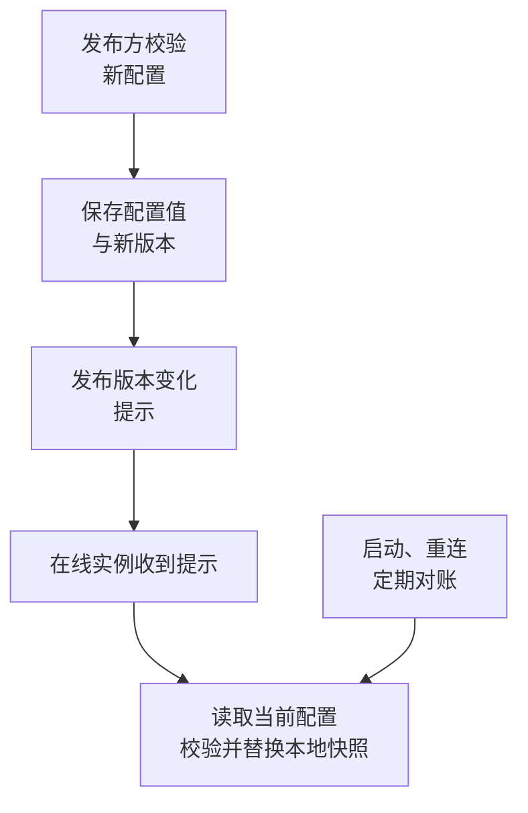
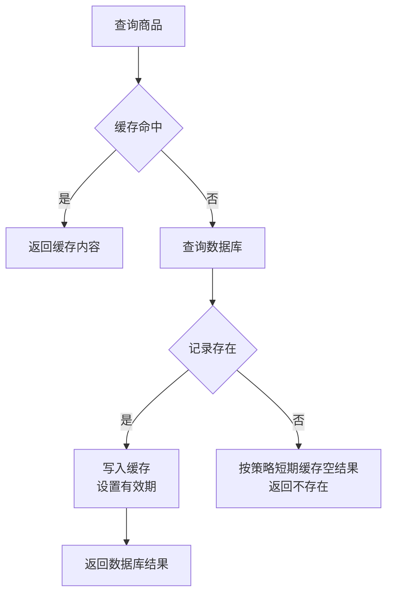

# Redis 与 Redisson 开发实践

Redis 在 Java 后端中常被用于缓存、集合查询、实时通知和并发协调。它们都通过 Redis 通信，但解决的问题不同：缓存关心读写与过期，集合关心数据组织，发布订阅关心在线通知，分布式锁关心多个执行者如何竞争同一段临界区。

学习时需要始终连接三个层次：**Java 中拿到的对象是什么，Redis 中实际保存或传递的内容是什么，业务最终需要保证什么。** 能调用一个 API，只说明具备执行入口；数据编码、故障恢复和业务约束仍需要单独设计。下面的代码是独立教学片段，省略具体工程的依赖与连接配置；涉及锁内部实现时，以官方 `redisson-4.8.0` 标签的源码为依据。

## 一、Java 访问接口与数据协议

### 1. 模板、客户端与 Redis 服务端

Redis 服务端接收命令并维护数据。Java 应用通过客户端建立连接、发送命令、接收响应，再把字节转换成 Java 能使用的值。Spring Data Redis 在客户端之上提供了统一接口，Redisson 则同时提供客户端能力与较高层的分布式对象。

| 接口或组件 | 主要职责 | 使用时的理解重点 |
| --- | --- | --- |
| `RedisTemplate<K, V>` | Spring Data Redis 的通用操作模板，管理连接使用、异常转换和序列化 | Java 泛型不等于 Redis 自动认识 Java 对象 |
| `StringRedisTemplate` | 针对字符串键和值配置好的模板 | 默认使用字符串序列化，也能操作 Set、Hash、Bitmap 等结构 |
| `RedisConnectionFactory` | 为 Spring Data Redis 提供连接抽象 | 常见实现适配 Lettuce、Jedis |
| Lettuce、Jedis | 具体 Java Redis 客户端 | 负责网络连接及 Redis 命令交互 |
| `RedissonClient` | Redisson 的主要入口，取得锁、Map、Bucket、Topic 等对象 | Redisson 自己具备客户端与连接管理能力，并非默认包装一层 Lettuce |
| Redis 服务端 | 执行命令，维护数据、过期时间和订阅关系 | 不知道应用中的 Spring Bean 名称与 Java 泛型 |

例如，`redisTemplate.opsForSet()` 返回集合操作入口，`redissonClient.getMap("profile:42")` 返回按名称操作远端 Map 的 Java 对象。二者都不是“把整个 Redis 下载进 JVM”。

Spring 的模板适合按 Redis 数据类型组织操作；Redisson 适合直接使用分布式对象接口。一个应用可以同时使用它们，但这不代表两套入口的连接池、序列化和命名规则会自动统一。[Spring Data Redis 驱动说明](https://docs.spring.io/spring-data/redis/reference/redis/drivers.html)解释了模板与连接抽象的关系；[Redisson 官方入口源码](https://github.com/redisson/redisson/blob/redisson-4.8.0/redisson/src/main/java/org/redisson/Redisson.java)可以核对各类对象的创建方式。

### 2. 序列化决定实际读写的内容

Redis 保存的是字节及相应的数据结构，序列化负责把 Java 值转换成这些字节。反序列化按事先约定的协议把字节还原成字符串、数字或对象。

`RedisTemplate<String, Product>` 中的泛型主要帮助 Java 编译器检查类型。它不会自动指定 JSON，也不会让 Redis 服务端创建一个 `Product` 类型。模板实际采用什么编码，由键、值、Hash 键和 Hash 值的序列化器决定。

一个普通 `RedisTemplate` 如果沿用默认设置，可能使用 Java 原生序列化；`StringRedisTemplate` 则使用字符串编码。项目也可能显式替换这些默认设置。因此，看见同一个文本键名，仍要核对它最终被编码成什么字节。原生序列化后的键与直接 UTF-8 编码的键，可能是 Redis 中两个不同的键。[Spring Data Redis 模板与序列化说明](https://docs.spring.io/spring-data/redis/reference/redis/template.html)给出了这些差异及可选的序列化方式。

共享数据时，应约定以下内容：

- 键使用什么命名空间和字符编码，例如 `prod:catalog:detail:42`。
- 值使用纯字符串、十进制数字文本、JSON，还是其他二进制协议。
- 对象字段的名称、类型、可空性和版本怎样演进。
- 不同写入方是否使用相同的过期策略。

JSON 也需要契约。“都是 JSON”不能保证一个客户端写出的类型信息、日期格式、枚举值和字段名称，另一个客户端都能正确解释。Java 原生对象序列化还会绑定类定义与兼容性，不适合作为跨语言共享协议；对不可信内容进行反序列化也有安全边界。

### 3. Spring 与 Redisson 互通的最小条件

下面的片段用纯字符串说明互通关系。假设两个客户端已经连接到同一 Redis 实例和同一逻辑数据库，且没有额外的名称映射：

```java
String key = "demo:feature:enabled";

stringRedisTemplate.opsForValue().set(key, "true");

RBucket<String> bucket =
        redissonClient.getBucket(key, StringCodec.INSTANCE);

String enabled = bucket.get(); // 按字符串协议读取同一份值
```

这里成立的关键不是 Java 变量都叫 `String`，而是键定位一致、Redis 类型一致、值的编码一致。`StringCodec.INSTANCE` 明确了 Redisson 这一侧的编码；若改用另一种 Codec，结果需要重新核对。[Redisson 序列化说明](https://redisson.pro/docs/data-and-services/data-serialization/)列出了不同 Codec 的定位，默认值可能随版本和工程配置变化。

若共享的是 Hash，还应同时核对字段名与字段值的编码。若共享的是 Redisson 的复合对象，例如带条目过期、索引或辅助元数据的对象，不能仅因它“底层用到了 Hash”，就绕过其 API 任意修改 Redis 内容。

模板完成配置后可以在多个线程中复用。不要据此把一次取得的底层 `RedisConnection` 也长期共享给多个线程；Spring 官方明确区分了模板与连接对象的线程安全边界。

## 二、数据类型与分布式对象的对应关系

### 1. 从业务问题选择结构

Redis 数据类型决定服务端能够高效执行哪些操作，Redisson 对象则提供 Java 侧的使用方式。常用关系如下：

| 需要表达的内容 | Redis 侧结构或机制 | 常见 Spring 入口 | 常见 Redisson 入口 |
| --- | --- | --- | --- |
| 一份文本、JSON、配置快照 | String | `opsForValue()` | `RBucket` |
| 一组不重复成员 | Set | `opsForSet()` | `RSet` |
| 一组字段与对应值 | Hash | `opsForHash()` | 普通 `RMap` |
| 按整数位置保存是否发生 | String 上的位操作 | `setBit()`、`getBit()` | `RBitSet` |
| 对在线订阅者广播消息 | Pub/Sub channel | `convertAndSend()` 与监听容器 | 普通 `RTopic` |
| 多个执行者竞争临界区 | 锁协议与服务端状态 | 通常不手写完整协议 | `RLock` |

`RBucket<User>` 表示把一份用户对象序列化后存入一个键，不代表能够直接修改对象的某个字段。`RMap<String, String>` 则适合按字段进行访问。普通 `RMap` 与本地 `HashMap` 的方法看起来相似，但操作会涉及远端通信，不能忽略网络延迟、超时以及批量读取成本。[Redisson 对象说明](https://redisson.pro/docs/data-and-services/objects/)与[集合说明](https://redisson.pro/docs/data-and-services/collections/)分别解释了这些对象的接口。

还应区分普通对象与增强变体。`RMapCache`、本地缓存 Map、分片对象等可能维护额外的数据和处理流程。学习映射关系的用途是理解职责，不能由此推导所有变体都只有一个简单 Redis 键。

### 2. String 与 Set 的常见操作

String 适合保存单值缓存、令牌与短期标识。常见操作包括读取、设置、设置过期时间、条件写入和数字递增：

```java
String cacheKey = "demo:product:name:42";

// 设置值时同时指定有效期，避免写值与设置 TTL 分成两个步骤。
stringRedisTemplate.opsForValue()
        .set(cacheKey, "机械键盘", Duration.ofMinutes(5));

String name = stringRedisTemplate.opsForValue().get(cacheKey);

String membersKey = "demo:event:2026:members";
stringRedisTemplate.opsForSet().add(membersKey, "user-42", "user-57");

boolean joined = Boolean.TRUE.equals(
        stringRedisTemplate.opsForSet().isMember(membersKey, "user-42"));
```

示例中，设置缓存时附带过期时间，可以避免应用在写值成功后、另行设置过期之前退出，留下一个没有预期 TTL 的键。`set` 覆盖已有值时，还需要关注是否同时改变原有过期策略，不能默认旧 TTL 永远保留。[Redis String 说明](https://redis.io/docs/latest/develop/data-types/strings/)提供了单值及数字操作的基础语义。

Set 适合保存精确成员集合，例如活动参与用户、允许访问的业务编号。写入同一成员不会产生重复条目，但这只表示集合去重；不代表“添加成员”和数据库发券已经组成一个原子业务动作。

查询“某用户是否属于集合”通常使用 `SISMEMBER`，对应模板的 `isMember`。如果每次请求都先读取全部成员再在 Java 中查找，就把服务端能够完成的判断转化成了整批网络传输。大集合遍历可以考虑扫描类接口，并正确处理迭代期间数据变化；扫描结果也不天然构成固定时间点的一致快照。[Redis Set 说明](https://redis.io/docs/latest/develop/data-types/sets/)可用于核对各操作的语义与复杂度。

### 3. Bitmap 的整数映射与空间成本

Bitmap 用一个二进制位表示一个对象的布尔状态。例如，把用户整数编号作为偏移量：第 42 位为 1，表示编号 42 的用户今天签到；第 57 位为 0，表示编号 57 尚未签到。

Redis 的 Bitmap 不是独立的顶层数据类型，而是对 String 的位进行操作。同一个键不能同时被当作普通文本与业务 Bitmap 随意修改，否则文本字节和业务位会相互破坏。

```java
String dailyKey = "demo:signin:2026-11-12";
long offset = 42L; // 假设来自稳定、无冲突的非负整数映射

stringRedisTemplate.opsForValue().setBit(dailyKey, offset, true);

boolean signed = Boolean.TRUE.equals(
        stringRedisTemplate.opsForValue().getBit(dailyKey, offset));
```

Bitmap 的空间取决于最高位的位置。若最高偏移量为 M，表示这些位所需的有效载荷字节数大致为：

$$
B = \left\lceil \frac{M + 1}{8} \right\rceil
$$

其中 B 是字节数，尚未包含键、对象和分配器等额外开销。100 万个连续编号对应约 125000 字节；如果只设置了一个偏移量为 10 亿的位，也需要扩展到约 1.25 亿字节。**“只记录了一个用户”不意味着只占一个位的实际空间。**

[Redis SETBIT 文档](https://redis.io/docs/latest/commands/setbit/)要求偏移量非负且小于 2 的 32 次方，并指出首次扩展到很高位置可能带来大量内存分配。使用之前，应检查编号规模和分布；稀疏的大编号不一定适合直接作为偏移量。

字符串用户标识不能随意通过 `hashCode()` 变成精确 Bitmap 的位置。两个用户可能得到相同哈希值；取模会进一步制造碰撞。假如用户 A 已签到，用户 B 恰好映射到同一位，B 就会被错误判断为已签到。对整数取绝对值也没有解决碰撞，且最小负整数还存在特殊情况。

若业务要求精确判断，可以维护稳定、唯一的紧凑整数映射，或者选择 Set。映射自身需要可靠保存与统一使用，不能让不同应用独立随机分配位置。若业务允许一定误判，则应选择并理解布隆过滤器等概率结构，而不是把普通哈希压缩后的 Bitmap 宣称为精确集合。

按日期、业务或编号区间拆分 Bitmap，可以控制单键规模，但需要让写入和查询遵守同一分段规则。拆分不能凭空消除编号稀疏与元数据开销。[Redis Bitmap 说明](https://redis.io/docs/latest/develop/data-types/strings/bitmaps/)还介绍了计数与位运算；对大范围执行 `BITCOUNT`、`BITOP` 时，应考虑扫描的数据量和服务端执行成本。

## 三、发布订阅与通知可靠性

### 1. 键与频道属于不同机制

Redis 键保存可被以后读取的数据，Pub/Sub 频道用于把消息发送给当前在线的订阅者。即使它们都叫 `demo:config:pricing`，也不是同一个对象。

执行 `SET demo:config:pricing ...` 会修改一个键；执行 `PUBLISH demo:config:pricing ...` 会广播一条消息。发布消息不会自动写入同名键，读取同名键也不会取得该频道以前的消息。

同样，`RBucket`、`RMap` 与 `RTopic` 是 Java 操作入口。只有真正调用相应方法时，才发生取值、写值或发布订阅行为。取得一个 Topic 对象，不等于已经添加监听器。

Redis 普通 Pub/Sub 还不按逻辑数据库编号隔离：连接选择不同数据库，仍可能通过相同频道通信。因此，环境隔离应显式体现在频道名中，例如 `test:config:changed`、`prod:config:changed`，不能只依赖 Redis 数据库编号。[Redis Pub/Sub 官方说明](https://redis.io/docs/latest/develop/pubsub/)明确区分了频道与键空间。

### 2. 订阅回调的实际执行过程

Redisson 的普通 Topic 可以按下列方式使用：

```java
RTopic topic = redissonClient.getTopic(
        "demo:config:changed", StringCodec.INSTANCE);

// 在需要接收通知的应用实例中注册监听。
int listenerId = topic.addListener(String.class, (channel, message) -> {
    // 示例只显示处理入口；实际可把刷新任务交给受控执行器。
    System.out.println("收到刷新提示：" + message);
});

// 发布方使用同一频道与兼容的消息编码。
long receivers = topic.publish("pricing:version=18");

// 应用关闭或不再需要订阅时，可以移除自己注册的监听。
// topic.removeListener(listenerId);
```

订阅方先注册监听，客户端随后维护与 Redis 的订阅关系。发布方发送消息，Redis 把消息推给在线订阅连接，Redisson 解码后调用相应监听器。监听器中的代码在订阅方应用中执行，并不是 Redis 服务端去反射修改 Java 字段。

多个应用实例分别订阅同一频道时，广播会面向这些在线订阅者。它不同于一个任务只让一个消费者执行的竞争消费模型。发布方法返回的数量也不能证明这些应用都已完成业务处理；网络接收、回调执行和业务完成是不同阶段。[Redisson 发布订阅说明](https://redisson.pro/docs/data-and-services/publish-subscribe/)介绍了普通 Topic 及其他通信对象，不能把增强对象的能力自动套到普通 `RTopic` 上。

### 3. 晚订阅、断线与消息丢失

普通 Redis Pub/Sub 采用至多一次的投递语义。应用尚未订阅、订阅连接断开，或者消息已经发出后应用才启动，都可能错过这条消息。重新建立订阅关系，只恢复今后的接收，不会自动回放断线期间的历史。

因此，配置刷新、缓存失效提示等场景可以使用它，但应让消息承担“提醒去检查”的职责。配置的真实值与版本应另行保存：



例如，版本 18 的完整配置已经保存，某个实例错过提示。它在重连后或定期检查时读取当前版本，仍能发现自己的版本 17 已过时，再补做刷新。若真实值只存在于那条已丢失的消息中，就没有这样的恢复来源。

保存成功但发布失败时，也需要后续重新提示或依靠对账发现变化。“先保存，再发布”降低了读到不存在版本的风险，却没有让两次操作天然可靠地一起完成。对普通动态配置而言，版本对账通常比要求每条提示都不丢更直接；对于发货、资金变动等必须追踪每项工作结果的业务，应采用具有持久记录、确认与恢复能力的消息或任务机制。

Redis Streams 能保存条目，并提供消费组、待处理消息等机制，但仍需要设计确认、重试、重复处理与保留策略。选择持久消息工具以后，也不能省去业务幂等。[Redis Streams 官方说明](https://redis.io/docs/latest/develop/data-types/streams/)提供了与普通 Pub/Sub 不同的数据与消费模型。

## 四、Redisson 分布式锁的工作机制

### 1. 取得锁对象与真正加锁

一个 JVM 内的 `synchronized` 只能约束共享同一监视器的线程。应用部署为多个进程后，各进程拥有独立堆内存，不能仅靠各自的本地锁互斥。分布式锁把竞争状态放到各方都能访问的协调系统中。

`redissonClient.getLock("demo:stock:42")` 取得的是一个按名称操作锁的本地 Java 入口。它没有因为“创建了 RLock 变量”就取得临界区，也不保证此刻 Redis 中已经存在对应锁键。真正尝试竞争发生在 `lock()`、`tryLock()` 等方法中。

不同 JVM 中的锁对象即使不是同一 Java 引用，只要操作同一 Redis 范围下同名的锁协议，仍会竞争同一份锁状态；反过来，如果键名、Redis 实例、数据库或名称映射不同，就可能根本没有竞争到一起。固定标签的[Redisson getLock 实现](https://github.com/redisson/redisson/blob/redisson-4.8.0/redisson/src/main/java/org/redisson/Redisson.java)可用于核对这个创建过程。

锁名通常围绕受保护的业务资源设计，例如按商品、用户或队伍编号加锁。所有路径都用同一个全局锁会增加无关请求的等待；锁名过细、没有覆盖同一资源的竞争路径，则可能保护不到真实冲突。

### 2. 所有者、重入计数与 TTL

普通 `RLock` 是可重入锁。同一所有者可以再次取得同一把锁，但需要按重入次数对应释放。其所有者与 Redisson 客户端身份及线程标识有关，不能只按“这个应用实例”理解。

在本次核对的普通锁实现中，Redis 侧使用 Hash 维护所有者及持有计数，并为锁键设置 TTL，即剩余存活时间。取得锁时，服务端原子地检查锁是否不存在，或当前线程是否已经是持有者；允许取得时增加计数并设置租期，否则返回已有锁的剩余 TTL。释放时核对所有者、减少计数，计数归零后删除锁并通知等待者。

等待者收到通知后仍需重新竞争，通知本身不是锁的授予凭证。即使等待过程中没有及时收到通知，等待逻辑还会结合剩余等待时间和 TTL 进行处理。实现细节可以在[固定版本的 RedissonLock](https://github.com/redisson/redisson/blob/redisson-4.8.0/redisson/src/main/java/org/redisson/RedissonLock.java)与[RedissonBaseLock](https://github.com/redisson/redisson/blob/redisson-4.8.0/redisson/src/main/java/org/redisson/RedissonBaseLock.java)中核对。

上述 Hash 结构属于 Redisson 的内部协议。业务代码应通过锁 API 使用它，不能直接用 `DEL` 或 `HSET` 模拟正常解锁、修正计数。

### 3. 等待时间与持有租期

`tryLock(waitTime, leaseTime, unit)` 的两个时间参数控制不同阶段：

| 参数 | 从哪个阶段看 | 控制的内容 |
| --- | --- | --- |
| `waitTime` | 尚未取得锁时 | 愿意等待竞争锁的时间 |
| `leaseTime` | 成功取得锁后 | 本次显式设置的持有期限 |
| `unit` | 参数解释时 | 上述时间参数使用的单位 |

`tryLock(3, 10, TimeUnit.SECONDS)` 表示竞争时最多等待约 3 秒，成功后使用 10 秒显式租期。第 3 秒没有等到锁应走失败分支；取得锁后，3 秒等待时间不会自动变成业务执行限时。

`waitTime` 也不是整个 HTTP 请求的硬性超时。连接建立、Redis 命令超时、线程调度和异常处理还受各自机制影响。不能把一次远程调用的全部耗时都归入这一个参数。

显式租期到达时，Redis 可以使锁过期，但不会中止正在执行的 Java 方法。如果业务仍在运行，其他执行者可能已经获得新锁。选择租期时必须结合临界区耗时；把租期设得很长，又会增加进程退出后的恢复等待。

### 4. 看门狗与零租期的版本语义

不显式指定租期的常见用法是：

```java
boolean acquired = lock.tryLock(3, TimeUnit.SECONDS);
```

在普通 `RLock` 的该用法中，Redisson 使用内部锁超时并安排看门狗续期。官方文档所列默认看门狗超时为 30 秒，可通过配置修改。它是续期机制使用的失效窗口，不是无论任务多长都只允许执行 30 秒。持有期间续期成功，TTL 会被继续延长；持有者进程停止或续期长期无法成功，锁仍可能到期。[Redisson 锁与同步器说明](https://redisson.pro/docs/data-and-services/locks-and-synchronizers/)描述了看门狗及显式租期的区别。

**显式传入正数租期的普通用法，与不指定租期的看门狗用法应分开选择。** 在这里核对的实现中，正数租期走显式租期分支，不能再假定看门狗会无限延长它。看门狗也不能保证网络分区、长时间暂停等条件下业务始终持有有效锁。

`tryLock(3, 0, TimeUnit.SECONDS)` 则需要看具体版本，不能凭参数外观猜测。本次核对的 `redisson-4.8.0` 实现，在 `tryAcquireAsync` 中判断 `leaseTime > 0`：满足条件时使用显式租期，否则使用内部租期，并在取得锁后安排续期。因此，**在这个具体实现中，0 会进入内部租期及续期分支；它既不表示 3 秒租期，也不是把 0 毫秒原样交给 Redis 立即过期。**

这属于固定版本的源码行为，不能扩展成所有版本、所有锁变体对 0 的公开承诺。该版本的双参数重载明确委托 `leaseTime=-1`；公开 `RLock` 三参数注释没有把 0 定义为推荐约定。新代码宜直接使用无租期的双参数重载，或者使用明确的正租期。对应证据见[RedissonLock 第 169 行附近及双参数重载](https://github.com/redisson/redisson/blob/redisson-4.8.0/redisson/src/main/java/org/redisson/RedissonLock.java#L169)与[RLock 接口](https://github.com/redisson/redisson/blob/redisson-4.8.0/redisson/src/main/java/org/redisson/api/RLock.java)。

## 五、正确释放锁与业务一致性

### 1. 成功取得以后才进入临界区

下面的片段展示普通同步调用的控制结构。外层方法允许向上抛出 `InterruptedException`；失败竞争与业务执行失败分别处理：

```java
public void runWithLock(RedissonClient client, Runnable action)
        throws InterruptedException {

    RLock lock = client.getLock("demo:resource:42");
    boolean acquired = lock.tryLock(3, TimeUnit.SECONDS);

    if (!acquired) {
        throw new IllegalStateException("当前资源繁忙");
    }

    try {
        action.run();
    } finally {
        if (lock.isHeldByCurrentThread()) {
            lock.unlock();
        }
    }
}
```

`isLocked()` 只判断是否有人持有锁，不能证明当前线程有权释放。正常解锁应由持有者完成，`isHeldByCurrentThread()` 才对应当前线程归属。不要用 `forceUnlock()` 作为普通业务方法的兜底，它可能破坏其他持有者的互斥关系。

归属检查与后续解锁仍是两次操作，期间锁状态可能变化，网络访问也可能失败。因此，`finally` 与归属检查是正确控制结构的一部分，不是“解锁永远不会出错”的证明。实际工程要记录解锁失败，并明确是否保留原业务异常，避免日志和异常处理掩盖真正的问题。

同步方法中取得锁后，又把实际业务放到另一个线程执行，需要重新审视线程归属、解锁时机和异常传播。不能让原线程提交异步任务后马上释放锁，而任务还在继续修改受保护资源。

### 2. 中断应沿调用约定传递

等待锁时收到中断，通常意味着任务取消、应用关闭或上层要求停止等待。能够声明 `throws InterruptedException` 的方法可以直接向上抛出，让调用方决定如何响应。

若当前接口不能抛出该受检异常，且只是把它转换成业务异常或停止当前任务，通常应先调用 `Thread.currentThread().interrupt()` 恢复中断状态，再退出当前路径。这样上层或后续协作代码仍能观察到取消信号。若当前层就是中断策略的最终处理边界，则按其明确约定执行，不能机械地在任何捕获处都恢复中断后继续原任务。

尤其不要把所有 `Exception` 都视为中断。网络超时、数据库异常、参数错误与 `InterruptedException` 的语义不同；只因捕获了异常就设置中断，会错误改变线程状态。

### 3. 锁协调竞争，数据库维护业务约束

假设两个请求同时购买最后一件商品。锁可以减少它们同时执行检查与更新的机会，但库存最终是否允许变成负数，应由可靠的数据更新条件保证。例如：

```sql
UPDATE product_stock
SET available = available - :quantity
WHERE product_id = :productId
  AND available >= :quantity;
```

执行后检查受影响行数：一行表示本次条件扣减成功，零行表示没有满足更新条件，不能继续按扣减成功创建后续业务事实。同一数据库中相关订单与库存变更如何一起提交，还要由事务边界决定。

如果同一订单的库存扣减可能重试，需要稳定的业务操作标识，以及扣减记录或状态约束。相同请求重新执行时应查询或复用原结果，而不是因为又取得一次锁，就再次扣减。

唯一约束可用于保护“同一订单的某种业务动作只能建立一份记录”。它与条件更新各有职责：唯一约束限制重复业务标识，条件更新限制状态或数量的合法变化。分布式锁不能代替这两类持久约束。

### 4. 外部副作用与过期持有者

锁尤其不能独自保证外部副作用恰好发生一次。考虑以下顺序：

1. 线程 A 取得锁，向外部系统发出充值请求。
2. 外部系统已充值，但应答丢失。
3. A 尚未记录本地成功，之后退出或锁失效。
4. 线程 B 取得新锁，重新发出充值请求。

B 的锁操作完全可能正确，但用户仍可能被重复充值。解决问题需要稳定的外部幂等请求号、结果查询、可靠的本地业务状态与补偿，而不是仅延长锁租期。

另一种风险是 A 暂停过久导致锁到期，B 取得新锁后开始工作，随后 A 恢复并继续写入。TTL 只能让协调系统中的锁失效，不能撤销 A 已获得的 CPU 执行机会。对于能够支持的资源，可以引入递增栅栏令牌，并由真正执行写入的资源方拒绝过期令牌；如果资源方不校验，令牌本身也不能阻止旧操作。

Redis 的部署、故障切换和复制方式同样影响锁的可靠性假设。[Redis 分布式锁说明](https://redis.io/docs/latest/develop/clients/patterns/distributed-locks/)专门讨论了互斥、过期与故障条件。理解这些前提后，才能判断某项业务需要普通协调锁，还是还需要数据库约束、下游幂等或其他一致性机制。

### 5. 独占、分布式与锁粒度

“独占锁”“分布式锁”“乐观锁”不是同一维度的互斥分类，先明确名称描述的角度，才能判断它保护什么：

| 描述角度 | 常见名称 | 关注的问题 |
| --- | --- | --- |
| 访问方式 | 独占／互斥，共享 | 同一时刻允许几个执行者访问受保护资源 |
| 协调范围 | 本地锁，分布式锁 | 只协调同一 JVM，还是协调多个进程 |
| 冲突处理策略 | 悲观式，乐观式 | 先取得执行权，还是尝试带条件操作再判断结果 |
| 保护粒度 | 全局锁，按业务对象加锁，按分片保护 | 哪些操作真正需要相互等待 |

==一把按订单编号命名的 RLock，可以同时是分布式、独占、可重入、细粒度的锁；这些名称并不矛盾。== 共享访问通常用于允许多个读者并存的场景，更新资源仍要遵守相应写入规则；通知发送、库存变更也不能因为允许读取，就被当作可以任意并发的只读动作。

典型的版本号乐观控制，是先读取版本 7，更新时要求版本仍为 7，成功后把版本增加到 8；若已有其他请求修改，当前条件更新失败，调用方再决定是否重新读取和尝试。悲观式控制则先获得资源的相应执行权，再开展受保护操作。==没有使用显式 RLock，并不自动等于已经实现版本号乐观锁；采用条件更新，也不表示数据库内部不再加锁。==

例如，三台应用都运行定时任务，可以用同一个任务锁控制批量扫描；订单完成后又可能立即触发处理，这个入口不经过扫描任务，还需要遵守订单级的认领或互斥规则：

| 保护对象 | 示例锁名 | 作用与范围 |
| --- | --- | --- |
| 一类批量扫描任务 | `demo:job:notify` | 减少多个实例同时扫描和处理同一批记录 |
| 一个具体订单的通知 | `demo:notify:order:O1001` | 让即时触发、定时补偿等入口协调同一订单 |
| 不同订单 | 各自使用业务编号 | 无关订单可以并发处理，避免全局串行 |

==锁名应对应共享资源，同一资源的所有竞争入口必须遵守同一协议。== 把实例编号加入锁名可能让各台机器各拿各的锁；只在定时入口加锁，则保护不到绕过它的即时入口。取得对象锁以后，还要核对当前任务状态，不能仅凭扫描时读到的旧状态就重复发送。

粗粒度锁容易理解，但把慢查询、远程调用和所有对象都放进同一临界区，会增加无关请求的等待。细粒度锁可以缩小竞争范围，却要求业务标识与共享数据的对应关系正确。应先找出真正冲突的读写，再决定保护范围，而不是简单认为锁越细越好。

锁在有效持有期间协调并发进入，并不天然保证“每个调度周期只执行一次”。等待者可能在前一个释放后再次取得锁。若需要一项任务只完成一次，仍要由任务标识、状态转换和幂等规则确认业务结果。

### 6. 原子取号、序号标记与失败恢复量

高并发名额竞争不一定要让每个请求等待同一把覆盖整段流程的互斥锁。一种思路是先通过 Redis 原子取号判断请求是否有资格继续，再执行持久化预占；明显超额的请求在前面返回，减少对数据库的无效竞争。

==业务中的“无锁化”通常指减少覆盖整个流程的互斥等待，不等于没有原子协调，也不等于已经证明严格的 lock-free 算法性质。== Redis 同一计数键的命令仍由服务端协调执行，数据库条件更新仍可能使用内部锁，网络请求也可能等待或超时。

以容量为 3 的报名组为例，约定已经有 1 位发起者。Redis 取号进度一次性初始化为 1，后续请求通过 `INCR` 得到 2、3、4 等序号。这里要区分三种数据：

| 数据 | 示例 | 表达的事实 |
| --- | --- | --- |
| 已发出的取号进度 | `issued = 4` | 序号已经分配到 4，不代表有 4 人成功报名 |
| 失败机会恢复量 | `recovered = 1` | 有一次已消耗序号的尝试，后来被确认未成功占用 |
| 持久化成功占用量 | `reserved_count = 3` | 真正已经占用的名额，受容量约束 |

在这种计数模型中，可以用“本次序号不超过容量＋恢复量”作为继续尝试的条件。没有失败时，序号 2、3 可以继续，4 被拒绝。==当序号已经包含发起者时，等于容量仍应允许尝试，超过容量才拒绝；边界必须与计数初始化方式一致。== 不能把同一判断直接套到另一种从 0 开始、且不包含发起者的模型中。[Redis INCR 说明](https://redis.io/docs/latest/commands/incr/)规定键不存在时从 0 起算，自增命令不会理解业务里是否已有发起者。

序号发出后，后续数据库保存仍可能失败。假设序号 2 已发出，但确认没有成功占用名额：

| 请求 | 取得序号 | 当时比较上限 | 持久化结果 | 成功占用量 | 恢复量 |
| --- | --- | --- | --- | --- | --- |
| A | 2 | 3 | 失败，补偿一次机会 | 仍为 1 | 变为 1 |
| B | 3 | 4 | 成功 | 变为 2 | 仍为 1 |
| C | 4 | 4 | 成功 | 变为 3 | 仍为 1 |
| D | 5 | 4 | 不再进入持久化预占 | 仍为 3 | 仍为 1 |

==恢复量补偿的是失败消耗的序号机会，既不增加真实容量，也不代表原来的 A 请求被自动重新执行。== B、C 可以来自其他用户，也可以是重新满足请求条件后的重试；它们都需要独立检查资格与最终容量。序号 4 在这里替代了失败的序号 2，最终仍然只有 3 个成功占用。

还可以为一个序号设置一次性标记。例如下面的命令仅在该键不存在时写入，并同时设置 900 秒有效期：

```redis
SET demo:quota:{Q1}:slot:2 taken NX EX 900
```

`NX` 解决的是同一个键只能有一次成功创建，`EX` 在同一命令中附带有效期。这个标记可以阻止相同序号重复放行，但它没有自动提供 RLock 的持有者、重入计数和主动解锁语义。[Redis SET 说明](https://redis.io/docs/latest/commands/set/)给出了条件写入与过期参数的约定。这里的 900 秒只是演示值，应按预占、补偿和重复请求可能到达的时间窗口设计。

==“按序号设置一次性标记”与“对共享资源取得互斥锁”保护的对象不同。== 前者保留一个序号的处理痕迹，后者约束有效持有期间谁能进入临界区。若失败后仍保留旧序号标记，简单把取号计数减回去，会让新请求重新拿到旧序号并撞上旧标记；记录恢复机会、继续使用新序号，可以避免这种直接复用冲突。

这只是一个计数与补偿模型，完整实现还要维持以下约束：

- 单条 `INCR`、单条 `SET NX` 原子，不代表“读恢复量、取号、比较、写标记、写数据库”整体原子。需要一起完成的 Redis 内部步骤，可分析是否使用短 Lua 脚本；脚本不会把外部数据库也纳入事务。
- 超限时随意把计数设置回旧值，可能覆盖其他并发请求的进度；初始化、重置和清理都要与活动生命周期协调。
- 同一次已确认失败只能补偿一次。否则恢复量重复增加，会放大前置放行范围；进程在持久化失败后、记录恢复量前退出，也需要有可追踪的补偿依据。
- 计数键、恢复键与序号标记的有效期必须配合设计。只让其中一种数据过期，可能破坏“哪些序号已经使用、哪些机会允许恢复”的关系。

Redis 脚本的原子执行及对其他操作的阻塞范围见[官方 Lua 说明](https://redis.io/docs/latest/develop/programmability/eval-intro/)。把命令组合成脚本，仍需控制执行时间、处理重试与结果未知情形，不能将其视为跨系统提交协议。

最终容量仍应在可靠的持久化边界上受约束，例如：

```sql
UPDATE booking_quota
SET reserved_count = reserved_count + 1
WHERE quota_id = :quotaId
  AND reserved_count < capacity;
```

这里 `:quotaId` 表示应用框架绑定的参数。执行后必须检查受影响行数，0 行可能表示对象不存在或人数条件不满足。相关订单与名额变更是否一起提交，还取决于数据库事务边界。==Redis 前置放行只是允许继续尝试，最终成功不能仅凭取得一个序号判定。== 业务预占、原请求失败与后续重试的区别，可结合[《电商营销与交易业务设计》](<电商营销与交易业务设计.md>)的锁单章节阅读。

## 六、缓存读写与一致性边界

### 1. 缓存保存副本，先确定真实来源

缓存的主要作用是降低重复查询成本。商品信息的真实来源可能是数据库，Redis 保存一份可丢弃、可重新生成的副本。业务应先确定哪些内容允许短时过时、允许过时多久，以及缓存不可用时的读取策略。

普通缓存旁路模式中，读取先查缓存，命中直接返回；未命中则查数据库，并把结果写回缓存。缓存键、内容、TTL 和空值含义共同构成协议：



空结果缓存可以减少不存在对象的反复查询，但要与“Redis 出错”“数据库查询失败”区分。下游超时不能直接写成“商品不存在”，否则短暂故障会被转换成持续的错误业务结果。

### 2. 写入后失效与并发竞态

更新商品时，常见做法是先提交数据库变更，再使相关缓存失效，让后续读取重新加载。若数据库事务最终回滚，却提前删除或重建了缓存，就需要进一步分析缓存内容与数据库事实的关系。

即使采用“先提交数据库，再删除缓存”，仍有并发窗口。例如：读线程先发现缓存未命中并读到数据库旧值；写线程随后提交新值并删除缓存；读线程最后才把刚才取得的旧值写回缓存。删除已经发生，旧值仍可能重新进入缓存。

因此，这种顺序减少了一类问题，却不能单独证明强一致。根据业务要求，可以进一步采用带版本的写入规则、限制旧版本回填、可靠失效任务、较短 TTL 或其他一致性设计。所谓延迟双删，只是尝试再次覆盖部分竞态窗口；固定等待一段时间不能证明所有慢请求都已结束。

缓存过期限制的是单份缓存副本的寿命，不保证数据库提交后所有请求立即读到新值。若业务要求严格以当前库存、账户余额或订单状态为准，关键决策需要回到具有相应事务与约束的数据来源。

### 3. 缓存击穿、雪崩与请求放大

热点键过期后，大量并发请求可能同时回源。可以为同一热点键安排互斥重建、请求合并或在允许的情况下返回旧值；取得重建资格的执行者应再次检查缓存，避免前一个执行者已经填好，后一个仍然重复查询。

重建锁控制的是回源并发，不会自动修复缓存与数据库的所有一致性问题。没有取得重建资格的请求，应有明确的短暂等待、再次读取或降级路径，不能无上限阻塞业务线程。

大量键在同一时刻失效，还可能形成集中的数据库负载。TTL 加入适量随机偏移、提前更新少量热点、限制回源并发等方式，可以分散负载。随机 TTL 的范围应满足业务过时容忍度，不能为削峰随意延长敏感数据寿命。

### 4. 多级缓存与可恢复失效

应用内缓存读取快，但每个 JVM 都有自己的副本。Redis 更新成功，不会自动让所有进程中的对象同时变化。发布订阅可以降低失效通知延迟，但断线实例仍需依靠版本检查、定期过期或重新加载恢复。

Redis 自身的客户端缓存追踪也属于特定协议，需要客户端正确处理失效通知、重连与缓存清理；不能把任意本地 `Map` 都理解为自动受 Redis 管理。[Redis 客户端缓存说明](https://redis.io/docs/latest/develop/reference/client-side-caching/)解释了服务端追踪与失效通知的机制。

### 5. 动态旁路与 Supplier 数据加载

多个查询都采用“先读缓存，未命中再查库并回填”时，可以把共同分支抽出来，用 `Supplier<T>` 提供各自的数据库查询行为。==公共方法负责选择读取路径，Supplier 负责描述需要回源时执行什么，两者不应互相承担对方的职责。== 函数式接口、泛型和延迟执行的详细示例见[《Java 函数式接口与 Lambda》](<Java 函数式接口与 Lambda.md>)。

下面假设已经注入 `StringRedisTemplate`，用字符串结果演示缓存协议；`useCache` 是本次读取到的开关值，可以来自配置中心、内存配置快照等来源：

```java
public String getFromCacheOrDb(
        String cacheKey, boolean useCache, Supplier<String> dbLoader) {

    if (!useCache) {
        return dbLoader.get();
    }

    String cached = stringRedisTemplate.opsForValue().get(cacheKey);
    if (cached != null) {
        return cached;
    }

    String loaded = dbLoader.get();
    if (loaded != null) {
        stringRedisTemplate.opsForValue()
                .set(cacheKey, loaded, Duration.ofMinutes(5));
    }
    return loaded;
}
```

缓存命中时不执行 `dbLoader.get()`；未命中时加载一次，非空才回填；关闭缓存时直接加载，并绕过 Redis 的读写。示例设置了 5 分钟 TTL，相关读写签名见 [Spring Data Redis ValueOperations](https://docs.spring.io/spring-data/redis/docs/current/api/org/springframework/data/redis/core/ValueOperations.html)。这里没有缓存 null，因此不存在的数据可能反复回源。对象结果还需要使用一致的序列化协议，不能仅把返回值改成泛型 T，就认为缓存内容自动完成了类型校验。

==把 `() -> dao.query(id)` 传入才保留按需查库；先执行 DAO，再传 `() -> 已有结果`，会提前产生那次查询。== Lambda 本身也不会启动异步线程，本方法里的加载就在调用线程执行。

“降级”需要明确触发条件，至少区分三个场景：

| 场景 | 触发原因 | 是否属于异常自动兜底 |
| --- | --- | --- |
| 缓存未命中 | 没有该键、已过期或按协议视为空 | 属于正常的缓存旁路流程 |
| 动态开关关闭缓存 | 运维或规则明确要求绕过缓存 | 属于配置控制的旁路 |
| 缓存访问抛出异常 | 连接、命令执行或解码等失败 | 需要单独设计容错分支 |

==上面的代码实现了正常回源和开关旁路，没有实现 Redis 异常后的自动查库。== 缓存读取异常会直接向上传播；回填异常时，即使已经读到数据库结果，方法也仍可能抛出异常。参数叫 `dbLoader` 或 `fallback`，不会自动改变这个事实。

如果业务允许缓存故障时读数据库，应分别界定可降级的缓存异常、数据库异常，以及回填失败是否可以忽略，避免用一个包住整个流程的 `catch (Exception)` 把数据源故障也重复执行成“兜底查询”。关闭缓存还会把原有命中流量转向数据库，需要配合回源容量和限流策略。

动态旁路开关不必以 YAML 文件的形式保存。配置服务可以在运行期间更新内存状态，业务请求读取当前开关并选择分支；持久化来源、刷新方式与遗漏更新后的恢复机制由配置系统负责。关闭缓存也不会自动清除旧值，重新开启后的新鲜度仍依赖 TTL、版本或失效规则。

设计缓存时，最终应能回答：真实数据保存在哪里，缓存如何重建，更新如何传播，遗漏如何恢复，暂时过时对业务意味着什么。对这些问题给出明确约定，Redis 才能作为可控的加速与协调工具进入业务系统。
