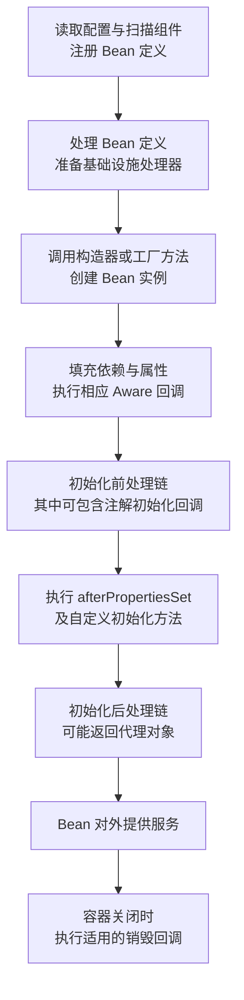
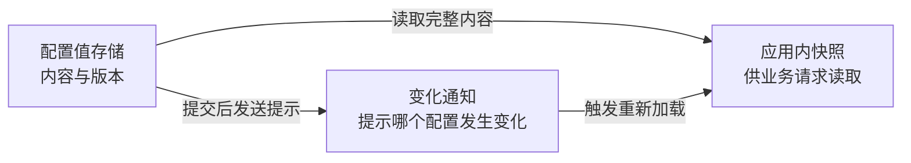
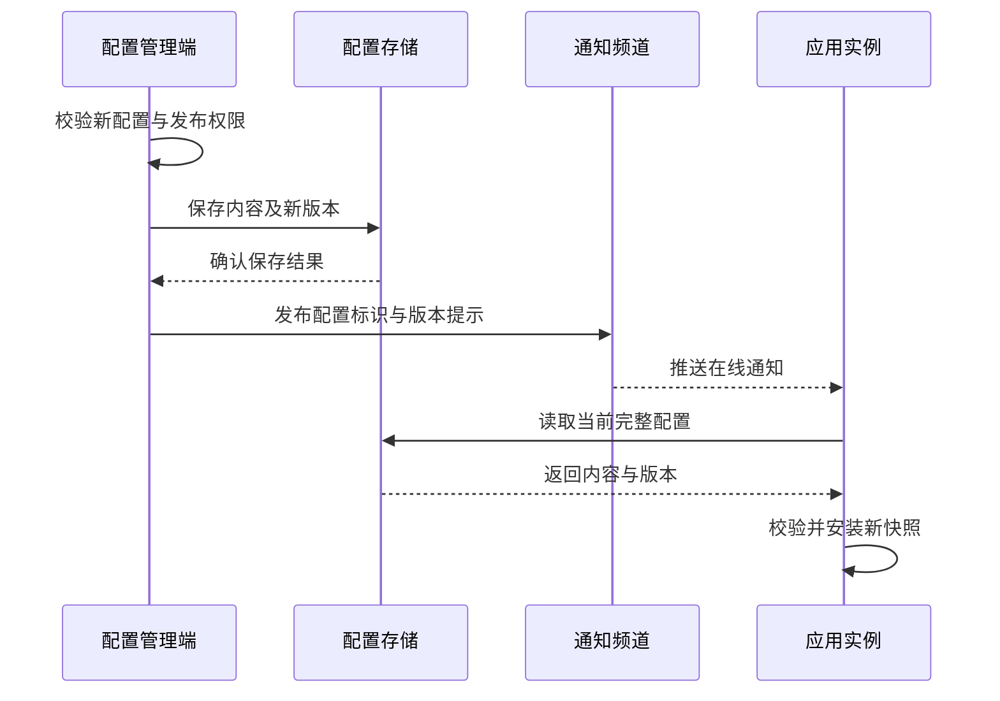
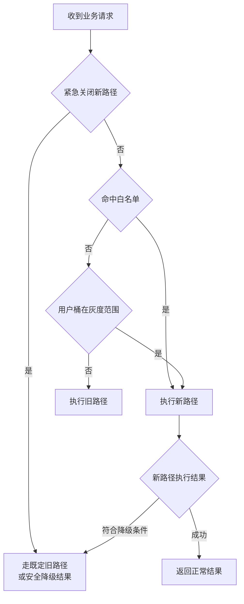

# Spring 容器与动态配置

Spring 容器负责创建对象、连接依赖并管理生命周期。动态配置则要让已经运行的应用，在明确的规则下使用新的参数。两者相互关联：容器可以在 Bean 创建时发现需要配置的对象，但运行期间的通知接收、内容校验和状态替换，需要另外建立执行路径。

理解这套机制，可以抓住两个时间阶段：**初始化阶段建立对象、装入初值并登记更新目标；运行阶段接收变化提示、加载有效配置，再让后续业务读取新快照。** 自定义注解只是表达约定，真正执行这些工作的始终是处理器、客户端和业务代码。

## 一、组件注册、依赖注入与 Bean 的职责

### 1. 容器从定义创建对象

普通 Java 代码通过 `new` 创建对象，再手动调用构造器或 setter 连接依赖。Spring 允许把“创建什么对象、如何配置、依赖谁”交给容器，业务类主要声明自己需要哪些协作者。

容器里的 Bean 是由 Spring 管理的对象。Bean 定义则是一份创建与配置说明，例如对象类型、工厂方法、作用域和初始化方法。定义不等于实例；注册了一份定义，不表示对象一定已立即创建。

组件扫描会在指定范围内查找符合条件的类，例如带 `@Component`、`@Service`、`@Repository` 的类，并为它们注册相应定义。扫描范围外的类不会仅因写了注解就自动出现；手动 `new` 出来的对象也不会自动经历完整的容器处理流程。[Spring 组件扫描说明](https://docs.spring.io/spring-framework/reference/core/beans/classpath-scanning.html)解释了这些注解与 Bean 定义的关系。

`@Service` 表达业务服务职责，`@Repository` 表达数据访问职责，它们都具有组件标记的基础作用。使用语义更明确的注解，有助于表达分层；注解名称本身不会自动生成完整业务逻辑。

### 2. @Bean 与 @Configuration

组件扫描适合注册自己编写、能够添加组件注解的类。第三方客户端、时钟、线程池等对象，也常通过 `@Bean` 工厂方法显式交给容器：

```java
@Configuration(proxyBeanMethods = false)
public class TimeConfiguration {

    @Bean
    public Clock businessClock() {
        return Clock.systemUTC();
    }
}

@Service
public class ExpiryService {

    private final Clock clock;

    public ExpiryService(Clock clock) {
        this.clock = clock;
    }

    public Instant expiresAt(Duration duration) {
        return clock.instant().plus(duration);
    }
}
```

示例中的类分别放在同名 Java 文件中，省略常规 import。`@Bean` 方法返回的 `Clock` 被容器管理，`ExpiryService` 通过构造器声明依赖，容器在创建服务时传入匹配的时钟对象。替换时钟实现不需要让服务自己读取容器或创建时钟。

`@Configuration` 表示这个类主要提供 Bean 定义，和“动态配置中心”不是同一个概念。它不会自动监听配置变化，也不会让所有 `@Bean` 每次请求都重新执行。

`proxyBeanMethods=false` 表示不通过配置类代理拦截同类 `@Bean` 方法之间的普通 Java 调用。如果一个工厂方法需要另一个 Bean，宜像构造器注入一样，把依赖写成方法参数；不要在这种模式下把直接调用其他 `@Bean` 方法当作必然返回容器单例。[Spring Java 配置基础](https://docs.spring.io/spring-framework/reference/core/beans/java/basic-concepts.html)说明了完整配置类处理与这种简化模式的区别。

### 3. 依赖注入与对象作用域

依赖注入是在容器创建对象时，把它所需的协作者传入。构造器注入能清楚表达必需依赖，并允许依赖字段使用 `final`。若同一接口有多个候选实现，需通过 `@Qualifier`、`@Primary` 等规则明确选择，不能指望容器理解业务意图。

默认单例作用域表示，同一个容器通常维护该 Bean 的一份实例。它不表示整个分布式系统只有一份，也不等于类本身只能被 JVM 创建一次。不同应用实例、不同容器和手动创建对象，都有各自的实例关系。

单例也不等于线程安全。Web 应用中多个请求线程可能同时使用同一个服务 Bean；如果服务保存可变配置、计数或集合，就需要适当的可见性与并发控制。容器负责对象管理，不会自动给每个业务方法加锁。[Spring 依赖注入说明](https://docs.spring.io/spring-framework/reference/core/beans/dependencies/factory-collaborators.html)可以帮助区分“连接对象”与“控制对象内部并发”这两件事。

## 二、Bean 生命周期与扩展处理器

### 1. 从定义处理到业务可用

对于常见的普通单例 Bean，可以用下面的主线理解创建过程。实际容器还存在条件装配、循环依赖、工厂对象等分支，这里先保留与动态配置有关的核心阶段：



构造器执行时，对象已经能建立基本状态，但字段注入等后续步骤可能尚未完成。初始化回调适合检查必需属性、准备本地资源等；需要整个应用已经就绪的工作，不应简单假定“我的 `@PostConstruct` 已执行”就足够。

普通非懒加载单例通常在容器启动时创建。懒加载、原型、请求作用域等对象可能在之后创建，所以生命周期与处理器并非只在进程启动的那一刻存在。[Spring Bean 生命周期说明](https://docs.spring.io/spring-framework/reference/core/beans/factory-nature.html)列出了初始化与销毁回调的执行方式。

### 2. BeanPostProcessor 处理已经创建的实例

`BeanPostProcessor`，简称 BPP，是容器在 Bean 创建过程中使用的扩展接口。两个常见方法是：

```java
Object postProcessBeforeInitialization(Object bean, String beanName);

Object postProcessAfterInitialization(Object bean, String beanName);
```

输入是当前 Bean 对象与名称，返回值是后续容器流程应继续使用的对象。处理器可以检查注解、建立注册关系，也可以返回包装后的代理。它不是单纯的“启动日志回调”。

初始化前处理发生在依赖填充之后、`InitializingBean.afterPropertiesSet()` 和自定义初始化方法之前。一个需要特别注意的细节是：`@PostConstruct` 本身也由相关 BPP 在处理链中识别并调用，不能机械地写成“所有自定义 before 方法执行完，再统一执行所有 `@PostConstruct`”。自定义处理器与内置处理器的次序会影响它们的先后关系；若初始化方法必须依赖某项值，应明确注入方式和初始化顺序。

初始化后处理常用于产生代理。例如，容器最终交给业务调用方的对象，可能是事务或其他增强逻辑使用的代理，和最初创建的目标对象不是同一个 Java 引用。

BPP 的这些回调针对 Bean 创建过程执行，**不会因为用户每请求一次接口，就重新扫描一次服务 Bean。** 某个后处理器在创建 Bean 时安装了方法拦截器，之后每次业务调用可以执行拦截器；这属于代理的运行期行为，不等于 BPP 再次执行。若请求作用域 Bean 每次请求都新建，则它每次创建时仍会经历相应处理。

### 3. BeanFactoryPostProcessor 处理创建说明

`BeanFactoryPostProcessor`，简称 BFPP，处理 Bean 的配置元数据。它可以读取或调整 Bean 定义，在普通业务 Bean 创建前改变相关创建说明。

| 比较项 | BeanFactoryPostProcessor | BeanPostProcessor |
| --- | --- | --- |
| 主要处理对象 | Bean 定义等配置元数据 | 已经创建的 Bean 实例 |
| 典型作用 | 调整属性值、处理占位符、修改创建说明 | 检查实例注解、登记目标、包装代理 |
| 与业务实例的关系 | 不应为修改定义而随意提前获取实例 | 直接接收当前处理的实例 |
| 是否是每次请求的拦截器 | 不是 | 不是，运行期拦截通常由其安装的机制完成 |

在 BFPP 中随意调用 `getBean()`，可能过早创建普通对象，使其错过部分正常处理流程。BPP 自身也要较早创建，因此不宜在处理器的构造阶段顺手创建大量业务服务、远程连接和复杂依赖。

如果通过 `@Bean` 注册 BPP 或 BFPP，应核对静态工厂方法、明确返回类型等要求，避免配置类过早实例化。这些基础设施的创建次序与普通业务 Bean 不完全相同。[Spring 容器扩展点说明](https://docs.spring.io/spring-framework/reference/core/beans/factory-extension.html)给出了两类处理器的适用范围及早期实例化问题。

## 三、配置来源与运行时快照

### 1. 配置来源与属性绑定

配置用于把环境差异或可运营参数从业务代码中分离出来。数据库地址、外部接口地址、超时、灰度比例和业务开关都属于配置，但它们的生效条件不一样。

| 配置来源 | 常见用途 | 需要明确的边界 |
| --- | --- | --- |
| YAML、properties 文件 | 应用默认值、环境参数 | 修改磁盘文件不等于运行中的 Bean 自动更新 |
| 环境变量、启动参数 | 部署时覆盖参数 | 通常在进程启动时确定，不能当作通用在线变更接口 |
| 数据库 | 有结构、需要查询与审计的业务配置 | 需要应用自己读取、校验并传播变化 |
| Redis | 高频读取的配置副本或当前值 | 要定义权威来源、持久化及更新协议 |
| Nacos 等配置中心 | 集中管理与分发配置 | 客户端接收变化之后，仍要正确更新应用使用的对象 |

Spring Boot 的 `Environment` 汇总多个属性来源；`@Value` 可以注入单个属性，`@ConfigurationProperties` 适合把一组相关属性绑定到结构化对象。来源之间存在优先级，普通情况下环境变量可以覆盖配置文件，命令行参数又可能具有更高优先级；Profile、外部文件和测试配置会继续影响结果，完整顺序应以所用版本为准。[Spring Boot 外部化配置说明](https://docs.spring.io/spring-boot/reference/features/external-config.html)给出了来源、覆盖和绑定规则。

数据库与 Redis 不会仅因应用依赖了客户端，就自动加入所有属性查找过程。要么通过特定集成把它们接入属性来源，要么由业务配置组件单独加载和提供读取接口。

### 2. 初始注入不等于运行期间持续绑定

假设某个 Bean 的字段声明为：

```java
@Value("${traffic.new-path-percent:0}")
private int newPathPercent;
```

在普通初始化流程中，相关处理器解析属性并赋值。之后即使配置中心中的文本改变，这个普通字段也不会因为保留着 `@Value` 注解，就自动重新读取远端内容。

每次通过 `Environment.getProperty()` 查询，读到的也只是当前应用属性源暴露的值。前提仍是属性源本身已经更新；它不会替调用者自动轮询任意数据库或 Redis。

结构化绑定同理。`@ConfigurationProperties` 能提供分组、类型转换和校验等能力，是否运行期重新绑定、哪些 Bean 重建、旧对象何时退出使用，要看实际引入的刷新机制。不能把“支持属性绑定”概括成“所有配置都支持热更新”。

有些配置还代表资源创建参数。例如连接池、线程池和 HTTP 客户端即使读取过新超时，也可能仍保留按旧参数创建的内部资源。更新一个 Java 数字字段，不等于已经重配所有相关连接。

### 3. 值存储、变化通知与应用快照

一套可理解的动态配置通常包含三层：



第一层回答当前有效配置是什么，可以是数据库、Redis 或专用配置中心。第二层降低发现变化的延迟，可以是监听回调、Pub/Sub 或其他通知方式。第三层把已经解析、校验的值保存在应用内部，使业务请求不必每次远程访问。

三层可以由一个产品协同实现，也可以由应用自己连接，但职责不能混淆。消息到达只说明收到变化提示；远端保存成功只说明有了一份存储结果；业务开始使用新值，还需要完成本地安装。

例如，配置快照包含版本 18、开关状态、灰度比例和超时。应用先完整读取和验证这份内容，成功后整体替换当前快照。解析失败时继续使用最近一次有效配置并记录错误，通常比把半份新值逐项写入共享字段更容易控制。

### 4. 可见性与一组配置的一致读取

一个后台线程负责更新配置，请求线程负责读取，就已经产生了并发问题。对于独立的简单标量，可以使用 `volatile` 字段或适当的原子类，让更新对其他线程可见。`volatile` 不会自动让“读、加一、写回”等复合操作变成原子操作，也不会让多个字段同时更新。

如果比例、开关和版本必须配套，适合保存不可变快照，再通过一个 `volatile` 引用或 `AtomicReference` 整体替换。下面使用 Java 17 及以上可用的 record，并把持有快照的代码放在普通业务类内部：

```java
public record TrafficSnapshot(
        long version,
        boolean enabled,
        int percent) {
}

private volatile TrafficSnapshot current =
        new TrafficSnapshot(0L, false, 0);

public void install(TrafficSnapshot next) {
    // 示例假设调用方已校验内容，并把更新串行化。
    current = next;
}

public boolean useNewPath(int bucket) {
    TrafficSnapshot snapshot = current; // 一次业务判断使用同一快照
    return snapshot.enabled()
            && bucket < snapshot.percent() * 100;
}
```

示例中 bucket 的范围为 0 到 9999，百分比为 0 到 100。一次调用只读取一次引用，避免先按旧开关、再按新比例组合判断。若多个刷新线程同时安装，还需要串行执行或使用比较更新，避免旧版本覆盖新版本。

不可变快照中的集合也需要复制并禁止后续修改；仅把最外层字段设成 `final`，并不能阻止内部 `HashMap` 被其他线程改变。[Java 内存模型规范](https://docs.oracle.com/javase/specs/jls/se21/html/jls-17.html)规定了 volatile 等同步行为的可见性关系，应用需要在正确的共享状态上使用它们。

## 四、自定义注解与配置更新目标

### 1. 用注解声明约定，用处理器执行约定

下面使用一个“动态百分比”示例，把注解、初始化处理与运行时回调连接起来。它只处理 0 到 100 的整数百分比，目标是普通单例 Bean 中的公开 setter，不尝试通用地修改任意字段。各类放在独立同名 Java 文件中，常规 import 省略。

```java
@Retention(RetentionPolicy.RUNTIME)
@Target(ElementType.METHOD)
public @interface DynamicPercent {
    String key();
    int defaultValue() default 0;
}

@Component
public class TrafficFlags {

    private volatile int newPathPercent;

    @DynamicPercent(key = "traffic.new-path-percent", defaultValue = 0)
    public void updateNewPathPercent(int value) {
        if (value < 0 || value > 100) {
            throw new IllegalArgumentException("百分比必须在 0 到 100 之间");
        }
        newPathPercent = value;
    }

    public int newPathPercent() {
        return newPathPercent;
    }
}
```

`@Retention(RUNTIME)` 使注解可以在运行期间被反射读取；`@Target(METHOD)` 限定它标记方法。注解中的 key 说明配置身份，defaultValue 说明没有外部初始值时的默认值。

注解没有自己启动线程或订阅 Redis。处理器需要发现它、解析 key，记录“哪个对象的哪个方法负责安装这个配置”。setter 负责保持该对象自身的校验与赋值规则。

### 2. 初始化时赋初值并登记目标

下面的处理器使用 `Environment` 取得初值，并保存更新目标。它不在后处理器构造阶段创建 Redis 连接。代码中的方法反射只服务于这个受限的 setter 协议：

```java
@Component
public class DynamicPercentProcessor implements BeanPostProcessor {

    private final Environment environment;
    private final Map<String, Integer> latest = new HashMap<>();
    private final Map<String, List<IntConsumer>> targets = new HashMap<>();

    public DynamicPercentProcessor(Environment environment) {
        this.environment = environment;
    }

    @Override
    public synchronized Object postProcessBeforeInitialization(
            Object bean, String beanName) {

        for (Method method : bean.getClass().getMethods()) {
            DynamicPercent setting = method.getAnnotation(DynamicPercent.class);
            if (setting == null) {
                continue;
            }

            if (Modifier.isStatic(method.getModifiers())
                    || method.getReturnType() != void.class
                    || method.getParameterCount() != 1
                    || method.getParameterTypes()[0] != int.class) {
                throw new IllegalStateException("动态百分比方法签名不合法");
            }

            String key = setting.key();
            int initial = latest.computeIfAbsent(key, ignored ->
                    environment.getProperty(
                            key, Integer.class, setting.defaultValue()));
            checkPercent(initial);

            IntConsumer target = value -> invoke(bean, method, value);
            target.accept(initial);
            targets.computeIfAbsent(key, ignored -> new ArrayList<>())
                    .add(target);
        }
        return bean;
    }

    public synchronized void refresh(String key, int value) {
        checkPercent(value);
        for (IntConsumer target : targets.getOrDefault(key, List.of())) {
            target.accept(value);
        }
        latest.put(key, value);
    }

    private static void checkPercent(int value) {
        if (value < 0 || value > 100) {
            throw new IllegalArgumentException("百分比超出范围");
        }
    }

    private static void invoke(Object bean, Method method, int value) {
        try {
            method.invoke(bean, value);
        } catch (ReflectiveOperationException exception) {
            throw new IllegalStateException("安装动态百分比失败", exception);
        }
    }
}
```

这个处理器完成两件事。首先，在目标 Bean 创建时取得有效初值，调用 setter，让对象拥有可用状态。其次，把配置 key 映射到更新回调，之后不必每次收到通知都重新扫描所有类。

`latest` 还保留本进程已经接受的值。若某个目标在一次刷新之后才创建，它可以优先取得该值，而不是无条件回退到最早的环境初值。示例通过同步方法串行化注册与刷新，避免一个线程正在登记目标、另一个线程刚好更新而遗漏该目标。

这仍是机制示例。它没有加入分布式版本、目标注销、重复登记消除和跨多个目标的事务回滚。如果多个 setter 中途抛出异常，不能认为此前目标的更新已经自动撤销。因此，setter 应保持短小、无外部副作用，复杂配置应优先采用整份快照验证与替换。

### 3. 运行时由监听器主动调用刷新入口

Bean 创建完成以后，`postProcessBeforeInitialization()` 不会持续运行。真正发生配置变更时，需要监听组件取得当前配置，完成解析，再调用：

```java
// 位于运行期间的配置加载回调中，value 已从当前配置解析得到。
processor.refresh("traffic.new-path-percent", value);
```

这次调用通过之前登记的目标执行 setter。下一次业务请求读取 `TrafficFlags.newPathPercent()`，才能看到新百分比。它不需要重新创建全部业务 Bean，也没有重新触发整个初始化流程。

如果通知来自 Redis，回调应先按版本提示读取保存的当前值；不宜仅凭一条未经校验的消息直接执行任意方法。启动时还应主动加载远端配置，避免默认值一直使用到第一条新通知才被替换。

本例初始值来自 `Environment`。如果真实来源在 Redis 或数据库，启动加载器需要在应用对外接流量前，把那份有效值安装进来；也可以把统一加载后的快照作为初值来源。不能因为写了这个处理器，就认为 Redis 值已经自动进入 `Environment`。

### 4. 代理、字段反射与线程安全边界

示例限定目标为普通 Bean，并在初始化前登记实际对象。若目标存在 JDK 动态代理，代理类可能只暴露接口，扫描 `bean.getClass()` 不一定找到实现类上的注解；若持有的是某个作用域目标，目标还可能在以后切换。不能简单把扫描代码搬到任意后处理器位置，就承诺始终找到正确目标。

CGLIB 代理、目标类解析和代理方法调用也各有规则。真实通用框架需要识别用户类型、方法可见性、继承注解及目标生命周期，并决定更新操作是否经过增强逻辑。[Spring 代理机制说明](https://docs.spring.io/spring-framework/reference/core/aop/proxying.html)解释了接口代理与子类代理的区别。

若改为给字段加注解，再通过反射直接写字段，还会增加问题：实际写到的是代理对象还是目标对象，字段是否可访问，是否为 static 或 final，转换后的类型是否匹配，读写线程是否存在数据竞争。开放反射访问不能代替这些约束，也不能由此修改任意 final 字段并期待稳定行为。

本例把可变状态封装在 setter 内，并用 volatile int 提供单个百分比的可见性。它只保证这一份标量的更新方式；注册表的同步不会自动保护所有业务字段，多个配置项的配套关系仍需要不可变快照或其他并发协议。

## 五、配置分发、故障恢复与 Nacos

### 1. 先保存版本值，再发送刷新提示

使用 Redis 构建轻量动态配置时，可以把完整内容与版本保存到一个字符串键中，再通过独立频道发布变化提示。例如，键 `prod:config:traffic` 保存版本 18 的配置，频道 `prod:config:changed` 只提示 `traffic` 已变化。

键与频道属于不同机制。即使使用相同文本名称，发布消息也不会自动修改同名键；键更新成功，也不会自动触发自定义监听器。[Redis Pub/Sub 文档](https://redis.io/docs/latest/develop/pubsub/)说明了消息与键空间的区别及至多一次语义。

推荐的主流程如下：



如果先通知，再保存，应用可能收到提示却读到旧值。先保存可避免这种确定的时序问题，但保存与通知仍有失败间隙。若发布方在保存后退出，实例需要通过其他入口发现新版本。

版本与内容最好作为同一份一致的记录读取，避免先读版本、再读内容时恰好跨越另一次更新。多发布者还要处理并发覆盖，可以采用数据库乐观版本或 Redis 原子比较更新等机制；仅给每个进程加一个本地自增计数，不足以形成全局可靠版本。

### 2. 重复、乱序与旧版本覆盖

通知可能重复，也可能因执行器排队、加载耗时等原因，使较旧的加载任务最后才完成。应用不能只按回调完成顺序覆盖当前值。

假设任务 A 取得版本 18 后解析较慢，任务 B 取得版本 19 并先完成安装。A 后来恢复时，应识别 18 已过时并放弃覆盖。可以串行处理同一配置的刷新，或者在安装快照时按版本比较更新。

对同一配置，内容校验、版本判断和快照安装需要作为一条清楚的路径执行。部分配置错误时，继续保留最近有效版本，并暴露失败原因。错误版本不能因为“通知已经消费”就被视为已经生效。

回滚也应保持版本推进。例如，用版本 20 恢复版本 17 的业务内容，而不是把当前版本号直接倒退到 17。这样客户端仍能按版本规则接受一次明确的新发布。

### 3. 启动、重连与定期对账

普通 Pub/Sub 不保存供离线订阅者补读的历史。只写监听代码，会遗漏应用启动前或断线期间发生的变化。因此，恢复路径至少应覆盖：

- 启动时主动加载当前配置，并根据关键程度决定未加载成功能否接流量。
- 订阅连接恢复后检查当前版本，补齐断线期间错过的变化。
- 定期比较远端与本地版本，使没有新通知的遗漏也有机会恢复。
- 加载或安装失败时保留最近有效值，记录错误并安排受控重试。

启动时“先读，再订阅”可能在两步之间漏掉一次更新；仅“先订阅，再读”也还需要处理订阅确认、并发回调和版本覆盖。较稳妥的组织方式是确认订阅建立，再读取当前快照，并让通知、主动加载和对账统一经过版本比较安装逻辑。周期对账继续补偿残余遗漏。

如果读取存在副本延迟，刚收到版本 19 提示却只读到 18，应安排后续检查，不能认为收到提示就一定已经拿到最新数据。若 Redis 只是数据库配置的分发副本，还需要确保它能从真实来源恢复；若把 Redis 本身当权威存储，则应明确相应持久化、备份与恢复要求。

应用内快照替换完成，只表示本实例已经更新。要判断整体生效情况，需要观察各实例的配置版本、最后成功安装时间与错误状态，而不是只看管理端显示“发布成功”。

### 4. Nacos 提供配置服务，应用决定生效方式

Nacos 将配置管理与客户端监听作为专门能力提供。Java SDK 的 `getConfig()` 用于读取内容，`addListener()` 用于登记后续变化监听，`getConfigAndSignListener()` 提供取得配置并登记监听的使用入口。应用仍要解析回调中的内容，并把它应用到真正使用配置的对象。[Nacos Java SDK 官方说明](https://nacos.io/en/docs/v3.0/manual/user/java-sdk/usage/)可以核对这些接口的职责。

| 方面 | Redis 自建轻量机制 | Nacos 配置服务 |
| --- | --- | --- |
| 当前值与分发 | 自行选择键、版本、频道及恢复协议 | 通过配置标识、SDK 和服务端能力协同 |
| 管理入口 | 需要自己建设或接入现有平台 | 提供专门的配置管理入口 |
| 变更监听 | 由应用连接消息并触发加载 | SDK 提供配置监听回调 |
| 业务对象更新 | 自行设置字段或替换快照 | 仍取决于 SDK 使用方式及 Spring 集成 |
| 生效校验 | 自行观察实例版本与业务结果 | 仍需核对应用是否接受并使用新值 |

直接使用 Nacos SDK，与使用 Spring 或 Spring Cloud 集成不是同一层次。集成可以帮助装载属性来源、发布环境变化事件或触发特定 Bean 刷新，但能力与配置方式受组件版本和接入路径影响。

Spring Cloud 的 `@RefreshScope` 是一种明确的刷新机制：业务通常通过作用域代理访问目标，刷新使缓存的目标失效，后续使用时重新创建目标。它不是把任意对象中的所有字段都原地改成新值，也不能承诺所有资源类型都可刷新。[Spring Cloud Refresh Scope 说明](https://docs.spring.io/spring-cloud-commons/reference/spring-cloud-commons/application-context-services.html#refresh-scope)还指出了部分 Bean 与运行模式的限制。

因此，不能仅根据“接入 Nacos”“写了 `@Value`”或“写了 `@ConfigurationProperties`”，就断定全部配置自动刷新。应沿着实际链路核对：配置是否加载、监听是否运行、变化如何进入 Spring、哪些对象会更新、业务又持有哪一份引用。具体 starter 参数与版本兼容关系，应在确定依赖版本后再查对应官方文档。

## 六、切量、灰度、降级与限流

### 1. 配置改变的是业务决策

动态配置只有被业务读取并参与决策，才会产生效果。例如，把 `new-path-percent` 从 10 改成 30，只改变配置状态；路由代码还需要按这个比例选择新旧实现。

| 概念 | 主要目的 | 典型例子 |
| --- | --- | --- |
| 切量 | 调整进入某条路径的流量份额 | 将部分查询从旧搜索服务切到新服务 |
| 用户灰度 | 让稳定的一组用户先体验新能力 | 先对白名单或某些用户桶开放新版报价 |
| 降级 | 在故障或资源不足时减少能力、采用替代结果 | 推荐服务异常时展示固定热门商品 |
| 限流 | 限制某种请求或资源消耗的速率 | 每秒只允许一定数量的短信发送请求 |

它们可以配合使用，但不能相互替代。把 20% 请求送到新实现不等于限流：总请求量仍可能很大。关闭可选推荐属于降级，也不自动限制下游请求速率；剩余主流程是否仍承受过载，需要另外判断。

### 2. 稳定用户哈希灰度

如果每次请求都随机抽签决定是否走新逻辑，同一用户刷新页面时可能反复切换，导致前后体验和排障结果不稳定。用户灰度通常希望相同用户在同一规则下持续进入同一组。

一种常见做法是把稳定用户标识与规则盐值组合后计算稳定哈希，再映射到 10000 个桶，桶号范围为 0 到 9999。比例为 p% 时，让桶号小于 p 乘以 100 的用户进入新路径。

例如，用户甲的桶号为 7312：灰度 25% 时进入旧路径，灰度 75% 时进入新路径。若哈希方式和盐值不变，阈值从 25% 增加到 75%，原来命中的用户仍位于新集合中，新增用户来自更高桶区间。

实现时要约定用户标识的规范化方式、字符编码、哈希算法和盐值。不同实例或语言使用不同规则，会让同一个用户得到不同分组。把负哈希转成桶号时应采用明确的非负映射，不能简单假定 `Math.abs()` 永远得到正数。

这里的比例是大样本下希望接近的分组份额，并不保证每 100 个请求恰好有 p 个。用户活跃度、实际样本规模和哈希分布都会影响请求占比。稳定用户灰度控制的是用户归属，按实例、地区或租户切量则具有不同的分组单位。

匿名用户可以使用稳定设备标识或会话标识，但登录后身份变化可能改变分组。需要长期一致体验的流程，应提前确定身份切换与分组保留规则。

### 3. 开关优先级与降级结果

当多个配置同时影响路由时，应确定优先顺序。例如，一条规则可以先检查紧急关闭，再检查白名单，最后按稳定用户桶选择新旧逻辑：



图中把紧急关闭置于白名单之前，是一种明确的规则选择。实际业务可以有别的优先级，但应让管理人员理解“打开哪个开关会覆盖哪个条件”，避免多个布尔字段组合后出现无法解释的结果。

降级需要定义可接受的替代结果。例如推荐服务失败可以返回热门列表；支付确认失败不能随意降级为“支付成功”。失败类型、业务风险和用户承诺决定哪些能力可以舍弃。

正在执行的请求是否中途改用新配置，也应有规则。一次价格试算通常适合固定本次采用的规则快照；紧急停用某种高风险操作，则可能要求关键提交点再次检查。动态配置改变未来决策，不会自动回滚已经发生的外部动作。

### 4. 限流需要独立的计量与执行

限流要回答限制什么、对谁限制、按什么时间范围计量。例如限制每个用户每分钟领取优惠券次数，与限制整个服务每秒调用短信渠道的总量，不是同一个指标。

算法可以采用固定窗口、滑动窗口或令牌桶等思路。动态配置负责改变额度、窗口或启停状态，执行器仍要按相应算法维护计数并原子判定。仅将一个比例字段调小，没有建立请求消耗与拒绝规则，就还没有完成限流。

多实例部署时，本地限额与全局限额也不同。每个实例都允许每秒 100 次，十个实例总体可能达到每秒 1000 次；需要全局约束时，应使用共享计量或经过明确分配的配额，并处理协调系统故障时的策略。

配置发布最终应能被观察为一条完整链路：管理端提交有效版本，各实例接受并安装，业务读取正确快照，路由、降级或限流结果符合规则。容器、消息与配置中心分别完成其中一部分，只有把参与者和生效条件连接清楚，才能形成可解释、可恢复的动态配置能力。
