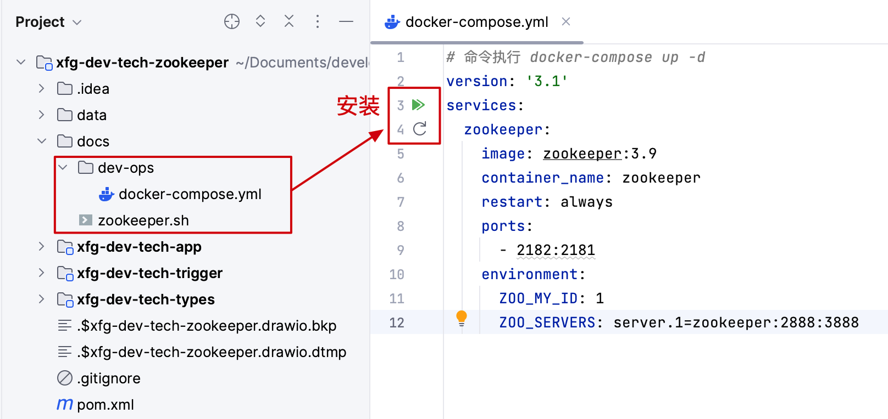
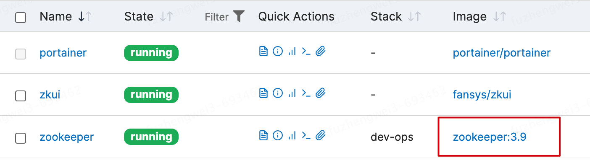
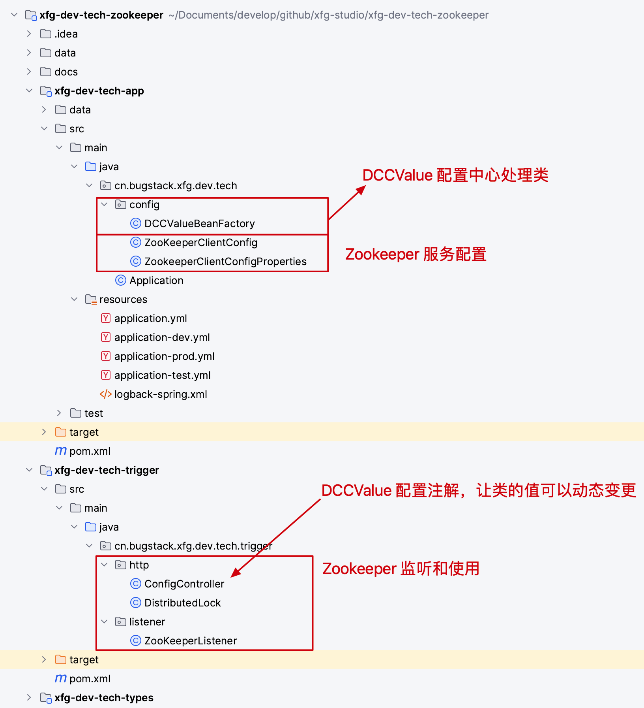
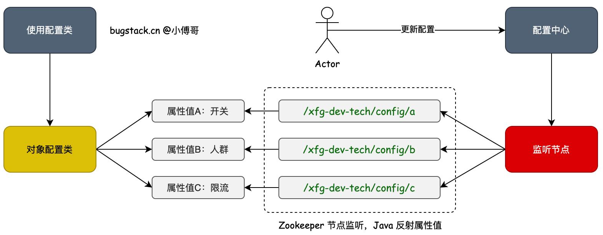
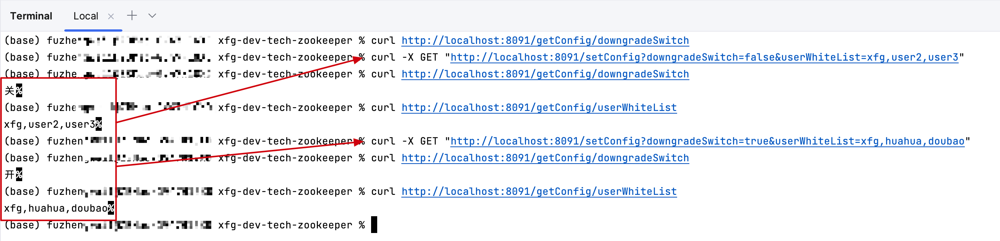

# ZooKeeper 使用与动态配置

## 一、用途、节点与使用规则

ZooKeeper 是分布式协调服务，应用通过共享的节点数据和变化通知完成配置维护、服务注册发现等工作。它适合保存少量配置、地址和状态信息；大量业务记录仍应放在数据库或相应存储中。学习使用时，先掌握节点的组织、读写和监听，再把这些操作组合成具体功能。

ZooKeeper 使用树形命名空间，每个数据节点称为 ZNode，以绝对路径标识。例如 `/xfg-dev-tech/config` 可以有 `downgradeSwitch` 和 `userWhiteList` 两个子节点。一个节点既可以保存数据，也可以包含子节点；数据本质上是字节数组，写入和读取字符串时应约定相同编码，下面统一使用 UTF-8。

节点类型决定其生命周期。持久节点在客户端退出后仍保留，适合长期配置；临时节点与创建它的会话关联，会话结束后删除，而且不能有子节点，适合表达实例的临时存在状态。顺序节点会在路径前缀后追加序号，可与持久或临时类型组合；创建后应使用实际返回的完整路径继续操作。

会话是客户端与服务端维持的逻辑关系，连接是通信通道。短暂断网不等于会话已经结束；会话过期后，依赖临时节点的注册等状态需要重新建立。客户端负责维持连接和心跳，应用仍需根据连接状态决定何时继续读取或更新，不能用“配置了重试”代替状态处理。

读取数据、读取子节点列表和查询节点状态是不同操作：数据用于保存配置值；子节点列表用于发现下一层节点；`stat` 中的版本、时间、直接子节点数用于判断节点状态。需要防止覆盖并发修改时，可以使用版本条件更新，版本不匹配后应重新读取再作决定，相关规则见 [ZooKeeper 数据模型与会话](https://zookeeper.apache.org/doc/r3.9.0/zookeeperProgrammers.html)。

监听（Watch）用来得知变化。普通 Watch 触发一次后需要重新注册，持久 Watch 则不受一次触发的限制。原生通知主要告诉应用发生了什么变化，应用再按需读取数据；后面的 CuratorCache 会维护本地缓存，并提供节点变化回调。通知和业务回写存在时间差，配置监听也不保证逐条交付，详见 [ZooKeeper 监听机制](https://zookeeper.apache.org/doc/r3.9.0/zookeeperProgrammers.html#sc_WatchRemember)。

## 二、环境准备与命令行操作

[示例工程](https://gitcode.net/KnowledgePlanet/road-map/xfg-dev-tech-zookeeper)的 `docs/dev-ops` 提供安装脚本。先准备 [Docker](https://bugstack.cn/md/road-map/docker.html)，Compose 用法可参考[配套教程](https://bugstack.cn/md/road-map/road-map.html)。下图使用 `zookeeper:3.9` 镜像，`2182:2181` 表示宿主机 2182 映射到容器内部 2181。



在脚本目录执行 `docker compose -f docker-compose.yml up -d`；旧版独立 Compose 使用 `docker-compose`。下图为容器 running 状态，还应通过客户端连接确认服务可用。



进入示例中的 `zookeeper` 容器后，使用容器内部地址连接：

```shell
docker exec -it zookeeper bash
zkCli.sh -server 127.0.0.1:2181
```

宿主机上的 Java 应用连接 `127.0.0.1:2182`；容器内部连接本容器的 2181。应用在其他机器或容器时，要使用其实际可达的宿主机地址或容器网络地址。连接成功后，再执行下面的常用命令；各项独立演示操作，不是顺序执行脚本。

```text
1. 创建节点：create /path data
2. 创建临时节点：create -e /path data
3. 创建顺序节点：create -s /path data
4. 创建临时顺序节点：create -e -s /path data
5. 获取节点数据：get /path
6. 获取节点子节点列表：ls /path
7. 更新节点数据：set /path data
8. 删除节点：delete /path
9. 删除节点及其子节点：deleteall /path
10. 监听节点变化：get -w /path
11. 查看节点状态：stat /path
12. 查看节点ACL权限：getAcl /path
13. 设置节点ACL权限：setAcl /path acl
14. 统计全部后代节点数量：getAllChildrenNumber /path
15. 查看直接子节点列表并监听变化：ls -w /path
```

练习时可以先创建 `/path` 并写入数据，用 `get` 读取，用 `set` 修改，再次读取确认变化，最后删除。创建子节点前先准备父节点；更新和删除要求目标节点存在。`delete` 用于无子节点的节点，`deleteall` 递归删除，练习时应使用独立测试路径。

`ls /path` 返回直接子节点名称。`stat` 的 `numChildren` 是直接子节点数，`getAllChildrenNumber` 统计全部后代。`get -w` 监听数据变化，`ls -w` 监听子节点列表变化；触发后再次执行相应读取命令，才能继续注册普通 Watch。`getAcl` 与 `setAcl` 查看、设置访问权限，权限配置还需与客户端认证方式匹配，命令细节见 [ZooKeeper CLI](https://zookeeper.apache.org/doc/r3.9.0/zookeeperCLI.html)。

下面是一段已连接会话的查询结果，地址和节点名称随环境变化：

```text
[zk: 192.168.1.101:2181(CONNECTED) 1] ls /xfg-dev-tech
[config, configdowngradeSwitch]
```

返回列表表示 `/xfg-dev-tech` 的直接子节点，而不是这些节点中保存的数据。查询具体配置值，应继续对其完整路径执行 `get`。

## 三、Curator 接入与常用操作

### 1. 创建并管理客户端

Apache Curator 为 Java 应用提供 ZooKeeper 客户端封装，简化连接管理、重试和节点操作。应用通常共享同一集群对应的 CuratorFramework，在启动时创建并 start，在结束时 close；不需要每次读写都新建客户端，参见 [Curator Framework](https://curator.apache.org/docs/framework/)。

基础客户端由 `org.apache.curator:curator-framework` 提供，CuratorCache 等封装位于 `curator-recipes`。本例用到缓存，可以引入 `org.apache.curator:curator-recipes`，由 Maven 带入其 framework 和 client 依赖；各 Curator 模块应保持版本一致，并选择包含本例 API、与 ZooKeeper 和 JDK 兼容的版本，参见 [Curator 接入说明](https://curator.apache.org/docs/getting-started/)。

下图中，app 的 config 包含客户端配置和 DCCValueBeanFactory，trigger 放置 HTTP 入口和监听示例，types 承载通用类型。普通节点操作先关注客户端配置，后续动态配置案例再使用 DCCValueBeanFactory。



`ZookeeperClientConfigProperties` 将 YAML 中的连接参数绑定为 Java 属性：

```java
@Data
@ConfigurationProperties(prefix = "zookeeper.sdk.config", ignoreInvalidFields = true)
public class ZookeeperClientConfigProperties {

    private String connectString;
    private int baseSleepTimeMs;
    private int maxRetries;
    private int sessionTimeoutMs;
    private int connectionTimeoutMs;

}
```

宿主机应用连接前述本地容器时，`application.yml` 使用 `127.0.0.1:2182`；远程部署时改成实际可达地址：

```yaml
zookeeper:
  sdk:
    config:
      connect-string: 127.0.0.1:2182
      base-sleep-time-ms: 1000
      max-retries: 3
      session-timeout-ms: 1800000
      connection-timeout-ms: 30000
```

`connect-string` 指定连接目标；`base-sleep-time-ms` 是指数退避重试的基础等待时间，`max-retries` 限制重试次数；`connection-timeout-ms` 控制连接超时，`session-timeout-ms` 是请求的会话超时，最终值由服务端协商。会话超时不能直接当作每次读写允许等待的时长。

配置类注册 CuratorFramework，并启动客户端：

```java
@Configuration
@EnableConfigurationProperties(ZookeeperClientConfigProperties.class)
public class ZooKeeperClientConfig {

    /**
     * 多参数构建ZooKeeper客户端连接
     *
     * @return client
     */
    @Bean(name = "zookeeperClient")
    public CuratorFramework createWithOptions(ZookeeperClientConfigProperties properties) {
        ExponentialBackoffRetry backoffRetry = new ExponentialBackoffRetry(properties.getBaseSleepTimeMs(), properties.getMaxRetries());
        CuratorFramework client = CuratorFrameworkFactory.builder()
                .connectString(properties.getConnectString())
                .retryPolicy(backoffRetry)
                .sessionTimeoutMs(properties.getSessionTimeoutMs())
                .connectionTimeoutMs(properties.getConnectionTimeoutMs())
                .build();
        client.start();
        return client;
    }

}
```

`client.start()` 开启连接管理，返回时不一定已经连接成功；后续操作按重试策略等待连接并处理部分连接异常，最终失败仍需要应用处理。这份 YAML 配置客户端，业务开关和名单则保存在 ZooKeeper 节点中，两者用途不同。

### 2. 创建、读写、删除与监听

Curator 采用链式调用，通常先用 `create`、`getData` 等选择操作，再设置模式等选项，最后以 `forPath` 指定路径并提交。例如 `creatingParentsIfNeeded` 用于补齐缺失的父节点，`withMode` 选择临时、顺序等类型。

下面的 ApiTest 展示一组常用操作。各方法独立说明 API 用法，运行前应准备相应父节点或目标节点，不依赖测试方法的执行顺序：

```java
@Slf4j
@RunWith(SpringRunner.class)
@SpringBootTest
public class ApiTest {

    @Resource
    private CuratorFramework curatorFramework;

    @Test
    public void test_all() throws Exception {
        String path = "/xfg-dev-tech/config/example-ephemeral";
        String data = "0";
        curatorFramework.create().withMode(CreateMode.EPHEMERAL).forPath(path, data.getBytes(StandardCharsets.UTF_8));

        for (int i = 0; i < 2; i++) {
            curatorFramework.setData().forPath(path, String.valueOf(i).getBytes(StandardCharsets.UTF_8));
        }
    }

    /**
     * 创建持久节点
     */
    @Test
    public void createNode() throws Exception {
        String path = "/xfg-dev-tech/config/downgradeSwitch/test/a";
        String data = "0";
        if (null == curatorFramework.checkExists().forPath(path)) {
            curatorFramework.create().creatingParentsIfNeeded().forPath(path);
        }
    }

    /**
     * 创建临时节点
     */
    @Test
    public void createEphemeralNode() throws Exception {
        String path = "/xfg-dev-tech/config/epnode";
        String data = "0";
        curatorFramework.create().withMode(CreateMode.EPHEMERAL).forPath(path, data.getBytes(StandardCharsets.UTF_8));
    }

    /**
     * 创建临时有序节点
     */
    @Test
    public void createEphemeralSequentialNode() throws Exception {
        String path = "/xfg-dev-tech/config/epsnode";
        String data = "0";
        curatorFramework.create()
                .withMode(CreateMode.EPHEMERAL_SEQUENTIAL)
                .forPath(path, data.getBytes(StandardCharsets.UTF_8));
    }

    /**
     * 向节点设置数据
     */
    @Test
    public void setData() throws Exception {
        curatorFramework.setData().forPath("/xfg-dev-tech/config/downgradeSwitch", "111".getBytes(StandardCharsets.UTF_8));
        curatorFramework.setData().forPath("/xfg-dev-tech/config/userWhiteList", "222".getBytes(StandardCharsets.UTF_8));
    }

    @Test
    public void getData() throws Exception {
        String downgradeSwitch = new String(curatorFramework.getData().forPath("/xfg-dev-tech/config/downgradeSwitch"), StandardCharsets.UTF_8);
        log.info("测试结果: {}", downgradeSwitch);
        String userWhiteList = new String(curatorFramework.getData().forPath("/xfg-dev-tech/config/userWhiteList"), StandardCharsets.UTF_8);
        log.info("测试结果: {}", userWhiteList);
    }

    /**
     * 异步修改数据
     */
    @Test
    public void setDataAsync() throws Exception {
        String path = "/xfg-dev-tech/config/downgradeSwitch";
        String data = "0";
        CuratorListener listener = (client, event) -> {
            Stat stat = event.getStat();
            log.info("stat=" + JSON.toJSONString(stat));
            CuratorEventType eventType = event.getType();
            log.info("eventType=" + eventType.name());
        };
        curatorFramework.getCuratorListenable().addListener(listener);
        curatorFramework.setData().inBackground().forPath(path, data.getBytes(StandardCharsets.UTF_8));
    }

    /**
     * 删除节点
     */
    @Test
    public void deleteData() throws Exception {
        String path = "/xfg-dev-tech/config/downgradeSwitch";
        curatorFramework.delete().deletingChildrenIfNeeded().forPath(path);
    }

    /**
     * 网络异常后的保障删除重试
     */
    @Test
    public void guaranteedDeleteData() throws Exception {
        String path = "/xfg-dev-tech/config/downgradeSwitch";
        curatorFramework.delete().guaranteed().forPath(path);
    }

    /**
     * 获取直接子节点名称并注册一次性监听
     */
    @Test
    public void watchedGetChildren() throws Exception {
        String path = "/xfg-dev-tech";
        List<String> children = curatorFramework.getChildren().watched().forPath(path);
        log.info("测试结果：{}", JSON.toJSONString(children));
    }

    /**
     * 获取节点数据
     */
    @Test
    public void getDataByPath() throws Exception {
        String path = "/xfg-dev-tech/config/downgradeSwitch";
        String fullClassName = ""; // 替换为实际业务类型的全限定类名
        String jsonStr = new String(curatorFramework.getData().forPath(path), StandardCharsets.UTF_8);
        Class clazz = Class.forName(fullClassName);
        log.info("测试结果：{}", JSON.parseObject(jsonStr, clazz));
    }

}
```

`test_all` 在独立的 example-ephemeral 路径创建临时节点，再修改数据。`createNode` 创建持久路径，`createEphemeralNode` 和 `createEphemeralSequentialNode` 演示临时及临时顺序节点；顺序节点创建结果会带序号，实际操作时应保存返回路径。持久节点可以通过 `checkExists` 判断后创建，多实例同时执行时仍需处理创建竞争。

`setData` 修改已有节点，`getData` 读取字节后按 UTF-8 还原字符串；写入和读取的业务格式要保持一致。`getDataByPath` 演示把 JSON 还原成对象，fullClassName 需填实际类型，节点内容也应是与该类型匹配的 JSON，不能把普通开关字符串直接按任意业务对象解析。

`setDataAsync` 用 `inBackground` 提交异步操作，返回不代表写入已成功，应在回调中检查事件类型、结果码并处理失败。注册的 [CuratorListener](https://curator.apache.org/apidocs/org/apache/curator/framework/api/CuratorListener.html) 可接收后台操作结果和 Watch 事件。`watchedGetChildren` 返回直接子节点名称并注册普通 Watch；接收通知需要相应监听回调，持续跟踪还要重新读取和注册，或使用后面的 CuratorCache。

`deleteData` 使用 `deletingChildrenIfNeeded` 递归删除。`guaranteedDeleteData` 使用 `guaranteed`，让连接异常后的删除在客户端仍打开时继续后台重试；当前调用失败时仍可能抛异常。它不能绕过 ACL，也不保证进程退出后继续重试；删除非空节点仍需指定递归删除，详见[删除重试语义](https://curator.apache.org/apidocs/org/apache/curator/framework/api/GuaranteeableDeletable.html)。

## 四、动态配置案例与使用验证

### 1. 配置路径与字段绑定

动态配置适合运行期间调整功能开关、地址、名单和比例。这里把配置保存到持久节点，应用加载并监听配置，再更新业务使用的字段。下图以 `/xfg-dev-tech/config` 为根路径，a、b、c 为配置项，展示“修改节点 → 监听变化 → 更新 Java 字段 → 业务读取”的过程。



使用运行期字段注解标记需要动态更新的属性，value 指定配置键：

```java
@Retention(RetentionPolicy.RUNTIME)
@Target({ElementType.FIELD})
@Documented
public @interface DCCValue {

    String value() default "";

}
```

`DCCValueBeanFactory` 通过 BeanPostProcessor 在 Bean 初始化后检查声明字段、建立节点并登记“完整路径 → Bean”。下面片段假定 client、BASE_CONFIG_PATH、dccObjGroup 已初始化，根路径为 `/xfg-dev-tech/config`：

```java
@Override
public Object postProcessAfterInitialization(Object bean, String beanName) throws BeansException {
    Class<?> beanClass = bean.getClass();
    Field[] fields = beanClass.getDeclaredFields();
    for (Field field : fields) {
        if (field.isAnnotationPresent(DCCValue.class)) {
            DCCValue dccValue = field.getAnnotation(DCCValue.class);
            try {
                if (null == client.checkExists().forPath(BASE_CONFIG_PATH.concat("/").concat(dccValue.value()))) {
                    client.create().creatingParentsIfNeeded().forPath(BASE_CONFIG_PATH.concat("/").concat(dccValue.value()));
                    log.info("DCC 节点监听 listener node {} not absent create new done!", BASE_CONFIG_PATH.concat("/").concat(dccValue.value()));
                }
            } catch (Exception e) {
                throw new RuntimeException(e);
            }
            dccObjGroup.put(BASE_CONFIG_PATH.concat("/").concat(dccValue.value()), bean);
        }
    }
    return bean;
}
```

`@DCCValue("downgradeSwitch")` 对应 `/xfg-dev-tech/config/downgradeSwitch`。本例按路径末段查找字段，因此键名与字段名必须一致，一个路径只登记一个 Bean。多个对象共享配置、继承字段或代理对象需要相应扩展；这些约束属于本例的绑定实现。

### 2. 监听变化并更新属性

先针对根路径构建 CuratorCache，注册监听器，再调用 start 启动缓存。下面监听 NODE_CHANGED，按路径找出目标对象，通过反射把节点数据写入字段：

```java
curatorCache.listenable().addListener((type, oldData, data) -> {
    switch (type) {
        case NODE_CHANGED:
            String dccValuePath = data.getPath();
            Object objBean = dccObjGroup.get(dccValuePath);
            if (objBean == null) {
                return; // 未映射的节点不参与字段更新
            }
            try {
                // 1. getDeclaredField 按名称获取当前类声明的单个字段，不包括继承字段。
                // 2. getField 按名称获取 public 字段，包括继承的 public 字段。
                Field field = objBean.getClass().getDeclaredField(dccValuePath.substring(dccValuePath.lastIndexOf("/") + 1));
                field.setAccessible(true);
                field.set(objBean, new String(data.getData(), StandardCharsets.UTF_8));
                field.setAccessible(false);
            } catch (Exception e) {
                throw new RuntimeException(e);
            }
            break;
        default:
            break;
    }
});
```

回调中 oldData、data 表示相关节点的缓存数据，应结合事件类型使用。本例只处理变更，并按 UTF-8 绑定 String，其他类型需要转换和校验。getDeclaredField 按名称获取当前类声明的单个字段，setAccessible 允许访问相应非公开字段。注册回调本身不会启动缓存，应用结束还应关闭缓存，详见 [CuratorCache](https://curator.apache.org/apidocs/org/apache/curator/framework/recipes/cache/CuratorCache.html)。

应用启动时应先准备业务默认值，加载已有配置，并在缓存初始化、监听衔接和连接恢复后确认当前值；只建立节点不会自动初始化 Java 字段。节点被删除时应有明确的默认值或禁用策略。上面的变更片段没有完整展示这些步骤，多实例同时建节点也需要处理竞争。

### 3. 修改配置并验证业务读取

`ConfigController` 展示开关和名单的读写。监听线程写、HTTP 线程读，字段使用 volatile 保证单字段可见性；这不保证两项配置原子更新。先确认路径和绑定准备完成，再通过接口更新节点：

```java
@RestController
public class ConfigController {

    @DCCValue("downgradeSwitch")
    private volatile String downgradeSwitch;

    @DCCValue("userWhiteList")
    private volatile String userWhiteList;

    @Resource
    private CuratorFramework curatorFramework;

    /**
     * curl http://localhost:8091/getConfig/downgradeSwitch
     */
    @RequestMapping("/getConfig/downgradeSwitch")
    public String getConfigDowngradeSwitch() {
        return downgradeSwitch;
    }

    /**
     * curl http://localhost:8091/getConfig/userWhiteList
     */
    @RequestMapping("/getConfig/userWhiteList")
    public String getConfigUserWhiteList() {
        return userWhiteList;
    }

    /**
     * curl -X GET "http://localhost:8091/setConfig?downgradeSwitch=false&userWhiteList=xfg,user2,user3"
     */
    @GetMapping("/setConfig")
    public void setConfig(Boolean downgradeSwitch, String userWhiteList) throws Exception {
        curatorFramework.setData().forPath("/xfg-dev-tech/config/downgradeSwitch", (downgradeSwitch ? "开" : "关").getBytes(StandardCharsets.UTF_8));
        curatorFramework.setData().forPath("/xfg-dev-tech/config/userWhiteList", userWhiteList.getBytes(StandardCharsets.UTF_8));
    }
    
}
```

启动后可先读取[降级开关](http://localhost:8091/getConfig/downgradeSwitch)和[白名单](http://localhost:8091/getConfig/userWhiteList)的当前值；若尚未补充初始加载，字段可能为空。随后调用[写入示例](http://localhost:8091/setConfig?downgradeSwitch=false&userWhiteList=xfg,user2,user3)，同时提供两个参数，再次读取并观察字段更新。后台或 CLI 也可以修改相同节点，真实写入口应有相应授权与参数校验。

下图先写 false，读到“关”；再写 true，读到“开”，名单也随之变化。节点与字段保存的是中文开关字符串，并非 Boolean 值。写入成功与监听回写之间有时间差，应等待回写后读取验证。



遇到异常时，先区分连接问题、节点状态问题和绑定问题：

| 现象 | 处理方向 |
| --- | --- |
| 连接被拒绝或等待超时 | 核对 ZooKeeper 进程、连接地址、2182/2181 的使用位置及网络可达性 |
| NoNode | 检查目标路径和父节点是否存在；更新操作不会自动创建目标节点 |
| NodeExists | 确认节点是否已由本次或其他实例创建；创建异常后可先读取状态再决定下一步 |
| NotEmpty | 节点仍有子节点；确认业务允许后，再使用递归删除 |
| NoAuth | 核对认证信息与目标节点 ACL，重试不能补足缺失的权限 |
| 节点值已变，业务字段仍旧 | 检查是否监听同一路径、缓存是否 start、事件类型与映射是否匹配，以及解码和回调异常 |
| 重启后字段为空 | 检查启动读取与默认值初始化，不能只等待下一次变更事件 |

连接中断时，Curator 会按策略重试，应用可通过 ConnectionStateListener 观察状态。SUSPENDED 表示连接中断；LOST 表示应按会话失效处理；RECONNECTED 表示重新建立连接。恢复连接后，应重新确认临时注册和本地配置状态，相关用法见 [Curator 连接与错误处理](https://curator.apache.org/docs/errors/)。

