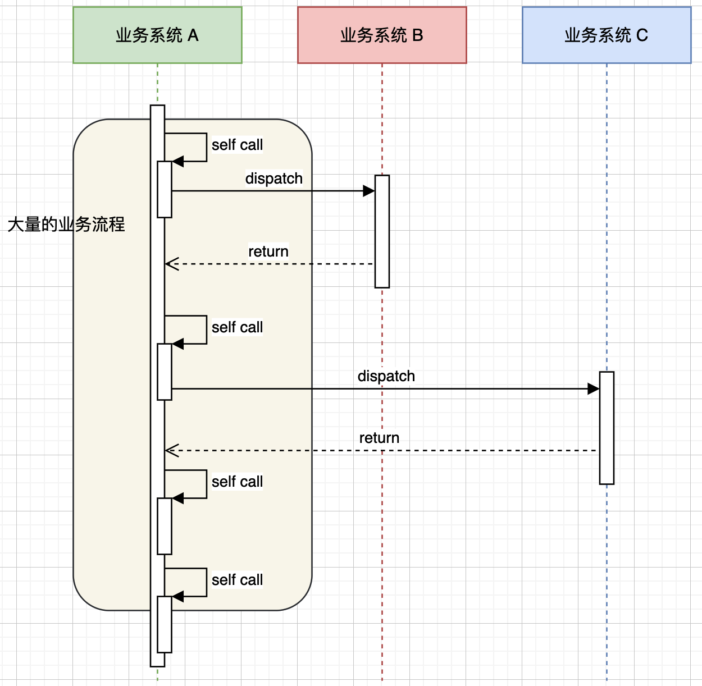
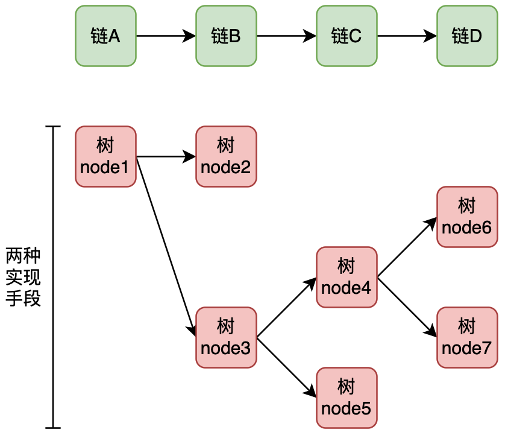
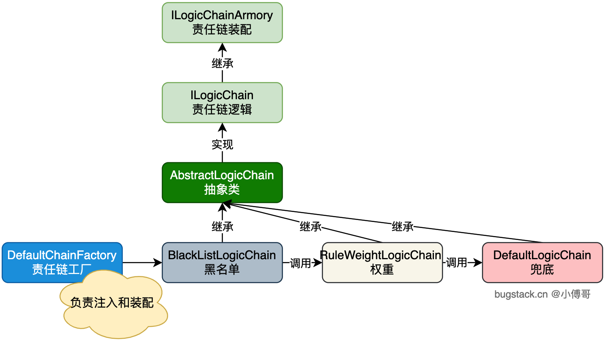
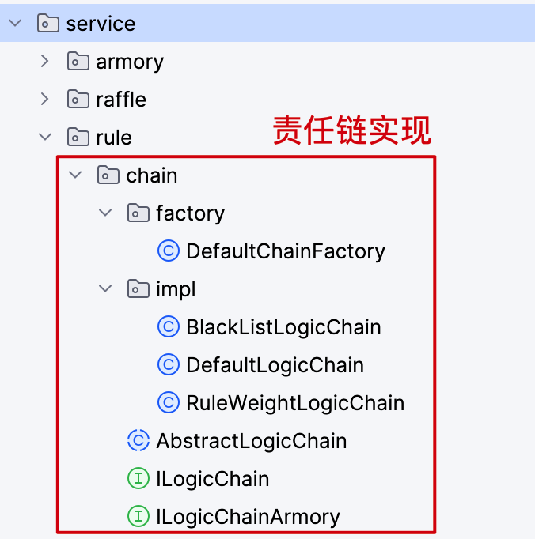
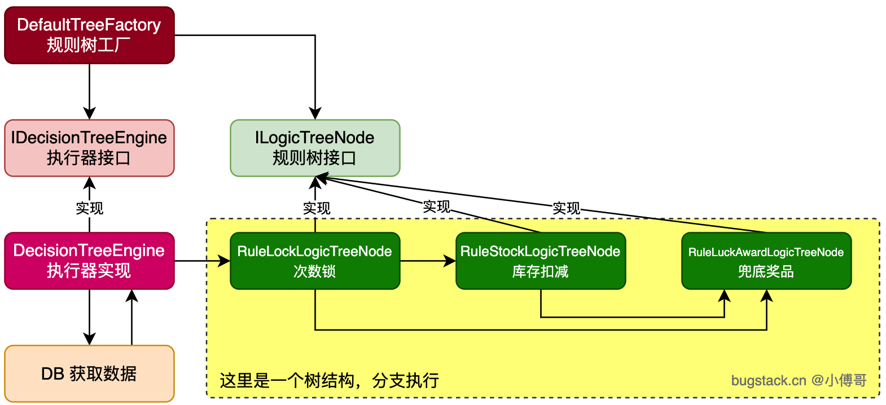
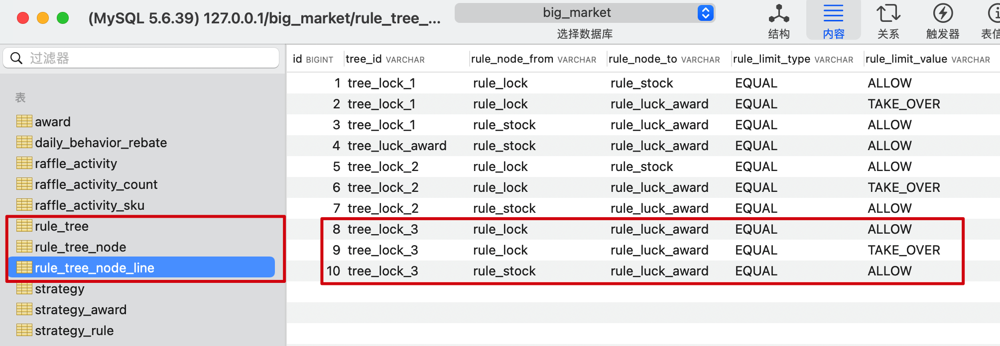
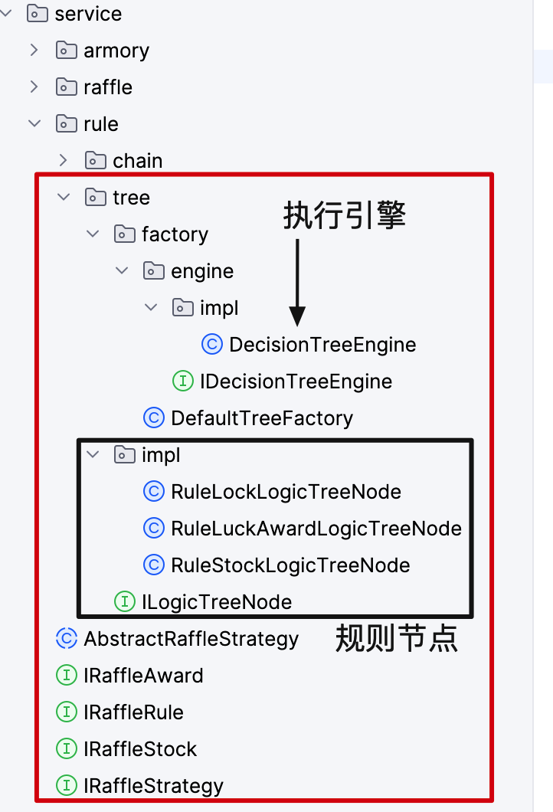
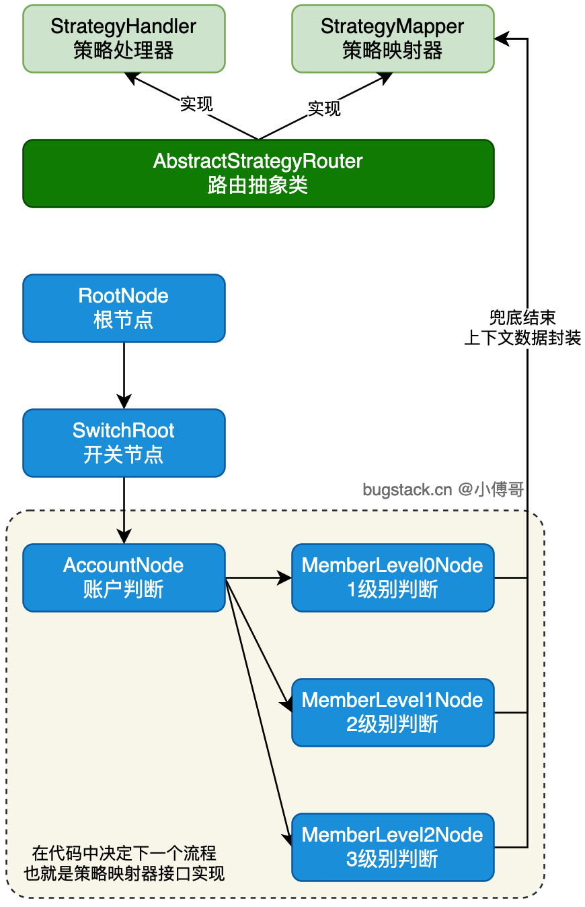
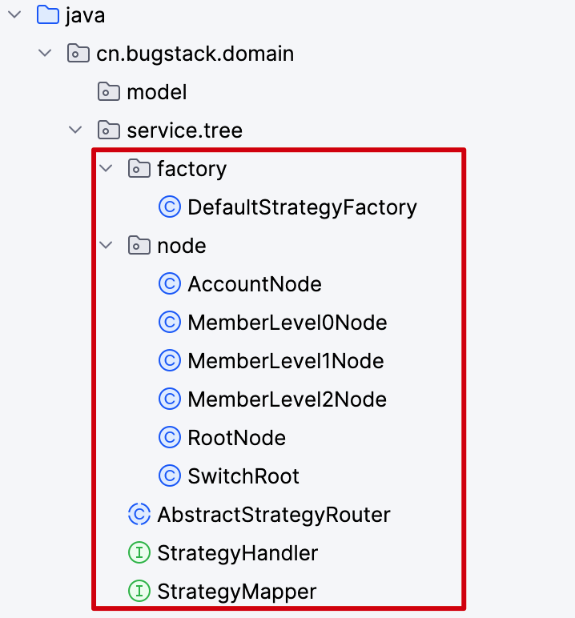

# if...else 流程重构：责任链与两种规则树

## 一、流程拆分与方案选择

Java 业务流程常包含渠道、身份、等级等判断，并穿插数据库和外部调用。规则频繁变化时，集中的嵌套判断容易扩大修改范围。重构应先明确规则职责、顺序和结束条件，再选择组织方式。

下图展示业务系统 A 的本地处理与对系统 B、C 的调用交织在一起。可以把有独立含义的处理拆成节点，让流程组织与节点内部逻辑分别变化。



下面讨论责任链、配置驱动规则树、代码路由规则树三种组织方式。后两者是组合接口、多态、策略和工厂等手段的业务方案，不宜直接当作三种独立的经典设计模式。

下图上半部是线性节点顺序，下半部是根据结果选择分支的结构；分支流转既可以配置在数据中，也可以由代码决定。



| 方式 | 后续节点由谁决定 | 适合的变化 |
| --- | --- | --- |
| 责任链 | 预先装配后继顺序，当前节点决定返回还是继续 | 多项规则按优先级依次处理 |
| 配置驱动规则树 | 执行器按节点结果匹配配置的连线 | 已有规则的组合、阈值和路径经常调整 |
| 代码路由规则树 | 当前节点通过路由方法选择后续处理器 | 分支与业务代码紧密相关，按版本发布调整 |

少量稳定判断可以保留，前提不满足时也可提前返回。节点会增加类和装配成本，应在职责与变化需要分离时引入。配套讲解可查阅[设计模式视频](https://bugstack.cn/md/develop/design-pattern/2022-03-12-%E9%87%8D%E5%AD%A6Java%E8%AE%BE%E8%AE%A1%E6%A8%A1%E5%BC%8FB%E7%AB%99%E8%A7%86%E9%A2%91.html)。

## 二、责任链：按优先级处理

责任链（Chain of Responsibility）把处理器连接起来。每个节点负责自己的规则，能够完成处理时返回结果，否则交给后继。链中可以包含多项校验，也可以在某个节点提前结束，具体由业务约定。

抽奖前按“黑名单 → 权重规则 → 默认抽奖”组织：黑名单命中时返回约定兜底奖品，符合权重条件时由相应节点处理，其余默认抽奖。权重资格与奖品范围由业务定义，不表示必得固定奖品。顺序决定优先级，调整顺序可能改变结果。

下图将装配接口、逻辑接口、抽象类和三个节点分开，工厂负责取得并连接节点，业务节点负责执行规则。



下图对应 chain 包：factory 放置工厂，impl 放置节点，接口和抽象类提供共同约定。代码依次展示后继连接、默认抽奖与装配，省略部分接口及支撑组件。



```java
public abstract class AbstractLogicChain implements ILogicChain{

    private ILogicChain next;

    @Override
    public ILogicChain next() {
        return next;
    }

    @Override
    public ILogicChain appendNext(ILogicChain next) {
        this.next = next;
        return next;
    }

    protected abstract String ruleModel();

}

@Slf4j
@Component("rule_default")
@Scope(ConfigurableBeanFactory.SCOPE_PROTOTYPE)
public class DefaultLogicChain extends AbstractLogicChain {

    @Resource
    protected IStrategyDispatch strategyDispatch;

    @Override
    public DefaultChainFactory.StrategyAwardVO logic(String userId, Long strategyId) {
        Integer awardId = strategyDispatch.getRandomAwardId(strategyId);
        log.info("抽奖责任链-默认处理 userId:{} strategyId:{} ruleModel:{} awardId:{}", userId, strategyId, ruleModel(), awardId);
        return DefaultChainFactory.StrategyAwardVO.builder()
                .awardId(awardId)
                .logicModel(ruleModel())
                .build();
    }

    @Override
    protected String ruleModel() {
        return DefaultChainFactory.LogicModel.RULE_DEFAULT.getCode();
    }

}

public ILogicChain openLogicChain(Long strategyId) {
    ILogicChain cacheLogicChain = strategyChainGroup.get(strategyId);
    if (null != cacheLogicChain) return cacheLogicChain;
    StrategyEntity strategy = repository.queryStrategyEntityByStrategyId(strategyId);
    String[] ruleModels = strategy.ruleModels();
    // 如果未配置策略规则，则只装填一个默认责任链
    if (null == ruleModels || 0 == ruleModels.length) {
        ILogicChain ruleDefaultLogicChain = applicationContext.getBean(LogicModel.RULE_DEFAULT.getCode(), ILogicChain.class);
        // 写入缓存
        strategyChainGroup.put(strategyId, ruleDefaultLogicChain);
        return ruleDefaultLogicChain;
    }
    // 按照配置顺序装填用户配置的责任链；rule_blacklist、rule_weight 「注意此数据从Redis缓存中获取，如果更新库表，记得在测试阶段手动处理缓存」
    ILogicChain logicChain = applicationContext.getBean(ruleModels[0], ILogicChain.class);
    ILogicChain current = logicChain;
    for (int i = 1; i < ruleModels.length; i++) {
        ILogicChain nextChain = applicationContext.getBean(ruleModels[i], ILogicChain.class);
        current = current.appendNext(nextChain);
    }
    // 责任链的最后装填默认责任链
    current.appendNext(applicationContext.getBean(LogicModel.RULE_DEFAULT.getCode(), ILogicChain.class));
    // 写入缓存
    strategyChainGroup.put(strategyId, logicChain);
    return logicChain;
}
```

`appendNext` 设置并返回后继，使工厂中的 current 向后移动。`openLogicChain` 优先按 strategyId 复用缓存；未命中时按 ruleModels 顺序装配，末尾补上默认节点。未配置规则则只用默认节点。规则标识须与 Spring Bean 名称匹配。

调用方取得链头后调用 `logic(userId, strategyId)`。黑名单、权重等节点需要自行决定返回结果还是调用 `next().logic(...)`；仅装配 next 不会自动执行整条链。DefaultLogicChain 返回抽奖结果，是这个流程的结束节点，不再向后传递。

带有可变 next 的节点应避免跨链装配时互相覆盖。本例默认节点使用 prototype，其他需要独立连接的节点也应隔离实例。缓存后的链仍会复用，用户等请求数据应通过参数传递，参见 [Spring Bean 作用域](https://docs.spring.io/spring-framework/reference/core/beans/factory-scopes.html#beans-factory-scopes-prototype)。

本例缓存规则数据和已装配链，修改数据库后需刷新数据并重建相关链。工厂承担装配与复用，对象创建的其他实践可参见[工厂方法示例](https://bugstack.cn/md/develop/design-pattern/2020-05-20-%E9%87%8D%E5%AD%A6Java%E8%AE%BE%E8%AE%A1%E6%A8%A1%E5%BC%8F%E3%80%8A%E5%AE%9E%E6%88%98%E5%B7%A5%E5%8E%82%E6%96%B9%E6%B3%95%E6%A8%A1%E5%BC%8F%E3%80%8B.html)。

## 三、配置驱动规则树：按结果选择路径

抽出候选奖品后，根据次数门槛和库存情况决定返回奖品或转向兜底，需要按结果选择节点，适合分离规则实现与路径配置。次数锁指抽奖次数门槛，不是并发互斥锁。

下图中，工厂提供规则节点和执行器，执行器根据节点结果选择路径。次数锁、库存扣减和兜底处理各自负责一项业务。这里沿用“规则树”的工程称呼，分支可以汇聚到同一兜底节点，并不要求严格的数据结构树。



下图的 rule_tree、rule_tree_node、rule_tree_node_line 描述树、节点和连线；连线记录来源、目标、比较类型和条件值。红框内次数锁的 ALLOW、TAKE_OVER 均指向兜底，体现配置对走向的控制；完整路径需结合根及其他连线判断。



下图将执行器 DecisionTreeEngine 与节点实现分开。节点根据输入和阈值计算结果，执行器统一负责寻找下一条连线。



```java
public interface ILogicTreeNode {

    DefaultTreeFactory.TreeActionEntity logic(String userId, Long strategyId, Integer awardId, String ruleValue, Date endDateTime);

}

@Component("rule_lock")
public class RuleLockLogicTreeNode implements ILogicTreeNode {

    @Resource
    private IStrategyRepository repository;

    @Override
    public DefaultTreeFactory.TreeActionEntity logic(String userId, Long strategyId, Integer awardId, String ruleValue, Date endDateTime) {
        log.info("规则过滤-次数锁 userId:{} strategyId:{} awardId:{}", userId, strategyId, awardId);

        long raffleCount = 0L;
        try {
            raffleCount = Long.parseLong(ruleValue);
        } catch (Exception e) {
            throw new RuntimeException("规则过滤-次数锁异常 ruleValue: " + ruleValue + " 配置不正确");
        }

        // 查询用户抽奖次数 - 当天的；策略ID:活动ID 1:1 的配置，可以直接用 strategyId 查询。
        Integer userRaffleCount = repository.queryTodayUserRaffleCount(userId, strategyId);

        // 用户抽奖次数大于或等于规则限定值，规则放行
        if (userRaffleCount >= raffleCount) {
            log.info("规则过滤-次数锁【放行】 userId:{} strategyId:{} awardId:{} raffleCount:{} userRaffleCount:{}", userId, strategyId, awardId, raffleCount, userRaffleCount);
            return DefaultTreeFactory.TreeActionEntity.builder()
                    .ruleLogicCheckType(RuleLogicCheckTypeVO.ALLOW)
                    .build();
        }

        log.info("规则过滤-次数锁【拦截】 userId:{} strategyId:{} awardId:{} raffleCount:{} userRaffleCount:{}", userId, strategyId, awardId, raffleCount, userRaffleCount);

        // 用户抽奖次数小于规则限定值，规则拦截
        return DefaultTreeFactory.TreeActionEntity.builder()
                .ruleLogicCheckType(RuleLogicCheckTypeVO.TAKE_OVER)
                .build();
    }

}

@Override
public DefaultTreeFactory.StrategyAwardVO process(String userId, Long strategyId, Integer awardId, Date endDateTime) {
    DefaultTreeFactory.StrategyAwardVO strategyAwardData = null;
    // 获取基础信息
    String nextNode = ruleTreeVO.getTreeRootRuleNode();
    Map<String, RuleTreeNodeVO> treeNodeMap = ruleTreeVO.getTreeNodeMap();
    // 获取起始节点「根节点记录了第一个要执行的规则」
    RuleTreeNodeVO ruleTreeNode = treeNodeMap.get(nextNode);
    while (null != nextNode) {
        // 获取决策节点
        ILogicTreeNode logicTreeNode = logicTreeNodeGroup.get(ruleTreeNode.getRuleKey());
        String ruleValue = ruleTreeNode.getRuleValue();
        // 决策节点计算
        DefaultTreeFactory.TreeActionEntity logicEntity = logicTreeNode.logic(userId, strategyId, awardId, ruleValue, endDateTime);
        RuleLogicCheckTypeVO ruleLogicCheckTypeVO = logicEntity.getRuleLogicCheckType();
        strategyAwardData = logicEntity.getStrategyAwardVO();
        log.info("决策树引擎【{}】treeId:{} node:{} code:{}", ruleTreeVO.getTreeName(), ruleTreeVO.getTreeId(), nextNode, ruleLogicCheckTypeVO.getCode());
        // 获取下个节点
        nextNode = nextNode(ruleLogicCheckTypeVO.getCode(), ruleTreeNode.getTreeNodeLineVOList());
        ruleTreeNode = treeNodeMap.get(nextNode);
    }
    // 返回最终结果
    return strategyAwardData;
}
```

`RuleLockLogicTreeNode` 把 ruleValue 解析为门槛 raffleCount，再查询用户当天的抽奖次数 userRaffleCount。次数达到门槛，即 `userRaffleCount >= raffleCount`，返回 ALLOW，否则返回 TAKE_OVER。若业务要求累计次数，应使用对应的查询口径；次数达标也不代表已经获得奖品，后续仍由连线和节点处理决定。

`process` 从 ruleTreeVO 取得根节点和节点映射，循环执行当前节点，再用结果码匹配其出边，直到没有下一节点。它使用已经加载的树配置，并不表示每经过一个节点就查询数据库。ALLOW、TAKE_OVER 在这里是匹配连线的结果码，不能统一理解成“继续”和“结束”。

落地时先实现节点并注册 ruleKey，再配置根、节点、阈值及条件连线，由工厂加载后交给执行器。终止路径需要有明确的奖品返回；若直接在只返回判断结果的节点结束，最终结果可能为空。还应检查根或目标缺失、条件冲突、不可达节点和循环路径，避免配置错误变成空指针或无限执行。

调整已有阈值和路径可以通过配置完成，增加全新的业务判断仍需实现对应节点。配置何时生效取决于加载与缓存刷新方式，写入数据库本身不会让正在使用的 ruleTreeVO 自动改变。

## 四、代码路由规则树：由节点选择处理器

分支与业务代码紧密相关时，可以由节点按当前数据选择处理器。例如总入口经过开关和账户节点后，再按等级进入分支，沿途数据放入本次调用的上下文。

下图中，StrategyHandler 定义处理行为，StrategyMapper 负责选择处理器，AbstractStrategyRouter 提供公共路由逻辑。右侧连线概括结束和结果封装；在下面的代码中，封装由 StrategyHandler.DEFAULT 等终止处理器完成，StrategyMapper 的职责仍是选择节点。



下图对应 service.tree 包中的入口、开关、账户和等级节点。核心片段展示两个接口、路由抽象类以及 AccountNode；入口和其他分支的实现未展开。



```java
public interface StrategyMapper {

    /**
     * 获取策略处理器
     */
    StrategyHandler get(DefaultStrategyFactory.MaterialVO materialVO, DefaultStrategyFactory.DynamicContext dynamicContext);

}

public interface StrategyHandler {

    /**
     * 处理最终返回结果
     */
    StrategyHandler DEFAULT = (materialVO, dynamicContext) -> {
        DefaultStrategyFactory.DecisionOutcomeVO decisionOutcomeVO = new DefaultStrategyFactory.DecisionOutcomeVO();
        decisionOutcomeVO.setLevel(dynamicContext.getLevel());
        return decisionOutcomeVO;
    };

    /**
     * 受理策略处理
     */
    DefaultStrategyFactory.DecisionOutcomeVO apply(DefaultStrategyFactory.MaterialVO materialVO, DefaultStrategyFactory.DynamicContext dynamicContext) throws Exception;

}

public abstract class AbstractStrategyRouter implements StrategyMapper, StrategyHandler {

    @Getter
    @Setter
    protected StrategyHandler defaultStrategyHandler = StrategyHandler.DEFAULT;

    /**
     * 行为路由
     */
    public DefaultStrategyFactory.DecisionOutcomeVO router(DefaultStrategyFactory.MaterialVO materialVO, DefaultStrategyFactory.DynamicContext dynamicContext) throws Exception {
        StrategyHandler strategyHandler = get(materialVO, dynamicContext);
        if (null != strategyHandler) return strategyHandler.apply(materialVO, dynamicContext);
        return defaultStrategyHandler.apply(materialVO, dynamicContext);
    }

}

@Component
public class AccountNode extends AbstractStrategyRouter {

    private final MemberLevel0Node memberLevel0Node;
    private final MemberLevel1Node memberLevel1Node;
    private final MemberLevel2Node memberLevel2Node;

    public AccountNode(MemberLevel0Node memberLevel0Node, MemberLevel1Node memberLevel1Node, MemberLevel2Node memberLevel2Node) {
        this.memberLevel0Node = memberLevel0Node;
        this.memberLevel1Node = memberLevel1Node;
        this.memberLevel2Node = memberLevel2Node;
    }

    @Override
    public DefaultStrategyFactory.DecisionOutcomeVO apply(DefaultStrategyFactory.MaterialVO materialVO, DefaultStrategyFactory.DynamicContext dynamicContext) throws Exception {
        log.info("【账户节点】规则决策树 userId:{}", materialVO.getUserId());

        // 1. 模拟查询用户级别
        int level = new Random().nextInt(3);
        log.info("模拟查询用户级别 level:{}",level);

        dynamicContext.setLevel(level);

        return router(materialVO, dynamicContext);
    }

    @Override
    public StrategyHandler get(DefaultStrategyFactory.MaterialVO materialVO, DefaultStrategyFactory.DynamicContext dynamicContext) {
        switch (dynamicContext.getLevel()){
            case 0:
                return memberLevel0Node;
            case 1:
                return memberLevel1Node;
            case 2:
                return memberLevel2Node;
            default:
                return defaultStrategyHandler;
        }
    }

}
```

`AccountNode.apply` 取得等级后写入 dynamicContext，并显式调用 router。router 调用当前节点的 get，选择处理器并执行其 apply；未选出处理器时使用默认处理器。每个需要继续的节点都要明确衔接路由，直接返回结果则结束。例中的 Random 仅模拟等级，真实业务应读取账户数据；代码用 0、1、2 对应三个等级节点。

`StrategyHandler.DEFAULT` 是接口中由 Lambda 创建的处理器常量，实现 apply 并将上下文中的 level 填入结果。它不是使用 default 关键字声明的接口默认方法；其他结果字段也不会自动组装，需由相应处理器明确赋值，相关语法可参见 [Java 接口字段与方法](https://docs.oracle.com/javase/specs/jls/se8/html/jls-9.html#jls-9.3)。

materialVO 表达输入，dynamicContext 保存沿途共享数据；每次请求使用自己的上下文，避免把可变请求数据放入共享节点。终止结果逐层返回，不会遍历未选择的等级分支。

新增分支时，实现并注入处理器，再调整 get 条件，连接关系随代码发布改变。节点内部仍可使用 switch 或 if。迁移时先明确优先级与输入输出，再逐步抽取节点，验证命中、未命中、边界和兜底路径，保持业务行为一致。

