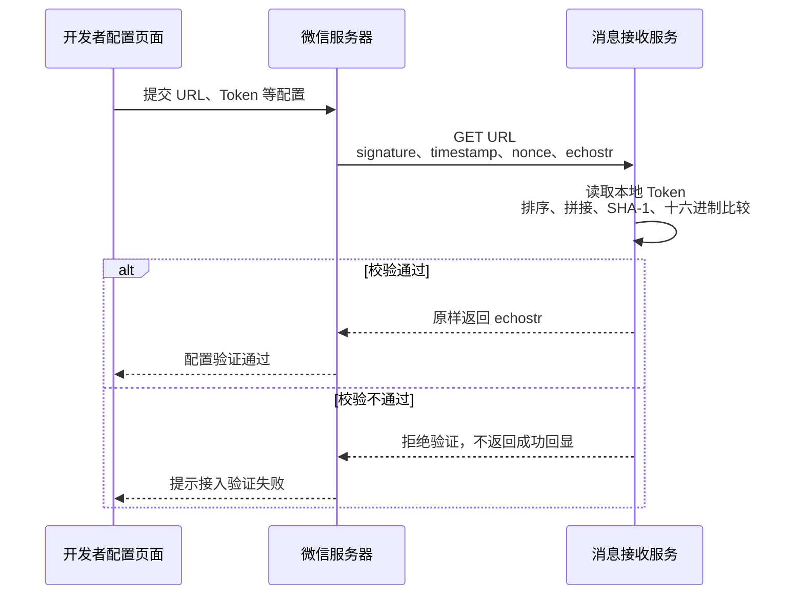
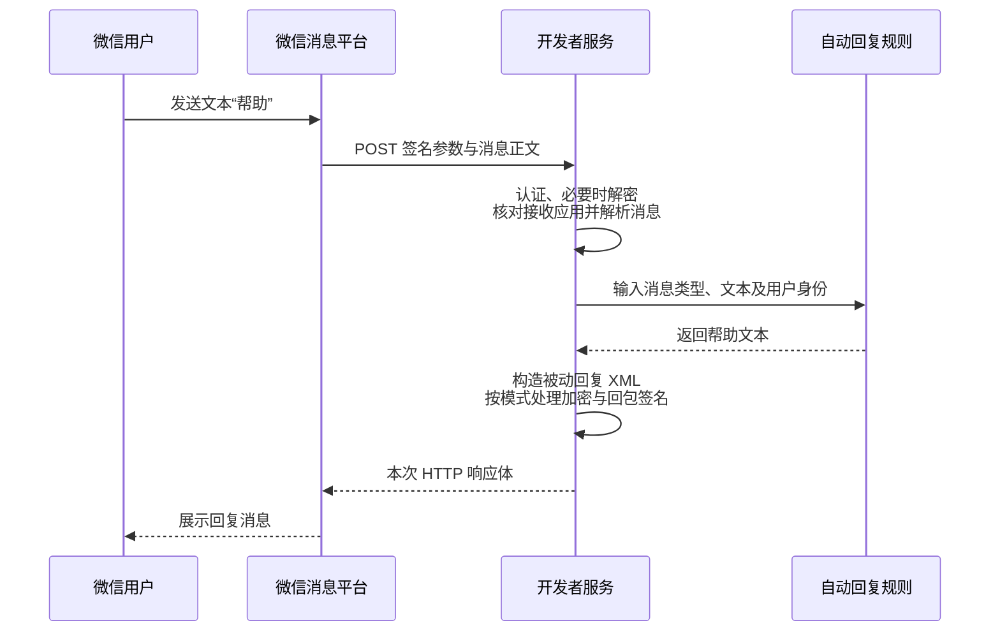
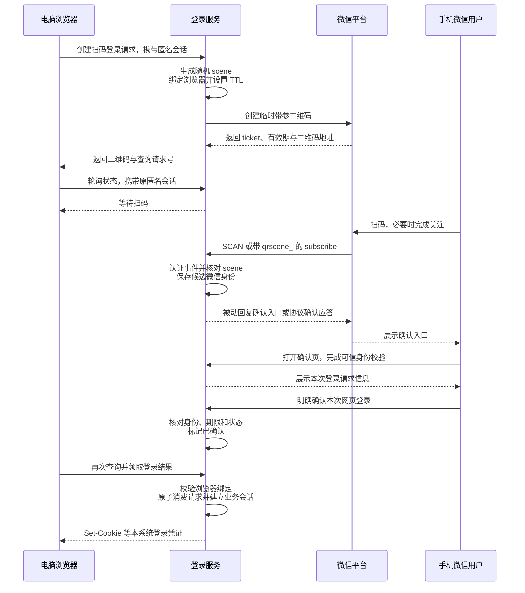

# 微信公众号开发与扫码登录

用户给公众号发送一条消息，公众号自动回复；用户用微信扫描网页上的二维码，电脑网页进入登录状态。这两种功能都涉及微信与业务服务器之间的信息交换，但它们解决的问题不同：前者处理消息，后者需要把微信身份与某个浏览器中的登录请求可靠关联。

理解公众号开发，可以围绕三条主线展开：**先建立可信的消息接收入口，再根据消息和事件执行业务；需要登录时，另行完成用户身份确认与本系统会话建立。** 接入微信服务器、拿到 `openid`、向用户回复消息和签发登录凭证，是不同的步骤。

下文使用“公众号开发”这一常用说法。微信当前文档已区分公众号与服务号，不同账号类型、认证状态和授权方式拥有不同能力。本文的带参二维码与网页授权示例主要依据服务号文档，具体权限在相关位置说明；接口与权限说明核对日期为 **2026 年 11 月 12 日**。

## 一、微信应用、用户身份与业务账户

### 1. AppID 标识应用，openid 标识应用内的用户

`AppID` 是微信为一个应用分配的标识。公众号、服务号、小程序、网站应用和移动应用有各自的应用身份，不能因为它们属于同一个公司，就在调用接口时混用 AppID 和密钥。

`openid` 表示一个微信用户在某个应用中的身份。同一用户在服务号 A、服务号 B 和小程序 C 中，通常分别具有不同的 openid。因此，保存微信身份时，应同时知道它属于哪个应用，例如使用“身份类型、AppID、openid”共同定位一条外部身份记录。

可以把它理解为：一个人在不同学校有不同的学号。只拿到一串学号，却不知道是哪所学校分配的，不能可靠关联身份。openid 也不是用户的微信号、手机号或昵称，不能通过字符串反推出这些资料。[微信官方：用户身份与 UnionID 机制](https://developers.weixin.qq.com/doc/service/guide/product/unionid.html)

用户发送消息后，业务服务器通常可以从已认证的消息中取得发送方的 openid；网页授权和小程序登录则通过各自的授权或登录接口取得。**普通浏览器访问一个网页，不会因为页面与微信有关，就自动生成或自动获得 openid。**

### 2. UnionID 用于满足条件的跨应用关联

当多个应用绑定到同一个微信开放平台账号时，可以利用 `unionid` 识别跨应用的同一微信用户。这里的关联范围是同一个开放平台账号，不能把 unionid 当成跨所有开发者通用的个人身份证号。

是否返回 unionid，还取决于应用绑定关系和具体接口。例如，当前小程序文档说明，绑定开放平台账号后，可通过 `wx.login` 与 `code2Session` 获取 unionid；服务号网页授权接口则对授权作用域和开放平台绑定关系分别有要求。因此，接口响应没有 unionid 时，应保留可用的应用内身份，而不是直接判定用户无效，也不能自行用 openid 拼出 unionid。[微信官方：小程序 UnionID 获取途径](https://developers.weixin.qq.com/miniprogram/dev/framework/open-ability/union-id.html)、[微信官方：网页授权](https://developers.weixin.qq.com/doc/service/guide/h5/auth.html)

### 3. 几种容易重名的凭据

| 名称 | 主要作用 | 保存或使用位置 |
| --- | --- | --- |
| AppID | 标识调用哪个微信应用的能力 | 服务端配置及必要的公开参数 |
| AppSecret | 应用调用特定微信接口的密钥 | 仅由服务端保管 |
| 消息推送配置中的 Token | 参与微信消息入口的签名校验 | 微信配置与业务服务端保持一致 |
| EncodingAESKey | 加解密推送消息与被动回复的消息体 | 服务端与微信配置保持一致 |
| 后台接口 access_token | 调用生成二维码、发送客服消息等后台接口 | 服务端按应用缓存与刷新 |
| 网页授权 access_token | 在用户授权范围内调用相应用户信息接口 | 服务端关联本次授权保存 |
| 本系统 Session 或登录 Token | 证明客户端已登录本系统 | 本系统签发和验证 |

配置消息推送时填写的 Token 是开发者与微信约定的校验材料，并不是 OAuth 的用户授权凭据，也不是通过 AppID、AppSecret 换取的后台 access_token。它不应作为参数直接发给来访者，更不能拿去替代接口要求的 access_token。

后台接口 access_token 和网页授权 access_token 虽然名称相同，获得方式、权限范围和使用接口不同。前者代表应用调用后台能力，后者关联特定用户授权；把两者都命名为一个没有语义的全局变量，容易造成凭据覆盖和接口调用错误。[微信官方：获取接口调用凭据](https://developers.weixin.qq.com/doc/service/api/base/api_getaccesstoken.html)

### 4. 微信身份与业务账户的关系

微信负责提供其平台范围内的身份信息，业务系统负责自己的账户、权限和会话。一个学习网站可能将微信身份绑定到内部 `user_id`，订单、收藏和会员状态都关联这个内部编号。以后增加手机号登录时，可以让多种登录方式指向同一个账户。

账号是否落库取决于业务需求。若只是无状态地回复一条帮助消息，不一定需要为每个发送者创建会员；若要保存订单、学习进度或长期绑定关系，则通常需要持久化账户和外部身份映射。**“所有微信 API 调用前都必须把用户存入数据库”并不是微信平台的统一规定。**

首次登录时创建账户、已有用户复用账户，是常见实现，但应由数据库唯一约束保护外部身份映射。两个并发请求同时发现“用户不存在”时，不能各自创建一个互不相关的账户；发生唯一键冲突后，应按明确规则重新查询和关联。

## 二、消息接入与每次请求的真实性校验

### 1. 服务器配置建立消息投递入口

消息推送地址是一个供微信服务器访问的 HTTP 接口，例如 `https://example.com/wechat/callback`。它与用户打开的网页地址、网页 OAuth 回调地址承担不同职责：前者接收微信服务器推送的消息，后者接收浏览器授权后的跳转。

在当前服务号文档中，消息配置位于微信开发者平台的“我的业务—服务号—消息与事件推送”，需要设置 URL、Token、EncodingAESKey 和消息加解密方式。当前配置说明要求消息体采用 XML，URL 支持的协议与端口也有明确限制。旧教程中的公众平台菜单位置可能已经变化，应以当前账号实际可见配置为准。[微信官方：消息与事件推送介绍](https://developers.weixin.qq.com/doc/service/guide/dev/push/)

微信服务器必须能从公网访问该地址。在本机启动 Spring Boot，只能证明应用在本地监听；还需要域名解析、HTTPS、反向代理、路由和防火墙共同把请求送到正确接口。若使用临时内网穿透，域名变化后也要同步调整微信配置。

### 2. GET 接入验证的输入、运算与输出

提交服务器配置时，微信会向该 URL 发送 GET 请求，查询参数中包含 `signature`、`timestamp`、`nonce` 和 `echostr`。服务器读取本地配置的 Token，按协议完成以下处理：

1. 将 Token、timestamp、nonce 三个**字符串值**按字典序排序。
2. 将排序后的三个字符串直接连接，不添加逗号、空格或参数名。
3. 对连接结果计算 SHA-1 摘要，转换为十六进制字符串。
4. 与请求中的 signature 比较；校验通过后，原样返回 echostr。

这里排序的是值，不是按字段名把整个 URL 排序。timestamp 和 nonce 也不应擅自转成整数后再排序；协议要求的字符串处理与数值大小比较不是同一种操作。SHA-1 是摘要运算，不能从摘要“解密”出原文。Java 可使用 `MessageDigest` 完成摘要，20 字节的 SHA-1 结果通常表示为 40 个十六进制字符；字节转十六进制时需要保留前导零。[Java 官方：MessageDigest](https://docs.oracle.com/en/java/javase/21/docs/api/java.base/java/security/MessageDigest.html)



响应应是协议要求的原始回显内容。若统一响应封装把它变为 `{"code":0,"data":"..."}`，或者返回登录页、HTML 错误页，即使服务端日志显示执行成功，微信也无法按预期完成验证。

### 3. URL 查询参数与 XML 请求体分别承担职责

配置验证使用 GET，日常消息和事件一般使用 POST。同一个 URL 可以按 HTTP 方法进入不同处理逻辑。POST 的 URL 查询串仍可携带签名、时间戳和随机串，消息正文则放在 HTTP 请求体中。

```http
POST /wechat/callback?signature=SIGNATURE&timestamp=TIMESTAMP&nonce=NONCE
Content-Type: text/xml

<xml>
  <ToUserName><![CDATA[公众号原始标识]]></ToUserName>
  <FromUserName><![CDATA[用户OPENID]]></FromUserName>
  <CreateTime>1800000000</CreateTime>
  <MsgType><![CDATA[text]]></MsgType>
  <Content><![CDATA[帮助]]></Content>
  <MsgId>1234567890123456</MsgId>
</xml>
```

上例只用于展示协议分层，字段值均为占位。Spring MVC 可以用 `@RequestParam` 读取 URL 查询参数，用 `@RequestBody` 读取 XML 文本；这些注解只是 Java 框架对 HTTP 请求的绑定方式。部分推送 URL 还会携带 openid，但不能只因 URL 出现该字段就相信其身份，更不能用它覆盖已验证消息中的发送者信息。

**GET 验证通过，只证明当次配置验证成功。POST 消息进入业务之前仍需要按所选模式认证。** 不能因为一个地址已经在微信后台登记过，就相信之后访问这个公网地址的所有请求。

### 4. 明文、兼容与安全模式

明文模式下，消息正文直接可读，服务器按 Token、timestamp、nonce 校验 `signature`。这一签名的计算不包含明文 XML 正文，因此应按官方建议采用 HTTPS，并在条件允许时使用安全模式，不能把明文模式描述为“消息体已经被签名保护”。

兼容模式同时提供明文与密文，允许按协议回复明文或密文，适合迁移调试；安全模式只提供密文。采用密文处理链路时，URL 中的 `encrypt_type=aes`、`msg_signature` 与消息外层的 `Encrypt` 共同参与处理。服务器应校验由 **Token、timestamp、nonce、Encrypt** 生成的 `msg_signature`，不能只检验不含密文的 signature 就接受业务。

通过消息体签名校验后，使用配置的 EncodingAESKey 解密，并核对解密结构中的接收方 AppID 与自己的应用是否一致。完成这些步骤，才将解密后的文本或事件交给业务处理；需要返回被动业务消息时，再按当前模式加密并生成回包签名。官方明确规定安全模式回复业务消息也要加密；不回复业务内容时，空串或 `success` 等确认方式按对应协议处理。[微信官方：消息加解密说明](https://developers.weixin.qq.com/doc/service/guide/dev/push/encryption.html)

官方提供的 Java 示例中，`WXBizMsgCrypt` 使用 Token、EncodingAESKey、AppID 初始化，`decryptMsg(...)` 校验消息体签名并解密，`encryptMsg(...)` 生成加密回复。接入时应使用经过维护和验证的实现，结合官方示例核对行为；无需自己重新实现 AES、填充和消息封装。官方示例用于解释协议，旧示例中的 XML 解析器、依赖版本和异常处理仍需要结合当前安全要求检查。[微信官方：多语言加解密示例](https://wximg.gtimg.com/shake_tv/mpwiki/cryptoDemo.zip)

## 三、消息解析、业务分流与自动回复

### 1. 普通文本和事件消息使用不同字段

`MsgType` 决定消息的大类。文本消息为 `text`，主要业务数据在 `Content`；事件消息为 `event`，还要读取 `Event` 判断关注、扫码、菜单点击等行为。不能对所有消息都无条件读取 Content，也不能看到 Event 字段为空就把一条文本消息判为格式错误。

| 字段 | 主要含义 | 处理时的注意点 |
| --- | --- | --- |
| ToUserName | 接收消息的公众号原始标识 | 不是 AppID；用于确认目标公众号 |
| FromUserName | 发送方的应用内 openid | 仅在消息通过认证后用于身份关联 |
| CreateTime | 消息创建时间 | 通常为秒级时间戳，不能直接当业务到期时间 |
| MsgType | 消息类型 | 决定后续字段解释方式 |
| Content | 文本内容 | 文本消息才按相应协议读取 |
| MsgId | 普通消息标识 | 可用于普通消息去重，不应假定所有事件都有 |
| Event、EventKey | 事件类型及其业务参数 | EventKey 的含义由 Event 决定 |

例如，菜单点击事件的 EventKey 可以是菜单配置的业务键；二维码事件的 EventKey 则表示二维码场景。相同字段名不意味着可以采用同一套字符串截取规则。[微信官方：接收普通消息](https://developers.weixin.qq.com/doc/service/guide/product/message/Receiving_standard_messages.html)、[微信官方：接收事件推送](https://developers.weixin.qq.com/doc/service/guide/product/message/Receiving_event_pushes.html)

### 2. XML 标签映射与解析安全

XML 标签区分大小写，`MsgType`、`msgType` 和 `msgtype` 不是同一个标签。Java 对象可以使用小驼峰字段名，再由解析器建立字段与标签的映射。例如，XStream 的 `@XStreamAlias("MsgType")` 表示“此 Java 字段对应 XML 中的 MsgType 标签”，类上的 `@XStreamAlias("xml")` 则指定根元素名称。

注解必须由实际使用的解析器识别；只在字段上写注解，而初始化时没有处理相应注解，并不会自动改变 XML 结构。也可以选用 Jackson XML、DOM 或其他方案，关键是输入结构、允许字段及输出协议一致。

消息入口接收的是外部文本，应限制报文大小和解析深度，禁用不需要的 DTD、外部实体与外部资源解析。使用 XStream 时，还应通过类型允许列表仅放行明确的消息 DTO，不能为省事允许任意类型反序列化。**验签与安全解析解决不同问题：验签确认协议来源，解析配置限制文本能够触发的程序行为。**[XStream 官方：反序列化安全与类型允许列表](https://x-stream.github.io/security.html)

### 3. 开发者自动回复的实际顺序

用户发送“帮助”后，微信先接收用户消息，再把消息 POST 到开发者服务。服务端先校验签名，必要时解密和核对 AppID，然后解析类型、识别关键词、生成回复，最后把回复 XML 写进**本次 HTTP 响应体**。微信读取这个响应后，才把对应内容发给用户。



接收消息时，ToUserName 是公众号，FromUserName 是用户；回复给用户时，两者的业务方向相反。回复 XML 中的 ToUserName 应填用户 openid，FromUserName 应填公众号原始标识。把 AppID 填入这两个字段，不能替代协议要求的账号标识。

当前文档要求及时响应，并说明微信在五秒内收不到响应会重试。没有需要展示的回复内容，或者处理无法在时限内完成时，应按文档返回 `success` 或真正的空响应体。空响应体指字节长度为零，并不是 Content 为空的 XML，也不是 JSON 中的空字符串。[微信官方：被动回复用户消息](https://developers.weixin.qq.com/doc/service/guide/product/message/Passive_user_reply_message.html)

### 4. 平台规则、被动回复与主动消息

公众平台后台配置的关键词回复，由平台按其规则执行；开发者自动回复，则由自己的程序接收消息并返回结果。当前服务号消息推送说明明确提示，启用相应服务器配置后，用户消息转发到配置地址，网站中设置的自动回复和自定义菜单会失效。因此，接入开发模式时要检查账号当前的能力和配置归属，不应假定后台原有规则一定继续处理；这一说明也不应扩张成所有类型账号、全部消息功能在任何配置下都永久失效。

被动 XML 回复只存在于本次微信请求的响应中。主动客服消息则是服务端另行调用微信接口，通常以后台 access_token 和 JSON 业务数据发起新的 HTTP 请求；模板消息、订阅通知又有各自的权限、模板与使用规则，不能因为已经拿到 openid 就无限制发送。

当前服务号客服文档按交互动作区分额度和窗口：用户发消息与关注、扫码、点击特定菜单等场景的规则不同。不要把旧教程中的“48 小时”简单套到所有交互。能否异步补发，应核对当时触发动作、账号权限、消息用途和接口返回结果。[微信官方：客服消息介绍](https://developers.weixin.qq.com/doc/service/guide/product/kf/intro.html)

一次扫码处理可以同时产生两条独立路径：在响应中被动回复“请确认登录”，同时由业务程序保存扫码状态。用户在微信里看到回复，不代表电脑已经获得登录会话；发送模板通知成功，同样不能替代浏览器完成登录。

## 四、网页授权、小程序登录与网站微信登录

### 1. 四种机制的入口与输出

| 机制 | 典型入口 | 微信提供的关键结果 | 本系统还需完成的工作 |
| --- | --- | --- | --- |
| 服务号网页 OAuth | 微信内打开网页，跳转授权链接 | 回调 code，再换取应用内身份及授权凭据 | 校验 state、绑定账户、签发会话 |
| 小程序登录 | 小程序调用 wx.login | 临时 code，再由后端 code2Session | 维护业务会话，不泄露 session_key |
| 开放平台网站微信登录 | 网站跳转或嵌入微信登录组件 | 授权后的 code、state | 后端换取身份，建立网站登录态 |
| 公众号带参二维码自建登录 | 业务生成二维码，用户扫码或关注 | 带 scene 的扫码／关注事件与 openid | 关联浏览器请求、确认授权、一次性建会话 |

它们可能都出现“微信登录”“二维码”“code”等词，但应用类型、接口和凭据不同。把小程序 code 交给网页授权接口，或者用带参二维码 ticket 调用 code2Session，都不属于有效的协议组合。

### 2. 服务号网页 OAuth 的授权过程

服务号网页授权适用于在微信客户端内访问的网页。后端先为当前浏览器创建随机 state 并保存关联，然后构造授权链接，引导浏览器跳转微信授权页面。用户授权后，浏览器带着 code 和 state 回到配置的地址；后端验证 state，再用自己的 AppID、AppSecret 和 code 调用微信接口换取用户身份。

`snsapi_base` 主要用于取得 openid，属于静默授权；`snsapi_userinfo` 用于相应用户信息授权，但是否出现确认弹窗还受用户交互和官方特定场景规则影响。获得 openid 不意味着同时获得手机号、昵称等全部资料，资料返回范围应以当前接口说明为准，不应照抄旧版字段示例假定全部可用。

网页授权域名控制授权后能回到哪里，state 关联这次授权由哪个浏览器发起。两者解决的问题不同：回调域名正确，仍要核验 state；state 正确，也不能允许任意 redirect_uri 成为开放跳转入口。

当前官方文档列出的主要适用账号是已认证服务号，并对已认证政府、事业单位、媒体类型公众号作了特殊说明。不能仅凭“已经注册公众号”就推定拥有网页授权权限。AppSecret 和换得的授权 access_token 应保存在服务器，不应透传给网页脚本。[微信官方：网页授权的账号、域名与授权流程](https://developers.weixin.qq.com/doc/service/guide/h5/auth.html)

### 3. 小程序 code2Session 与网站应用登录

小程序前端先调用 `wx.login` 得到临时 code，再把 code 发给业务后端。后端用小程序 AppID、AppSecret 调用 `code2Session`，读取 openid、session_key 及满足条件时的 unionid，随后创建或查找本系统用户并签发业务登录凭证。session_key 是微信会话密钥，不等于本系统 Session；不能把它当业务 Token 返回给客户端或写进普通日志。[微信官方：小程序登录凭证校验](https://developers.weixin.qq.com/miniprogram/dev/server/API/user-login/api_code2session.html)

开放平台网站微信登录则需要审核通过的网站应用和相应登录权限，常用授权入口为 `connect/qrconnect`，作用域为 `snsapi_login`。用户确认后，网站收到 code、state，后端再换取身份。当前官方还支持在满足版本与设备条件时使用桌面微信快速确认，因此“网站微信登录”并不总要求手机扫码。

这套流程的二维码、确认页面与授权 code 由网站微信登录能力管理。公众号带参二维码主要提供“哪个用户扫描了哪个场景”的事件，开发者需要自己完成浏览器关联和确认流程，不能把它包装成完全相同的官方网站登录协议。[微信官方：网站应用微信登录开发指南](https://developers.weixin.qq.com/doc/oplatform/Website_App/WeChat_Login/Wechat_Login.html)

### 4. 浏览器访客标识不能替代真实认证

浏览器指纹、随机访客 Cookie 或本地存储标识，可以辅助区分访问设备、统计行为或维持匿名购物车，但这些标识不是微信身份来源。清理 Cookie、换浏览器、共享设备或伪造部分环境，都可能影响其稳定性。

例如，浏览器访问首页后得到一个随机 `visitor_id`，只说明服务器建立了一份匿名访问上下文；只有后来成功完成微信授权或扫码确认，才能把这份上下文与经验证的微信身份关联。指纹再复杂，也不能自动推出这个访问者的 openid，更不能据此授权查看他人的订单。

## 五、带参数二维码与扫码事件

### 1. scene 表示业务场景，ticket 用于取得二维码

生成带参二维码时，业务后端先确定场景值 scene，再调用微信二维码接口。微信返回 ticket、有效期和二维码内容地址等数据；ticket 可以用于换取二维码图片，scene 则在之后的扫码事件中帮助服务器定位业务场景。

例如，为一次网页登录创建场景 `LOGIN_x7...`，把它保存在待登录记录中，再使用 `QR_STR_SCENE` 创建临时字符串二维码。示例请求只展示业务结构，真正调用需由服务端携带正确应用的后台 access_token：

```json
{
  "expire_seconds": 180,
  "action_name": "QR_STR_SCENE",
  "action_info": {
    "scene": {
      "scene_str": "LOGIN_不可预测的随机场景值"
    }
  }
}
```

这里的 180 秒是学习示例采用的业务期限，不是微信统一要求。二维码在微信侧的有效期，与本系统待登录记录的有效期都要控制；即使图片还能被扫描，本系统也可以因为登录请求过期而拒绝使用该场景。

临时二维码适合短期绑定与登录场景。永久二维码适合长期来源统计等业务，不能直接当成永不过期的登录凭证。当前服务号二维码 API 的适用范围明确为已认证服务号，其他账号不能仅凭通用示例就认定拥有接口权限。[微信官方：生成带参数的二维码](https://developers.weixin.qq.com/doc/service/api/qrcode/qrcodes/api_createqrcode.html)

**scene 与 ticket 不能混用。** 前者由业务指定并表达关联，后者由微信返回以获取二维码；它们都不应直接替代本系统正式登录 Token。事件里虽可能同时包含 EventKey 和 Ticket，业务仍应按自己保存的映射核对，而不是看到一个 ticket 就允许任意浏览器领取会话。

### 2. 未关注与已关注用户触发不同事件

用户尚未关注时，扫描带参二维码后可以进入关注流程；完成关注，微信推送 `Event=subscribe`，EventKey 形如 `qrscene_场景值`。已经关注的用户扫码时，微信推送 `Event=SCAN`，EventKey 直接是场景值，没有 `qrscene_` 前缀。

| 用户路径 | Event | EventKey 的解释 |
| --- | --- | --- |
| 未关注，扫码后完成关注 | subscribe | 识别 qrscene_ 前缀，再取得后面的 scene |
| 已关注，扫描带参二维码 | SCAN | 直接按 scene 处理 |
| 普通关注，未经过带参二维码 | subscribe | 不应假定一定携带登录场景 |

处理时先判断事件类型，再按该类型解释参数。不能只实现 SCAN 就宣称覆盖全部扫码用户，也不能对所有 EventKey 都机械删除前八个字符。大小写也要按协议处理，`SCAN` 与 `subscribe` 在官方示例中的写法不同。[微信官方：扫描带参数二维码事件](https://developers.weixin.qq.com/doc/service/guide/product/message/Receiving_event_pushes.html)

未关注用户只是打开二维码页面、没有完成关注时，不能假定已收到该关注事件。产品流程需要能展示等待、过期或取消状态，而不是让浏览器无限轮询“登录中”。

### 3. 扫码事件描述事实，登录授权由业务决定

通过认证的扫码事件可以告诉服务器：某个应用内用户与某个二维码场景发生了交互。它还不能独立证明“当前显示该二维码的浏览器，已被这个用户明确授权登录”。

二维码可能被截图、转发或由其他页面展示。若一收到 SCAN 就把任意持有场景值的客户端升级为该用户，用户可能在不知情时授权了别人的浏览器。因此，自建登录应设计明确的确认动作，并让手机端知道此次确认对应哪次网页登录。

业务可以在扫码后向用户提供确认页面，展示浏览器类型、请求时间及必要的短校验信息；确认页面应通过可信的微信授权身份或其他已认证渠道识别确认者，再与扫码事件中的候选身份核对。仅让页面提交 `openid=某个值`，不能完成这一认证。

## 六、自建扫码登录的完整闭环

### 1. 把一次登录请求绑定到发起浏览器

浏览器打开登录页时，后端先创建匿名会话，再生成不可预测的一次性登录请求。请求至少需要保存场景值、发起浏览器会话标识、创建时间、到期时间、当前状态，以及扫码后的候选微信身份。

场景值应由安全随机源生成，避免顺序编号让旁人猜到有效请求。一个示例记录可以具有如下含义：

| 字段 | 作用 |
| --- | --- |
| login_request_id | 标识本次待登录请求 |
| scene | 与二维码及微信扫码事件关联 |
| browser_session_ref | 绑定创建请求的匿名浏览器会话 |
| expires_at | 本系统接受扫码与确认的截止时间 |
| status | 待扫码、待确认、已确认、已消费、已过期、已取消 |
| candidate_identity | 通过微信事件确认的 AppID 与 openid |

登录请求号可以发给浏览器用于查询，但查询时还应校验创建它的匿名会话。**知道一个二维码场景值，不应等于有权领取它对应的登录结果。** 微信的 ticket 和图片地址本来就需要展示给扫码者，更不适合成为领取登录态的唯一秘密。

### 2. 回调只推进经过认证的待登录记录

微信推送事件后，入口先验签，安全模式下还要解密并核对 AppID。业务再按 Event 解析 scene，查找待登录记录，检查是否存在、是否到期、是否已被使用，以及是否属于当前应用和登录业务。

成功匹配后，将该请求从“待扫码”推进到“待确认”，记录候选 AppID、openid。重复扫码或微信重试时，应按现有状态返回稳定结果，不能把已经绑定用户 A 的同一请求随意改成用户 B。

后续用户确认必须再次核对本次请求与候选身份。确认链接中的随机挑战、OAuth state 和后端记录共同关联同一次操作；确认处理还应判断请求仍有效，并以原子条件更新状态。确认页面收到的 openid 只作为不可信输入没有意义，实际身份必须来自服务器完成的微信授权结果或已有认证会话。

### 3. 确认后由浏览器领取并消费登录结果

下面展示一种“公众号事件识别扫码者、微信内确认、电脑端轮询领取”的通用方案。确认页面可采用前文服务号网页 OAuth 识别确认者，因此需要具备相应网页授权权限；它不是扫码事件自动附送的能力。



微信到业务服务器的回调不会自动替电脑浏览器设置 Cookie：那次 HTTP 响应的接收方是微信服务器。真正给浏览器设置登录 Cookie，应发生在浏览器与业务服务交互的响应中。使用 WebSocket 或服务端推送，也不会取消“校验原浏览器、一次性消费、创建会话”的要求。

领取成功时应轮换或重新建立会话标识，避免继续沿用可被固定的匿名会话编号。Cookie 的 HttpOnly、Secure、SameSite、作用域及会话过期策略，应与站点部署和认证方案配合；采用 Token 方案时，也要遵守相应的存储与失效规则。

### 4. openid 不能直接作为登录 Token

openid 是身份标识，登录凭证则需要具有不可伪造或不可预测、有效期、撤销和权限关联等性质。若接口只要求客户端提交 openid 就允许查看订单，知道他人 openid 的客户端也可能冒充身份。

正确关系是：服务器从可信微信流程得到外部身份，映射到内部账户，然后签发自己的会话。后续请求验证本系统会话，并从可信的服务端上下文取得 user_id，不再让客户端任意指定“我是哪个 openid”。

二维码短期有效和一次性消费可以降低票据盗用风险，但无法完全阻止用户被诱导扫描别人发来的二维码。确认页面应明确显示登录行为，避免把“扫码领取资料”之类含糊文案等同于登录授权；高敏感操作还应结合业务风险安排进一步认证。

## 七、凭据维护、重复事件与运行验证

### 1. 后台 access_token 的缓存与刷新

生成二维码、发送客服消息等操作需要应用的后台 access_token。它有有效期，应由服务端统一按 AppID 缓存并刷新，避免每次业务请求都重新获取。多实例部署时还需要协调刷新，防止多个实例同时更换凭据、相互覆盖或短时大量请求微信。

当前官方建议优先考虑稳定版接口调用凭据，传统获取接口也有相应有效期、白名单和错误码约束。实现应读取返回的 expires_in 并预留合理刷新余量，不能只把教程中的固定时间写进任意缓存。Token 获取失败需要区分密钥错误、应用错误、IP 白名单和频率限制，不能全部当成“微信暂时故障”。[微信官方：后台接口调用凭据](https://developers.weixin.qq.com/doc/service/api/base/api_getaccesstoken.html)

Token、AppSecret、EncodingAESKey 和授权凭据应避免出现在前端、版本库、普通访问日志及异常回显中。日志需要帮助定位错误，可以保留请求关联号、事件类型、应用标识和脱敏用户标识，无需输出完整密钥或完整用户资料。

### 2. 平台重试与业务幂等

微信没有及时收到响应，可能重新推送同一消息。普通消息可使用 MsgId 识别重复；事件消息可能没有 MsgId，应参考事件协议，以发送者、创建时间、事件类型和必要业务字段形成适合该事件的判断。官方对部分事件推荐 FromUserName 与 CreateTime，但具体业务仍要防止同一秒多个合法动作被误合并。

重复消息是否需要再次返回相同回复，与业务副作用是否允许重复执行，是两个决定。帮助文本重复生成的代价很低；重复创建账号、重复绑定身份、重复消费登录请求，则必须由状态条件、唯一约束或事务控制保护。不能只在方法开头查询“还没处理”，随后无约束更新。

若接收后转为异步处理，需要先可靠保存消息或任务，再根据协议应答。仅把任务提交到内存线程池就认为已经可靠接收，进程退出时可能丢失后续工作。扫码登录也应避免把所有状态只放在某一实例的内存里，否则另一个实例可能始终查不到扫码结果。

### 3. 从传输结果定位业务问题

接入验证失败，应先确认微信实际访问的 URL、HTTP 方法、查询参数以及最终返回体，再检查 Token、字典序、字符编码和十六进制格式。若日志中完全没有请求，优先检查域名、代理、HTTPS 和路由；若进入接口却回显失败，检查统一响应包装与异常处理。

能收到消息却不能回复，应检查响应是否超时、XML 结构和收发方向是否正确、当前加密模式是否匹配。安全模式下只有明文业务 XML，没有加密回包和 MsgSignature，并不满足协议。主动客服发送失败，则另外检查后台 access_token、权限、交互窗口、额度与错误码。

能扫码却不能网页登录，需要继续检查：是否覆盖 subscribe 与 SCAN 两条事件路径、scene 是否正确解析、记录是否过期、扫码身份是否只停在待确认状态、轮询是否携带原浏览器会话、领取结果是否被提前消费。看到“扫码回调到达”只是其中一个环节的证据。

### 4. 学习验证与真实接入的证据范围

本地构造 XML 可以检查字段解析和业务分支；官方调试工具可以帮助核对请求与响应；真实账号联调则才能覆盖实际权限、微信投递、加密模式、未关注用户路径和浏览器会话。三者分别验证不同层次，不能互相替代。[微信官方：消息推送调试工具](https://developers.weixin.qq.com/apiExplorer?type=messagePush)

验证一个完整扫码登录，应能观察到同一请求依次经历创建、扫码、确认、领取和失效，并在重复扫码、超时、其他浏览器查询和重复领取时保持预期行为。测试“任何传入 openid 都能登录”没有证明认证功能成功，反而说明系统绕过了身份确认。

