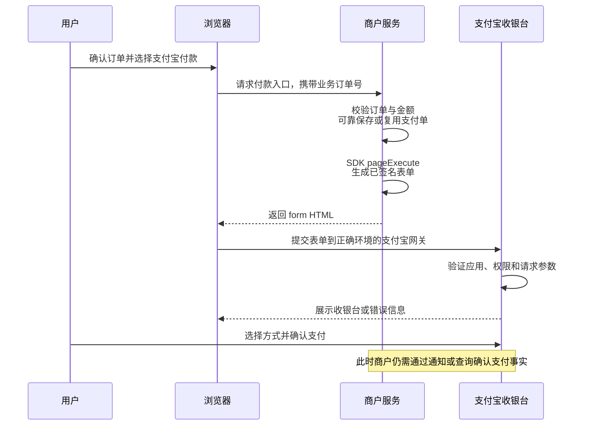
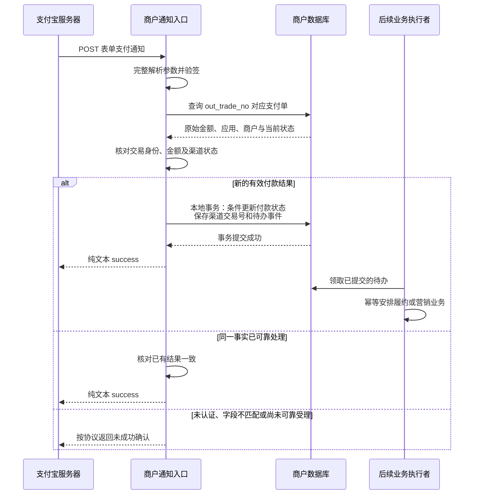
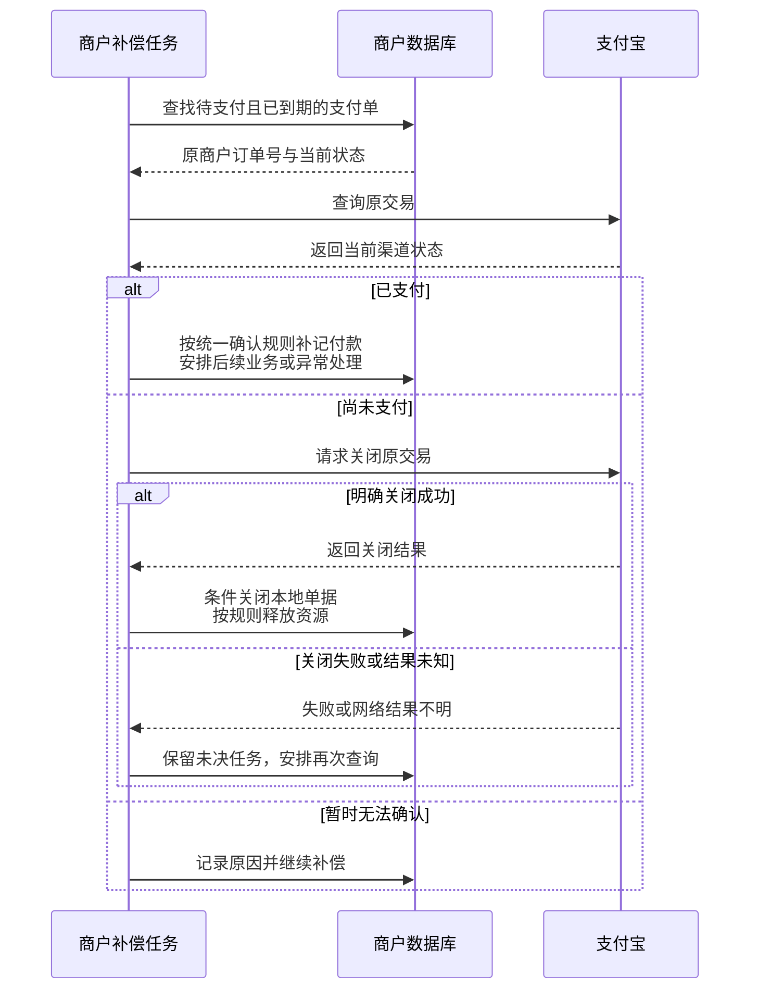

# 支付宝支付接入与回调处理

用户点击“支付宝付款”，浏览器进入收银台，支付后回到商城，看起来只经过了几次页面跳转。服务端还要处理另一条更关键的链路：保存应收订单、生成合法支付请求、接收可信支付结果、核对交易、幂等记账，并在结果未知时继续查询和补偿。

这条主线可以概括为：**先由商户确定收什么钱、归属哪张单，再让支付宝完成收款；商户通过验签后的通知或主动查询确认付款，最后推进自己的履约业务。** 页面展示、请求被受理、支付成功和履约完成，分别对应不同结果。

下文围绕 Java 后端常见的支付宝开放平台 **v2 协议**介绍，使用 `alipay.trade.page.pay`、`pageExecute` 和表单通知等概念。官方同时提供 v3 协议与 SDK，其 REST、JSON 和报文签名约定不同，不能把本文的参数处理方式直接套到 v3。平台文档与 SDK 核对日期为 **2026 年 11 月 12 日**。[支付宝官方：Java SDK 与 v2、v3 区别](https://github.com/alipay/alipay-sdk-java-all)

## 一、支付产品、应用与环境

### 1. 产品决定支付入口与使用条件

支付宝支付不是一套无差别的“生成二维码接口”。电脑网站支付、手机网站支付、当面付和 App 支付面对不同终端及经营场景，需要选择对应产品与接口。

| 产品或场景 | 用户侧体验 | 常见技术入口 | 接入时的关键区别 |
| --- | --- | --- | --- |
| 电脑网站支付 | 电脑网页进入支付宝收银台，扫码或登录付款 | alipay.trade.page.pay | 服务端生成供浏览器提交的支付表单或地址 |
| 手机网站支付 | 移动网页进入支付宝网页或唤起支付宝 App | alipay.trade.wap.pay | 按移动网页产品要求构造请求并处理返回 |
| 当面付扫码支付 | 用户扫描商户展示的收款二维码 | alipay.trade.precreate | 后端预下单取得二维码内容，再展示给用户 |
| 当面付付款码支付 | 商户设备扫描用户出示的付款码 | alipay.trade.pay | 商户发起收款，处理支付中与未知结果 |
| App 支付 | 原生移动应用调起支付宝客户端 | 服务端生成订单串，客户端 SDK 调起 | 服务端签名与客户端交互分工明确 |

电脑网站支付页面里出现二维码，仍可能是电脑网站支付产品；当面付也有二维码，但适用场景和协议不同。**二维码的外观不能决定产品类别。** 当前当面付产品文档还明确提示不再支持小程序，小程序应选择相应专用产品，不能沿用旧教程推定产品权限。[支付宝官方：电脑网站支付](https://opendocs.alipay.com/open/00dn7j)、[手机网站支付](https://opendocs.alipay.com/open/00f7nf)、[当面付](https://opendocs.alipay.com/open/00f7nr)

产品选择也涉及应用状态、商户签约、网站及经营材料等条件。SDK 中存在某个请求类，只说明它能够表达该接口参数，不代表当前 AppID 已拥有正式调用权限。应按实际经营场景开通产品，再完成相应技术接入。

### 2. 应用身份与收款商户

`app_id` 标识发起接口调用的支付宝应用，收款方则是交易对应的商户账号。在自研接入中，应用与本商户通常有直接关系；服务商代商户接入时，还会涉及商户授权关系、授权令牌和实际收款方。

因此，不能在数据库里只存一串商户订单号，却不保存它属于哪个支付渠道、环境、应用与收款商户。一个系统为多个商户服务时，这些上下文决定使用哪套密钥、怎样核对回调，以及款项实际进入哪个账户。

创建应用、配置加签方式、开通产品和提交上线审核是不同事项。当前官方应用创建文档说明，开发中的网页或移动应用不能直接在线上正式调用接口；能够在控制台看到 AppID，不等于已完成正式接入。[支付宝官方：创建应用与开发配置](https://opendocs.alipay.com/open/009yp4)

### 3. 沙箱是一套隔离环境

沙箱用于学习接口与联调核心链路，有自己的环境配置、测试账号和数据。接入时应从当前沙箱控制台取得配套的 AppID、应用私钥、支付宝公钥或证书、网关与买卖家信息，并按对应产品的沙箱说明测试。

当前沙箱文档示例的网关为 `https://openapi-sandbox.dl.alipaydev.com/gateway.do`，并展示了线上应用同步到沙箱后 AppID 可以保持一致的情况。因此，不能机械地说“沙箱 AppID 必定与线上不同”，也不能由 AppID 相同推断密钥和交易数据可以混用。**环境身份由整套配置共同确定，切换环境不只是修改一个网关 URL。**[支付宝官方：沙箱快速接入](https://opendocs.alipay.com/common/097jyh)

沙箱只覆盖有限功能，客户端支持情况、产品范围和线上行为可能存在差异。遇到异常应先查看当前限制与错误码，不能在没有公告依据时断言某天“支付宝沙箱统一维护”。沙箱通过也不代表正式产品已签约、已上线或完成生产验收。[支付宝官方：沙箱约束限制](https://opendocs.alipay.com/common/097oft)

正式交易必须具备对应的应用与产品权限，并使用符合商户经营范围的真实交易安排。生产验证涉及实际资金、手续费、退款和财务记录，不能为了绕过沙箱问题就直接把未完成接入的代码切到正式网关。

### 4. 几种回调地址承担不同职责

| 地址 | 主要调用者 | 用途 |
| --- | --- | --- |
| 支付 notify_url | 支付宝服务器 | 通知对应支付交易的结果 |
| 支付 return_url | 用户浏览器 | 支付流程后返回商户页面，改善用户体验 |
| 应用网关 | 支付宝相应消息服务 | 接收所订阅能力的事件与异步消息 |
| 授权回调地址 | 授权后的浏览器跳转流程 | 接收用户或第三方应用授权码等数据 |

支付结果通知通常按支付 API 中传入的 notify_url 投递。应用开发设置中的“应用网关”并不自动替代每笔支付请求中的 notify_url；“授权回调地址”也不是支付结果接收地址。即使为了部署方便复用同一个域名，也应分别设计路由、验签方式和业务解析规则。[支付宝官方：应用环境配置说明](https://opendocs.alipay.com/open/009yp4)

## 二、业务订单、支付单与交易状态

### 1. 三种编号分别记录不同对象

业务订单记录用户买了什么、成交金额和履约约定；支付单记录本次准备用哪个渠道收钱；支付宝交易号记录支付宝侧建立的交易。三者可以关联，但不应在概念上混为一个字段。

| 标识或字段 | 由谁产生 | 主要用途 |
| --- | --- | --- |
| 业务订单号 | 商户业务系统 | 关联商品、用户、优惠和履约 |
| out_trade_no | 商户系统 | 支付请求中的商户订单号，关联渠道交易与本地支付单 |
| trade_no | 支付宝 | 支付宝交易号，用于查询、退款和对账等 |
| app_id、收款方标识 | 平台配置与交易上下文 | 确定哪套应用和商户在收款 |
| total_amount | 商户确认并提交 | 本次交易的订单总金额 |
| trade_status | 支付宝交易结果 | 表示渠道交易当前所处状态 |

在一个简单系统中，可以让业务订单号同时作为 out_trade_no，但这只是设计选择。一次业务购买可能出现多个支付尝试，例如更换支付渠道或在合法关闭原交易后重新发起；此时更适合明确区分业务订单与支付记录。

out_trade_no 应在商户对应交易范围内唯一，重试同一次支付操作时保持稳定。相同编号会关联原单据，不能把它当成“每次 HTTP 请求的临时随机号”；更不能每次网络超时就生成新编号，使一笔购买出现多笔可付款交易。[支付宝官方：电脑网站支付接入流程](https://opendocs.alipay.com/open/270/105899)

### 2. 支付金额来自服务端确认的成交结果

前端可以提交准备购买的商品、数量或已有业务订单号，但最终支付金额必须由服务端依据成交记录确定。若支付接口直接信任浏览器传入的 `totalAmount`，用户就可能把 100.00 元订单改为 0.01 元后生成合法签名的支付请求。

调用渠道前，需要核对订单属于当前用户、仍允许付款、币种和金额有效，并保存本次采用的交易快照。支付处理中，不能因为商品表后来改价，就悄悄用新价覆盖这笔支付单。

Java 金额通常使用 BigDecimal 或明确的最小货币单位整数，避免二进制浮点误差。比较通知金额与应收金额时，应按币种、精度和数值比较，例如把 `10.0` 与 `10.00` 识别为同一金额；同时拒绝超精度、负值和不符合业务范围的内容，不能只为了“比较通过”随意四舍五入。

本文普通网站支付示例使用人民币元，金额精确到分。并非每类通知都单独携带币种字段；接口固定币种时，应由产品契约和本地支付记录共同约束，涉及支持多币种的其他产品时，再按对应接口核对币种。

### 3. 渠道状态与业务状态分开维护

支付宝常见交易状态如下，实际通知触发条件还应以所接产品说明为准：

| trade_status | 渠道含义 | 本地处理方向 |
| --- | --- | --- |
| WAIT_BUYER_PAY | 交易已创建，等待买家付款 | 保持待付款，按期限查询或关闭 |
| TRADE_SUCCESS | 交易支付成功 | 核对后确认付款，按条件安排后续业务 |
| TRADE_FINISHED | 交易结束，不可退款 | 按已付款事实核实本地状态，不重复计入收款 |
| TRADE_CLOSED | 未付款交易关闭，或支付完成后全额退款等 | 结合原支付与退款记录处理，不能一律当未付款 |

`TRADE_FINISHED` 是渠道交易状态，不表示商户已经发货；`TRADE_CLOSED` 也不能一律翻译成“用户从未付款”。若已经完成支付后全额退款，订单的资金历史中仍应保留收款与退款事实。[支付宝官方：交易状态与通知触发条件](https://opendocs.alipay.com/open/270/105902)

本地可以分别保存支付状态、交易订单状态、退款状态与履约状态。例如，用户已付款但拼团尚未成功，支付状态为已付，履约仍在等待；仓库发货失败，也不能把支付记录改成“支付失败”。

### 4. 保存支付意图后再交给外部渠道

生成支付请求之前，应先可靠保存商户支付单及其与业务订单的关系。之后回调或查询返回 out_trade_no 时，系统才能找到原始应收金额与对应账户。

数据库事务不能自动覆盖支付宝的外部系统。先在本地保存支付意图，再调用或生成渠道请求，出现异常后可以沿着已保存的编号恢复。若直到支付完成才尝试建立本地记录，服务重启或通知先到时就可能找不到订单。

是否需要复用一笔未完成支付单、什么时候允许创建新支付尝试，应给出明确规则。对同一业务单，更换 out_trade_no 前应核实上一笔渠道交易，避免旧二维码仍可付款，新支付入口也已生成。

## 三、RSA2、证书与 Java SDK 的分工

### 1. 商户签名与支付宝验签

RSA2 是支付宝常用的接口签名方式，使用 SHA-256 与 RSA。商户用**应用私钥**对按协议组织的内容签名，支付宝用登记的应用公钥验证请求；支付宝用自己的私钥签名返回消息，商户使用**支付宝公钥**验证来源与内容完整性。

因此，有三类材料需要分清：应用私钥由商户保管并用于签名；应用公钥上传到对应应用供支付宝验签；支付宝公钥从可信的开放平台配置取得，供商户验证平台消息。应用公钥和支付宝公钥的归属不同，不能因为都是一大段 Base64 文本就相互替换。[支付宝官方：设置密钥加签方式](https://opendocs.alipay.com/common/02kdnc)

签名不是“把交易内容加密后只有支付宝能看”。普通签名参数仍可能是明文，签名主要用于检测篡改并验证持有相应私钥的一方。HTTPS 保护传输通道，RSA2 处理接口消息签名，两者应按各自职责使用。

应用私钥应通过安全配置或受控文件加载，不能写进网页、移动客户端、公开代码仓库或普通日志。示例中的 AppID、密钥和地址应全部替换为自己对应环境的配置，不使用教程作者留下的真实账号信息。

### 2. 公钥模式与证书模式

公钥模式直接配置应用私钥与支付宝公钥；证书模式还需要应用公钥证书、支付宝公钥证书及支付宝根证书等材料，由 SDK 处理相应的证书序列号、验签公钥提取和证书校验。

证书不会替商户取消私钥。商户仍使用与应用证书中公钥匹配的应用私钥签名，支付宝侧验证其对应关系。证书路径也不是任意一个 `.crt` 文件就能代替；应用证书、支付宝公钥证书和根证书具有不同用途，需按角色与环境配套配置。

回调验签要使用与模式匹配的入口。普通公钥模式可使用当前 SDK 的 `rsaCheckV1` 或对应通用验签方法；证书模式可以使用 `certVerifyV1` 等官方提供的方法。支付通知与生活号、应用网关等其他消息可能采用不同待验签规则，不能看到方法名里有“验签”就无差别替换。[支付宝官方：SDK 证书使用与异步验签](https://opendocs.alipay.com/common/055cla)

### 3. AES 内容加密是可选能力

部分接口可以对业务内容使用 AES 加密。AES 保护内容机密性，RSA2 验证签名，两者职责不同；启用 AES 后仍需要按协议签名与验签，不能用“消息能成功解密”代替身份认证。

是否支持内容加密、加密哪部分数据以及怎样配置，应按具体接口与 SDK 处理；需要启用时，使用对应 SDK 的能力，并确认双方字符集及密钥一致。[支付宝官方：接口内容加密方式](https://opendocs.alipay.com/common/02mse3)

### 4. SDK 处理协议，商户处理业务

服务端 SDK 负责把请求对象组织为接口参数，生成签名，执行适用的 HTTP 调用，并对相应返回做验签等处理。页面类支付的 `pageExecute` 则生成浏览器需要提交的表单或 URL，行为与直接请求查询接口的 `execute` 不同。

移动端客户端 SDK 主要负责原生 App 与支付宝客户端之间的调起及结果返回。客户端不能持有商户应用私钥；客户端显示“支付成功”，也不能替代服务器核实支付结果。电脑网站支付通常通过浏览器提交表单，不要求为了显示收银台而引入原生客户端 SDK。[支付宝官方：开发工具包与客户端、服务端 SDK](https://opendocs.alipay.com/common/02kg67)

SDK 不知道本系统的成交价格、哪个用户有权付款、订单能否履约或是否已经发货。这些判断必须由商户实现。**SDK 验签通过，不等于当前通知已经通过订单、金额和商户归属校验。**

## 四、从商户下单到支付宝收银台

### 1. 先完成商户侧订单确认

用户发起付款时，服务端首先确定待付款业务单，检查用户归属、金额、订单状态与有效期，再创建或复用合适的支付记录。输入是业务购买意图或订单号，输出是一个可与后续渠道结果关联的支付单。

商品价格、优惠券分摊和库存预占等属于交易业务。支付请求使用已经确认的应付金额，不应临时从浏览器重新拼出另一份报价。支付过程中修改订单内容时，也要处理原支付请求仍可能有效的问题。

### 2. pageExecute 返回支付表单

下面的示例只展示电脑网站支付中“已存在支付单 → 生成表单”的部分。`client` 已按正确环境与加签方式初始化，`payNo`、`amountYuan`、`subject` 均来自服务端已确认的数据，不从浏览器金额字段直接赋值。

```java
AlipayTradePagePayModel model = new AlipayTradePagePayModel();
model.setOutTradeNo(payNo);
model.setTotalAmount(amountYuan);
model.setSubject(subject);
model.setProductCode("FAST_INSTANT_TRADE_PAY");

AlipayTradePagePayRequest request = new AlipayTradePagePayRequest();
request.setBizModel(model);
request.setNotifyUrl("https://example.com/payments/alipay/notify");
request.setReturnUrl("https://example.com/payments/alipay/return");

String formHtml = client.pageExecute(request).getBody();
```

`formHtml` 是 HTML 表单，通常含提交到支付宝网关的字段和自动提交脚本。它表明 SDK 已生成付款入口，**不表示用户已付款，也不表示支付宝已经返回一笔成功交易。** 官方 SDK 的 `pageExecute` 源码可见，它为 POST 方式构建表单，为 GET 方式构建地址，而不是在此等待用户完成付款。[支付宝官方：页面支付调用说明](https://opendocs.alipay.com/open/270/105899)、[Java SDK：pageExecute 实现](https://github.com/alipay/alipay-sdk-java-all/blob/master/v2/src/main/java/com/alipay/api/AbstractAlipayClient.java)

后端应以正确的 HTML 响应方式交给浏览器，或者由前后端按明确契约完成跳转。若把表单字符串当普通 JSON 文本展示，浏览器未必执行其中的脚本；接口成功返回了一段字符串，也不等于浏览器已经访问收银台。

### 3. 浏览器提交之后，支付宝才处理页面支付请求



浏览器访问收银台之后，支付宝才有机会验证提交的页面支付请求。应用未上线、产品未开通、密钥不匹配等错误，可能在这个阶段暴露。商户服务器成功生成 form，不能证明这些外部条件已经全部满足。

当面付的预下单不同：商户服务器通过对应接口与支付宝交互，取得二维码内容，随后在自己的页面或终端展示。但“取得二维码”仍只是取得付款入口，之后仍要等待可信支付结果。

### 4. 页面关闭与支付结果未知

用户可能关闭浏览器、在手机上完成支付却不回到电脑页面，或者付款后发生网络超时。这些情况都会使前端观察结果不完整。

商户应保存待支付或结果未知状态，并安排查询或等待通知。不能把浏览器断开、SDK 超时、页面未跳回都直接解释为支付失败；也不能因此马上释放所有资源并允许同一笔业务生成全新的支付交易。

## 五、同步回跳与异步通知

### 1. return_url 主要服务用户体验

同步回跳指支付流程结束后，浏览器按约定访问商户的 return_url，通常以 GET 查询参数携带相关交易信息。它适合展示“正在确认支付结果”或已核实的订单状态，并引导用户回到订单详情。

浏览器链路可能中断，URL 可以被重复访问，客户端提交的参数也不能天然被信任。即使对同步参数完成验签，也不应仅靠这次跳转安排发货或充值；应让页面查询商户服务端已经核实的支付状态，必要时触发受控查单。[支付宝官方：支付流程与同步返回的可靠性边界](https://opendocs.alipay.com/open/270/105899)

return_url 与 notify_url 的到达顺序没有可靠的业务保证。回跳页面到达时，通知可能已处理，也可能还没到；通知也可以在用户未返回商城时独立完成。实现中不应写死“先显示回跳，再等待回调”的顺序。

### 2. notify_url 是服务器之间的支付结果传递

异步通知由支付宝服务器向商户 notify_url 发起 POST 请求，和浏览器是否在线无关。它传递交易状态、商户订单号、支付宝交易号、金额及签名等数据。通知可能重复发送，也可能因为网络、服务异常等原因未成功交付。[支付宝官方：电脑网站支付异步通知](https://opendocs.alipay.com/open/270/105902)

通知接口不能要求用户浏览器 Cookie 或普通网站登录态，因为发送者是支付宝服务器。但这不意味着“通知接口无鉴权”：**协议验签和交易归属核对就是它的认证与授权边界。** 常见实现是在安全框架中让专用回调路径进入渠道校验器，再拒绝验签失败或业务字段不匹配的消息。

通知地址应能被支付宝从公网直接访问，返回协议要求的确认结果。反向代理、网关和安全过滤器需要正确转发 POST 及其参数，避免重定向到登录页、统一错误页或验证码页面。

### 3. 传统支付通知是 URL 编码表单

本文 v2 支付通知按表单参数接收，通常使用 `application/x-www-form-urlencoded`，不应把整个请求体按业务 JSON 反序列化。某些参数值本身可能是一段 JSON 字符串，例如资金明细；这不改变外层是表单的事实。

```http
POST /payments/alipay/notify
Content-Type: application/x-www-form-urlencoded; charset=UTF-8

app_id=APP_ID&out_trade_no=PAY_NO&trade_no=ALIPAY_TRADE_NO&
total_amount=88.88&trade_status=TRADE_SUCCESS&
seller_id=SELLER_ID&sign_type=RSA2&sign=URL_ENCODED_SIGNATURE
```

上例分行只为阅读，真实报文按表单格式传输。签名中可能含 `+`、`/`、`=`，中文标题也需要正确的字符编码。若框架已经完成一次 URL 表单解码，再对参数值调用 URLDecoder，可能把真实的加号变为空格，导致签名不一致。

应在框架读取参数之前设置或确认正确字符集，保留完整的原始业务参数集合供验签使用。不能先只挑出 DTO 中认识的几个字段，丢掉其余平台参数后再验签；也不能先 trim、截断、重新格式化金额或解析后重新序列化 JSON 字符串。业务标准化应放在验签成功以后。[支付宝官方：异步返回参数与验签规则](https://opendocs.alipay.com/open/270/105902)

如果网关或框架允许同名参数重复，商户需要明确拒绝含糊报文或按已确认的协议解析，避免“验签代码取第一个值，业务代码取最后一个值”。记录诊断报文时也应注意脱敏与存储范围，不把完整用户标识和签名长期写进公开日志。

### 4. HTTP 成功与协议确认不同

对于该支付通知协议，支付宝期待商户成功受理后返回纯文本 `success`。只返回 HTTP 200、`{"code":0}`、HTML 页面或字符串被 JSON 引号包裹，都不等价于协议确认；支付宝未得到预期确认时，会按其策略重试。

反过来，返回 success 不是“以后不会再有重复消息”的保证。第一次处理已经完成，但应答在网络中丢失，平台仍可能再次通知。接收方要让重复请求安全地返回同样的确认，而不是依靠平台只投递一次。[支付宝官方：异步通知特性](https://opendocs.alipay.com/open/270/105902)

## 六、验签、交易核对与幂等更新

### 1. 先验证平台消息，再进入业务判断

验签时使用支付宝公钥或相应证书，按 SDK 与通知协议规定处理参数。普通支付通知的 V1 规则会排除 sign、sign_type，再对其余适用参数组成待验签内容。应交给 SDK 完成这些协议细节，避免手写时误删字段或改变顺序。

下面的方法只说明普通公钥模式的一次验签，不承担参数接收、业务校验和订单更新职责。传入 Map 应是已经按正确字符集完成一次表单解析、尚未被业务改写的完整参数集合。

```java
boolean verifyPaymentNotification(
        Map<String, String> params, String alipayPublicKey)
        throws AlipayApiException {
    return AlipaySignature.rsaCheckV1(
            new HashMap<>(params), alipayPublicKey, "UTF-8", "RSA2");
}
```

示例复制 Map，是因为 SDK 的相关实现会在构造待验签内容时移除签名字段，保留原集合可以方便后续按原始参数进行业务解析。证书模式应换成对应的证书验签入口，不能把证书文件全文当成普通公钥字符串传入。[支付宝官方 Java SDK：通知验签实现](https://github.com/alipay/alipay-sdk-java-all/blob/master/v2/src/main/java/com/alipay/api/internal/util/AlipaySignature.java)

验签失败时，不更新支付状态、不发放权益。若通过传入“验签开关”或异常兜底允许未认证通知进入业务，整个可信支付结果边界就被绕过了。测试应使用沙箱真实签名通知或隔离的内部测试入口，不应在公网生产回调中保留可伪造成功的模拟分支。

### 2. 验签后核对期待的那笔交易

合法签名只能说明消息通过了对应签名规则，服务器仍要确认它与本系统期待的交易相符。应先用 out_trade_no 找到支付单，再与创建时保存的记录核对，而不是根据通知临时拼出一笔“已支付订单”。

| 核对内容 | 对照的数据 | 不匹配时的含义 |
| --- | --- | --- |
| app_id | 本支付单使用的应用配置 | 可能是另一应用或错误环境的消息 |
| seller_id 或协议规定的收款方字段 | 本支付单预期收款方 | 款项可能不属于本商户或该子商户 |
| out_trade_no | 本地已存在的支付记录 | 无法关联本系统已发起的支付意图 |
| total_amount | 创建支付时确认的订单金额 | 不能把不同金额计为本次应收已付 |
| trade_no | 已记录的渠道交易号或首次合法绑定 | 防止同一支付记录被不一致交易覆盖 |
| trade_status | 所接产品的状态定义 | 决定是否确认付款或走关闭、退款等处理 |
| 币种与环境 | 产品契约及本地支付配置 | 防止跨币种、跨环境混记 |

通知里的 total_amount、receipt_amount、buyer_pay_amount 含义不同。订单总额、商户实收与买家实际支付可能因营销、渠道规则等不相等，不能拿“金额看起来较大”的字段随意替换 total_amount 校验应收订单。[支付宝官方：通知字段与二次业务校验](https://opendocs.alipay.com/open/270/105902)

某些字段在接口表中是可选项，服务商场景也可能增加授权方与实际商户关系。实现要依据所接产品确定成功入账所必需的证据；关键字段缺失时不能直接跳过安全核对。确需通过主动查询补足时，查询结果也应验证并与同一交易关联。

### 3. 在本地一致性边界内确认付款

典型处理是先加载待付款支付单，核对消息，再通过数据库条件更新将它从允许的状态变为已付款，同时保存渠道交易号、付款时间和必要通知记录。事务内还可写入后续业务事件或待处理任务，提交后再推进发货、成团或权益开通。



“先查询未支付，再执行无条件更新”不足以处理并发，两条通知可能同时读到未支付。需要状态条件、行锁、版本号或其他适合当前数据库的方式保护状态转换，并检查实际更新结果；唯一约束也应保护渠道交易关联和后续动作标识。

通知接收、查单补偿和人工核实应尽量进入同一套“确认渠道事实”的业务规则。若回调路径核对金额，定时查询路径却直接改状态，就会出现正常路径安全、补偿路径绕过约束的问题。

### 4. 合法重复通知仍需确认

第一次通知已经把订单更新为已付，第二次收到同一支付成功通知时，应核对订单、金额、商户与渠道交易号仍一致，随后返回 success。不能因为“状态已经是已支付”就返回失败，迫使支付宝继续重试；也不能再次累计收入、重复发货或重复增加拼团人数。

幂等应围绕业务事实设计。notify_id 可帮助识别同一通知的重发，但同一交易也可能产生不同通知或由主动查单确认，因此付款入账与履约动作还要使用支付单号、渠道交易号、订单及动作等稳定标识保护。

当前状态已经与通知矛盾时，应进入异常核实。例如，本地已经合法关闭订单却收到真实付款，需要查明渠道时序，再根据资源与合同规则补单或退款；不能简单把关闭状态改回待发货，也不能因为本地关闭就忽略真实到账的资金。

### 5. 已确认付款与已完成履约

支付确认的本地事务适合做短而确定的更新，不宜在持有数据库锁时等待物流、远程营销服务或其他耗时接口。可以在同一事务中保存付款事实与待履约事件，再由任务执行者处理，并为失败安排恢复。

如果选择先持久化通知或收件箱记录，再立即返回 success，持久化记录就代表商户已经承担后续处理责任。必须有实际的异步执行、重试和异常处理机制；仅提交给内存线程池后应答，进程退出时可能丢失工作。

发货、充值或开通服务也需要自己的幂等与完成状态。支付成功消息已发送，不证明下游实际完成交付；调用方超时，也不证明下游没有执行。相关交易、通知任务和履约职责可结合[电商营销与交易业务设计](电商营销与交易业务设计.md)中的业务状态与补偿思路理解。

## 七、查单补偿、超时关闭与退款

### 1. 主动查询弥补通知缺口

通知不是唯一可靠结果来源。官方要求商户接入支付结果通知的同时接入 `alipay.trade.query`：在通知未到、结果未知、用户重复发起付款等情况下，查询渠道交易状态并核实本地记录。

查询输入通常使用原 out_trade_no 或已知 trade_no；服务器使用相应环境、应用与商户上下文调用。收到响应后，先区分接口调用结果，再读取交易状态、金额等字段，不应把 HTTP 200 或 `response.isSuccess()` 直接等同于“买家已付款”。查询接口成功执行，也可能查到 WAIT_BUYER_PAY。[支付宝官方：通知缺失时的查询要求](https://opendocs.alipay.com/open/270/105902)

前端查询本地订单状态，可以触发受控查单，但要做鉴权、限频和任务协调，避免每个浏览器每秒直接压向支付宝。服务端还应有独立调度恢复长时间未决记录，否则用户关闭网页以后，该订单可能永远无人继续核实。

### 2. 超时关闭与支付成功的并发

业务订单到期，不意味着渠道已经无法付款。若本地先释放库存、关闭订单，而原支付宝交易仍有效，用户可能继续支付成功。因此，关闭流程需要核实渠道状态，并按产品接口关闭尚未付款的交易。



“查询尚未支付”与“关闭请求”之间仍可能发生付款，因此查询只是当时快照，不能替代关闭结果。关闭失败后应识别是否因为交易已经支付，并再次核实；关闭请求超时也不能直接当作关闭成功。

支付回调与关闭任务应遵守一致的状态转换条件。已经有效确认付款的订单，不能被晚到的超时任务按旧状态释放；已经关闭却发现渠道确实付款的记录，则需进入补单、退款或人工处理，保留资金事实。

### 3. 退款是一项独立、可追踪的资金操作

业务退款先确定原支付交易、可退金额、原因和本次退款请求号，再调用 `alipay.trade.refund`。订单的取消、售后审批通过与渠道退款成功是不同状态，不能在点击“退款”按钮时就把它们全部标成完成。

`out_request_no` 标识一次退款请求，至少要在对应交易下保持唯一。重试同一次退款时，继续使用原请求号及一致的请求内容；新的部分退款才使用新的请求号。官方 SDK 字段说明明确要求，失败或异常重试时不能更换同一次退款请求号，以避免重复退款。[支付宝官方 Java SDK：退款请求号约定](https://github.com/alipay/alipay-sdk-java-all/blob/master/v2/src/main/java/com/alipay/api/domain/AlipayTradeRefundModel.java)

退款记录至少应保存原支付单、本次退款号、金额、申请时间、当前结果和最近错误。并发申请部分退款时，还要在受保护的状态变更中检查累计退款与处理中金额，防止多项退款各自看到相同可退余额。

退款接口调用异常或网络超时，表示本次结果未知，不代表款项一定没有退。应使用同一原交易与退款请求号通过 `alipay.trade.fastpay.refund.query` 等相应查询能力核实，或按协议重试原请求；不能生成新号“再试一次”。退款可用期限、手续费退还和资金处理规则按产品与合约确定，不把某个旧教程中的固定期限当作全部产品通则。

### 4. 对账查找正常链路之外的矛盾

主动查单主要恢复单笔未决交易，对账则从更大范围核对渠道与本地记录，例如渠道已付但本地未付、渠道存在交易但本地缺单、退款成功但售后状态仍处理中，或本地已付款却没有履约任务。

可以按商户、环境和日期取得适用账单，再用商户订单号、渠道交易号及金额匹配。账单中的手续费、实收与退款等字段有各自口径，不应直接把实收金额与业务商品金额相减后就判定收款异常。

发现差异后，需要有明确的补偿、告警或人工核实入口。仅打印“订单不一致”日志不能完成恢复；自动补偿也应复用原幂等标识和状态规则，避免在对账任务中重复退款或重复发货。

### 5. 从本地验证到真实接入

本地测试可以验证金额比较、状态转换、重复请求和通知参数解析；沙箱联调可以覆盖签名、收银台、真实平台通知与查单；正式环境验收还要覆盖实际签约权限、商户配置及资金结果。本文给出的是通用协议与实现思路，没有因此证明任何本地工程已经完成交易联调。

验证回调时，应同时观察“参数进入—验签通过—订单与金额匹配—事务提交—返回 success”的证据。收到 POST、打印了 trade_no 或页面显示“付款成功”，都不足以单独证明商户已经正确记账。

重复通知、金额不符、签名错误、通知先于回跳、回跳未到、查询超时、支付与关闭竞争、退款结果未知，分别对应不同故障。应验证系统在这些分支中仍能保留真实资金事实，并为未完成工作留下可执行的恢复路径。

