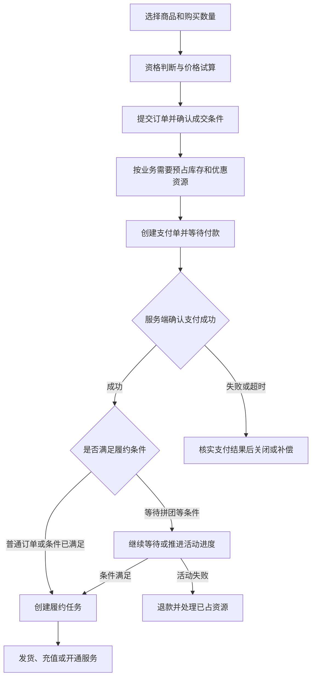
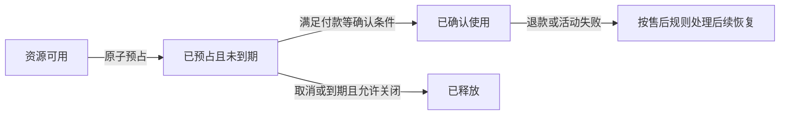
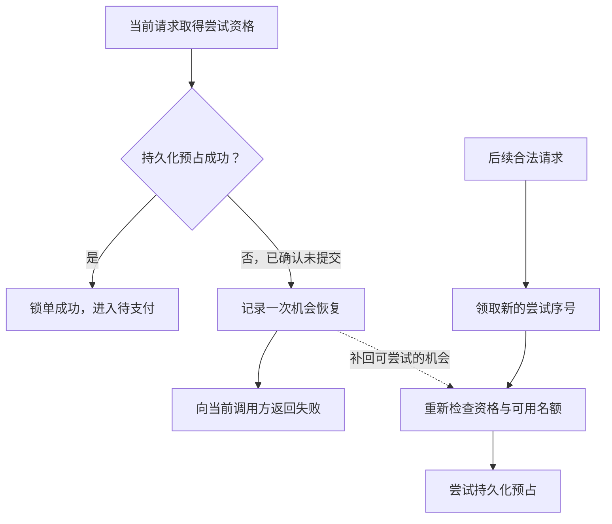
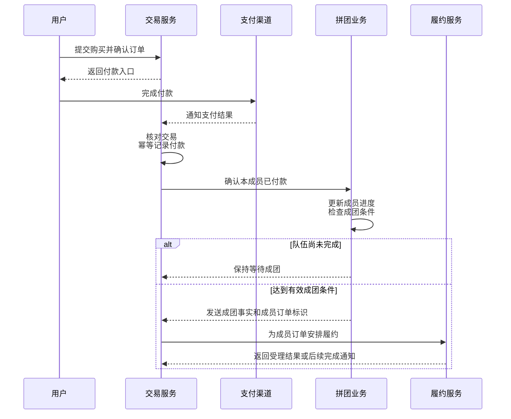
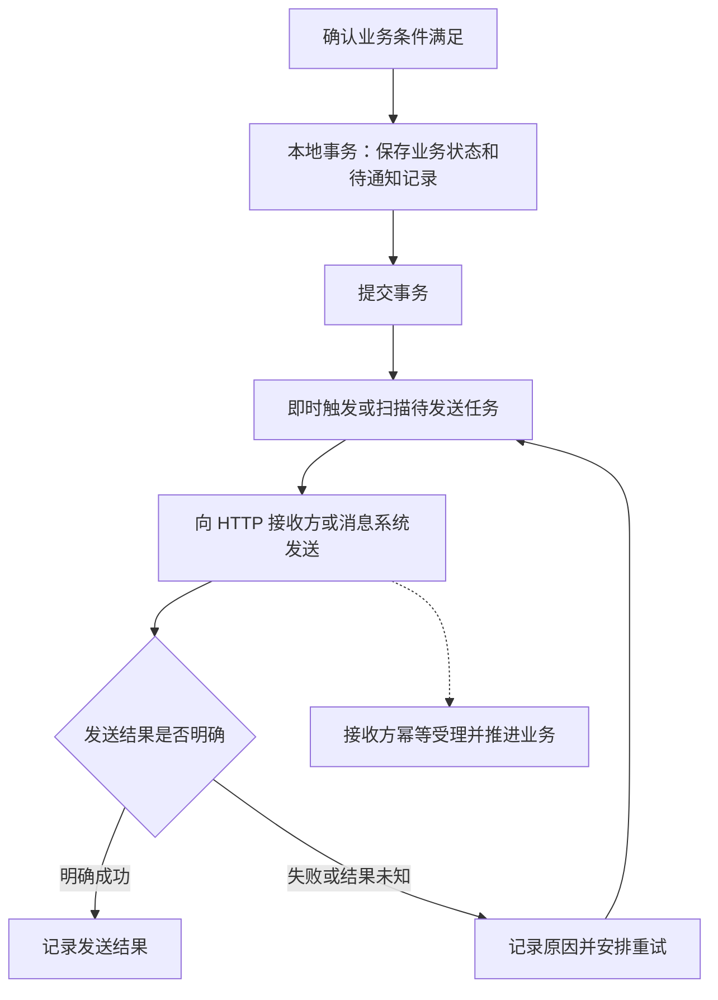

# 电商营销与交易业务设计

用户在商品页看到优惠价格，提交订单后付款，最后收到商品，这是一条连续的购买体验。服务端需要把其中不同性质的操作区分开：计算价格、判断资格、预占资源、确认付款、推进营销条件、安排履约。它们处理的数据和成功条件不同，失败后的处理方式也不同。

理解这些业务时，可以先抓住一条主线：**先说明用户当前可以按什么条件购买，再在下单时确认交易约定，随后根据可靠的支付结果推进业务，最终完成履约或退款。** 营销活动改变了价格、资格或履约条件，但没有取消这条交易主线。

## 一、交易流程与核心业务概念

### 1. 商品、营销、订单与支付的分工

商品描述卖什么，包括商品名称、规格、销售单位和基础价格。库存描述还能销售多少；活动名额描述还有多少次优惠或参与机会。它们可能同时限制购买，但计量对象并不相同。例如，一位用户购买两件商品，可能消耗两件库存、一个拼团名额和一张优惠券。

营销决定在什么时间、通过什么渠道、针对哪些用户和商品提供什么权益。满减、折扣、优惠券、会员价、包邮和拼团都属于常见形式。营销系统需要表达规则和权益的使用情况，订单系统则需要记录用户最终接受的交易内容。

| 业务概念 | 主要回答的问题 | 常见记录 |
| --- | --- | --- |
| 商品与库存 | 卖什么，还有多少可售资源 | 商品规格、基础价格、可售量、预占量 |
| 营销活动 | 谁在什么条件下享受什么权益 | 活动规则、有效期、资格、预算与名额 |
| 交易订单 | 用户这次具体买了什么、同意付多少 | 商品快照、数量、成交金额、优惠明细、订单状态 |
| 支付订单 | 通过哪个渠道收取这笔钱，结果怎样 | 商户支付单号、渠道交易号、金额、币种、支付状态 |
| 履约任务 | 付款并满足条件后，如何交付权益 | 出库单、物流单、充值记录、服务开通记录 |

业务订单与支付订单通常需要区分。一次购买可能因为支付单超时、更换渠道等原因产生多次支付尝试；系统既要保存这些尝试，又要防止同一笔应收业务被重复计入成功付款。具体采用一个业务单对应几个支付单，应由渠道和产品流程决定。

### 2. 从浏览到履约的主流程

价格展示可以多次发生，真正提交购买时才进入订单和资源确认。下面是一条常见主线，其中的拼团属于可选营销条件：

实际系统可以把这些能力部署在一个应用内，也可以分给多个服务。**业务职责的区分不要求每项能力都成为一个微服务。** 单体应用同样需要处理状态、并发和外部支付结果；拆成服务以后，还会增加跨服务失败与一致性问题。

### 3. 成功结果与状态维度

“订单成功”过于笼统。创建订单成功只说明交易记录建立了；支付成功说明某次收款被确认；拼团成功说明队伍达到活动约定；履约成功说明商品或权益完成交付。页面跳转成功、HTTP 请求成功和消息发送成功，则属于不同层次的技术结果。

一个订单可以同时具有多个状态维度。例如：交易状态为“进行中”，支付状态为“已支付”，营销状态为“等待成团”，履约状态为“尚未开始”。将所有情况压进一个“成功／失败”字段，会难以表达这种组合。

“结算”也需要限定语境。营销结算可以指确认某位用户已完成付款并推进活动进度；交易系统中的结算可能指完成订单的业务确认；支付渠道与商户之间的资金结算则涉及资金清分和到账。设计接口、状态和事件时，应使用能够明确区分这些含义的名称。

## 二、价格试算与优惠计算

### 1. 试算的目的与业务边界

价格试算是根据当前购买意图和规则，预先计算用户预计需要支付的金额，并说明这个结果如何产生。用户改变数量、切换优惠券、修改地址或重新选择活动后，都可能触发一次新的试算。

一次试算通常需要商品及数量、用户身份或会员等级、活动与优惠券、销售渠道、配送地址、计算时间等信息。输出则应包含商品小计、各项优惠、运费和税费、预计应付金额，以及不适用优惠的原因。只返回一个“优惠价”，后续很难解释为什么另一张券不可用，或为什么地址变化后应付金额增加了。

**试算主要回答当前报价，不默认确认交易，也不默认占用资源。** 试算可以记录日志、使用缓存，或保存一份短期报价记录，但不能仅因生成了报价编号，就认为库存、活动名额和优惠券已经被锁定。报价保存、保价承诺和资源预占应分别定义。

以平台能力为例，[Stripe 的账单预览](https://docs.stripe.com/invoicing/preview)允许在不创建正式账单的情况下计算金额、行项目及优惠。这说明“提前计算”可以独立于“正式创建”，不意味着所有电商平台采用相同的接口或定价规则。

### 2. 试算的输入、处理与输出

试算可以组织成一条确定的计算流水线：

首先校验购买意图：商品是否有效、数量是否符合销售单位、币种和地址是否完整。然后读取服务端维护的商品价格与活动规则。前端可以提交选择了哪张券、购买了几件商品，但最终金额应由服务端根据可信规则计算。

资格筛选与金额计算应区分。例如，一张券可能未到使用时间、只适用于特定商品、要求会员身份，或已经被核销。这些情况决定优惠是否进入候选集合；“满多少减多少”“折扣如何取整”则属于计算规则。

输出除了金额，还可以包含所用活动与规则版本、报价时间、有效期以及必要的明细标识。它们帮助提交订单时核对前后是否使用了同一份报价。规则版本不会自动冻结商品价格或用户资格，其作用仍取决于下单时采用怎样的校验和保价策略。

### 3. 优惠层级、叠加与计算顺序

优惠可以作用于单件商品、一组商品、整张订单或运费。设计规则时，应明确适用商品、门槛金额的口径、与其他优惠能否叠加、计算先后以及最大优惠额度。不能只保存“满 150 减 10”，却不说明这个 150 是按原价还是商品优惠后的金额判断。

下面以人民币订单为学习示例，约定商品折扣先计算，订单券门槛按折后商品小计判断，最后处理运费优惠：

| 计算步骤 | 示例规则 | 本步结果 |
| --- | --- | --- |
| 商品原价小计 | 两本书，每本 100.00 元 | 200.00 元 |
| 商品折扣 | 两本书都参加 8 折活动 | 商品小计变为 160.00 元，优惠 40.00 元 |
| 订单优惠券 | 折后商品满 150.00 元减 10.00 元 | 商品应付变为 150.00 元 |
| 运费 | 配送费用为 6.00 元 | 加运费后为 156.00 元 |
| 运费优惠 | 本次享受 6.00 元运费减免 | 最终应付 150.00 元 |

这张订单的优惠合计为 56.00 元，其中商品和订单优惠共 50.00 元，运费优惠 6.00 元。订单应保留这些组成，便于解释、分摊和退款，而不只保存最终的 150.00 元。

上述顺序属于示例规则，并非所有平台的统一要求。例如，[Shopify 的优惠组合说明](https://help.shopify.com/en/manual/discounts/discount-combinations)区分商品、订单和运费优惠，并要求检查组合条件。业务实现可以参考这种分层思路，但需要明确自己的规则，不能直接把某个平台的先后顺序视为行业标准。

有多项可用优惠时，也需要定义选择目标：按业务优先级执行、允许用户指定，还是在合法组合中选择最低应付价。所谓“最优优惠”必须先满足预算、资格、互斥和使用次数等约束；不能把所有优惠相加后称为最优方案。

### 4. 金额精度、优惠分摊与成交快照

金额必须明确币种、精度和舍入规则。人民币订单一般按分处理，也可以使用满足精度要求的十进制类型；其他币种的最小单位可能不同。计算折扣时应统一规定在哪一步取整，避免商品行各自计算的总和与订单汇总不同。

订单级优惠通常需要分摊到商品行。假设两个商品的可优惠金额分别为 60.00 元和 40.00 元，一张订单券优惠 10.00 元，按金额比例分摊后分别承担 6.00 元和 4.00 元。退款时才能知道第一件商品对应的实付金额，而不是重新套用退款当天的活动价。

比例分摊可能出现尾差，处理规则应保证各行分摊总额等于订单优惠总额，同时不使某一行应付金额小于零。可以按明确顺序调整尾差，但必须保证同一输入重复计算得到相同结果。

订单确认成交后，应保存商品名称、规格、单价、数量、所用优惠及分摊结果等必要快照。后续商品改名、活动停用或价格变化，不应悄悄改写历史交易约定。退款和售后通常以成交记录为依据，再结合具体售后规则计算。

### 5. 从试算结果到正式下单

试算与提交订单之间存在时间间隔。期间价格可能变化，库存可能售罄，优惠券可能在另一个页面被使用。因此，下单至少需要重新核对决定成交的关键条件。

常见方案是提交时重新计算并让用户确认变化；另一种方案是保存有有效期的报价，在满足约定条件时按报价成交。如果承诺保价，应保存可核对的报价内容，并说明有效期、数量、地址和资格变化后是否仍然适用。仅让前端传回一个金额，不足以证明用户持有有效报价。

[commercetools 的购物车接口](https://docs.commercetools.com/api/projects/carts)也专门提供重新计算操作，用于更新价格和优惠等内容。这里需要理解的通用原则是：购物车中保存过一个价格，不等于它永远代表当前有效的成交条件。

正式下单应把本次采用的价格与规则固定到订单中，再按业务需要预占资源。之后进入支付阶段，支付金额来自已确认的订单应付金额，而不是由页面自行重新计算。

## 三、人群标签与营销资格

### 1. 标签表达用户特征，规则决定如何使用

人群标签把具有某些共同特征的用户归为一组，例如“近 30 天购买过图书”“新注册用户”“会员等级达到某一级”。标签来源可以是用户属性、行为统计、运营导入或规则计算。

标签只是业务事实或分析结果，本身并不等于权限。一个活动可以针对某个人群提供专属价格，也可以只将其作为推荐依据；是否限制其他用户，应由活动资格规则决定。

标签还需要考虑更新时间和有效期。“历史上购买过”与“最近 30 天购买过”采用不同的维护方式。若使用离线批量计算，业务必须接受一定更新延迟；对于优惠券已用、账户被冻结等必须及时生效的条件，应在关键操作处查询相应的实时状态。

### 2. 可见、可参与与其他资格条件

可见决定用户是否看到活动入口或相关内容，可参与决定服务端是否允许用户获得活动权益。这两种控制可以组合：

| 活动规则 | 标签内用户 | 标签外用户 |
| --- | --- | --- |
| 全量可见，限定参与 | 可以看到并按规则参与 | 可以看到介绍，不能参与该权益 |
| 定向可见，定向参与 | 可以看到并按规则参与 | 不展示入口，也不允许通过接口绕过 |
| 全量开放，标签用于推荐 | 可以看到并参与，可能被优先推荐 | 同样可以看到并参与 |

可见性属于产品体验，参与资格则必须由服务端执行。隐藏按钮不能替代服务端校验。标签命中也不代表无条件允许购买：活动是否有效、用户参与次数、库存和风控等其他规则仍然可能拒绝请求。

没有配置标签时怎样处理，需要产品给出清楚约定：可以定义为面向所有用户，也可以要求某些定向活动必须配置人群。数字范围值、默认允许或默认拒绝，都应有明确的配置含义和校验规则。

### 3. 人群判断的常见实现

规模较小时，可以在数据库保存用户与标签的关系，通过索引查询；需要快速集合判断时，可以使用集合结构；用户拥有稳定、紧凑的整数编号时，可以考虑 Bitmap，用某一位表示某个用户是否属于该标签。

Bitmap 的业务前提很重要：位偏移应能可靠对应用户，不能直接假定任意字符串哈希后都不会碰撞。若两个不同用户落到同一位，就可能把不具备资格的人误认为标签成员。稀疏且很大的编号空间也可能带来不合适的存储开销。

无论使用哪种存储方式，都要安排标签数据的生成、更新和过期。成员查询快，只解决读取环节；它不能弥补标签计算错误、数据尚未加载或用户标识映射不一致的问题。

## 四、锁单与资源预占

### 1. 锁定的是一份有期限的业务承诺

锁单通常指在订单进入付款前后，为本次购买暂时固定部分条件或预占资源。需要明确锁定对象：商品价格、实物库存、优惠券、活动名额或营销预算。锁了其中一项，不代表其他条件也同时得到保证。

例如，系统可能给用户保留 15 分钟活动价，但库存仍需另行预占；也可能预占商品库存，却不承诺优惠券在超时后继续有效。应把资源类型、数量、所属订单、预占时间、到期时间和当前状态记录清楚。

**业务锁单与分布式互斥锁不是同一个概念。** 业务预占可能持续数分钟，应该有可查询和可恢复的业务记录；Redis 互斥锁或数据库行锁通常用于保护某段短时间操作，释放这把技术锁并不意味着业务预占应当取消。

### 2. 预占、确认与释放

一份资源预占常见的状态变化如下：

库存中的“预占”可以使可售量减少，支付成功后再转为确认扣减；已经预占过的数量不能在确认时无条件再次扣减。优惠券也可以区分可用、锁定、核销和返还，但具体在什么阶段核销、退款后是否返还，要由权益规则决定。

同一个用户重复点击下单时，应通过请求幂等标识、订单号或业务唯一约束识别同一次购买。重试同一个请求应能查询或复用原结果，而不是每次都再占一份库存和名额。

### 3. 并发控制与一致性边界

“先查库存还有一件，再扣一件”在并发下可能超卖，因为两个请求可能同时读到同一份可售量。关键是让检查和占用形成一个受保护的状态变化，例如数据库条件更新、带版本号的乐观锁，或由资源服务提供原子预占能力，并检查实际执行结果。

同样，拼团只剩一个名额时，应保证最终只有允许的数量被成功占用。只在页面展示人数，或只在进入业务时查询一次人数，都不能保证后续写入仍然有效。

在同一数据库中，可以使用本地事务共同保存订单及相关预占记录；跨库存、营销、订单等独立服务时，则需要各方提供幂等的预占、确认和释放能力。出现局部成功后，由流程编排决定重试、取消或补偿，不能因为调用顺序写在一个方法里，就认为所有服务共同处在一个事务中。

### 4. 超时关闭与支付回调的竞争

预占到期需要可恢复的释放机制。可以通过定时扫描、延迟任务或其他调度方式找到过期记录，再按状态条件执行关闭与释放。缓存过期通知可以辅助触发，但关键资源不能只依靠一次可能错过的内存通知恢复。

超时关闭时，还可能恰好收到支付成功回调。处理者需要共同遵守状态转换条件：某一方已经完成有效确认，另一方不能继续按过时状态释放资源；若订单已经合法关闭却收到迟到的成功付款，需要进入核实、补单或退款流程。

网络超时尤其不能直接当作支付失败。支付渠道可能已经完成收款，只是应答尚未到达。系统需要查询渠道结果或等待可靠通知，再决定关闭和释放，避免资源已卖给别人但原用户实际上已经付款。

### 5. 预占失败、机会恢复与请求重试

资源预占可能分成前置资格或容量筛选，以及最终持久化两个阶段。前置通过后，数据库事务仍可能因为容量竞争、唯一约束或其他问题失败。因此，“取得尝试资格”“成功建立订单”“完成付款”是不同的结果。

采用递增序号筛选名额时，一次失败可能消耗了一个序号，却没有产生实际占用。如果以后只允许固定范围内的序号继续，就会把这个失败消耗的机会也当作已经用完。可以记录一次恢复量，让后续的新序号补上这个机会；具体计数与序号标记见[《Redis 与 Redisson 开发实践》](<Redis 与 Redisson 开发实践.md>)。

==恢复量记录的是“之前有一次尝试没有成功占用资源”，不会自动把原来的用户、订单或请求重新放进执行队列。== 如果失败路径只是记录补偿后继续抛异常，原调用方收到的仍然是失败结果；用户重新点击或系统安排重试，都是另外需要设计的动作。

下面展示“前置预占通过，后续持久化已确认失败”的路径：

例如一个三人组已经有一位发起者，第二个序号的请求失败，恢复一次机会；后续请求可以继续使用第三、第四个序号，把真实成功人数补到三人。==尝试序号可以大于三，最终成功占用人数仍不能超过三；恢复机会不等于扩大活动容量。== 后续请求可能来自另一位用户，也可能来自原用户的一次合法重试，并不是专门把机会保留给失败用户。

补偿与重试应分别回答三个问题：补回什么资源或机会，谁负责再次执行，重复执行会不会新增不应发生的结果。同一次失败不能重复恢复；同一业务动作重试时，应使用可识别的操作标识，查询或复用原有结果，避免再占一份名额。

还要区分“已确认失败”与“结果未知”。数据库或远程调用超时，可能是没有提交，也可能是提交成功后应答丢失。==结果未知时，应先按稳定业务标识查询或对账，不能仅凭异常就断言没有占用并无条件恢复。== 这与确认回滚后的补偿不同。恢复动作自身失败或进程在补偿前退出，也需要依靠持久记录和后续任务发现，而不能只依赖一次内存中的异常处理。

## 五、支付、成团与履约

### 1. 支付尝试与可靠的付款结果

创建支付单、生成支付表单或取得二维码，说明用户获得了付款入口，不表示商户已经收到钱。浏览器支付完成后的页面跳转也可能被关闭、重复访问或伪造，业务状态应根据服务端可信通知或主动查询推进。

收到支付通知后，系统需要按渠道要求验签或认证，并核对商户身份、订单关联、金额、币种和支付状态等适用字段。合法签名只能帮助确认消息来源与完整性，仍需要判断它是否对应本系统期待的那笔交易。

消息可能重复到达，也可能出现先后顺序与预期不同的情况。[Stripe 的 Webhook 文档](https://docs.stripe.com/webhooks)明确要求处理重复事件，并说明事件不保证按生成顺序投递。设计支付结果处理时，应根据当前业务状态和交易事实决定动作，不能把“收到一次通知”简单等同于“新增一次付款”。

### 2. 普通购买与拼团购买

普通购买在付款后，通常进入审核、备货、发货或权益发放，具体还可能受风控、预售时间等条件约束。

拼团购买增加了队伍层面的营销条件。例如，约定三人成团，每人应付 80.00 元，先付款再等待成团：第一人付款后，其个人支付单已经成功，但队伍还未成功；第二人付款继续推进进度；第三位有效成员完成付款并满足规则后，队伍才可以转为成团成功，随后安排各成员履约。

这一例子中的“先付款后成团”是一种业务方案。也可以采用先授权、满足条件后再扣款等不同支付安排。选择方案后，必须相应确定失败时的资金处理，不能把支付渠道尚未扣款与已经收款后退款混为一种状态。

### 3. 队伍进度与成团确认

锁定名额表示用户已预订参与机会，完成付款才可能成为有效成团成员。因此，预占人数与有效完成人数应分开维护；取消、支付失败和已付款退团，也需要各自的规则。

确认成团时，应在可靠的一致性边界内判断条件并记录结果。多个成员同时付款，可能让多个线程读到相同的旧完成量。实现可以使用条件更新、必要的并发串行化或可恢复的成团确认任务；队伍状态从进行中转为成功的操作还应避免重复生效。

队伍成功后，通常需要查出应处理的成员订单，形成成团事件或履约请求。队伍结束时间、个人支付期限和资源预占期限可能不同，应明确它们之间的约束，而不是统一使用一个倒计时。

图中展示业务协作关系，不要求各参与者独立部署，也不限定采用 HTTP 还是 MQ。支付应答、消息投递与异步履约在时间上不必严格排成一条同步调用栈。

### 4. 履约失败、活动失败与退款

成团成功后，履约服务还需要建立自己的任务和状态，例如待处理、已受理、发货中、已完成或处理异常。发送了“请发货”消息，只说明动作被请求；需要仓库出库、充值入账或服务开通等相应结果，才能确认实际交付。

若队伍到期仍未成功，应找出符合退款条件的支付记录，创建退款请求，再跟踪渠道退款结果。请求被受理不一定代表退款已经到账；结果不明时，需要查询或补偿。资源和优惠券是否恢复，也应按活动与售后规则执行。

退款金额应关联原始成交和分摊记录，避免重新按当前商品价或新活动计算。对于重复退款请求，使用稳定的业务退款编号，并记录申请、处理中、成功和失败等必要状态，防止同一笔款项被重复处理。

## 六、业务通知、失败补偿与幂等

### 1. 通知传递事实，接收方推进自己的业务

付款完成、队伍成团、退款成功等事件，表示已经发生的业务事实。接收方依据事实决定后续动作，例如释放待履约订单、创建发货任务或更新退款展示。

事件内容至少要让接收方确定发生了什么、关联哪个业务对象、是否已经处理过。可以携带事件标识、事件类型、发生时间、契约版本和必要业务数据。接收方不应依赖发布方的数据库表结构，也不需要收到发布方整个内部对象。

HTTP 回调适合明确通知某个接收方，MQ 适合通过队列解耦接收与处理。选哪种方式不会改变业务要求：发送失败要可恢复，重复到达要可识别，处理结果要有明确含义。

### 2. 业务保存与通知任务共同落库

假设成团状态已经保存，但应用在发送通知之前退出，商城就可能一直等待成团。反过来，如果先发消息再提交事务，接收方可能收到一条后来被回滚的业务事实。

一种常用设计是在保存业务结果的同一个本地数据库事务中，写入待发送事件或通知任务。事务提交后，再由独立的执行者发送；应用中断后，扫描任务仍可找到这项待办。这是 [Transactional Outbox](https://microservices.io/patterns/data/transactional-outbox.html) 的核心思路。

这套设计把“业务结果已提交，但没有留下通知任务”的缺口收拢到一个本地事务内。图中的接收方处理与发送方记录结果是两条相关路径：接收方可能已经完成处理，发送方却还没有记录成功。它仍然需要发送任务被持续执行、失败被识别和消费者正确处理，不能单凭增加一张任务表就宣称整个链路永不丢失。

### 3. 即时发送、定时补偿与重试策略

即时执行可以降低通知延迟，定时扫描负责发现因进程退出、临时故障等原因未完成的任务。两者应复用同一套发送与状态更新规则，以免出现一条路径扣次数、另一条路径不扣次数的差异。

通知任务通常需要业务关联、通知内容、执行状态、尝试次数、下次执行时间及最近错误。多实例同时扫描时，还要安排任务认领或条件更新，防止所有实例无约束地并行处理同一任务。

重试应区分故障性质。连接超时、临时服务不可用可以延后再试；消息格式错误、缺少必要订单标识等问题，反复发送相同内容通常不会自行恢复。对于结果未知的外部操作，应先查询或凭同一幂等标识重试，不能随意生成一个新业务请求。

重试间隔和上限由业务时效决定，例如采用逐步延长的等待间隔，并配合告警、人工处理或对账任务。达到上限时，应明确记为需要进一步处理的异常，而不是继续把任务标成“还会自动重试”，却没有实际执行入口。

### 4. 重复执行与幂等处理

调用方没有收到应答，不代表接收方没有完成处理。发送者可能在对方处理成功后、记录发送成功前退出，恢复后就会再次发送。因此，可靠补偿往往伴随重复执行的可能。

幂等表示同一业务动作重复执行时，不会重复产生不应增加的业务结果。防止重复发货不能只依赖按钮置灰；防止重复充值也不能只在内存里记住刚刚处理过的事件。

接收方可以使用事件标识去重，也可以使用业务操作的唯一标识，例如“订单号＋履约动作”或业务退款号，并结合数据库唯一约束与状态条件更新。检查是否处理过、执行本地业务变更、记录处理结果，需要在合适的一致性边界内完成，避免两个请求都先查到“没有处理”再重复执行。

对于真实出库、充值、退款等外部副作用，还需要下游提供幂等请求或结果查询能力。仅在本地插入一条去重记录，不能自动使外部动作与本地事务原子提交。支付平台的[幂等请求机制](https://docs.stripe.com/api/idempotent_requests)就是在外部调用边界复用同一操作标识的一种具体实现，各平台的适用接口和保留规则应分别核对。

### 5. 成功确认与业务对账

至少应分清三类结果：发送者交出消息，接收方可靠接收，目标业务完成。MQ 的发送确认不能替代消费者的业务完成结果；HTTP 的成功应答具体确认哪一步，也必须由双方约定。

如果通知入口采用异步处理，可以先验证消息并可靠保存待办，再尽快应答，后续任务完成业务。若只是把消息交给一个内存线程池就返回成功，进程退出时仍可能失去这项工作。接收方一旦声明已承担后续处理，就需要有相应的恢复机制。

对账用于发现正常请求链路之外的遗漏和矛盾。例如：渠道显示已付款但本地仍待支付，队伍已满足人数却未结束，订单已成团但没有履约任务，退款请求长期没有最终结果。对账结果应进入明确的补偿或人工处理流程，而不只是打印错误日志。

业务设计最终需要让每一项承诺都能被追踪：本次报价是否被用户接受，资源归属哪个订单，付款是否可靠确认，营销条件是否满足，交付是否实际完成，未完成事项由谁继续处理。这样的记录与状态关系，才能支撑页面展示、客服解释、异常恢复和后续业务迭代。
